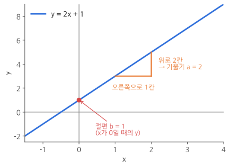
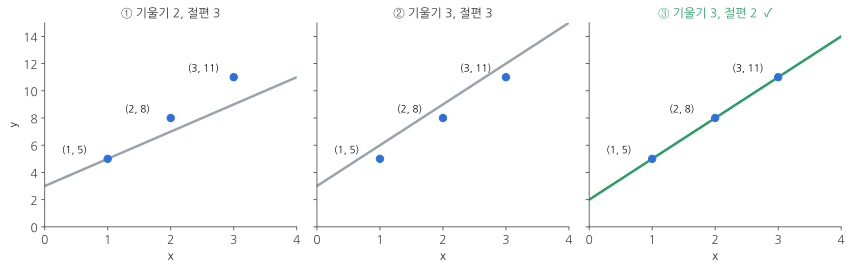
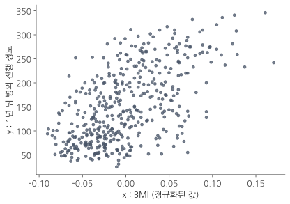
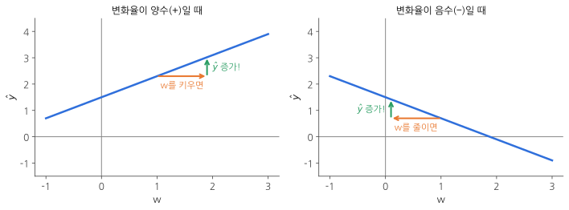
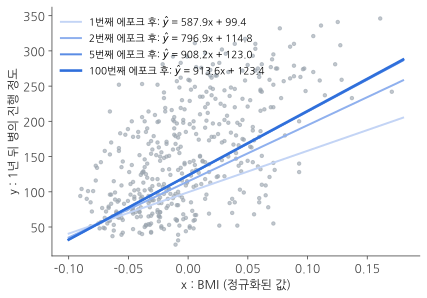
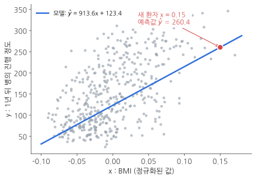
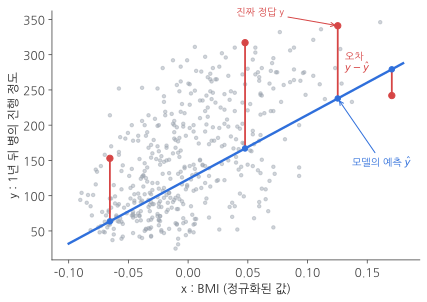
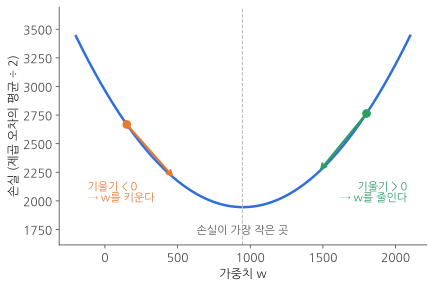
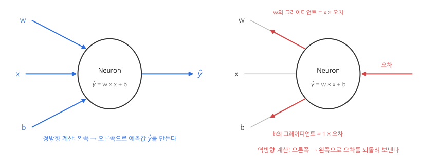
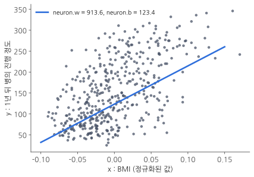

> **이 글에서 배우는 것**
> 컴퓨터가 데이터만 보고 "가장 잘 맞는 직선"을 **스스로** 찾아가는 과정을 처음부터 끝까지 따라가 봅니다. 이 과정이 딥러닝의 가장 밑바닥에 깔린 원리예요.
{: .prompt-info }

이 글은 『머신러닝 기초 학습』 3장을 공부하면서, **AI를 처음 접하는 사람도 이해할 수 있도록** 제 말로 다시 풀어 쓴 정리입니다. 책 내용을 그대로 옮기지 않고, 예시와 그래프는 직접 만들었어요.

글이 길어서 다섯 파트로 나눴어요. 순서대로 읽으면 앞에서 배운 게 뒤에서 계속 쓰이도록 구성했습니다.

| 파트 | 내용 | 한 줄 요약 |
|---|---|---|
| 1 | 선형 회귀 | 점들을 가장 잘 지나는 직선을 찾는 문제 |
| 2 | 데이터 준비 | 진짜 환자 데이터 442명분을 불러와서 살펴보기 |
| 3 | 경사 하강법 | 직선을 조금씩 고쳐 가며 정답에 다가가기 |
| 4 | 손실 함수 | "얼마나 틀렸나"를 점수로 매기고, 그 점수를 줄이기 |
| 5 | Neuron 클래스 | 지금까지 만든 걸 파이썬 클래스 하나로 정리하기 |

---

## 시작하기 전에: 큰 그림 한 장

본격적으로 들어가기 전에 **택시 요금**을 떠올려 볼게요.

택시 요금은 대략 이렇게 정해집니다.

```text
요금 = (1km당 요금) × (이동 거리) + 기본요금
```

그런데 내가 요금 체계를 모르고, 손에는 영수증 몇 장만 있다고 해 봅시다.

| 이동 거리(km) | 낸 요금(원) |
|---|---|
| 2 | 7,000 |
| 5 | 10,600 |
| 10 | 16,600 |

영수증을 보고 "1km당 1,200원이고 기본요금이 4,600원이구나"라고 **규칙을 거꾸로 알아내는 것**, 이게 바로 이 글의 주제인 **선형 회귀**예요. 규칙을 알아내면 처음 가 보는 거리의 요금도 **예측**할 수 있죠.

머신러닝이 하는 일을 한 문장으로 줄이면 이렇습니다.

> **데이터(영수증)를 보고 규칙(1km당 요금, 기본요금)을 찾아낸 다음, 그 규칙으로 새로운 값을 예측한다.**

이 문장을 기억해 두고 따라오시면 됩니다.

---

## 파트 1. 선형 회귀란 무엇인가

### 1-1. 중학교 때 배운 1차 함수 다시 보기

선형 회귀를 이해하려면 1차 함수 하나만 알면 돼요.

$$
y = ax + b
$$

- **x**: 입력값이에요. 택시 예시에서는 이동 거리입니다.
- **y**: 결과값이에요. 택시 예시에서는 요금입니다.
- **a**: **기울기(slope)**. x가 1 늘어날 때 y가 얼마나 늘어나는지를 나타내요. 택시 예시에서는 1km당 요금입니다.
- **b**: **절편(intercept)**. x가 0일 때의 y값이에요. 택시 예시에서는 기본요금입니다.

그래프로 그리면 이렇게 **곧은 직선**이 나와요.


_y = 2x + 1. 오른쪽으로 1칸 갈 때마다 위로 2칸 올라가므로 기울기는 2, x가 0일 때 y가 1이므로 절편은 1이에요._

"선형(線形)"은 **선 모양**이라는 뜻이에요. 그래프가 곧은 직선으로 그려지기 때문에 선형 회귀라고 부릅니다.

> **"회귀(regression)"는 무슨 뜻인가요?**
> 머신러닝에서 회귀는 **숫자를 예측하는 문제**를 말해요. 요금, 집값, 키처럼 연속된 숫자를 맞히면 회귀이고, "스팸이다/아니다"처럼 종류를 고르면 **분류**라고 합니다. 이름의 어원보다는 "회귀 = 숫자 맞히기"로 기억하는 게 편해요.
{: .prompt-tip }

### 1-2. 문제의 방향이 거꾸로입니다

학교에서 풀던 1차 함수 문제는 보통 이랬어요.

> **[학교 문제]** `y = 3x + 2`에서 x가 5이면 y는?
> → 3 × 5 + 2 = **17**

**기울기와 절편이 주어지고 y를 구하는** 문제죠.

선형 회귀는 정반대예요.

> **[선형 회귀 문제]** x가 1일 때 y는 5, x가 2일 때 8, x가 3일 때 11이었다. 기울기와 절편은 얼마일까?
> ① 기울기 2, 절편 3
> ② 기울기 3, 절편 3
> ③ 기울기 3, 절편 2

**x와 y가 주어지고, 기울기와 절편을 찾는** 문제예요. 선형 회귀의 관심사는 처음부터 끝까지 **"기울기와 절편 찾기"** 하나입니다.

### 1-3. 직선을 그려 보면서 정답 찾기

보기 세 개를 하나씩 그려 볼게요.


_파란 점이 주어진 데이터이고, 선이 각 보기의 직선이에요._

- **① 기울기 2, 절편 3**: 점들보다 직선이 눕혀져 있어요. 기울기가 모자랍니다.
- **② 기울기 3, 절편 3**: 기울기는 점들과 나란한데, 직선 전체가 위로 떠 있어요. 절편이 너무 큽니다.
- **③ 기울기 3, 절편 2**: 세 점을 정확히 지나요. **정답은 ③**입니다.

방금 우리는 "기울기를 올려 보고, 너무 높으니 절편을 내려 보고" 하면서 직선을 **조금씩 고쳐 가며** 답을 찾았어요. 이 감각이 뒤에서 배울 **경사 하강법**의 핵심이니 꼭 기억해 두세요.

### 1-4. 찾은 직선 = 모델, 그리고 예측

이렇게 찾은 직선 `y = 3x + 2`를 **모델(model)**이라고 불러요. 모델이라는 말이 거창하게 들리지만, 지금은 그냥 **"데이터에서 찾아낸 규칙"**이라고 생각하면 됩니다.

모델이 있으면 처음 보는 x에 대해서도 y를 **예측**할 수 있어요.

> x가 4라면? → 3 × 4 + 2 = **14쯤 되겠구나!**

여기서 쓰인 용어도 정리해 둘게요.

| 용어 | 뜻 | 이 예시에서 |
|---|---|---|
| 입력(input) | 모델에 넣는 값 | x = 1, 2, 3 |
| 타깃(target) | 맞혀야 하는 진짜 정답 | y = 5, 8, 11 |
| 모델(model) | 입력과 타깃 사이의 규칙 | y = 3x + 2 |
| 예측(prediction) | 모델이 새 입력에 내놓는 답 | x = 4 → 14 |

> **파트 1 체크포인트**
> - 선형 회귀는 점들을 잘 표현하는 직선의 **기울기와 절편**을 찾는다.
> - 그렇게 찾은 직선을 **모델**이라고 부른다.
> - 모델로 새로운 x에 대한 y를 **예측**할 수 있다.
{: .prompt-tip }

---

## 파트 2. 진짜 데이터 준비하기: 당뇨병 환자 442명

점 3개짜리 연습 문제는 끝났어요. 이제 진짜 데이터로 해 봅니다.

**목표: 환자의 건강 정보를 보고, 1년 뒤 당뇨병이 얼마나 진행될지 예측하는 모델 만들기**

모델을 만들려면 먼저 **입력 데이터와 타깃 데이터**가 충분히 있어야 해요. 다행히 연습용으로 쓰기 좋은 데이터가 이미 준비되어 있습니다.

### 2-0. 실습 환경

코드는 **구글 코랩(Google Colab)**에서 돌리는 걸 추천해요. 브라우저에서 바로 파이썬을 실행할 수 있고, 아래에서 쓰는 라이브러리가 이미 설치되어 있어서 설치할 게 없어요.

내 컴퓨터에서 돌린다면 먼저 라이브러리를 설치해 주세요.

```bash
pip install scikit-learn matplotlib
```

### 2-1. 사이킷런에서 당뇨병 데이터 불러오기

**사이킷런(scikit-learn)**은 파이썬에서 가장 많이 쓰는 머신러닝 라이브러리예요. 공부용 데이터 세트(dataset)도 여러 개 들어 있는데, 그중 **당뇨병 환자 데이터**를 쓰겠습니다.

```python
from sklearn.datasets import load_diabetes   # 사이킷런의 데이터 모음에서 당뇨병 데이터 불러오는 함수를 가져옴

diabetes = load_diabetes()                    # 함수를 호출하면 데이터가 diabetes 변수에 담김
```

- 첫째 줄은 "사이킷런의 `datasets`라는 서랍에서 `load_diabetes`라는 도구를 꺼내 온다"는 뜻이에요.
- 둘째 줄에서 그 도구를 실행하면 데이터가 `diabetes`라는 변수에 담깁니다.

`diabetes`에는 여러 정보가 함께 묶여 있어요. 자료형은 `Bunch`라는 사이킷런 전용 클래스인데, **파이썬 딕셔너리(dictionary)와 거의 똑같이** 쓸 수 있어요. 특별한 기능이 있는 건 아니라서 "이름표 붙은 상자 묶음" 정도로 생각하면 됩니다. 이 중에서 우리가 쓸 건 두 개예요.

- `diabetes.data`: **입력 데이터**. 환자들의 건강 정보예요.
- `diabetes.target`: **타깃 데이터**. 환자마다 1년 뒤 병이 진행된 정도예요.

> 이 데이터는 사이킷런에 BSD 라이선스로 포함된 공개 데이터이고, 원래 출처는 Efron 외(2004)의 *Least Angle Regression* 논문입니다. 공부와 블로그 실습에 자유롭게 써도 괜찮아요.
{: .prompt-info }

### 2-2. 데이터가 얼마나 큰지 확인하기: shape

데이터를 받으면 제일 먼저 **크기**부터 확인하는 게 습관이 되면 좋아요.

```python
print(diabetes.data.shape, diabetes.target.shape)
```

```text
(442, 10) (442,)
```

- `diabetes.data.shape`가 `(442, 10)`이에요. **442행 10열짜리 표**라는 뜻입니다.
- `diabetes.target.shape`가 `(442,)`예요. **숫자 442개가 한 줄로 늘어선 목록**이라는 뜻입니다. 쉼표 뒤가 비어 있는 건 1차원이라는 표시예요.

엑셀 시트로 상상하면 쉬워요.

- **한 행 = 환자 한 명.** 이걸 **샘플(sample)**이라고 불러요. 환자가 442명이니 샘플도 442개입니다.
- **한 열 = 측정 항목 하나.** 나이, BMI, 혈압 같은 것들이고, 이걸 **특성(feature)**이라고 불러요. 항목이 10개니 특성도 10개입니다.
- **타깃** 442개는 환자 442명 각각의 "정답"이에요. 환자 한 명(샘플 1개)에 정답 하나가 짝지어져 있습니다.

실제 데이터를 원래 단위로 몇 줄 보면 감이 더 잘 와요. (`load_diabetes(scaled=False)`로 불러오면 원래 값을 볼 수 있어요.)

| | 나이 | BMI | 평균 혈압 | 혈당 | … (특성 10개) | **타깃: 1년 뒤 진행 정도** |
|---|---|---|---|---|---|---|
| 1번 환자 | 59 | 32.1 | 101 | 87 | … | **151** |
| 2번 환자 | 48 | 21.6 | 87 | 69 | … | **75** |
| 3번 환자 | 72 | 30.5 | 93 | 85 | … | **141** |
| 4번 환자 | 24 | 25.3 | 84 | 89 | … | **206** |

여기서 **가로 한 줄(환자 1명의 측정값 묶음)이 샘플**이고, **세로 한 줄(예: BMI 열)이 특성**이에요.

> **같은 말, 다른 이름**
> 특성은 책이나 분야에 따라 **속성, 독립 변수(independent variable), 설명 변수(explanatory variable)**라고도 불러요. 통계학에서 온 이름이 많은데, 머신러닝에서는 주로 **특성**이라고 합니다. 타깃은 **정답, 레이블, 종속 변수**라고도 해요.
{: .prompt-tip }

### 2-3. 입력 데이터 들여다보기

앞쪽 환자 3명의 데이터만 출력해 볼게요.

```python
diabetes.data[0:3]
```

```text
array([[ 0.03807591,  0.05068012,  0.06169621,  0.02187239, -0.0442235 ,
        -0.03482076, -0.04340085, -0.00259226,  0.01990749, -0.01764613],
       [-0.00188202, -0.04464164, -0.05147406, -0.02632753, -0.00844872,
        -0.01916334,  0.07441156, -0.03949338, -0.06833155, -0.09220405],
       [ 0.08529891,  0.05068012,  0.04445121, -0.00567042, -0.04559945,
        -0.03419447, -0.03235593, -0.00259226,  0.00286131, -0.02593034]])
```

**`[0:3]`은 무슨 뜻인가요?** 파이썬의 **슬라이싱(slicing)**이에요. "0번부터 3번 **직전**까지", 즉 0, 1, 2번 행을 잘라 오라는 뜻입니다. 끝 번호는 포함되지 않는다는 점만 주의하세요.

결과를 보면 대괄호 `[ ]` 안에 숫자 10개짜리 묶음이 3개 있어요. **묶음 하나가 환자 한 명(샘플)**이고, 그 안의 숫자 10개가 **특성 10개**입니다. 그래서 3 × 10 크기의 배열이 나왔어요.

그런데 이상한 점이 있죠? 1번 환자는 BMI가 32.1이었는데, 여기선 세 번째 숫자가 `0.0617`이에요. 나이도 59가 아니라 `0.038`이고, 음수도 섞여 있습니다.

> **왜 숫자가 이렇게 작고 음수도 있나요? → "정규화"되어 있기 때문이에요**
> 이 데이터는 미리 손질되어 있어요. 각 특성에서 **평균을 빼서 평균이 0이 되게** 만들고, 값의 크기도 작게 줄여 놨어요. 그래서 평균보다 작은 값은 음수가 됩니다.
> 이렇게 하는 이유는 특성마다 단위가 달라서예요. 나이는 20~80, 혈압은 60~130처럼 범위가 제각각이면 숫자가 큰 특성이 괜히 더 중요해 보일 수 있거든요. 모든 특성을 비슷한 크기로 맞춰 두면 공정하게 비교할 수 있어요.
> 지금 단계에서는 **"원래 값을 비슷한 크기로 바꿔 놓은 것"** 정도로만 이해해도 충분합니다.
{: .prompt-info }

### 2-4. 타깃 데이터 들여다보기

```python
diabetes.target[:3]
```

```text
array([151.,  75., 141.])
```

`[:3]`처럼 **앞 번호를 생략하면 0부터** 시작해요. `[0:3]`과 같은 뜻입니다.

1번 환자의 측정값 10개 묶음 `[0.038, 0.050, 0.061, …]`이 타깃 `151`과 짝이고, 2번 환자는 `75`, 3번 환자는 `141`과 짝이에요. 타깃 값은 전체적으로 25부터 346 사이에 분포합니다.

**이 숫자들이 의학적으로 무슨 뜻인지 꼭 알아야 할까요?** 이번 실습에서는 아니에요. 우리는 **입력 숫자와 타깃 숫자 사이의 규칙(모델)**만 찾으면 되고, 숫자를 해석하는 건 의사의 영역이에요. 다만 실무에서는 데이터의 의미를 알아야 좋은 모델을 만들 수 있는 경우가 많아서, 그럴 땐 그 분야 전문가의 도움을 받는 게 좋습니다.

### 2-5. 그래프로 그려 보기: 산점도

숫자만 봐서는 감이 안 오니 그림으로 그려 볼게요. **산점도(scatter plot)**는 데이터를 점으로 찍어서 두 값의 관계를 보는 그래프예요.

그런데 특성이 10개라서 전부 한 그래프에 담으려면 11차원 그래프가 필요해요. 사람은 3차원까지만 그릴 수 있죠. 그래서 **특성 하나만 골라서** 그립니다. 여기서는 세 번째 특성인 **BMI(체질량지수)**를 골랐어요.

```python
import matplotlib.pyplot as plt               # 그래프 그리는 라이브러리를 plt라는 짧은 이름으로 불러옴

plt.scatter(diabetes.data[:, 2], diabetes.target)  # x축: BMI, y축: 타깃 → 점 442개를 찍음
plt.xlabel('x (BMI)')                          # x축 이름
plt.ylabel('y (progression)')                  # y축 이름
plt.show()                                     # 화면에 표시
```

`diabetes.data[:, 2]`가 처음 보면 낯설 수 있어요. 쉼표를 기준으로 **앞은 행, 뒤는 열**을 고른다는 뜻입니다.

- 앞의 `:` → 시작과 끝을 안 적었으니 **모든 행**(환자 442명 전부)
- 뒤의 `2` → **2번 열**(0부터 세므로 세 번째 특성인 BMI)

즉 **"모든 환자의 BMI 값만 세로로 쭉 뽑아 와라"**는 뜻이에요.


_점 하나가 환자 한 명이에요. 가로 위치는 BMI, 세로 위치는 1년 뒤 진행 정도입니다._

> 그래프에 한글 라벨을 쓰면 글자가 네모로 깨질 수 있어요. 코랩에서는 영어 라벨을 쓰거나, 한글 폰트를 따로 설정해야 합니다.
{: .prompt-warning }

**그래프 해석하기:** 점들이 흩어져 있긴 하지만, 전체적으로 **오른쪽으로 갈수록 위로 올라가는** 모양이에요. BMI가 높은 환자일수록 1년 뒤 병이 더 진행되는 경향이 있다는 뜻입니다. 이런 관계를 **정비례 관계**(또는 양의 상관관계)라고 해요.

점들이 오른쪽 위로 향하니, **이 점들 사이를 지나는 직선 하나**를 잘 그릴 수 있을 것 같죠? 그 직선을 찾는 게 다음 파트의 목표예요.

### 2-6. x와 y 따로 저장해 두기

매번 `diabetes.data[:, 2]`라고 길게 쓰기 번거로우니, 짧은 이름으로 저장해 둘게요.

```python
x = diabetes.data[:, 2]   # 입력: 모든 환자의 BMI (442개)
y = diabetes.target       # 타깃: 모든 환자의 1년 뒤 진행 정도 (442개)
```

이제부터 `x`와 `y`만 가지고 모델을 훈련시킵니다.

> **실무에서는 데이터 준비가 제일 힘들어요**
> 우리는 잘 정리된 데이터를 함수 한 줄로 받았지만, 실제 현장에서는 데이터를 모으고 정리하는 데 가장 많은 시간과 돈이 들어요. 데이터가 부족하면 아무리 좋은 알고리즘도 소용없고, 데이터를 돈 주고 사는 경우도 있습니다.
{: .prompt-tip }

---

## 파트 3. 경사 하강법: 직선을 조금씩 고쳐 나가기

### 3-1. 어떤 직선이 "가장 잘 맞는" 직선일까?

산점도에 직선을 그어 본다고 상상해 보세요. 너무 눕힌 직선, 반대로 내려가는 직선, 점들 한가운데를 비스듬히 가로지르는 직선 중에 어느 게 제일 그럴듯한가요? 당연히 **점들 한가운데를 가로지르는 직선**이죠. 사람은 눈으로 보면 바로 알아요.

문제는 **컴퓨터는 "눈으로 보고" 판단할 수 없다**는 거예요. 그래서 직선을 조금씩 고쳐 가며 정답에 다가가는 **방법(알고리즘)**이 필요한데, 그게 **경사 하강법(gradient descent)**입니다.

> **특성이 여러 개면요?**
> 특성 1개면 직선, 2개면 평면, 그보다 많으면 **초평면(hyperplane)**이라는 걸 찾게 돼요. 상상하기는 어렵지만 원리는 똑같아요. 그래서 공부할 때는 특성 1~2개로 그림을 그려 감을 잡고, 그 감을 높은 차원으로 넓혀 가는 경우가 많습니다.
{: .prompt-info }

### 3-2. 이름을 살짝 바꿔 부를게요: w, b, ŷ

딥러닝에서는 `y = ax + b`를 조금 다르게 씁니다.

$$
\hat{y} = wx + b
$$

| 기호 | 읽는 법 | 뜻 |
|---|---|---|
| w | 가중치(weight) | 기울기 a를 이렇게 불러요. 입력 x에 **얼마나 무게를 둘지** 정하는 값이에요. |
| b | 절편(bias) | 그대로 절편이에요. |
| ŷ | 와이 햇(y-hat) | 모델이 **예측한 값**이에요. |
| y | 와이 | **진짜 정답**(타깃)이에요. |

**y와 ŷ를 구분하는 게 정말 중요해요.** 둘 다 "결과값"이지만, y는 데이터에 적힌 진짜 정답이고 ŷ는 모델이 내놓은 추측이에요. 모자(^)를 씌운 건 "이건 추측값이야"라는 표시입니다.

예를 들어 모델이 `ŷ = 3x + 2`인데 x에 4를 넣으면 ŷ는 14예요. 진짜 정답 y가 15였다면, 모델은 1만큼 틀린 거죠.

### 3-3. 컴퓨터가 직선을 찾는 계획

계획은 단순해요. **눈 가리고 샤워 물 온도 맞추기**와 비슷합니다.

1. 일단 아무렇게나 수도꼭지를 튼다. → **w와 b를 아무 값으로 정한다.**
2. 손을 대 본다. → **샘플 하나를 넣어 ŷ를 계산한다.**
3. 원하는 온도와 비교한다. → **ŷ와 진짜 정답 y를 비교한다.** (처음엔 거의 100% 틀려요.)
4. 차가우면 온수 쪽으로, 뜨거우면 냉수 쪽으로 돌린다. → **ŷ가 y에 가까워지도록 w와 b를 조금 고친다.**
5. 2~4를 모든 샘플에 대해 반복한다.

1~3, 5번은 쉬워요. 문제는 **4번, "어느 방향으로 얼마나 고칠까?"**입니다. 지금부터 이걸 해결해 볼게요.

### 3-4. 일단 아무렇게나 시작해 보기

w와 b를 둘 다 1.0으로 정합니다. 아직 좋은 시작값을 정하는 규칙을 모르니 일단 임시로 정한 거예요.

```python
w = 1.0
b = 1.0
```

이 모델로 첫 번째 환자 `x[0]`의 값을 예측해 봅니다.

```python
y_hat = x[0] * w + b    # ŷ = w·x + b
print(y_hat)
```

```text
1.0616962065186832
```

진짜 정답과 비교해 볼까요?

```python
print(y[0])
```

```text
151.0
```

정답은 151인데 예측은 1.06이에요. **엄청나게 틀렸죠.** 아무렇게나 정한 값이니 당연합니다. 이제 ŷ를 151 쪽으로 키워야 해요.

### 3-5. w를 살짝 바꾸면 ŷ는 얼마나 변할까? 변화율

가장 단순한 방법은 **직접 조금 바꿔 보는 것**이에요. w를 0.1만큼 키운 뒤 ŷ가 어떻게 되는지 볼게요.

```python
w_inc = w + 0.1                  # w를 0.1 증가
y_hat_inc = x[0] * w_inc + b     # 바뀐 w로 다시 예측
print(y_hat_inc)
```

```text
1.0678658271705517
```

ŷ가 1.06170에서 1.06787로 **아주 조금 커졌어요.** w가 0.1 늘었을 때 ŷ가 얼마나 늘었는지를 비율로 계산해 봅니다.

```python
w_rate = (y_hat_inc - y_hat) / (w_inc - w)   # (ŷ가 늘어난 양) ÷ (w가 늘어난 양)
print(w_rate)
```

```text
0.06169620651868429
```

이 값을 **변화율**이라고 불러요. "w를 1만큼 바꾸면 ŷ가 약 0.0617만큼 바뀐다"는 뜻입니다. 1차 함수의 기울기와 같은 개념이에요.

**그런데 신기한 점이 있어요.** 이 숫자 `0.06169620…`, 어디서 본 것 같지 않나요? 바로 첫 번째 환자의 BMI 값 `x[0] = 0.06169621`과 같아요. 우연이 아니에요. 식으로 풀어 보면 이유가 보입니다.

$$
\text{w_rate} = \frac{(x[0] \cdot (w+0.1) + b) - (x[0] \cdot w + b)}{(w + 0.1) - w} = \frac{x[0] \cdot 0.1}{0.1} = x[0]
$$

b끼리 빼서 없어지고, 0.1도 위아래에서 약분되면 **x[0]만 남아요.**

> **쉽게 이해하기**
> ŷ = w × x + b에서 w가 1 커지면 ŷ는 **x만큼** 커져요. 사과 한 개 값이 x원일 때, 사과를 한 개 더 사면 x원이 더 드는 것과 같아요. 그래서 **w에 대한 변화율 = x**입니다. 매번 계산할 필요 없이 x를 그대로 쓰면 돼요.
{: .prompt-tip }

같은 방법으로 b의 변화율도 구해 볼게요.

```python
b_inc = b + 0.1
y_hat_inc = x[0] * w + b_inc
b_rate = (y_hat_inc - y_hat) / (b_inc - b)
print(b_rate)
```

```text
1.0
```

**b의 변화율은 항상 1이에요.** b가 1 늘면 직선 전체가 위로 1 올라가니 ŷ도 그대로 1 늘어나요. 택시 기본요금이 1,000원 오르면 모든 요금이 1,000원씩 오르는 것과 같습니다.

### 3-6. 변화율을 더해서 w와 b 고치기

이제 "어느 방향으로 고칠까?"에 답할 수 있어요. 지금은 **ŷ를 키워야 하는** 상황이에요.


_왼쪽: 변화율이 양수면 w를 키울 때 ŷ도 커져요. 오른쪽: 변화율이 음수면 w를 줄여야 ŷ가 커져요._

- **변화율이 양수(+)일 때**: w를 키우면 ŷ가 커져요. → w에 **변화율을 더하면** w가 커지니 OK.
- **변화율이 음수(−)일 때**: w를 줄여야 ŷ가 커져요. → w에 **음수인 변화율을 더하면** w가 줄어드니 역시 OK.

경우를 나눌 필요 없이 **두 경우 모두 "w에 변화율을 더한다"** 하나로 해결돼요.

```python
w_new = w + w_rate
b_new = b + 1          # b의 변화율은 1
print(w_new, b_new)
```

```text
1.0616962065186843 2.0
```

그런데 이 방법에는 문제가 두 가지 있어요.

1. **ŷ가 y에 한참 못 미쳐도 조금씩만 움직여요.** 정답이 151인데 w는 1.06으로, b는 2로 찔끔 움직였어요. 이래서는 한참 걸립니다.
2. **ŷ가 y보다 커지면 줄일 방법이 없어요.** 지금 방식은 항상 ŷ를 키우는 방향으로만 움직여요.

### 3-7. 오차를 곱하면 두 문제가 한 번에 해결돼요: 오차 역전파

해결책은 의외로 간단해요. **변화율에 오차를 곱해서 더하는 것**이에요.

```text
오차(err) = 진짜 정답 y − 예측값 ŷ
```

- **많이 틀렸으면** 오차가 커요. → 크게 고쳐요. (문제 1 해결)
- **ŷ가 y보다 크면** 오차가 음수가 돼요. → 반대 방향으로 고쳐요. (문제 2 해결)

샤워에 비유하면 **"많이 차가우면 크게, 조금 차가우면 살짝, 뜨거우면 반대로"** 돌리는 거예요.

이렇게 ŷ와 y의 차이(오차)를 이용해서 w와 b를 고치는 방법을 **오차 역전파(backpropagation)**라고 불러요. 오차가 결과 쪽에서 입력 쪽으로 **거꾸로 전달**되며 값을 고친다는 뜻인데, 지금 예제는 아주 단순해서 "거꾸로 전달되는" 모습이 잘 안 보여요. 뉴런을 여러 층 쌓는 뒤 장에서 그 모습을 제대로 보게 됩니다.

첫 번째 환자로 해 볼게요.

```python
err = y[0] - y_hat               # 151 - 1.06 = 약 149.94 (많이 모자람!)
w_new = w + w_rate * err         # w를 (변화율 × 오차)만큼 고침
b_new = b + 1 * err              # b를 (1 × 오차)만큼 고침
print(w_new, b_new)
```

```text
10.250624555903848 150.9383037934813
```

아까는 1.06과 2.0으로 찔끔 움직였는데, 이번엔 w가 10.25, b가 150.94로 **크게** 움직였어요.

두 번째 환자로 한 번 더 해 볼게요. 앞에서 **w의 변화율은 x와 같다**는 걸 알아냈으니, 이제 `w_rate`를 따로 계산하지 않고 `x[1]`을 그대로 씁니다.

```python
y_hat = x[1] * w_new + b_new     # 고친 모델로 2번 환자 예측
err = y[1] - y_hat               # 정답 75 - 예측 약 150.41 = 약 -75.41 (이번엔 너무 큼!)
w_rate = x[1]                    # w의 변화율 = x
w_new = w_new + w_rate * err
b_new = b_new + 1 * err
print(w_new, b_new)
```

```text
14.132317616380695 75.52764127612656
```

**어떤 일이 일어났는지 따라가 볼까요?**

| 단계 | 정답 y | 예측 ŷ | 오차 | 결과 |
|---|---|---|---|---|
| 1번 환자 | 151 | 1.06 | **+149.94** (모자람) | b가 1 → 150.94로 크게 증가 |
| 2번 환자 | 75 | 150.41 | **−75.41** (넘침) | b가 150.94 → 75.53으로 감소 |

2번 환자에서는 예측이 정답보다 커서 오차가 음수가 됐고, 그 덕분에 b가 **알아서 줄어들었어요.** 경우를 나누는 if문 하나 없이 방향과 크기가 자동으로 정해진 거예요.

### 3-8. 환자 442명 전부에게 반복하기

이 과정을 모든 샘플에 대해 반복하면 됩니다.

```python
w = 1.0
b = 1.0
for x_i, y_i in zip(x, y):      # 환자 한 명씩 (x, y)를 짝지어 꺼냄
    y_hat = x_i * w + b         # ① 예측
    err = y_i - y_hat           # ② 오차 계산
    w_rate = x_i                # ③ w의 변화율 = x
    w = w + w_rate * err        # ④ w 고치기
    b = b + 1 * err             # ⑤ b 고치기
print(w, b)
```

```text
587.8654539985616 99.4093556453094
```

**`zip()`은 뭔가요?** 여러 목록에서 **같은 순서의 원소를 하나씩 짝지어** 꺼내 주는 파이썬 함수예요. 첫 바퀴에는 `(x[0], y[0])`, 두 번째 바퀴에는 `(x[1], y[1])`… 이런 식으로 442번 돌아요. 지퍼(zip)가 양쪽 이빨을 하나씩 맞물리는 모습을 떠올리면 기억하기 쉬워요.

코드는 앞에서 손으로 한 것과 똑같고, 반복문으로 감싸고 변수 이름만 바꿨을 뿐이에요.

### 3-9. 한 바퀴로는 부족해요: 에포크

442명을 한 바퀴 돈 결과 w = 587.9, b = 99.4가 됐어요. 그래프로 그려 보면 아직 직선이 점들보다 눕혀져 있어요. (아래 그래프에서 가장 연한 선이에요.)

그래서 **442명 전체를 여러 바퀴** 반복합니다. 전체 데이터를 한 바퀴 다 도는 걸 **에포크(epoch)**라고 불러요. "1 에포크 = 문제집 한 권을 처음부터 끝까지 한 번 푼 것"이라고 생각하면 돼요. 문제집도 여러 번 풀수록 실력이 늘죠.

```python
w = 1.0
b = 1.0
for epoch in range(100):            # 전체 데이터를 100바퀴 반복
    for x_i, y_i in zip(x, y):      # 한 바퀴 = 환자 442명
        y_hat = x_i * w + b
        err = y_i - y_hat
        w = w + x_i * err
        b = b + 1 * err
print(w, b)
```

```text
913.5973364346786 123.39414383177173
```

바퀴 수에 따라 w와 b가 어떻게 변하는지 보면 학습 과정이 한눈에 보여요.

| 에포크 | w (기울기) | b (절편) |
|---|---|---|
| 1 | 587.87 | 99.41 |
| 2 | 796.89 | 114.80 |
| 5 | 908.23 | 123.00 |
| 10 | 913.57 | 123.39 |
| 100 | 913.60 | 123.39 |


_연한 선(1 에포크)에서 진한 선(100 에포크)으로 갈수록 직선이 점들의 흐름을 따라가요._

처음 몇 바퀴 동안은 크게 바뀌다가 **10 에포크쯤부터는 거의 변하지 않아요.** 더 고칠 게 별로 없는 상태에 도착했다는 뜻이고, 이걸 **수렴(converge)했다**고 말해요.

드디어 이 데이터에 맞는 모델을 찾았어요.

$$
\hat{y} = 913.6x + 123.4
$$

### 3-10. 모델로 새 환자 예측하기

훈련 데이터에 없던 새 환자가 왔다고 해 볼게요. 이 환자의 BMI(정규화된 값)가 0.15라면, 찾은 모델에 넣기만 하면 됩니다.

```python
x_new = 0.15
y_pred = x_new * w + b
print(y_pred)
```

```text
260.4337442969735
```


_빨간 점이 새 환자에 대한 예측이에요. 직선 위에 정확히 놓이고, 주변 데이터의 흐름과도 잘 맞아요._

**축하합니다! 머신러닝으로 예측까지 해냈어요.** 데이터를 보고 규칙을 찾고, 그 규칙으로 새로운 값을 예측한다는, 글 처음에 말한 머신러닝의 한 문장을 직접 해 본 거예요.

> **지금까지 한 일 정리**
> 1. w와 b를 아무 값(1.0, 1.0)으로 정하고, 샘플을 하나씩 넣어 오차(y − ŷ)를 구한다.
> 2. 오차에 변화율을 곱해서 w와 b에 더한다. (w의 변화율은 x, b의 변화율은 1)
> 3. ŷ가 y보다 크면 오차가 음수라서 w와 b가 **자동으로 줄어든다.**
> 4. ŷ가 y보다 작으면 오차가 양수라서 w와 b가 **자동으로 커진다.**
> 5. 이걸 전체 샘플에 대해 여러 에포크 반복한다.
{: .prompt-tip }

> **조금 더 알아보기: 이 직선이 "최고"일까요?**
> 사실 이 데이터에서 수학적으로 가장 잘 맞는 직선은 `ŷ = 949.4x + 152.1`이에요. (사이킷런의 `LinearRegression`으로 확인할 수 있어요.) 우리가 찾은 직선은 이것보다 절편이 낮아요.
> 이유는 b를 **오차만큼 통째로** 고치기 때문이에요. 그러면 매번 직선이 방금 본 환자 쪽으로 확 끌려가고, 결국 **마지막 몇 명의 영향**을 크게 받아요. 실제로는 오차에 0.01 같은 작은 수를 곱해서 **조금씩** 고치는데, 이 작은 수를 **학습률(learning rate)**이라고 해요. 학습률은 뒤 장에서 자세히 나오니, 지금은 "고치는 보폭도 조절할 수 있다" 정도만 알아 두세요.
{: .prompt-info }

---

## 파트 4. 손실 함수: 방금 한 일에 수학 이름 붙이기

파트 3에서 "오차에 변화율을 곱해서 더한다"는 방법을 거의 직관으로 만들었어요. 놀랍게도 이 방법은 **수학적으로 정확한 근거**가 있어요. 이번 파트에서 그 근거를 확인합니다. 미분이 나오지만 최대한 말로 풀어 볼게요.

### 4-1. 손실 함수 = "얼마나 틀렸나"를 매기는 점수표

경사 하강법을 좀 더 정확히 표현하면 이래요.

> **손실 함수가 주어졌을 때, 그 값이 가장 작아지는 지점을 찾아가는 방법**

**손실 함수(loss function)**는 **예측값이 정답과 얼마나 다른지를 숫자로 매기는 함수**예요. 골프 타수나 시험의 감점처럼 **낮을수록 좋은 점수**라고 생각하면 됩니다.

가장 기본적인 손실 함수가 **제곱 오차(squared error)**예요. 이름은 거창하지만 **정답에서 예측값을 빼고 제곱한 것**일 뿐이에요.

$$
SE = (y - \hat{y})^2
$$


_빨간 세로선의 길이가 오차(y − ŷ)예요. 제곱 오차는 이 길이를 제곱한 값입니다._

**왜 그냥 빼지 않고 제곱할까요?** 이유가 두 가지 있어요.

1. **부호를 없애려고.** 어떤 환자는 +50, 어떤 환자는 −50만큼 틀렸다면 그냥 더하면 0이 돼서 "하나도 안 틀렸다"고 착각하게 돼요. 제곱하면 둘 다 2,500이 됩니다.
2. **크게 틀린 걸 더 크게 혼내려고.** 2만큼 틀리면 4점, 10만큼 틀리면 100점이에요. 많이 틀린 예측을 우선해서 고치게 돼요.

**제곱 오차가 가장 작아지는 w와 b를 찾으면, 그게 바로 데이터를 가장 잘 표현하는 직선이에요.** 결국 "좋은 직선 찾기" 문제가 "손실 점수가 가장 낮은 곳 찾기" 문제로 바뀐 거예요.

### 4-2. 그릇 바닥으로 굴러가기: 이름이 "경사 하강법"인 이유

b를 고정하고 w만 바꿔 가며 손실을 그려 보면 이런 **그릇 모양**이 나와요.


_그릇 바닥(점선)이 손실이 가장 작은 곳이에요. 어디서 시작하든 경사를 따라 내려가면 바닥에 도착합니다._

우리 목표는 **그릇의 바닥**에 가는 거예요. 그런데 컴퓨터는 그릇 전체 모양을 한눈에 볼 수 없어요. 안개 낀 산에서 길을 잃은 사람처럼 **발밑의 경사만** 알 수 있죠.

안개 낀 산에서 내려오는 방법은 간단해요. **발밑이 기울어진 반대 방향으로 한 걸음씩** 걸으면 됩니다.

- 왼쪽 주황 점: 경사가 **음수**(오른쪽 아래로 기울어짐) → w를 **키우는** 쪽으로 이동
- 오른쪽 초록 점: 경사가 **양수**(오른쪽 위로 기울어짐) → w를 **줄이는** 쪽으로 이동

**경사(gradient)**를 따라 **아래로 내려간다(descent)**고 해서 **경사 하강법(gradient descent)**이라는 이름이 붙었어요.

### 4-3. 발밑의 경사 구하기: 미분

"발밑의 경사"를 구하는 수학 도구가 **미분**이에요. 미분을 처음 보는 분을 위해 딱 필요한 만큼만 설명할게요.

- **미분**: "w를 **아주아주 살짝** 바꾸면 손실이 얼마나 바뀌나?"를 구하는 것. 파트 3에서 w를 0.1 바꿔 보며 구한 **변화율**을 훨씬 정밀하게 구하는 방법이라고 보면 돼요.
- **편미분**: 변수가 여러 개(w, b)일 때 **하나만 움직이고 나머지는 꼼짝 않게 고정**한 채로 미분하는 것. 기호는 d 대신 둥근 ∂(라운드 디)를 써요.

**① 가중치 w에 대해 편미분하기**

$$
\frac{\partial SE}{\partial w} = \frac{\partial}{\partial w}(y - \hat{y})^2 = 2(y - \hat{y})\left(-\frac{\partial \hat{y}}{\partial w}\right) = 2(y - \hat{y})(-x) = -2(y - \hat{y})x
$$

한 단계씩 풀어 볼게요.

1. `(무언가)²`를 미분하면 `2 × (무언가)`가 나와요. 그리고 그 "무언가" 안쪽도 미분해서 곱해 줘야 해요. 이걸 **연쇄 법칙(chain rule)**이라고 불러요. 양파 껍질을 바깥부터 하나씩 벗기는 것과 비슷해요.
2. 안쪽 `(y − ŷ)`에서 **y는 데이터에 적힌 정답**이라 w가 바뀌어도 그대로예요. 그래서 미분하면 0이 돼요. **ŷ만 w에 따라 바뀌니** `−ŷ`만 미분합니다.
3. `ŷ = w × x + b`를 w로 미분하면 **x**가 남아요. b는 w와 상관없는 상수라 사라집니다. (3-5에서 "w의 변화율 = x"라고 했던 바로 그거예요!)

**깔끔하게 만드는 작은 요령:** 앞에 붙은 2가 거슬리죠? 그래서 보통은 처음부터 손실 함수를 2로 나눠서 정의해요.

$$
L = \frac{1}{2}(y - \hat{y})^2
$$

그러면 2와 ½이 약분돼서 결과가 깔끔해져요.

$$
\frac{\partial L}{\partial w} = -(y - \hat{y})x
$$

손실을 2로 나누든 10으로 나누든 **그릇의 바닥 위치는 똑같아서** 최종 w와 b에는 영향이 없어요. 그릇을 위아래로 납작하게 눌러도 바닥 위치는 안 바뀌는 것과 같습니다.

**② 절편 b에 대해 편미분하기**

$$
\frac{\partial L}{\partial b} = \frac{\partial}{\partial b}\frac{1}{2}(y - \hat{y})^2 = (y - \hat{y})\left(-\frac{\partial \hat{y}}{\partial b}\right) = (y - \hat{y})(-1) = -(y - \hat{y})
$$

w 때와 똑같은데, 마지막에 `ŷ = w × x + b`를 **b로** 미분하면 w × x는 사라지고 b 앞의 **1**만 남아요. ("b의 변화율 = 1"이었죠!)

### 4-4. 왜 "빼는" 걸까? 그리고 놀라운 결론

미분으로 구한 값은 **오르막 방향**을 가리켜요. 우리는 손실을 **줄이고**(내려가고) 싶으니 **반대로**, 즉 **빼야** 해요.

$$
w \leftarrow w - \frac{\partial L}{\partial w} = w + (y - \hat{y})x
$$

$$
b \leftarrow b - \frac{\partial L}{\partial b} = b + (y - \hat{y})
$$

(`←`는 "오른쪽 값으로 w를 새로 바꾼다"는 뜻이에요.)

**이 식, 어디서 본 것 같지 않나요?** 파트 3에서 직관으로 만든 코드를 다시 볼게요.

```python
err = y_i - y_hat        # (y − ŷ)
w = w + x_i * err        # w + (y − ŷ)x   ← 위의 식과 똑같다!
b = b + 1 * err          # b + (y − ŷ)    ← 위의 식과 똑같다!
```

**완전히 똑같아요!** "오차에 변화율을 곱해서 더한다"는 우리의 아이디어는 사실 **제곱 오차를 미분해서 경사를 따라 내려가는 것**과 같은 일이었어요. 직관으로 만든 방법이 수학적으로도 맞았던 거예요.

### 4-5. 새로 나온 용어 정리

앞으로는 변화율을 매번 0.1씩 바꿔 가며 계산하지 않고, **편미분 공식으로 바로** 구해요. 그리고 이 변화율을 AI 분야에서는 **그레이디언트(gradient)**라고 불러요.

- "그레이디언트가 전달된다"는 "변화율이 전달된다"는 뜻이에요.
- "그래디언트"라고 쓰는 자료도 많으니 검색할 때 둘 다 찾아보세요.

> **손실 함수의 다른 이름들**
> 손실 함수는 **비용 함수(cost function)**, **목적 함수(objective function)**라고도 불러요. 엄밀히는 손실 함수가 샘플 하나의 점수, 비용 함수가 전체 샘플 점수의 합(또는 평균), 목적 함수가 "최적화하려는 대상"을 부르는 가장 넓은 말이에요. 하지만 실제로는 거의 구분 없이 섞어 씁니다.
{: .prompt-tip }

---

## 파트 5. 첫 번째 뉴런 만들기: Neuron 클래스

마지막으로, 지금까지 만든 경사 하강법을 **`Neuron`이라는 파이썬 클래스 하나**로 정리할게요. 앞으로 배울 복잡한 딥러닝 모델들도 전부 이 클래스를 조금씩 확장해 나가기 때문에, **이 장에서 가장 중요한 부분**이에요.

### 5-1. 클래스로 묶는 이유

지금까지는 w, b와 예측·학습 코드가 여기저기 흩어져 있었어요. **클래스(class)**는 **데이터(w, b)와 그 데이터로 하는 동작(예측하기, 학습하기)을 하나로 묶은 설계도**예요.

붕어빵 틀을 떠올려 보세요. **틀(클래스)**을 한 번 만들어 두면 **붕어빵(객체)**을 몇 개든 찍어낼 수 있고, 붕어빵마다 속(w, b 값)은 따로 가질 수 있어요.

클래스의 뼈대는 이렇게 생겼어요.

```python
class Neuron:

    def __init__(self):
        # 처음 만들 때 할 일(초기화)
        ...

    # 필요한 기능(메서드)을 여기에 추가
    ...
```

> **진짜 뇌의 뉴런과는 관계가 없어요**
> 이름이 "뉴런"이라서 뇌를 흉내 낸 것 같지만, 실제로는 **곱하기와 더하기를 하는 계산 단위**일 뿐이에요. 그래서 요즘 연구자들은 **유닛(unit)**이라는 이름을 더 많이 써요. 직접 만들어 보면 뇌와 상관없다는 걸 금방 느낄 수 있을 거예요.
{: .prompt-info }

### 5-2. `__init__()`: 처음 만들 때 w와 b 정하기

```python
def __init__(self):
    self.w = 1.0     # 가중치 시작값
    self.b = 1.0     # 절편 시작값
```

- `__init__`은 객체를 **처음 만들 때 자동으로 실행**되는 메서드예요. 앞뒤 밑줄 두 개는 파이썬이 정해 둔 특별한 이름이라는 표시입니다.
- `self`는 **"지금 만들어지는 이 객체 자신"**을 가리켜요. `self.w`는 "이 뉴런의 w"라는 뜻이에요. 붕어빵마다 자기 속을 따로 가지는 것처럼, 뉴런마다 자기 w와 b를 따로 가집니다.
- 학습을 시작하려면 시작값이 있어야 하니 일단 1.0으로 정했어요. (파트 3과 같아요.)

### 5-3. `forpass()`: 정방향 계산, ŷ 구하기

```python
def forpass(self, x):
    y_hat = x * self.w + self.b    # 직선의 방정식으로 예측값 계산
    return y_hat
```

입력 x를 받아서 `ŷ = w × x + b`를 계산해 돌려줘요. 파트 3에서 한 예측과 **완전히 같은 계산**이에요. 이름은 forward pass(앞으로 전달)를 줄인 거예요.


_왼쪽: 정방향 계산. w, x, b가 뉴런 안에서 곱하고 더해져 ŷ가 돼요. 오른쪽: 역방향 계산. 오차가 반대 방향으로 흘러가 w와 b를 고칠 그레이디언트를 만들어요._

그림처럼 w, x, b가 **왼쪽에서 오른쪽으로** 흘러 ŷ가 되기 때문에 **정방향 계산**이라고 불러요. 새로운 개념이 아니라 이미 해 본 계산에 이름을 붙인 거예요. 앞으로 "정방향 계산을 한다"는 말이 나오면 **"ŷ를 구한다"**로 바꿔 읽으면 됩니다.

$$
\hat{y} = w \times x + b
$$

### 5-4. `backprop()`: 역방향 계산, 그레이디언트 구하기

파트 4에서 구한 그레이디언트 공식을 다시 볼게요.

$$
\frac{\partial L}{\partial w} = -(y - \hat{y})x \qquad \frac{\partial L}{\partial b} = -(y - \hat{y})
$$

이걸 그대로 코드로 옮기면 돼요.

```python
def backprop(self, x, err):
    w_grad = x * err      # 가중치의 그레이디언트 = x × 오차
    b_grad = 1 * err      # 절편의 그레이디언트 = 1 × 오차
    return w_grad, b_grad
```

위 그림의 오른쪽처럼, 정방향 계산으로 얻은 ŷ와 y의 차이(오차)가 **오른쪽에서 왼쪽으로** 거꾸로 흘러가며 w와 b의 그레이디언트를 만들어요. 그래서 **역방향 계산**이라고 하고, 오차가 거꾸로 퍼져 나간다고 해서 **오차 역전파(backpropagation)**라고 불렀던 거예요. 파트 3에서 들었던 이름의 의미가 이제 보이죠?

> **여기서 `err`의 부호가 헷갈릴 수 있어요!**
> 이 클래스에서는 오차를 `err = -(y - ŷ)`, 즉 **ŷ − y**로 정의해요. 그래서 그레이디언트 `x * err`가 미분 공식 `-(y − ŷ)x`와 정확히 같아지고, 업데이트할 때는 경사 하강법 원래 모양대로 **빼요**(`w -= w_grad`).
> 파트 3의 코드는 `err = y − ŷ`로 정의하고 **더했어요**(`w += x * err`). 부호를 두 번 뒤집은 셈이라 **결과는 완전히 같아요.**
{: .prompt-warning }

### 5-5. `fit()`: 훈련시키기

이제 정방향 계산 → 오차 계산 → 역방향 계산 → 업데이트를 묶어서 **훈련(학습)** 메서드를 만들어요. 머신러닝에서는 "데이터에 모델을 맞춘다"는 뜻으로 보통 이 메서드를 **fit**이라고 이름 붙여요.

```python
def fit(self, x, y, epochs=100):
    for i in range(epochs):                       # ① 에포크 수만큼 반복
        for x_i, y_i in zip(x, y):                # ② 모든 샘플을 하나씩
            y_hat = self.forpass(x_i)             # ③ 정방향 계산: 예측
            err = -(y_i - y_hat)                  # ④ 오차 계산 (ŷ − y)
            w_grad, b_grad = self.backprop(x_i, err)  # ⑤ 역방향 계산: 그레이디언트
            self.w -= w_grad                      # ⑥ 가중치 업데이트 (빼기!)
            self.b -= b_grad                      # ⑦ 절편 업데이트 (빼기!)
```

- `epochs=100`은 **기본값**이에요. `fit(x, y)`처럼 따로 안 적으면 100 에포크, `fit(x, y, epochs=10)`처럼 적으면 10 에포크 돌아요.
- `self.w -= w_grad`는 `self.w = self.w - w_grad`를 줄여 쓴 거예요.

파트 3의 반복문과 비교해 보면 **하는 일은 똑같고, 각 단계에 이름을 붙여 메서드로 나눈 것뿐**이에요.

### 5-6. 전체 코드: 복사해서 바로 실행하기

데이터 불러오기부터 그래프까지 한 번에 실행할 수 있는 전체 코드예요.

```python
import matplotlib.pyplot as plt
from sklearn.datasets import load_diabetes


class Neuron:

    def __init__(self):
        self.w = 1.0                     # 가중치 초기화
        self.b = 1.0                     # 절편 초기화

    def forpass(self, x):
        y_hat = x * self.w + self.b      # 정방향 계산: 직선의 방정식
        return y_hat

    def backprop(self, x, err):
        w_grad = x * err                 # 가중치의 그레이디언트
        b_grad = 1 * err                 # 절편의 그레이디언트
        return w_grad, b_grad

    def fit(self, x, y, epochs=100):
        for i in range(epochs):                          # 에포크 반복
            for x_i, y_i in zip(x, y):                   # 샘플 하나씩
                y_hat = self.forpass(x_i)                # 정방향 계산
                err = -(y_i - y_hat)                     # 오차
                w_grad, b_grad = self.backprop(x_i, err) # 역방향 계산
                self.w -= w_grad                         # 가중치 업데이트
                self.b -= b_grad                         # 절편 업데이트


# 1. 데이터 준비
diabetes = load_diabetes()
x = diabetes.data[:, 2]      # 입력: BMI
y = diabetes.target          # 타깃: 1년 뒤 진행 정도

# 2. 뉴런 만들고 훈련시키기
neuron = Neuron()
neuron.fit(x, y)
print(neuron.w, neuron.b)

# 3. 결과를 그래프로 확인하기
plt.scatter(x, y)
pt1 = (-0.1, -0.1 * neuron.w + neuron.b)     # 직선의 왼쪽 끝 점
pt2 = (0.15, 0.15 * neuron.w + neuron.b)     # 직선의 오른쪽 끝 점
plt.plot([pt1[0], pt2[0]], [pt1[1], pt2[1]]) # 두 점을 이어 직선 그리기
plt.xlabel('x (BMI)')
plt.ylabel('y (progression)')
plt.show()
```

```text
913.5973364346786 123.39414383177173
```

**직선 그리는 부분이 헷갈린다면:** `plt.plot()`에는 **x좌표 목록**과 **y좌표 목록**을 따로 넣어요. 직선은 두 점만 있으면 그릴 수 있으니, x가 −0.1일 때와 0.15일 때 두 점을 모델로 계산해서 이은 거예요.

### 5-7. 결과 확인


_Neuron 클래스로 학습한 직선이에요. 파트 3의 결과와 숫자까지 정확히 같아요._

`neuron.w = 913.6`, `neuron.b = 123.4`로 파트 3과 **똑같은 직선**을 얻었어요. 코드를 클래스로 정리했을 뿐 하는 일은 같으니 당연한 결과예요.

**성공입니다!** 경사 하강법으로 스스로 학습하는 뉴런을 직접 만들었어요. 신경망을 쓰는 딥러닝은 거의 항상 경사 하강법으로 학습하기 때문에, 방금 만든 이 작은 클래스에 **딥러닝의 핵심 원리**가 담겨 있어요. 딥러닝은 결국 **이런 간단한 곱하기, 더하기, 빼기를 엄청나게 많이 조합한 것**이에요.

---

## 마무리

### 핵심 요약

| 개념 | 한 줄 설명 |
|---|---|
| 선형 회귀 | 데이터를 가장 잘 표현하는 직선의 기울기(w)와 절편(b)을 찾는 것 |
| 샘플 / 특성 / 타깃 | 데이터 한 줄 / 측정 항목 하나 / 맞혀야 할 정답 |
| ŷ (와이 햇) | 모델의 예측값. 진짜 정답 y와 구분해서 써요 |
| 변화율(그레이디언트) | w를 바꿀 때 ŷ(또는 손실)가 얼마나 바뀌는지. w에 대해서는 x, b에 대해서는 1 |
| 오차 역전파 | 오차를 거꾸로 전달해 w와 b를 고치는 방법 |
| 에포크 | 전체 데이터를 한 바퀴 다 학습하는 것 |
| 손실 함수 | 얼마나 틀렸는지 매기는 점수. 낮을수록 좋아요 (예: 제곱 오차) |
| 경사 하강법 | 손실 함수의 경사를 따라 바닥(최솟값)으로 내려가는 방법 |
| 정방향 / 역방향 계산 | ŷ 구하기 / 오차로 그레이디언트 구하기 |

### 헷갈리기 쉬운 포인트

1. **y와 ŷ는 다릅니다.** y는 데이터에 적힌 진짜 정답, ŷ는 모델의 추측이에요.
2. **선형 회귀가 찾는 건 x나 y가 아니라 w와 b입니다.** 학교 수학 문제와 방향이 반대예요.
3. **w의 그레이디언트가 x인 건 우연이 아니에요.** ŷ = w × x + b에서 w가 1 늘면 ŷ는 x만큼 늘기 때문이에요.
4. **"더하기"와 "빼기" 버전은 같은 방법이에요.** 오차를 `y − ŷ`로 쓰면 더하고, `ŷ − y`로 쓰면 빼요. 결과는 같습니다.
5. **손실 함수를 ½로 나누는 건 계산을 깔끔하게 하려는 요령이에요.** 최종 w와 b는 바뀌지 않아요.
6. **우리가 찾은 직선이 수학적 최적은 아니에요.** 보폭(학습률)을 조절하면 더 좋아지는데, 다음 장에서 나옵니다.

다음 편에서는 이 Neuron 클래스를 바탕으로 이어지는 내용을 정리해 보겠습니다. 궁금한 점이나 틀린 부분이 있으면 편하게 알려 주세요!
