> **이 글에서 배우는 것**
> 1편에서 만든 뉴런은 **숫자**를 예측했어요. 이번에는 그 뉴런을 조금 고쳐서 **"예 / 아니오"를 판단하는 뉴런**을 만듭니다. 실제 종양 데이터 569건으로 "악성인지 아닌지"를 구분하는 모델을 직접 만들고, 마지막에는 이것이 가장 단순한 **신경망**이라는 것까지 확인해요.
{: .prompt-info }

글이 길어서 여덟 파트로 나눴어요. 1편의 Neuron 클래스를 알고 있으면 훨씬 쉽게 읽힙니다.

| 파트 | 내용 | 한 줄 요약 |
|---|---|---|
| 1 | 퍼셉트론, 아달린, 로지스틱 회귀 | 분류하는 뉴런이 발전해 온 세 단계 |
| 2 | 시그모이드 함수 | 아무 숫자나 0~1 사이의 확률로 바꾸는 함수 |
| 3 | 로지스틱 손실 함수 | 분류에서 "얼마나 틀렸나"를 매기는 점수표와 그 미분 |
| 4 | 데이터 준비 | 종양 데이터 569건을 불러와서 살펴보기 |
| 5 | 훈련 세트와 테스트 세트 | 모델의 진짜 실력을 재는 방법 |
| 6 | LogisticNeuron 클래스 | 분류하는 뉴런을 코드로 만들기 |
| 7 | 단일층 신경망 | 뉴런에 기능을 더해 첫 번째 신경망 만들기 |
| 8 | 사이킷런 | 같은 일을 라이브러리 세 줄로 하기 |

---

## 시작하기 전에: 큰 그림 한 장

1편에서 다룬 문제는 "BMI가 이 정도면 병이 **얼마나** 진행될까?"처럼 **숫자를 맞히는** 문제였어요. 이런 문제를 **회귀**라고 했죠.

이번에 다룰 문제는 종류가 달라요.

- 이 메일은 스팸일까, 아닐까?
- 이 거래는 사기일까, 아닐까?
- 이 종양은 악성일까, 아닐까?

답이 **둘 중 하나**로 정해지는 문제예요. 이런 문제를 **이진 분류(binary classification)**라고 부릅니다. 컴퓨터에서는 보통 "예"를 1, "아니오"를 0으로 적어요.

그런데 1편의 뉴런은 `ŷ = w × x + b`를 계산해서 151.3이나 -42.7 같은 **아무 숫자**나 내놓아요. 이걸 어떻게 "예/아니오"로 바꿀까요? 이번 글 전체가 이 질문에 대한 답이고, 답은 세 단계예요.

```text
① 점수 계산      ② 확률로 변환          ③ 기준으로 자르기
  z = w·x + b  →  a = 0~1 사이 값   →   0.5보다 크면 "예(1)", 아니면 "아니오(0)"
```

**스팸 필터**로 생각하면 쉬워요. 메일에 "무료", "당첨" 같은 단어가 많을수록 **스팸 점수**가 올라가고(①), 그 점수를 "스팸일 확률 93%" 같은 값으로 바꾼 다음(②), 50%가 넘으면 스팸함으로 보내는 거예요(③).

①은 1편에서 이미 만들었어요. 이번 글에서 새로 배우는 건 ②와 ③, 그리고 이 구조를 **학습시키는 방법**입니다.

---

## 파트 1. 분류하는 뉴런의 세 단계: 퍼셉트론, 아달린, 로지스틱 회귀

로지스틱 회귀를 바로 설명할 수도 있지만, 이 알고리즘이 **어떤 문제를 고치면서 만들어졌는지** 순서대로 보면 구조가 훨씬 잘 이해돼요.

### 1-1. 퍼셉트론: 점수를 계산하고 계단으로 자른다

**퍼셉트론(perceptron)**은 1957년 프랑크 로젠블라트가 발표한 알고리즘으로, 이진 분류를 학습하는 가장 오래된 방법 중 하나예요.

구조는 1편의 뉴런과 거의 같아요. 먼저 직선의 방정식으로 점수 z를 계산합니다.

$$
z = w_1 x_1 + w_2 x_2 + b
$$

1편과 다른 점이 하나 보이죠? **x가 두 개**예요. 1편에서는 특성을 하나(BMI)만 썼지만, 이번에는 특성을 여러 개 쓸 거라서 번호를 붙였어요. x₁은 첫 번째 특성, x₂는 두 번째 특성이고, 특성마다 자기 가중치(w₁, w₂)를 따로 가집니다.

> **선형 함수**
> 이렇게 "가중치 × 입력"을 더하고 절편을 더하는 계산을 **선형 함수**라고 불러요. 특성이 하나일 때 그래프가 직선으로 그려지기 때문이에요. 앞으로 "선형 함수를 통과한다"는 말은 **"z를 계산한다"**로 읽으면 됩니다.
{: .prompt-tip }

그다음이 퍼셉트론의 핵심이에요. z를 **계단 함수(step function)**에 넣어서 둘 중 하나로 잘라 버립니다.

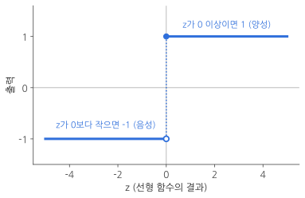
_계단 함수. z가 0 이상이면 1, 0보다 작으면 -1을 내놓아요. 그래프가 계단처럼 생겨서 붙은 이름이에요._

- z가 0 이상이면 → **1** (양성 클래스, "예")
- z가 0보다 작으면 → **-1** (음성 클래스, "아니오")

퍼셉트론은 이렇게 나온 **마지막 결과(1 또는 -1)**를 정답과 비교해서 가중치를 고쳐요.

### 1-2. 특성이 많아지면: 시그마(Σ) 기호

특성이 30개면 식을 `w₁x₁ + w₂x₂ + … + w₃₀x₃₀ + b`처럼 길게 써야 해요. 이럴 때 **시그마(Σ)** 기호를 쓰면 한 줄로 줄일 수 있습니다.

$$
z = b + \sum_{i=1}^{n} w_i x_i
$$

처음 보면 무섭게 생겼지만 뜻은 단순해요. **"i를 1부터 n까지 바꿔 가면서 w × x를 전부 더해라"**는 뜻이에요. 프로그래밍으로 치면 for 문과 똑같습니다.

```python
z = b
for i in range(n):        # i를 0부터 n-1까지 바꿔 가면서
    z += w[i] * x[i]      # w × x를 전부 더한다
```

### 1-3. 아달린: 자르기 전의 값으로 학습한다

퍼셉트론에는 아쉬운 점이 있어요. 계단 함수를 거치고 나면 **"얼마나 틀렸는지"가 사라져요.**

시험에 비유하면, 퍼셉트론은 59점을 받은 학생과 5점을 받은 학생에게 똑같이 **"불합격"**이라고만 알려 주는 셈이에요. 59점은 조금만 고치면 되고 5점은 많이 고쳐야 하는데, 그 정보가 없죠.

1960년 버나드 위드로우와 테드 호프가 이 점을 개선한 **아달린(Adaline)**을 발표했어요. 아달린은 구조는 퍼셉트론과 같지만, **계단 함수를 거치기 전의 점수 z**를 보고 학습해요. "불합격" 대신 "59점"을 알려 주는 거예요.

### 1-4. 로지스틱 회귀: 점수를 확률로 바꾼 다음 학습한다

**로지스틱 회귀(logistic regression)**는 아달린에서 한 걸음 더 나아가요. 점수 z를 그대로 쓰지 않고 **활성화 함수(activation function)**라는 것에 통과시켜서 **0과 1 사이의 값 a**로 바꾼 다음, 이 a를 보고 학습합니다.

세 알고리즘을 나란히 놓으면 차이가 한눈에 보여요.

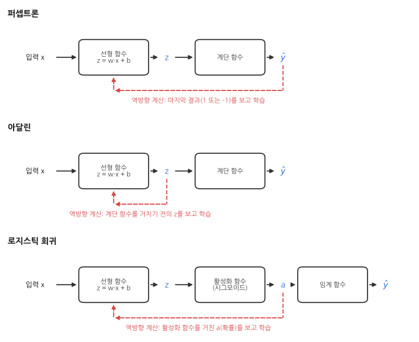
_빨간 점선이 "무엇을 보고 학습하는가"예요. 퍼셉트론은 마지막 결과, 아달린은 z, 로지스틱 회귀는 a를 봅니다._

새로 나온 용어를 정리할게요.

| 기호 | 이름 | 뜻 |
|---|---|---|
| z | 선형 함수의 출력 | 가중치와 입력으로 계산한 점수. 어떤 숫자든 될 수 있어요 |
| a | 활성화 함수의 출력 | z를 0~1 사이로 바꾼 값. 확률처럼 읽어요 |
| ŷ | 최종 예측 | a를 기준(0.5)으로 잘라 만든 0 또는 1 |

마지막에 a를 0 또는 1로 자르는 부분은 **임계 함수(threshold function)**라고 불러요. 퍼셉트론의 계단 함수와 하는 일은 같고, z 대신 a를 받는다는 점만 달라요.

> **이름은 "회귀"인데 분류 알고리즘이에요**
> 로지스틱 회귀는 이름에 회귀가 들어가지만 **분류**를 하는 알고리즘이에요. 0~1 사이의 숫자(확률)를 예측하는 부분이 회귀와 닮아서 붙은 이름인데, 처음 배울 때 많이 헷갈리는 부분이니 꼭 기억해 두세요.
{: .prompt-warning }

### 1-5. 활성화 함수는 왜 "휘어진" 함수여야 할까

활성화 함수로는 직선이 아닌 **휘어진 함수(비선형 함수)**를 써요. 이유는 직선을 여러 번 겹쳐 봐야 결국 직선이기 때문이에요.

예를 들어 "2배 하는 함수" 뒤에 "3배 하는 함수"를 이어 붙이면 그냥 "6배 하는 함수" 하나와 같아요.

$$
y = 3 \times (2 \times x) = 6x
$$

뉴런도 마찬가지예요. 활성화 함수가 직선이면 뉴런을 아무리 여러 층 쌓아도 **뉴런 하나짜리와 다를 게 없어요.** 층을 쌓는 의미가 없어지죠. 그래서 활성화 함수는 반드시 휘어진 함수를 씁니다. 지금은 뉴런이 하나뿐이라 실감이 안 나지만, 뉴런을 여러 층으로 쌓을 때 이 성질이 결정적으로 중요해져요.

그러면 로지스틱 회귀는 어떤 휘어진 함수를 쓸까요? 바로 다음 파트의 주인공인 **시그모이드 함수**예요.

> **파트 1 체크포인트**
> - 퍼셉트론은 선형 함수 뒤에 계단 함수를 붙인 것이고, **계단 함수의 결과**로 학습한다.
> - 아달린은 퍼셉트론을 개선한 것으로, **선형 함수의 결과 z**로 학습한다.
> - 로지스틱 회귀는 아달린에 **활성화 함수**를 추가한 것으로, **a**로 학습한다.
{: .prompt-tip }

---

## 파트 2. 시그모이드 함수: 아무 숫자나 확률로 바꾸기

### 2-1. 시그모이드 함수가 하는 일

점수 z는 -1000도 될 수 있고 +1000도 될 수 있어요. 범위가 정해져 있지 않죠. 이런 값은 "악성일 확률"로 읽을 수가 없어요.

**시그모이드 함수(sigmoid function)**는 z가 어떤 값이든 **0과 1 사이**로 눌러 담아 줘요.

$$
a = \frac{1}{1 + e^{-z}}
$$

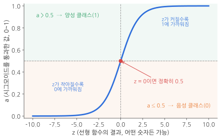
_시그모이드 함수. S자 모양이라서 그리스 문자 시그마(S)에서 이름을 따 왔어요._

실제 값을 몇 개 넣어 보면 감이 와요.

| z | -10 | -5 | -2 | 0 | 2 | 5 | 10 |
|---|---|---|---|---|---|---|---|
| a | 0.00005 | 0.007 | 0.119 | **0.5** | 0.881 | 0.993 | 0.99995 |

- z가 **크면 클수록** a는 1에 가까워져요. → "확실히 예"
- z가 **작으면 작을수록** a는 0에 가까워져요. → "확실히 아니오"
- z가 **정확히 0**이면 a는 0.5예요. → "반반"

그래서 a를 **"양성 클래스(1)일 확률"**로 읽을 수 있어요. 그리고 보통 a가 0.5보다 크면 1로, 그 이하면 0으로 판단합니다.

> **식에 나오는 e는 뭔가요?**
> e는 **자연 상수**라고 부르는 숫자로, 약 2.718이에요. 원주율 π(3.14…)처럼 수학에서 자주 쓰는 특별한 상수라고 생각하면 됩니다. 파이썬에서는 `np.exp(x)`가 "e의 x제곱"을 계산해 줘요.
{: .prompt-info }

### 2-2. 이 식은 어디서 나왔을까: 오즈 → 로짓 → 시그모이드

"왜 하필 이렇게 생긴 식일까?" 궁금할 수 있어요. 시그모이드 함수는 **확률을 다루는 세 단계**를 거쳐 만들어져요. 결과만 필요하다면 이 절은 건너뛰어도 괜찮습니다.

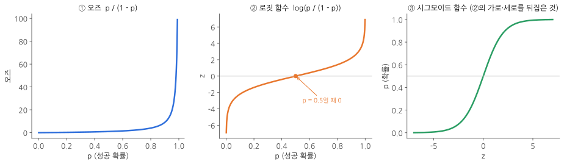
_확률 p에서 출발해서 시그모이드 함수에 도착하는 세 단계예요._

**① 오즈(odds): 성공 확률과 실패 확률의 비율**

$$
\text{오즈} = \frac{p}{1 - p} \qquad (p = \text{성공 확률})
$$

"이길 확률이 80%"를 "4 대 1로 유리하다"고 말하는 것과 같아요.

| 성공 확률 p | 0.2 | 0.5 | 0.8 | 0.9 | 0.99 |
|---|---|---|---|---|---|
| 오즈 | 0.25 | 1 | 4 | 9 | 99 |

p가 0에서 1로 갈 때 오즈는 처음엔 천천히 커지다가 1 근처에서 급격히 커져요. (자료에 따라 이 값을 "오즈 비"라고 부르기도 해요.)

**② 로짓 함수(logit): 오즈에 로그를 씌운 것**

$$
\text{logit}(p) = \log\left(\frac{p}{1 - p}\right)
$$

여기서 log는 **자연 로그**예요. "e를 몇 번 곱해야 이 숫자가 되는가"를 구하는 계산이고, `np.exp()`의 정반대 동작이라고 보면 됩니다.

로그를 씌우면 그래프가 깔끔하게 대칭이 돼요. p가 0.5일 때 정확히 0이고, p가 0에 가까워지면 한없이 작은 음수, 1에 가까워지면 한없이 큰 양수가 됩니다. 즉 로짓 함수는 **0~1 사이의 확률을 "모든 실수"로 펼쳐 주는 함수**예요.

**③ 뒤집기: 로지스틱 함수 = 시그모이드 함수**

우리에게 필요한 건 방향이 반대예요. **모든 실수(z)를 0~1 사이의 확률(p)로** 바꾸고 싶죠. 그래서 로짓 함수의 값을 z라고 두고, 식을 p에 대해 풀어 줍니다.

$$
\begin{aligned}
\log\left(\frac{p}{1 - p}\right) &= z \\
\frac{p}{1 - p} &= e^{z} \\
p &= e^{z}(1 - p) \\
p\,(1 + e^{z}) &= e^{z} \\
p &= \frac{e^{z}}{1 + e^{z}} = \frac{1}{1 + e^{-z}}
\end{aligned}
$$

마지막 줄에서는 분자와 분모를 똑같이 e<sup>z</sup>로 나눴어요. 이렇게 얻은 식을 **로지스틱 함수**라고 부르고, 그래프가 S자 모양이라서 **시그모이드 함수**라고도 불러요. 로지스틱 회귀라는 이름도 여기서 왔습니다.

### 2-3. 중간 정리: 로지스틱 회귀의 전체 흐름

지금까지 나온 걸 한 줄로 이으면 이래요.

| 단계 | 계산 | 값의 범위 | 의미 |
|---|---|---|---|
| ① 선형 함수 | z = b + Σ w·x | -∞ ~ +∞ | 점수 |
| ② 시그모이드 함수 | a = 1 / (1 + e<sup>-z</sup>) | 0 ~ 1 | 1일 확률 |
| ③ 임계 함수 | a > 0.5 이면 1, 아니면 0 | 0 또는 1 | 최종 판단 ŷ |

이제 "예측하는 방법"은 다 알았어요. 남은 건 **"가중치 w와 절편 b를 어떻게 학습시키느냐"**입니다.

---

## 파트 3. 로지스틱 손실 함수: 분류에서 틀린 정도를 재는 법

### 3-1. 정확도를 손실 함수로 쓸 수 없는 이유

1편에서 선형 회귀는 **제곱 오차**를 줄이는 방향으로 학습했어요. 분류의 목표는 뭘까요? 당연히 **맞히는 비율(정확도)**을 높이는 거예요.

그런데 정확도는 손실 함수로 쓸 수가 없어요. 경사 하강법은 "가중치를 아주 살짝 바꾸면 손실이 얼마나 변하나(기울기)"를 보고 움직이는데, 정확도는 가중치를 살짝 바꿔도 **대부분 그대로**예요. 샘플 하나가 "틀림"에서 "맞음"으로 넘어가는 순간에만 갑자기 툭 바뀌죠. 계단 위에 서 있는 것처럼 발밑이 평평해서 **어느 쪽으로 내려가야 할지 알 수 없어요.**

그래서 정확도 대신, 비슷한 목표를 가지면서 **매끄럽게 변하는** 함수가 필요해요. 그게 **로지스틱 손실 함수(logistic loss function)**입니다.

### 3-2. 로지스틱 손실 함수

$$
L = -\big(y \log(a) + (1 - y)\log(1 - a)\big)
$$

- **a**: 모델이 내놓은 "1일 확률" (시그모이드 함수의 출력)
- **y**: 진짜 정답 (1 또는 0)

식이 복잡해 보이지만, **y는 1 아니면 0뿐**이라는 걸 이용하면 아주 단순해져요.

- **y가 1일 때**: 뒤쪽 항에 (1 - y) = 0이 곱해져서 사라져요. → `L = -log(a)`
- **y가 0일 때**: 앞쪽 항에 y = 0이 곱해져서 사라져요. → `L = -log(1 - a)`

| 정답 | 손실 L | 손실이 작아지려면 |
|---|---|---|
| y = 1 (양성 클래스) | -log(a) | a가 1에 가까워야 해요 |
| y = 0 (음성 클래스) | -log(1 - a) | a가 0에 가까워야 해요 |

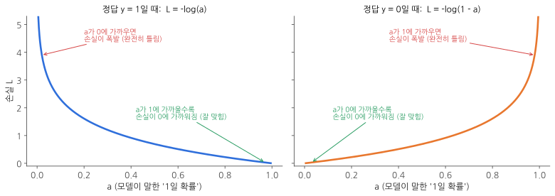
_정답 쪽으로 확신할수록 손실이 0에 가까워지고, 반대쪽으로 확신할수록 손실이 폭발적으로 커져요._

정답이 1인 경우에 실제 숫자를 넣어 볼게요.

| 모델이 말한 확률 a | 0.99 | 0.9 | 0.5 | 0.1 | 0.01 |
|---|---|---|---|---|---|
| 손실 -log(a) | 0.01 | 0.105 | 0.693 | 2.303 | 4.605 |

정답이 1인데 "99% 확률로 1"이라고 하면 손실이 거의 0이에요. 반대로 "1% 확률로 1"이라고 하면 손실이 4.6으로 치솟아요. **자신 있게 틀릴수록 크게 혼나는** 점수표인 거예요.

이 손실을 줄이는 방향으로 학습하면 a가 **자연스럽게 정답 쪽으로** 움직여요. 정답이 1인 샘플은 a가 1에 가까워지고, 정답이 0인 샘플은 a가 0에 가까워져요. 그 a를 0.5 기준으로 자르면 올바른 분류가 됩니다.

> **크로스 엔트로피**
> 로지스틱 손실 함수는 여러 개 중 하나를 고르는 분류(다중 분류)에 쓰는 **크로스 엔트로피(cross entropy) 손실 함수**를 "둘 중 하나" 버전으로 만든 거예요. 그래서 실무에서는 둘을 구분하지 않고 그냥 크로스 엔트로피라고 부르는 경우도 많아요. **이진 크로스 엔트로피**라는 이름도 같은 걸 가리킵니다.
{: .prompt-tip }

### 3-3. 미분 결과부터: 1편과 똑같은 식이 나와요

경사 하강법을 쓰려면 손실 함수를 가중치와 절편으로 미분해야 해요. 과정은 조금 뒤에 보고, **결과부터** 볼게요.

$$
\frac{\partial L}{\partial w_i} = -(y - a)\,x_i \qquad\qquad \frac{\partial L}{\partial b} = -(y - a)
$$

1편에서 제곱 오차를 미분한 결과와 나란히 놓아 볼까요?

| | 제곱 오차의 미분 (1편) | 로지스틱 손실의 미분 (이번 편) |
|---|---|---|
| 가중치 | -(y - ŷ) × x | -(y - a) × x |
| 절편 | -(y - ŷ) × 1 | -(y - a) × 1 |

**ŷ가 a로 바뀌었을 뿐 완전히 같은 모양이에요!** 손실 함수가 저렇게 복잡하게 생겼는데도 미분 결과는 "오차 × 입력"으로 깔끔하게 떨어집니다. 그래서 로지스틱 회귀의 코드는 1편의 Neuron 클래스와 거의 똑같을 거예요.

가중치와 절편을 업데이트하는 식도 그대로예요. 기울기를 **빼 주면** 됩니다.

$$
w_i \leftarrow w_i - \frac{\partial L}{\partial w_i} = w_i + (y - a)\,x_i
\qquad\qquad
b \leftarrow b - \frac{\partial L}{\partial b} = b + (y - a)
$$

> **수식이 부담스럽다면**
> 아래 3-4절은 위 결과가 **어떻게 나오는지** 보여 주는 유도 과정이에요. 읽다가 막히면 건너뛰고 파트 4로 가도 괜찮습니다. **"로지스틱 손실을 미분하면 -(y - a)x가 나온다"**는 결과만 가져가면 코드를 이해하는 데 문제없어요.
{: .prompt-tip }

### 3-4. 유도 과정: 연쇄 법칙으로 한 조각씩

손실 L을 w로 바로 미분하기는 어려워요. L은 a로 만들어지고, a는 z로 만들어지고, z는 w로 만들어지는 **3단 구조**이기 때문이에요.

이럴 때 쓰는 도구가 **연쇄 법칙(chain rule)**이에요. **톱니바퀴**를 떠올리면 쉬워요.

- 톱니바퀴 A가 1바퀴 돌면 B가 2바퀴 돈다.
- 톱니바퀴 B가 1바퀴 돌면 C가 3바퀴 돈다.
- 그러면 A가 1바퀴 돌 때 C는? → 2 × 3 = **6바퀴**

단계별 변화율을 **곱하면** 전체 변화율이 나와요. 수식으로는 이렇게 씁니다.

$$
\frac{\partial L}{\partial w_i} = \frac{\partial L}{\partial a} \times \frac{\partial a}{\partial z} \times \frac{\partial z}{\partial w_i}
$$

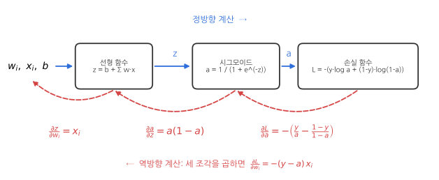
_파란 화살표(정방향)로 계산한 것을, 빨간 화살표(역방향)를 따라 한 조각씩 미분해서 곱해요._

세 조각을 오른쪽 끝에서부터 하나씩 구해 볼게요.

**조각 1. 손실 L을 a로 미분하기**

log(a)를 a로 미분하면 1/a가 돼요. 그리고 log(1 - a)를 미분하면 안쪽의 -a 때문에 부호가 뒤집혀서 -1/(1 - a)가 됩니다. y는 정답이라 a와 상관없는 상수예요.

$$
\frac{\partial L}{\partial a} = -\left(y \cdot \frac{1}{a} - (1 - y) \cdot \frac{1}{1 - a}\right)
$$

**조각 2. a를 z로 미분하기 (시그모이드 함수의 미분)**

$$
\begin{aligned}
\frac{\partial a}{\partial z}
&= \frac{\partial}{\partial z}\left(1 + e^{-z}\right)^{-1}
= -\left(1 + e^{-z}\right)^{-2} \times \left(-e^{-z}\right)
= \frac{e^{-z}}{\left(1 + e^{-z}\right)^{2}} \\
&= \frac{1}{1 + e^{-z}} \times \frac{e^{-z}}{1 + e^{-z}}
= \frac{1}{1 + e^{-z}} \times \left(1 - \frac{1}{1 + e^{-z}}\right)
= a\,(1 - a)
\end{aligned}
$$

중간 과정은 복잡하지만 결과는 놀랄 만큼 간단해요. **시그모이드 함수의 미분은 a(1 - a)**예요. 이미 계산해 둔 a만 있으면 바로 구할 수 있어서 계산이 아주 편합니다.

**조각 3. z를 w로 미분하기**

z = b + w₁x₁ + w₂x₂ + … 에서 wᵢ와 관련 있는 항은 wᵢxᵢ 하나뿐이에요. 나머지는 전부 사라지고 **xᵢ**만 남아요. 1편에서 "w의 변화율은 x"라고 했던 것과 같은 이야기예요.

$$
\frac{\partial z}{\partial w_i} = x_i
$$

**세 조각 곱하기**

$$
\begin{aligned}
\frac{\partial L}{\partial w_i}
&= -\left(\frac{y}{a} - \frac{1 - y}{1 - a}\right) \times a\,(1 - a) \times x_i \\
&= -\big(y\,(1 - a) - (1 - y)\,a\big)\,x_i \\
&= -\,(y - ya - a + ya)\,x_i \\
&= -\,(y - a)\,x_i
\end{aligned}
$$

a(1 - a)를 괄호 안에 곱해 넣으면 분모가 약분되고, ya가 서로 지워지면서 **-(y - a)xᵢ**만 남아요.

절편 b도 같은 방법이에요. 마지막 조각만 "z를 b로 미분한 것"으로 바꾸면 되는데, 그 값은 1이에요.

$$
\frac{\partial L}{\partial b} = \frac{\partial L}{\partial a} \times \frac{\partial a}{\partial z} \times \frac{\partial z}{\partial b} = -(y - a) \times 1
$$

이렇게 손실에서 출발한 미분값(그레이디언트)이 **오른쪽에서 왼쪽으로** 한 단계씩 곱해지며 전달되는 모습을 두고 **"그레이디언트가 역전파된다"**고 말해요. 1편에서는 구조가 너무 단순해서 잘 보이지 않았던 **역전파**의 모습이 이제 조금 보이기 시작했어요.

> **파트 3 체크포인트**
> - 로지스틱 회귀는 가중치를 학습하기 위해 **로지스틱 손실 함수**를 쓴다.
> - 이 손실 함수는 **연쇄 법칙**으로 한 조각씩 미분할 수 있다.
> - 미분 결과는 제곱 오차를 미분한 것과 **같은 모양**이다: -(y - a)x
{: .prompt-tip }

---

## 파트 4. 데이터 준비하기: 종양 데이터 569건

이론은 끝났어요. 이제 진짜 데이터로 분류 문제를 풀어 봅니다.

### 4-1. 위스콘신 유방암 데이터 세트

사이킷런에 들어 있는 **위스콘신 유방암 데이터 세트(Wisconsin breast cancer dataset)**를 쓸 거예요. 종양에서 채취한 세포를 현미경으로 관찰해서 측정한 값들이 들어 있고, 각 종양이 **악성인지 아닌지**가 정답으로 붙어 있어요.

```python
from sklearn.datasets import load_breast_cancer

cancer = load_breast_cancer()
```

1편에서 본 `load_diabetes()`와 사용법이 똑같아요. `cancer.data`에 입력 데이터가, `cancer.target`에 정답이 들어 있습니다.

> 이 데이터는 사이킷런에 포함된 공개 데이터 세트예요. 원본은 UCI 머신러닝 저장소에 CC BY 4.0 라이선스로 공개되어 있어서 공부와 실습에 자유롭게 쓸 수 있습니다.
{: .prompt-info }

### 4-2. 용어 주의: "양성"이라는 말이 두 가지 뜻으로 쓰여요

데이터를 보기 전에 꼭 짚고 넘어가야 할 함정이 있어요. 우리말 **"양성"**이 두 분야에서 전혀 다른 뜻으로 쓰입니다.

| 분야 | 용어 | 영어 | 뜻 |
|---|---|---|---|
| 의학 | **양성** 종양 | benign | 암이 **아닌**, 비교적 안전한 종양 |
| 의학 | 악성 종양 | malignant | 암 |
| 이진 분류 | **양성** 클래스 | positive | 숫자 **1**로 표시한 클래스 |
| 이진 분류 | 음성 클래스 | negative | 숫자 **0**으로 표시한 클래스 |

영어로는 benign과 positive로 완전히 다른 단어인데, 우리말로는 둘 다 "양성"이에요. 그래서 이 글에서는 헷갈리지 않도록 의학 쪽은 항상 **"양성 종양"**, 분류 쪽은 항상 **"양성 클래스"**라고 끝까지 붙여서 쓸게요.

그러면 이 데이터에서 1은 어느 쪽일까요? 직접 확인해 봅시다.

```python
print(cancer.target_names)
```

```text
['malignant' 'benign']
```

순서대로 0번, 1번이에요. 즉 이 데이터에서는

- **0 = malignant = 악성 종양** (음성 클래스)
- **1 = benign = 양성 종양** (양성 클래스)

우연히도 양성 클래스(1)가 양성 종양이에요. 따라서 우리가 만들 모델의 출력 a는 **"이 종양이 양성 종양(암이 아닐) 확률"**로 읽으면 됩니다.

> **보통은 "찾고 싶은 것"을 1로 둬요**
> 이진 분류에서는 관례적으로 **찾아내려는 대상**을 양성 클래스(1)로 정해요. 스팸 필터라면 스팸이 1, 사기 탐지라면 사기가 1이에요. 이 데이터는 그 관례와 반대로 되어 있으니, 데이터를 받으면 **무엇이 1인지부터 확인하는 습관**을 들이는 게 좋아요.
{: .prompt-tip }

### 4-3. 입력 데이터 살펴보기

크기부터 확인합니다.

```python
print(cancer.data.shape, cancer.target.shape)
```

```text
(569, 30) (569,)
```

**샘플 569개, 특성 30개**예요. 종양 569건 각각에 대해 30가지 측정값이 있다는 뜻이에요. 30개의 특성은 세포핵의 반지름, 둘레, 넓이, 매끄러움 같은 10가지 항목을 각각 **평균, 표준 오차, 최댓값** 세 가지로 기록한 거예요. (10 × 3 = 30)

첫 번째 샘플을 출력해 볼게요.

```python
cancer.data[0]
```

```text
array([1.799e+01, 1.038e+01, 1.228e+02, 1.001e+03, 1.184e-01, 2.776e-01,
       3.001e-01, 1.471e-01, 2.419e-01, 7.871e-02, 1.095e+00, 9.053e-01,
       8.589e+00, 1.534e+02, 6.399e-03, 4.904e-02, 5.373e-02, 1.587e-02,
       3.003e-02, 6.193e-03, 2.538e+01, 1.733e+01, 1.846e+02, 2.019e+03,
       1.622e-01, 6.656e-01, 7.119e-01, 2.654e-01, 4.601e-01, 1.189e-01])
```

**`1.799e+01`은 어떻게 읽나요?** 컴퓨터가 큰 수나 작은 수를 짧게 적는 **지수 표기법**이에요. `e+01`은 "10을 1번 곱하라", `e-03`은 "10으로 3번 나누라"는 뜻입니다.

- `1.799e+01` = 1.799 × 10 = **17.99**
- `1.001e+03` = 1.001 × 1000 = **1001**
- `6.399e-03` = 6.399 ÷ 1000 = **0.006399**

여기서 중요한 사실이 하나 보여요. 같은 샘플 안에 **1001**도 있고 **0.006**도 있어요. **특성마다 값의 크기가 엄청나게 달라요.** 이 점이 나중에 모델의 성능에 영향을 주니 기억해 두세요.

### 4-4. 박스 플롯으로 특성 30개 한눈에 보기

1편에서는 산점도를 그렸지만, 특성이 30개나 되면 산점도로는 볼 수가 없어요. 이럴 때는 **박스 플롯(box plot)**이 좋아요.

박스 플롯은 값들을 크기순으로 줄 세웠을 때의 위치를 상자로 보여 줘요.

- **상자의 아래쪽 변**: 아래에서 25% 지점의 값 (1사분위)
- **상자 안의 선**: 정확히 가운데 값 (2사분위, 중간값)
- **상자의 위쪽 변**: 아래에서 75% 지점의 값 (3사분위)
- **위아래로 뻗은 선(수염)**: 상자 길이의 1.5배 안에 있는 가장 큰 값과 가장 작은 값
- **수염 밖의 점**: 다른 값들과 동떨어진 값 (이상치)

즉 **상자 안에 전체 데이터의 가운데 50%**가 들어 있어요.

```python
import matplotlib.pyplot as plt

plt.boxplot(cancer.data)    # 특성 30개 각각에 대해 상자를 하나씩 그림
plt.xlabel('feature')
plt.ylabel('value')
plt.show()
```

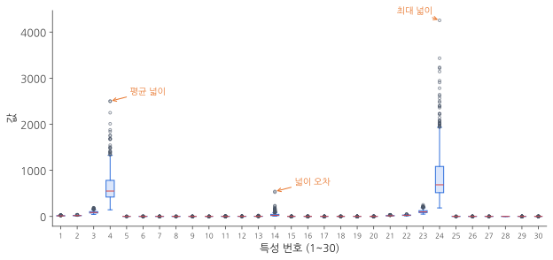
_특성 30개의 값 분포예요. 4번째, 14번째, 24번째 특성만 유독 값이 커요._

대부분의 특성은 0 근처에 납작하게 붙어 있는데, **4, 14, 24번째 특성**만 수백에서 수천까지 올라가요. 어떤 특성인지 이름을 확인해 볼게요.

```python
cancer.feature_names[[3, 13, 23]]
```

```text
array(['mean area', 'area error', 'worst area'], dtype='<U23')
```

파이썬은 번호를 0부터 세기 때문에 4번째 특성의 인덱스는 3이에요. 대괄호 안에 번호 목록 `[3, 13, 23]`을 넣으면 그 위치의 값들만 골라 줍니다.

결과를 보니 셋 다 **넓이(area)**와 관련된 특성이에요. 넓이는 길이를 두 번 곱한 값이라 다른 측정값보다 숫자가 훨씬 큰 거예요.

### 4-5. 타깃 데이터 확인하기

정답이 어떻게 분포되어 있는지 봅시다. 넘파이의 `unique()` 함수는 배열 안에 **어떤 값들이 있는지** 알려 주고, `return_counts=True`를 주면 **각각 몇 개인지**도 세어 줘요.

```python
import numpy as np

np.unique(cancer.target, return_counts=True)
```

```text
(array([0, 1]), array([212, 357]))
```

- 왼쪽 `[0, 1]`: 타깃에는 0과 1 두 가지 값만 있어요.
- 오른쪽 `[212, 357]`: 0이 212개, 1이 357개예요.

즉 **악성 종양(0)이 212건, 양성 종양(1)이 357건**이에요. 양성 종양이 약 1.7배 많습니다.

### 4-6. x와 y에 저장하기

```python
x = cancer.data      # 입력: 569 × 30
y = cancer.target    # 타깃: 569개의 0 또는 1
```

1편에서는 특성 하나만 골랐지만, 이번에는 **30개를 전부** 씁니다.

---

## 파트 5. 훈련 세트와 테스트 세트: 진짜 실력을 재는 방법

### 5-1. 기출문제만 외운 학생

1편에서는 가진 데이터를 **전부** 써서 모델을 훈련했어요. 그런데 생각해 볼 문제가 있어요. **이 모델이 실전에서 얼마나 잘할지 어떻게 알 수 있을까요?**

훈련에 쓴 데이터로 다시 평가하면 안 돼요. 문제집 한 권을 통째로 외운 학생에게 **똑같은 문제**로 시험을 보면 100점이 나오겠지만, 그게 실력은 아니잖아요. 처음 보는 문제를 풀려 봐야 진짜 실력을 알 수 있어요.

모델이 처음 보는 데이터에서 내는 성능을 **일반화 성능(generalization performance)**이라고 불러요. 그리고 훈련에 쓴 데이터로 평가해서 실제보다 좋게 나온 결과를 두고 **"일반화 성능을 과도하게 낙관적으로 추정했다"**고 말합니다. 다른 자료에서도 자주 보이는 표현이에요.

해결책은 간단해요. 데이터를 **두 덩어리로 나눠서** 하나는 훈련에만 쓰고, 다른 하나는 평가할 때만 꺼내 쓰는 거예요.

- **훈련 세트(training set)**: 모델을 학습시키는 데 쓰는 데이터. 공부용 문제집이에요.
- **테스트 세트(test set)**: 학습이 끝난 뒤 평가에만 쓰는 데이터. 한 번도 본 적 없는 시험지예요.

### 5-2. 나눌 때 지켜야 할 두 가지 규칙

1. **훈련 세트가 테스트 세트보다 많아야 해요.** 공부할 자료가 충분해야 하니까요. 보통 8:2나 7.5:2.5 정도로 나눕니다.
2. **두 세트의 클래스 비율이 원래 데이터와 같아야 해요.** 나누기 전에 골고루 섞어야 합니다.

두 번째 규칙이 왜 중요할까요? 우리 데이터는 악성 212건, 양성 종양 357건이에요. 만약 운이 나빠서 훈련 세트에 양성 종양만 잔뜩 들어가면, 모델은 악성 종양이 어떻게 생겼는지 **제대로 배우지 못해요.** 반대로 테스트 세트에 한쪽만 몰리면 **성능을 잘못 측정**하게 됩니다.

### 5-3. train_test_split()으로 나누기

직접 섞고 나눌 수도 있지만, 사이킷런에 이 일을 해 주는 함수가 있어요.

```python
from sklearn.model_selection import train_test_split

x_train, x_test, y_train, y_test = train_test_split(
    x, y, stratify=y, test_size=0.2, random_state=1)
```

함수 하나가 값을 **네 개** 돌려줘요. 순서대로 훈련용 입력, 테스트용 입력, 훈련용 정답, 테스트용 정답이에요. 뒤에 붙인 설정 세 개는 이런 뜻입니다.

| 설정 | 뜻 |
|---|---|
| `stratify=y` | y의 클래스 비율이 두 세트에서 **똑같이 유지되도록** 나눠요. 클래스 비율이 한쪽으로 치우친 데이터에서는 꼭 넣어 주세요. |
| `test_size=0.2` | 전체의 **20%**를 테스트 세트로 떼어 내요. 지정하지 않으면 기본값은 25%예요. |
| `random_state=1` | 섞을 때 쓰는 **난수의 시작값**이에요. 같은 숫자를 주면 누가 실행해도 똑같이 나뉘어요. |

> **random_state는 왜 쓰나요?**
> `train_test_split()`은 데이터를 **무작위로** 섞어서 나누기 때문에 실행할 때마다 결과가 달라져요. 그러면 이 글의 숫자와 여러분이 실행한 숫자가 달라서 비교하기 어렵죠. `random_state`에 숫자를 지정하면 "무작위지만 매번 같은 순서"로 섞여요. 숫자 자체에는 의미가 없고, 실제 서비스를 만들 때는 꼭 필요한 설정도 아니에요.
{: .prompt-info }

### 5-4. 잘 나뉘었는지 확인하기

```python
print(x_train.shape, x_test.shape)
```

```text
(455, 30) (114, 30)
```

훈련 세트 455개, 테스트 세트 114개로 **4:1(80%:20%)**로 나뉘었어요. 뒤의 30은 특성 개수예요.

클래스 비율도 유지됐는지 확인합니다.

```python
np.unique(y_train, return_counts=True)
```

```text
(array([0, 1]), array([170, 285]))
```

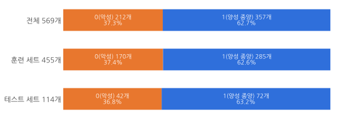
_세 덩어리 모두 악성과 양성 종양의 비율이 거의 같아요. stratify=y 덕분이에요._

훈련 세트에서 양성 종양이 악성보다 약 1.7배 많아요(285 ÷ 170 ≈ 1.68). 전체 데이터의 비율(357 ÷ 212 ≈ 1.68)과 같죠. 잘 나뉘었습니다.

---

## 파트 6. LogisticNeuron 클래스: 분류하는 뉴런 만들기

이제 로지스틱 회귀를 코드로 만들어요. **1편의 Neuron 클래스와 거의 같고, 달라지는 곳은 네 군데**뿐이에요. 달라지는 부분 위주로 볼게요.

### 6-1. 뼈대: `__init__()`, `forpass()`, `backprop()`

```python
class LogisticNeuron:

    def __init__(self):
        self.w = None        # 가중치: 아직 정하지 않음
        self.b = None        # 절편: 아직 정하지 않음

    def forpass(self, x):
        z = np.sum(x * self.w) + self.b    # 직선 방정식을 계산
        return z

    def backprop(self, x, err):
        w_grad = x * err     # 가중치에 대한 그레이디언트
        b_grad = 1 * err     # 절편에 대한 그레이디언트
        return w_grad, b_grad
```

**달라진 점 ① 가중치를 미리 정하지 않아요**

1편에서는 `self.w = 1.0`으로 바로 정했어요. 특성이 하나라 가중치도 하나면 됐으니까요. 이번에는 특성이 30개라 **가중치도 30개**가 필요한데, 클래스를 만드는 시점에는 특성이 몇 개인지 알 수 없어요. 그래서 일단 `None`(비어 있음)으로 두고, 나중에 데이터를 받았을 때 특성 개수에 맞춰 만듭니다.

**달라진 점 ② `forpass()`에서 `np.sum()`을 써요**

`x * self.w`가 이번에는 숫자 하나가 아니라 **숫자 30개짜리 배열끼리의 곱**이에요. 넘파이 배열은 사칙연산을 하면 **같은 위치의 값끼리** 자동으로 계산해 줘요.

```python
a = np.array([2, 4, 6])
b = np.array([1, 3, 5])
print(a + b)
print(a * b)
```

```text
[ 3  7 11]
[ 2 12 30]
```

2+1, 4+3, 6+5가 각각 계산됐고, 곱셈도 2×1, 4×3, 6×5가 각각 계산됐어요. 그리고 `np.sum()`은 배열의 값을 **전부 더해** 줍니다.

```python
np.sum(a * b)
```

```text
44
```

2 + 12 + 30 = 44예요. 이게 바로 파트 1에서 본 시그마 식이에요.

$$
z = b + \sum_{i=1}^{n} w_i x_i \quad\Longleftrightarrow\quad \texttt{z = np.sum(x * self.w) + self.b}
$$

for 문을 쓰지 않고도 "w × x를 전부 더하기"가 한 줄로 끝나요.

`backprop()`은 1편과 글자 하나 다르지 않아요. 파트 3에서 확인했듯이 미분 결과가 같은 모양이기 때문이에요. 다만 `x`가 배열이라서 `w_grad`도 값이 30개인 배열이 됩니다. 가중치 30개 각각의 그레이디언트가 한 번에 계산되는 거예요.

### 6-2. `activation()`: 시그모이드 함수

**달라진 점 ③ 활성화 함수가 추가돼요**

```python
    def activation(self, z):
        z = np.clip(z, -100, None)     # 안전한 계산을 위해 z의 최솟값을 -100으로 제한
        a = 1 / (1 + np.exp(-z))       # 시그모이드 계산
        return a
```

둘째 줄이 시그모이드 식 그대로예요. `np.exp(-z)`가 e<sup>-z</sup>를 계산합니다.

첫째 줄의 `np.clip()`은 **값을 정해진 범위 안으로 잘라 넣는** 함수예요. `np.clip(z, -100, None)`은 "z가 -100보다 작으면 -100으로 바꾸고, 위쪽은 제한하지 않는다"는 뜻이에요.

이게 왜 필요할까요? z가 -1000 같은 아주 작은 값이면 `np.exp(1000)`을 계산해야 하는데, 이 값은 컴퓨터가 담을 수 있는 범위를 넘어가서 **무한대(inf)**가 되고 경고가 떠요. z가 -100만 되어도 시그모이드 값은 이미 0과 구별이 안 될 만큼 작기 때문에, -100에서 잘라도 결과에는 영향이 없어요.

### 6-3. `fit()`: 훈련하기

```python
    def fit(self, x, y, epochs=100):
        self.w = np.ones(x.shape[1])       # 가중치를 초기화 (특성 개수만큼 1로 채움)
        self.b = 0                         # 절편을 초기화
        for i in range(epochs):            # epochs만큼 반복
            for x_i, y_i in zip(x, y):     # 모든 샘플에 대해 반복
                z = self.forpass(x_i)      # 정방향 계산
                a = self.activation(z)     # 활성화 함수 적용
                err = -(y_i - a)           # 오차 계산
                w_grad, b_grad = self.backprop(x_i, err)   # 역방향 계산
                self.w -= w_grad           # 가중치 업데이트
                self.b -= b_grad           # 절편 업데이트
```

1편의 `fit()`과 비교하면 두 군데가 달라요.

- **처음에 가중치를 만들어요.** `x.shape[1]`은 입력 데이터의 열 개수, 즉 특성 개수(30)예요. `np.ones(30)`은 **1이 30개 들어 있는 배열**을 만들어요. 절편은 0으로 시작합니다.
- **정방향 계산 뒤에 활성화 함수를 한 번 거쳐요.** 그래서 오차를 계산할 때 `y_hat` 대신 `a`를 써요.

나머지는 전부 같아요. 정방향 계산 → 오차 → 역방향 계산 → 업데이트.

> **배열을 채워서 만드는 함수들**
> `np.ones()`처럼 특정 값으로 채운 배열을 만드는 함수가 몇 개 더 있어요.
> - `np.zeros((2, 3))`: 0으로 채운 2행 3열 배열
> - `np.ones((2, 3))`: 1로 채운 2행 3열 배열
> - `np.full((2, 3), 7)`: 원하는 값(7)으로 채운 2행 3열 배열
>
> 2차원 이상의 배열을 만들 때는 크기를 `(2, 3)`처럼 괄호로 묶어서 전달해요.
{: .prompt-tip }

### 6-4. `predict()`: 예측하기

**달라진 점 ④ 예측 메서드가 생겨요**

1편에서는 예측할 때 `forpass()`를 직접 불렀어요. 하지만 분류에서는 선형 함수 → 활성화 함수 → 임계 함수를 **차례로** 거쳐야 하고, 샘플 여러 개를 한꺼번에 예측하고 싶을 때가 많아요. 그래서 예측 전용 메서드를 만듭니다.

```python
    def predict(self, x):
        z = [self.forpass(x_i) for x_i in x]    # 선형 함수 적용
        a = self.activation(np.array(z))        # 활성화 함수 적용
        return a > 0.5                          # 임계 함수 적용
```

첫째 줄은 **리스트 내포(list comprehension)**라는 파이썬 문법이에요. 대괄호 안에 for 문을 넣어서 새 리스트를 만드는 간결한 방법입니다. 아래 두 코드는 같은 일을 해요.

```python
# 리스트 내포
z = [self.forpass(x_i) for x_i in x]

# 풀어서 쓰면
z = []
for x_i in x:
    z.append(self.forpass(x_i))
```

"x에서 샘플을 하나씩 꺼내 `forpass()`에 넣고, 그 결과를 모아 리스트로 만들어라"는 뜻이에요.

마지막 줄 `a > 0.5`는 배열의 값 하나하나를 0.5와 비교해서 `True` 또는 `False`로 바꿔 줘요. a가 0.5보다 크면 True(양성 클래스), 아니면 False(음성 클래스)예요.

### 6-5. 훈련하고 정확도 측정하기

완성된 클래스로 모델을 훈련합니다. **반드시 훈련 세트만** 넣어야 해요.

```python
neuron = LogisticNeuron()
neuron.fit(x_train, y_train)
```

이제 한 번도 보여 주지 않은 **테스트 세트**로 실력을 확인해요.

```python
np.mean(neuron.predict(x_test) == y_test)
```

```text
0.8333333333333334
```

이 한 줄이 어떻게 동작하는지 풀어 볼게요.

1. `neuron.predict(x_test)` → 테스트 샘플 114개에 대한 예측. `[True, False, True, …]`
2. `== y_test` → 예측과 정답을 하나씩 비교. 파이썬에서 True는 1, False는 0과 같다고 보기 때문에 `True == 1`은 맞음, `True == 0`은 틀림이에요. 결과는 "맞혔는가?"를 나타내는 `[True, True, False, …]`
3. `np.mean(...)` → 평균 계산. True를 1, False를 0으로 치고 평균을 내면 **맞힌 비율**이 돼요.

이렇게 구한 "올바르게 예측한 샘플의 비율"을 **정확도(accuracy)**라고 불러요. 0.833이니 114개 중 95개를 맞혔다는 뜻이에요. **약 83%**입니다.

아주 훌륭하진 않지만, 직접 만든 뉴런이 처음 보는 종양 6개 중 5개를 맞힌 거예요. 로지스틱 회귀가 제대로 동작합니다!

> **왜 더 높게 나오지 않을까요?**
> 파트 4에서 **특성마다 값의 크기가 엄청나게 다르다**는 걸 봤어요. 실제로 첫 번째 훈련 샘플에 가중치 1을 곱해 다 더하면 z가 약 1700이 나와요. 시그모이드 함수에 1700을 넣으면 a는 그냥 1.0이에요. 모델이 처음부터 "100% 확신"만 하다 보니 섬세하게 배우기가 어려운 거예요. 이 문제는 특성들의 크기를 비슷하게 맞춰 주면 해결되는데, 뒤에서 자세히 다룹니다.
{: .prompt-info }

---

## 파트 7. 단일층 신경망: 뉴런에 기능 더하기

### 7-1. 사실 우리는 이미 신경망을 만들었어요

방금 만든 로지스틱 회귀 뉴런은 **가장 단순한 형태의 신경망**이에요. 지금까지 "층"이라는 말을 쓰지 않았을 뿐이죠. 이제 신경망 용어를 정리할 때가 됐어요.

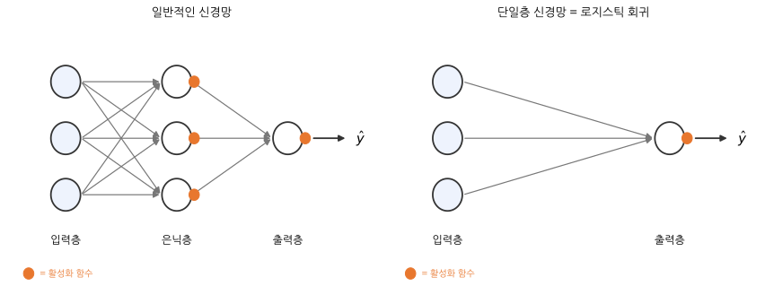
_왼쪽이 일반적인 신경망, 오른쪽이 우리가 만든 것이에요. 주황색 점은 활성화 함수를 나타내요._

- **입력층(input layer)**: 가장 왼쪽. 입력 데이터 그 자체예요.
- **출력층(output layer)**: 가장 오른쪽. 최종 결과를 내놓는 층이에요.
- **은닉층(hidden layer)**: 입력층과 출력층 사이에 있는 층들이에요. 바깥에서 보이지 않아서 "숨은 층"이라고 불러요.
- **활성화 함수**: 은닉층과 출력층의 일부로 봐요.

로지스틱 회귀는 **은닉층이 없고 입력층과 출력층만 있는** 신경망이에요. 이런 신경망을 **단일층 신경망(single layer neural network)**이라고 부릅니다.

"입력층과 출력층, 층이 두 개인데 왜 단일층이지?" 싶을 수 있어요. 입력층은 **입력 데이터 그 자체**라서 계산을 하지 않고, 코드에서도 따로 만들지 않아요. 그래서 층을 셀 때 빼는 게 오랜 관례예요.

LogisticNeuron이 이미 단일층 신경망이니 새로 만들 필요는 없어요. 다만 여기에 **유용한 기능 세 가지**를 더해서 `SingleLayer`라는 이름의 클래스로 다시 만들어 볼게요.

1. 에포크마다 **손실 값을 기록**하기
2. 에포크마다 **샘플 순서를 섞기**
3. 정확도를 계산하는 **`score()` 메서드**

### 7-2. 기능 ① 손실 함수의 값 기록하기

경사 하강법은 손실 함수의 값을 줄이는 방향으로 움직여요. 그렇다면 **손실이 정말 줄어들고 있는지** 눈으로 확인하고 싶겠죠? 줄어들지 않는다면 뭔가 잘못된 거니까요.

먼저 기록할 빈 리스트를 만듭니다.

```python
    def __init__(self):
        self.w = None
        self.b = None
        self.losses = []      # 에포크마다 손실을 기록할 리스트
```

그리고 `fit()` 안에서 샘플마다 로지스틱 손실을 계산해서 더해 두었다가, 한 에포크가 끝나면 샘플 수로 나눈 **평균**을 리스트에 추가해요. (전체 코드는 7-5절에 있어요.)

```python
                a = np.clip(a, 1e-10, 1 - 1e-10)     # 안전한 로그 계산을 위해 a를 살짝 조정
                loss += -(y[i] * np.log(a) + (1 - y[i]) * np.log(1 - a))   # 손실을 누적
            self.losses.append(loss / len(y))        # 에포크마다 평균 손실을 저장
```

둘째 줄이 파트 3의 로지스틱 손실 식 그대로예요.

첫째 줄의 `np.clip()`은 이번에도 안전장치예요. a가 정확히 0이 되면 `np.log(0)`은 **음의 무한대**가 되고, a가 정확히 1이면 `np.log(1 - a)`가 음의 무한대가 돼요. 손실이 무한대가 되면 평균을 낼 수 없어요. 그래서 a를 **0.0000000001(1e-10)부터 0.9999999999(1 - 1e-10) 사이**로 살짝 잘라 넣습니다.

### 7-3. 기능 ② 에포크마다 샘플 순서 섞기: 경사 하강법의 세 가지 방식

지금까지 우리는 **샘플 하나를 볼 때마다** 가중치를 고쳤어요. 이 방식에는 이름이 있어요. 경사 하강법은 "한 번 고칠 때 샘플을 몇 개 보느냐"에 따라 세 가지로 나뉩니다.

| 방식 | 한 번 고칠 때 보는 샘플 | 특징 |
|---|---|---|
| **확률적 경사 하강법** (stochastic gradient descent, SGD) | 무작위로 고른 **1개** | 계산이 가볍고 빠르지만, 가는 길이 들쭉날쭉해요 |
| **배치 경사 하강법** (batch gradient descent) | 훈련 세트 **전체** | 가는 길이 매끄럽고 안정적이지만, 한 번 고치는 데 계산이 많이 들어요 |
| **미니 배치 경사 하강법** (mini-batch gradient descent) | 무작위로 고른 **몇 개 묶음** | 둘의 장점을 절충한 방식이에요 |

**산에서 내려오는 길**에 비유하면 이래요. 확률적 경사 하강법은 지나가는 사람 **한 명**에게 길을 묻고 바로 걷는 거예요. 빠르지만 엉뚱한 방향을 알려 주는 사람도 있어서 갈지자로 걷게 돼요. 배치 경사 하강법은 **모든 사람**에게 묻고 평균을 내서 걷는 거예요. 방향은 정확하지만 한 걸음 떼는 데 오래 걸려요. 미니 배치는 **열 명쯤**에게 묻고 걷는 거고요.

가중치가 2개인 연습용 데이터로 세 방식을 실제로 돌려서, 가중치가 움직인 경로를 그려 봤어요.

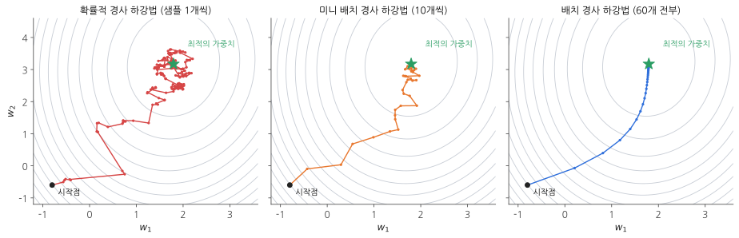
_회색 등고선은 손실의 높이예요. 별이 손실이 가장 낮은 곳이고, 점 하나가 가중치를 한 번 고친 것이에요._

확률적 경사 하강법(왼쪽)은 이리저리 흔들리면서 가고, 도착해서도 별 주변을 맴돌아요. 배치 경사 하강법(오른쪽)은 매끄럽게 곧장 가요. 미니 배치(가운데)는 그 중간이에요.

**샘플 순서를 섞어야 하는 이유**

어떤 방식을 쓰든, **에포크마다 훈련 세트의 샘플 순서를 섞어 주는 게** 좋아요. 매번 같은 순서로 보면 가중치도 매번 같은 길로만 흔들려요. 1편에서 "마지막 몇 명의 영향을 크게 받는다"고 했던 문제도 순서가 고정되어 있어서 생긴 거예요. 순서를 섞으면 가중치가 다양한 길을 탐색하게 돼서 더 좋은 값을 찾을 가능성이 높아져요.

**카드 섞기**와 비슷해요. 다만 무거운 데이터 자체를 뒤섞는 대신, **번호표만 섞은 다음 번호표 순서대로 데이터를 꺼내요.** 이쪽이 훨씬 빠르고 간단합니다.

```python
indexes = np.random.permutation(np.arange(len(x)))   # 인덱스를 섞는다
for i in indexes:                                    # 섞인 번호표 순서대로
    z = self.forpass(x[i])                           # x[i], y[i]로 샘플을 꺼내 쓴다
```

- `np.arange(len(x))`: 0부터 454까지의 번호표를 만들어요. `[0, 1, 2, …, 454]`
- `np.random.permutation(...)`: 번호표를 무작위로 섞어요. `[311, 42, 7, …]` 같은 식이에요.

### 7-4. 기능 ③ `score()` 메서드, 그리고 더 간단해진 `predict()`

정확도 계산을 매번 `np.mean(...)`으로 쓰기 번거로우니 메서드로 만들어 둡니다.

```python
    def predict(self, x):
        z = [self.forpass(x_i) for x_i in x]    # 정방향 계산
        return np.array(z) > 0                  # 계단 함수 적용

    def score(self, x, y):
        return np.mean(self.predict(x) == y)    # 맞힌 비율(정확도)
```

그런데 `predict()`가 달라졌어요. **시그모이드 함수가 사라지고**, `a > 0.5` 대신 `z > 0`으로 판단해요. 이래도 될까요?

파트 2의 시그모이드 그래프를 떠올려 보세요. **z가 0일 때 a가 정확히 0.5**였고, z가 0보다 크면 a는 0.5보다 크고, z가 0보다 작으면 a는 0.5보다 작아요. 즉

> **a > 0.5** 와 **z > 0** 은 완전히 같은 조건이에요.

예측만 할 때는 굳이 시그모이드 함수를 계산할 필요 없이 z의 부호만 보면 되는 거예요. 계산을 한 단계 아낄 수 있습니다. (물론 **확률 값 자체**가 필요할 때는 시그모이드 함수를 거쳐야 해요.)

### 7-5. 전체 코드: 복사해서 바로 실행하기

데이터 준비부터 LogisticNeuron, SingleLayer까지 한 번에 실행할 수 있는 전체 코드예요.

```python
import numpy as np
import matplotlib.pyplot as plt
from sklearn.datasets import load_breast_cancer
from sklearn.model_selection import train_test_split

# 1. 데이터 준비
cancer = load_breast_cancer()
x = cancer.data
y = cancer.target
x_train, x_test, y_train, y_test = train_test_split(
    x, y, stratify=y, test_size=0.2, random_state=1)


# 2. 로지스틱 회귀 뉴런
class LogisticNeuron:

    def __init__(self):
        self.w = None
        self.b = None

    def forpass(self, x):
        z = np.sum(x * self.w) + self.b        # 직선 방정식을 계산
        return z

    def backprop(self, x, err):
        w_grad = x * err                       # 가중치에 대한 그레이디언트
        b_grad = 1 * err                       # 절편에 대한 그레이디언트
        return w_grad, b_grad

    def activation(self, z):
        z = np.clip(z, -100, None)             # 안전한 np.exp() 계산을 위해
        a = 1 / (1 + np.exp(-z))               # 시그모이드 계산
        return a

    def fit(self, x, y, epochs=100):
        self.w = np.ones(x.shape[1])           # 가중치를 초기화
        self.b = 0                             # 절편을 초기화
        for i in range(epochs):                # epochs만큼 반복
            for x_i, y_i in zip(x, y):         # 모든 샘플에 대해 반복
                z = self.forpass(x_i)          # 정방향 계산
                a = self.activation(z)         # 활성화 함수 적용
                err = -(y_i - a)               # 오차 계산
                w_grad, b_grad = self.backprop(x_i, err)   # 역방향 계산
                self.w -= w_grad               # 가중치 업데이트
                self.b -= b_grad               # 절편 업데이트

    def predict(self, x):
        z = [self.forpass(x_i) for x_i in x]   # 정방향 계산
        a = self.activation(np.array(z))       # 활성화 함수 적용
        return a > 0.5                         # 임계 함수 적용


neuron = LogisticNeuron()
neuron.fit(x_train, y_train)
print(np.mean(neuron.predict(x_test) == y_test))


# 3. 단일층 신경망
class SingleLayer:

    def __init__(self):
        self.w = None
        self.b = None
        self.losses = []                       # 에포크마다 손실을 기록

    def forpass(self, x):
        z = np.sum(x * self.w) + self.b        # 직선 방정식을 계산
        return z

    def backprop(self, x, err):
        w_grad = x * err                       # 가중치에 대한 그레이디언트
        b_grad = 1 * err                       # 절편에 대한 그레이디언트
        return w_grad, b_grad

    def activation(self, z):
        z = np.clip(z, -100, None)             # 안전한 np.exp() 계산을 위해
        a = 1 / (1 + np.exp(-z))               # 시그모이드 계산
        return a

    def fit(self, x, y, epochs=100):
        self.w = np.ones(x.shape[1])           # 가중치를 초기화
        self.b = 0                             # 절편을 초기화
        for i in range(epochs):                # epochs만큼 반복
            loss = 0
            indexes = np.random.permutation(np.arange(len(x)))   # 인덱스를 섞는다
            for i in indexes:                  # 모든 샘플에 대해 반복
                z = self.forpass(x[i])         # 정방향 계산
                a = self.activation(z)         # 활성화 함수 적용
                err = -(y[i] - a)              # 오차 계산
                w_grad, b_grad = self.backprop(x[i], err)   # 역방향 계산
                self.w -= w_grad               # 가중치 업데이트
                self.b -= b_grad               # 절편 업데이트
                a = np.clip(a, 1e-10, 1 - 1e-10)   # 안전한 로그 계산을 위해
                loss += -(y[i] * np.log(a) + (1 - y[i]) * np.log(1 - a))   # 손실 누적
            self.losses.append(loss / len(y))  # 에포크마다 평균 손실을 저장

    def predict(self, x):
        z = [self.forpass(x_i) for x_i in x]   # 정방향 계산
        return np.array(z) > 0                 # 계단 함수 적용

    def score(self, x, y):
        return np.mean(self.predict(x) == y)   # 정확도


np.random.seed(42)                             # 섞는 순서를 고정 (결과 재현용)
layer = SingleLayer()
layer.fit(x_train, y_train)
print(layer.score(x_test, y_test))

# 4. 손실 그래프
plt.plot(layer.losses)
plt.xlabel('epoch')
plt.ylabel('loss')
plt.show()
```

```text
0.8333333333333334
0.9298245614035088
```

`np.random.seed(42)`는 `random_state`와 같은 역할이에요. 샘플을 섞는 순서를 고정해서 누가 실행해도 같은 결과가 나오게 합니다.

### 7-6. 결과 확인: 정확도와 손실 그래프

**정확도가 83%에서 93%로 올랐어요!** 114개 중 106개를 맞혔습니다. 에포크 수는 똑같이 100인데, 에포크마다 샘플 순서를 섞은 것만으로 더 좋은 가중치를 찾은 거예요.

손실이 정말 줄어들었는지도 그래프로 확인해 볼게요.

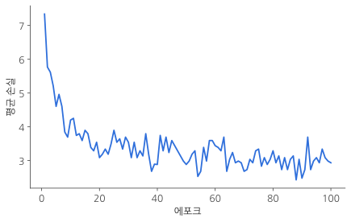
_에포크가 진행될수록 평균 손실이 줄어들어요._

처음에 7.3이던 평균 손실이 빠르게 떨어져서 3 근처까지 내려왔어요. **모델이 학습하고 있다는 증거**예요. 선이 매끄럽지 않고 **들쭉날쭉한 건 확률적 경사 하강법의 특징**이에요. 샘플 하나만 보고 고치다 보니 손실이 오르락내리락하면서 전체적으로 내려갑니다.

> **솔직한 이야기: 이 결과는 꽤 흔들려요**
> `np.random.seed()`의 숫자를 0부터 19까지 바꿔 가며 20번 돌려 보면, 정확도가 **낮게는 73%, 높게는 94%**까지 나오고 평균은 약 90%예요. 섞는 순서에 따라 결과가 크게 달라지는 거예요. 섞지 않았을 때(83%)보다 평균적으로는 좋지만, 운이 나쁘면 더 낮게 나올 수도 있습니다.
> 원인은 앞에서 말한 **특성 크기의 차이**예요. 실제로 특성들의 크기를 비슷하게 맞춰 준 뒤 같은 코드를 돌리면 정확도가 96~99%로 올라가고 흔들림도 훨씬 줄어들어요. 직접 만든 이 클래스는 **원리를 이해하기 위한 것**이니 지금은 성능에 너무 신경 쓰지 않아도 됩니다.
{: .prompt-info }

**축하합니다!** 가장 기초적인 신경망을 직접 만들었어요. 신경망은 결국 **로지스틱 회귀를 여러 개 이어 붙여 확장한 것**이라고 생각해도 좋아요. 지금은 은닉층이 없어서 로지스틱 회귀와 똑같지만, 여기에 은닉층을 끼워 넣으면 우리가 흔히 말하는 딥러닝 모델이 됩니다.

---

## 파트 8. 사이킷런으로 같은 일 하기

지금까지는 원리를 이해하려고 전부 직접 만들었어요. 하지만 실제로 일할 때는 잘 만들어진 라이브러리를 쓰는 게 보통이에요. 사이킷런에는 경사 하강법이 `SGDClassifier`라는 클래스로 구현되어 있어요. 이름의 SGD가 바로 **확률적 경사 하강법**(Stochastic Gradient Descent)이에요.

### 8-1. 모델 만들기

```python
from sklearn.linear_model import SGDClassifier

sgd = SGDClassifier(loss='log_loss', max_iter=100, tol=1e-3, random_state=42)
```

| 설정 | 뜻 |
|---|---|
| `loss='log_loss'` | 손실 함수로 **로지스틱 손실 함수**를 써요. 이 설정 덕분에 로지스틱 회귀가 됩니다. |
| `max_iter=100` | 최대 반복 횟수(에포크)를 100으로 정해요. |
| `tol=1e-3` | 반복할 때마다 손실이 0.001만큼도 줄지 않으면 **더 돌리지 않고 멈춰요.** |
| `random_state=42` | 실행할 때마다 같은 결과가 나오도록 난수의 시작값을 고정해요. |

`tol`은 "이 정도면 충분히 학습했다"고 판단하는 기준이에요. 쓸데없이 끝까지 돌지 않게 해 주고, 반대로 `max_iter`만큼 돌았는데도 손실이 계속 줄고 있으면 "반복 횟수를 늘려 보라"는 경고를 띄워 줘서 유용해요.

> **`loss='log'`라고 쓰면 오류가 나요**
> 예전 버전의 사이킷런에서는 `loss='log'`라고 썼어요. 최근 버전에서는 이름이 `'log_loss'`로 바뀌어서, 옛날 방식으로 쓰면 오류가 납니다. 오래된 자료의 코드를 따라 하다가 오류가 나면 이 부분을 확인해 보세요.
{: .prompt-warning }

### 8-2. 훈련하고 평가하기

메서드 이름이 우리가 만든 것과 똑같아요. `fit()`으로 훈련하고 `score()`로 정확도를 구합니다.

```python
sgd.fit(x_train, y_train)
sgd.score(x_test, y_test)
```

```text
0.9298245614035088
```

정확도 약 93%예요. 직접 만든 SingleLayer와 같은 수준이 나왔어요.

### 8-3. 예측하기

`predict()` 메서드도 있어요. 테스트 세트의 앞쪽 10개만 예측해 볼게요.

```python
sgd.predict(x_test[0:10])
```

```text
array([1, 0, 1, 1, 0, 1, 1, 1, 0, 1])
```

실제 정답과 비교해 봅시다.

```python
y_test[0:10]
```

```text
array([1, 0, 1, 1, 0, 1, 1, 1, 0, 1])
```

**10개가 전부 일치해요.** 1은 양성 종양, 0은 악성 종양이었죠.

> **사이킷런은 2차원 배열만 받아요**
> 사이킷런의 모델은 입력 데이터가 항상 **2차원 배열**(행 = 샘플, 열 = 특성)이라고 가정해요. 샘플을 딱 하나만 예측하고 싶어도 `x_test[0]`(1차원)이 아니라 `x_test[0:1]`(1행짜리 2차원)처럼 넣어야 합니다.
{: .prompt-warning }

> **회귀 문제에는 SGDRegressor**
> `SGDClassifier`는 분류용이에요. 1편처럼 숫자를 예측하는 회귀 문제에 경사 하강법을 쓰고 싶다면 `SGDRegressor`를 쓰면 됩니다.
{: .prompt-tip }

우리가 수십 줄로 만든 걸 사이킷런은 세 줄로 끝내요. 하지만 직접 만들어 봤기 때문에 이제 그 세 줄 안에서 **무슨 일이 일어나는지** 알고 쓸 수 있어요. 그게 직접 만들어 보는 이유입니다.

---

## 마무리

### 핵심 요약

| 개념 | 한 줄 설명 |
|---|---|
| 이진 분류 | 답이 둘 중 하나(1 또는 0)인 문제 |
| 퍼셉트론 | 선형 함수 + 계단 함수. 계단 함수의 결과로 학습 |
| 아달린 | 퍼셉트론을 개선. 선형 함수의 결과 z로 학습 |
| 로지스틱 회귀 | 아달린에 활성화 함수(시그모이드)를 추가. 이름은 회귀지만 **분류** 알고리즘 |
| 시그모이드 함수 | 어떤 숫자든 0~1 사이로 바꿔 주는 S자 함수. a = 1 / (1 + e<sup>-z</sup>) |
| z / a / ŷ | 점수 / 확률 / 최종 판단(0 또는 1) |
| 로지스틱 손실 함수 | 분류용 손실 함수. 자신 있게 틀릴수록 값이 커져요 |
| 연쇄 법칙 | 여러 단계로 이어진 함수를 한 조각씩 미분해서 곱하는 방법 |
| 훈련 세트 / 테스트 세트 | 학습에 쓰는 데이터 / 실력 평가에만 쓰는 데이터 |
| 일반화 성능 | 처음 보는 데이터에서의 성능. 모델의 진짜 실력 |
| 정확도 | 올바르게 예측한 샘플의 비율 |
| 확률적 / 배치 / 미니 배치 | 가중치를 한 번 고칠 때 샘플을 1개 / 전부 / 몇 개 보는 방식 |
| 단일층 신경망 | 은닉층 없이 입력층과 출력층만 있는 신경망. 로지스틱 회귀와 같아요 |

### 헷갈리기 쉬운 포인트

1. **로지스틱 회귀는 분류 알고리즘이에요.** 이름에 속지 마세요.
2. **"양성"은 두 가지 뜻이 있어요.** 양성 종양(benign)은 암이 아니라는 뜻이고, 양성 클래스(positive)는 1로 표시한 클래스예요. 이 데이터에서는 1이 양성 종양입니다.
3. **z, a, ŷ는 서로 다른 값이에요.** z는 점수, a는 그 점수를 확률로 바꾼 값, ŷ는 a를 0.5로 자른 최종 판단이에요.
4. **손실 함수는 달라도 미분 결과는 같은 모양이에요.** 제곱 오차와 로지스틱 손실 모두 -(정답 - 예측) × 입력이 나와요. 그래서 `backprop()` 코드가 1편과 똑같아요.
5. **a > 0.5 와 z > 0 은 같은 조건이에요.** 그래서 예측만 할 때는 시그모이드 함수를 생략할 수 있어요.
6. **테스트 세트는 훈련에 절대 쓰지 않아요.** `fit()`에는 훈련 세트만, `score()`에는 테스트 세트를 넣습니다.
7. **`np.clip()`은 결과를 바꾸려는 게 아니라 계산이 터지지 않게 하는 안전장치예요.**
8. **정확도가 실행할 때마다 달라질 수 있어요.** 무작위로 섞는 과정이 있기 때문이에요. 결과를 고정하고 싶으면 `random_state`나 `np.random.seed()`를 쓰세요.

다음 편에서는 이번에 숙제로 남겨 둔 **"특성의 크기 맞추기"**를 포함해서, 모델을 더 잘 훈련시키는 방법들을 정리해 보겠습니다. 궁금한 점이나 틀린 부분이 있으면 편하게 알려 주세요!
