> **이 글에서 배우는 것**
> 2편에서는 분류하는 뉴런(단일층 신경망)을 직접 만들었어요. 이번에는 같은 모델을 **더 믿을 수 있게, 더 잘 훈련하는 방법**을 배웁니다. 모델을 고칠 때 쓰는 **검증 세트**, 특성의 크기를 맞추는 **표준화**, 훈련 데이터만 외워 버리는 **과대적합**을 알아보고, 이를 막는 **조기 종료**와 **규제**, 데이터가 적을 때 쓰는 **교차 검증**까지 직접 실행해 봐요.
{: .prompt-info }

이번 글도 길어서 여덟 파트로 나눴어요. 2편의 `SingleLayer` 클래스를 조금씩 고쳐 가면서 진행합니다.

| 파트 | 내용 | 한 줄 요약 |
|---|---|---|
| 1 | 테스트 세트로 튜닝하면 안 되는 이유 | 시험지를 미리 보고 공부하면 실력을 잴 수 없어요 |
| 2 | 검증 세트 | 모델을 고칠 때 쓰는 별도의 데이터 |
| 3 | 특성의 스케일과 학습률 | 특성마다 크기가 다르면 가중치가 크게 흔들려요 |
| 4 | 표준화 | 특성의 크기를 맞추는 방법과 흔한 실수 |
| 5 | 과대적합과 과소적합 | 외우기만 한 모델과 덜 배운 모델 |
| 6 | 조기 종료 | 과대적합이 시작되기 전에 훈련 멈추기 |
| 7 | 규제 (L1, L2) | 가중치가 너무 커지지 않게 붙잡기 |
| 8 | 교차 검증 | 데이터가 적을 때 검증을 더 믿을 수 있게 하는 법 |

---

## 시작하기 전에: 이번 편의 질문

2편에서 종양 데이터로 만든 모델의 테스트 세트 정확도는 약 93%였어요. 그럼 이제 이런 생각이 들죠.

- 설정을 바꿔 보면 더 좋아지지 않을까?
- 그런데 **어떤 데이터로** "좋아졌다"를 판단해야 할까?
- 훈련을 오래 할수록 무조건 좋아질까?

이번 글은 이 세 가지 질문에 답하는 과정이에요. 모델을 만드는 것보다 **모델을 제대로 평가하고 고치는 방법**에 가까운 내용이라, 앞으로 어떤 모델을 만들든 계속 쓰게 될 기본기입니다.

이번 글에서는 2편과 똑같이 데이터를 나눌 때 `random_state=1`을 써요. 그래서 테스트 세트도 2편과 같은 114개입니다.

---

## 파트 1. 테스트 세트로 모델을 튜닝하면 안 되는 이유

### 1-1. 하이퍼파라미터: 사람이 정해 줘야 하는 값

먼저 2편 마지막에 썼던 사이킷런의 `SGDClassifier`로 다시 모델을 훈련해 볼게요.

```python
from sklearn.datasets import load_breast_cancer
from sklearn.model_selection import train_test_split
from sklearn.linear_model import SGDClassifier

cancer = load_breast_cancer()
x = cancer.data
y = cancer.target
x_train_all, x_test, y_train_all, y_test = train_test_split(
    x, y, stratify=y, test_size=0.2, random_state=1)

sgd = SGDClassifier(loss='log_loss', random_state=42)
sgd.fit(x_train_all, y_train_all)
sgd.score(x_test, y_test)
```

```text
0.9298245614035088
```

훈련 세트 이름이 `x_train`이 아니라 `x_train_all`인 데 주목해 주세요. 잠시 뒤에 이 훈련 세트를 한 번 더 나눌 거라서 "전체 훈련 세트"라는 뜻으로 이름을 바꿨어요.

정확도는 약 93%예요. 이 성능이 마음에 들지 않으면 설정을 바꿔 볼 수 있어요. 예를 들어 `loss`를 `'hinge'`로 바꾸면 로지스틱 회귀 대신 **선형 서포트 벡터 머신(SVM)**이라는 다른 모델이 돼요. SVM은 "두 클래스를 가르는 경계선을 찾는 방법" 정도로만 알고 넘어가도 괜찮습니다.

여기서 중요한 건 `loss` 같은 값은 **가중치나 절편처럼 훈련으로 알아서 정해지는 값이 아니라는 점**이에요. 사람이 직접 골라 줘야 하죠. 이런 값을 **하이퍼파라미터(hyperparameter)**라고 부르고, 하이퍼파라미터를 이리저리 바꿔 가며 성능을 높이는 작업을 **모델을 튜닝한다**고 말해요.

| 구분 | 누가 정하나요? | 예시 |
|---|---|---|
| 파라미터 | 훈련 과정에서 모델이 스스로 | 가중치 w, 절편 b |
| 하이퍼파라미터 | 사람이 훈련 전에 직접 | 손실 함수 종류(`loss`), 규제 강도(`alpha`), 에포크 수 |

그럼 `loss` 두 가지와 `alpha`(잠시 뒤 파트 7에서 배울 규제의 강도) 세 가지를 조합해서 테스트 세트 점수를 비교해 볼게요.

```python
for loss in ['log_loss', 'hinge']:
    for alpha in [0.0001, 0.001, 0.01]:
        sgd = SGDClassifier(loss=loss, alpha=alpha, random_state=42)
        sgd.fit(x_train_all, y_train_all)
        print(loss, alpha, sgd.score(x_test, y_test))
```

| loss | alpha=0.0001 | alpha=0.001 | alpha=0.01 |
|---|---|---|---|
| log_loss | 0.9298 | 0.9298 | **0.9386** |
| hinge | 0.9298 | **0.9386** | 0.9298 |

가장 좋은 조합을 고르면 테스트 세트 정확도가 약 94%까지 올라가요. "좋아, 이 설정으로 하자!" 하고 끝내면 될까요?

### 1-2. 시험지를 미리 보고 공부한 학생

아이에게 덧셈 공부를 시키는데, 시험에 나올 문제지를 주고 연습을 시켰다고 생각해 보세요.

```text
덧셈 시험지
1 + 1 = 2
7 + 3 = 10
5 + 3 = 8
4 + 2 = 6
```

이 시험지를 여러 번 풀어 본 아이는 같은 시험지를 받으면 다 맞힐 거예요. 하지만 문제를 바꾸면 잘 못 풀 수도 있어요. 덧셈을 배운 게 아니라 **그 시험지의 답을 외운 것**일 수도 있으니까요.

테스트 세트로 모델을 튜닝하는 것도 똑같아요. 앞에서 우리는 테스트 세트 점수를 보면서 설정을 골랐어요. 그러면 고른 설정은 **이 114개 샘플에서 점수가 잘 나오는 설정**이 됩니다. 새로운 환자 데이터에서도 똑같이 잘할지는 알 수 없어요.

이런 상황을 **"테스트 세트의 정보가 모델에 새어 나갔다"**고 표현해요. 정보가 새어 나가면 테스트 세트 점수가 실제 실력보다 **좋게 나와요.** 2편에서 배운 **일반화 성능**(처음 보는 데이터에서의 성능)을 제대로 잴 수 없게 되는 거죠.

> **테스트 세트는 마지막에 딱 한 번**
> 테스트 세트는 모든 튜닝을 끝낸 뒤, 모델을 실제로 쓰기 직전에 **딱 한 번만** 쓰는 게 좋아요. 그 점수가 "이 모델은 처음 보는 데이터에서 이 정도 할 거야"라는 예상치가 됩니다.
{: .prompt-tip }

---

## 파트 2. 검증 세트를 준비합니다

### 2-1. 훈련 세트를 한 번 더 나누기

테스트 세트로 튜닝하면 안 되는데, 튜닝을 하려면 점수는 있어야 해요. 그래서 **튜닝용 데이터를 따로** 만들어요. 이 데이터를 **검증 세트(validation set)**라고 부르고, 훈련 세트에서 일부를 떼어 내서 만듭니다. 검증 세트는 **개발 세트(dev set)**라고 부르기도 해요.

| 데이터 | 하는 일 | 비유 |
|---|---|---|
| 훈련 세트 | 가중치와 절편을 학습 | 교과서와 연습 문제 |
| 검증 세트 | 하이퍼파라미터를 고르고 모델을 고칠 때 평가 | 모의고사 |
| 테스트 세트 | 모든 결정이 끝난 뒤 마지막 평가 | 수능 |

보통 전체 데이터를 **훈련 60%, 검증 20%, 테스트 20%** 정도로 나눠요. 다만 처음부터 세 덩어리로 나누는 게 아니라, **8:2로 두 번** 나누는 방법을 많이 써요.

1. 전체를 8:2로 나눠서 (전체) 훈련 세트와 테스트 세트를 만들어요. → 이미 1-1에서 했어요.
2. (전체) 훈련 세트를 다시 8:2로 나눠서 훈련 세트와 검증 세트를 만들어요.

그러면 비율이 정확히 6:2:2가 되지는 않고 **64:16:20**이 돼요. 전체가 100개라면 훈련 64개, 검증 16개, 테스트 20개인 셈이에요.

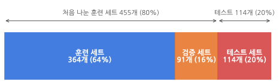
_569개의 샘플을 8:2로 두 번 나눈 결과예요._

### 2-2. 코드로 나누기

```python
x_train, x_val, y_train, y_val = train_test_split(
    x_train_all, y_train_all, stratify=y_train_all, test_size=0.2, random_state=1)
print(len(x_train), len(x_val))
```

```text
364 91
```

455개였던 훈련 세트가 훈련 세트 364개와 검증 세트 91개로 나뉘었어요. `stratify=y_train_all`도 잊지 말고 넣어 주세요. 검증 세트에서도 악성과 양성 종양의 비율이 그대로 유지돼요.

이제 훈련은 `x_train`으로, 평가는 `x_val`로 해 봅시다.

```python
sgd = SGDClassifier(loss='log_loss', random_state=42)
sgd.fit(x_train, y_train)
sgd.score(x_val, y_val)
```

```text
0.8901098901098901
```

약 89%예요. 앞에서 본 93%보다 낮아졌죠. 이유는 간단해요. 훈련에 쓴 데이터가 455개에서 364개로 **줄었기 때문**이에요. 공부한 양이 줄었으니 점수가 떨어질 수 있어요.

> **훈련 세트가 너무 작아져도 곤란해요**
> 검증 세트를 떼어 내면 그만큼 훈련 데이터가 줄어들어요. 데이터가 원래 적다면 이게 꽤 큰 손해일 수 있죠. 이 문제를 해결하는 방법은 파트 8의 **교차 검증**에서 다룰게요.
{: .prompt-warning }

### 2-3. 데이터가 적으면 점수가 크게 흔들려요

위스콘신 유방암 데이터는 569개로 샘플이 적은 편이에요. 그래서 **어떻게 나누느냐**에 따라 검증 점수가 꽤 달라져요. 검증 세트를 나눌 때의 `random_state`만 0부터 4까지 바꿔 봤어요.

| random_state | 0 | 1 | 2 | 3 | 4 |
|---|---|---|---|---|---|
| 검증 정확도 | 0.802 | 0.890 | 0.890 | 0.901 | 0.890 |

모델도 설정도 똑같은데, 나누는 방식만 바꿨더니 80%에서 90%까지 차이가 나요. 검증 세트가 91개뿐이라 몇 개만 더 틀려도 점수가 크게 바뀌는 거예요.

데이터가 많다면 이런 걱정이 줄어들어요. 그래서 데이터 양에 따라 나누는 비율도 달라집니다.

| 데이터 양 | 훈련 : 검증 : 테스트 |
|---|---|
| 수천 개 정도 | 6 : 2 : 2 |
| 10만 개 정도 | 8 : 1 : 1 |
| 100만 개 이상 | 98 : 1 : 1 |

검증 세트와 테스트 세트에 각각 1만 개 정도만 있어도 평가는 충분히 안정적이에요. 그 이상은 **훈련 세트에 몰아주는 게** 이득이에요.

> **잠깐 정리**
> - 테스트 세트로 튜닝하면 테스트 세트의 정보가 모델에 새어 나가요.
> - 튜닝은 **검증 세트**로 해요.
> - 훈련, 검증, 테스트 세트는 보통 6:2:2 정도로 나눠요. 실제로는 8:2로 두 번 나눕니다.
{: .prompt-tip }

---

## 파트 3. 특성의 스케일과 학습률

### 3-1. 데이터 전처리와 스케일

사이킷런에 들어 있는 데이터는 실습용이라 깔끔하게 정리되어 있어요. 하지만 실제로 모은 데이터는 그렇지 않아요. 빠진 값이 있기도 하고, 같은 항목인데 형식이 제각각이기도 해요. 이런 데이터를 모델에 넣기 좋게 다듬는 과정을 **데이터 전처리(data preprocessing)**라고 해요.

그런데 깔끔하게 정리된 데이터도 전처리가 필요할 때가 있어요. **특성의 스케일(scale)**이 서로 다를 때예요. 스케일은 어떤 특성이 가지는 **값의 범위**를 말해요.

| | 당도 | 무게(g) |
|---|---|---|
| 사과 1 | 4 | 540 |
| 사과 2 | 8 | 700 |
| 사과 3 | 2 | 480 |

이 표는 빠진 값도 없고 형식도 깔끔해요. 하지만 당도는 1~10 사이이고 무게는 500~1,000 사이예요. 이럴 때 **두 특성의 스케일 차이가 크다**고 말해요.

어떤 알고리즘은 스케일에 별로 영향을 받지 않지만, 우리가 쓰는 **경사 하강법은 스케일에 아주 민감해요.** 그래서 특성의 스케일을 맞춰 주는 전처리를 해야 해요. 이걸 **스케일을 조정한다**고 말합니다.

### 3-2. 종양 데이터의 스케일 확인하기

2편에서 박스 플롯으로 특성 30개를 살펴봤을 때, 특성마다 값의 크기가 많이 달랐어요. 그중 세 번째와 네 번째 특성인 `mean perimeter`(평균 둘레)와 `mean area`(평균 넓이)만 뽑아서 비교해 볼게요.

```python
import matplotlib.pyplot as plt

print(cancer.feature_names[[2, 3]])
plt.boxplot(x_train[:, 2:4])
plt.xlabel('feature')
plt.ylabel('value')
plt.show()
```

```text
['mean perimeter' 'mean area']
```

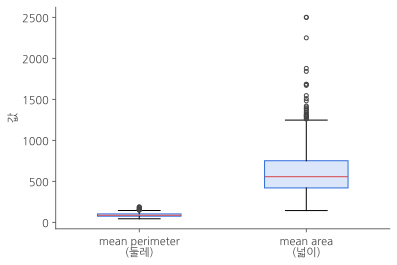
_둘레는 바닥에 납작하게 붙어 있고, 넓이는 수백에서 2,500까지 퍼져 있어요._

훈련 세트에서 둘레는 44~189 사이인데, 넓이는 144~2,501 사이예요. 평균만 봐도 둘레는 약 92, 넓이는 약 650으로 일곱 배 넘게 차이 나요. 이렇게 스케일이 다른 두 특성으로 경사 하강법을 쓰면 가중치가 어떻게 바뀔까요? 확인하기 전에 준비할 게 하나 있어요.

### 3-3. 학습률: 한 번에 얼마나 고칠까

지금까지 우리 뉴런은 가중치를 이렇게 고쳤어요.

```python
self.w -= w_grad
```

그레이디언트를 **그대로** 빼서 가중치를 고친 거예요. 여기에 **학습률(learning rate)**이라는 값을 곱해서, 한 번에 고치는 양을 조절해 볼게요.

$$
w \leftarrow w - \eta \times \frac{\partial L}{\partial w}
$$

η(에타)가 학습률이에요. 말로 풀면 **"그레이디언트가 알려 주는 방향으로 가되, 학습률만큼만 가라"**는 뜻이에요. 학습률도 사람이 정해 주는 하이퍼파라미터입니다.

손실 함수를 그래프로 그리면 보통 아주 복잡하게 휘어진 면이에요. 가중치가 30개라면 30차원 공간에 펼쳐진 면이라 머릿속에 그리기도 어렵죠. 여기서는 가중치가 하나뿐인 단순한 경우로 학습률의 영향을 살펴볼게요.

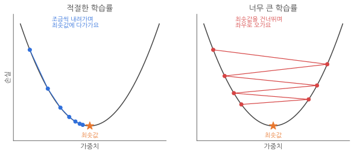
_학습률이 적절하면 차근차근 내려가고, 너무 크면 최솟값을 건너뛰며 오락가락해요._

- **학습률이 적절하면** 가중치가 조금씩 바뀌면서 손실이 가장 작은 지점(**전역 최솟값**)에 안정적으로 다가가요. 이런 모습을 "손실 함수의 표면을 천천히 따라 내려가며 최솟값을 찾는다"고 말해요.
- **학습률이 너무 크면** 한 번에 너무 많이 움직여서 최솟값을 지나쳐 버려요. 심하면 점점 더 멀어지기도 합니다.
- **학습률이 너무 작으면** 방향은 맞지만 너무 조금씩 움직여서 최솟값까지 가는 데 오래 걸려요.

알맞은 학습률은 문제마다 달라요. 보통 0.1, 0.01, 0.001처럼 **10배씩 차이 나게**(로그 스케일) 바꿔 가며 시험해 봅니다.

### 3-4. SingleLayer 클래스 고치기: 가중치 기록과 학습률

2편의 `SingleLayer` 클래스에 두 가지를 추가할게요.

1. 가중치가 바뀔 때마다 그 값을 기록하는 `w_history` 리스트
2. 학습률을 받는 `learning_rate` 매개변수

```python
def __init__(self, learning_rate=0.1):
    self.w = None
    self.b = None
    self.losses = []
    self.w_history = []                    # 가중치의 변화를 기록
    self.lr = learning_rate                # 학습률
```

`fit()` 메서드도 고쳐요.

```python
def fit(self, x, y, epochs=100):
    self.w = np.ones(x.shape[1])           # 가중치를 초기화
    self.b = 0                             # 절편을 초기화
    self.w_history.append(self.w.copy())   # 처음 가중치를 기록
    np.random.seed(42)                     # 섞는 순서를 고정
    for i in range(epochs):                # epochs만큼 반복
        loss = 0
        indexes = np.random.permutation(np.arange(len(x)))   # 인덱스를 섞는다
        for i in indexes:                  # 모든 샘플에 대해 반복
            z = self.forpass(x[i])         # 정방향 계산
            a = self.activation(z)         # 활성화 함수 적용
            err = -(y[i] - a)              # 오차 계산
            w_grad, b_grad = self.backprop(x[i], err)   # 역방향 계산
            self.w -= self.lr * w_grad     # 가중치 업데이트 (학습률 적용)
            self.b -= b_grad               # 절편 업데이트
            self.w_history.append(self.w.copy())   # 가중치를 기록
            a = np.clip(a, 1e-10, 1 - 1e-10)       # 안전한 로그 계산을 위해
            loss += -(y[i] * np.log(a) + (1 - y[i]) * np.log(1 - a))
        self.losses.append(loss / len(y))  # 에포크마다 평균 손실을 저장
```

바뀐 곳은 세 군데예요.

| 바뀐 부분 | 이유 |
|---|---|
| `self.w_history.append(self.w.copy())` | 가중치가 바뀔 때마다 기록해요. 나중에 그래프로 그려 볼 거예요. |
| `self.w -= self.lr * w_grad` | 그레이디언트에 학습률을 곱해서 고치는 양을 조절해요. |
| `np.random.seed(42)`를 `fit()` 안으로 | 2편에서는 밖에서 시드를 정했어요. 안으로 옮기면 `fit()`을 부를 때마다 같은 순서로 섞여서, 모델 여러 개를 비교하기 좋아요. |

> **왜 `copy()`를 써야 하나요?**
> 넘파이 배열을 리스트에 그냥 넣으면 값이 복사되는 게 아니라 **배열 자체를 가리키는 연결**만 들어가요. 그러면 나중에 `self.w`가 바뀔 때 리스트에 넣어 둔 값도 같이 바뀌어서, 결국 리스트에 똑같은 마지막 가중치만 수천 개 쌓여요. `copy()`로 그 순간의 값을 따로 복사해 둬야 기록이 남습니다.
{: .prompt-warning }

> 절편 `b`에는 학습률을 곱하지 않았어요. 이번 실험의 관심은 가중치가 움직이는 모습이라 절편은 그대로 두었습니다. 절편에도 학습률을 곱해도 괜찮아요.
{: .prompt-info }

### 3-5. 스케일을 조정하지 않고 훈련하기

```python
layer1 = SingleLayer()
layer1.fit(x_train, y_train)
layer1.score(x_val, y_val)
```

```text
0.945054945054945
```

검증 세트 정확도는 약 95%예요. 나쁘지 않네요. 그럼 가중치가 어떻게 움직였는지 볼게요. `w_history`에는 100번의 에포크 동안 바뀐 가중치가 모두 들어 있어요. 이 중에서 세 번째, 네 번째 값(`w[2]`, `w[3]`)이 각각 둘레와 넓이의 가중치예요.

```python
w2 = []
w3 = []
for w in layer1.w_history:
    w2.append(w[2])
    w3.append(w[3])
plt.plot(w2, w3)
plt.plot(w2[-1], w3[-1], 'ro')             # 최종 가중치는 빨간 점
plt.xlabel('w[2]')
plt.ylabel('w[3]')
plt.show()
```

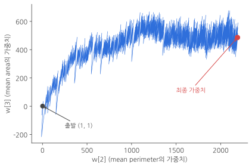
_가로축은 둘레의 가중치, 세로축은 넓이의 가중치예요. 1에서 출발해 수백, 수천까지 크게 움직이고, 위아래로 심하게 흔들려요._

1에서 출발한 가중치가 **둘레는 2,000 넘게, 넓이는 600 근처까지** 커졌어요. 그리고 선이 굵은 띠처럼 보일 정도로 **위아래로 심하게 요동쳐요.** 넓이의 가중치는 샘플 하나를 볼 때마다 한 번에 수십에서 수백씩 오르내렸어요.

왜 이렇게 될까요? 2편에서 본 가중치 그레이디언트의 식을 떠올려 보세요.

$$
\frac{\partial L}{\partial w_i} = -(y - a) \times x_i
$$

그레이디언트에 **특성값 x가 그대로 곱해져요.** 넓이처럼 값이 큰 특성은 그레이디언트도 덩달아 커지고, 그만큼 가중치가 한 번에 크게 움직여요. 이런 상황을 **"w[3]에 대한 그레이디언트가 커서 w[3] 방향으로 가중치가 크게 요동친다"**고 말해요. 가중치가 최적값에 차분히 다가가지 못하고 **불안정하게 수렴**하는 거죠.

정확도가 95%로 나쁘지 않았던 건 다행이지만, 이렇게 흔들리는 모델은 섞는 순서 같은 작은 차이에도 결과가 크게 달라질 수 있어요. 2편 마지막에 "정확도가 73~94%로 흔들린다"고 했던 것도 같은 원인이었어요. 이 문제는 **스케일을 조정하면** 해결됩니다.

---

## 파트 4. 스케일을 조정해 모델을 훈련합니다

### 4-1. 표준화: 평균은 0, 표준 편차는 1로

스케일을 조정하는 방법은 여러 가지인데, 신경망에서 많이 쓰는 방법은 **표준화(standardization)**예요. 각 특성값에서 **평균을 빼고 표준 편차로 나누면** 돼요.

$$
z = \frac{x - \mu}{s}
$$

- μ(뮤): 그 특성의 평균
- s: 그 특성의 표준 편차

말로 풀면 **"이 값이 평균에서 표준 편차 몇 개만큼 떨어져 있나"**를 계산하는 거예요. 예를 들어 어떤 사과의 무게가 평균보다 표준 편차 두 개만큼 무겁다면 z = 2, 당도가 평균보다 표준 편차 한 개만큼 낮다면 z = -1이 돼요. 원래 단위가 g이든 당도든, 표준화하고 나면 **모두 같은 잣대**로 비교할 수 있어요.

표준화한 특성은 평균이 0, 표준 편차가 1이 돼요(분산도 1이에요).

> **표준 편차의 공식이 궁금해요**
> 표준 편차(standard deviation)는 데이터가 평균을 중심으로 얼마나 흩어져 있는지를 나타내는 값이에요. 각 값이 평균에서 떨어진 거리를 제곱해서 평균을 낸 것이 **분산(variance)**이고, 분산의 제곱근이 표준 편차예요.
>
> $$
> s = \sqrt{\frac{1}{m}\sum_{i=1}^{m}(x_i - \mu)^2}
> $$
>
> m은 샘플의 개수, μ는 평균이에요. 거리를 제곱하는 이유는 평균보다 큰 값(+)과 작은 값(-)이 서로 지워지지 않게 하기 위해서고, 마지막에 제곱근을 씌우면 원래 단위로 돌아와요.
>
> 표준 편차가 잘 와닿지 않는다면 [보충 글: 평균, 분산, 표준 편차 쉽게 이해하기](/posts/ml-basics-extra-01-mean-variance-std/)에서 숫자 5개로 직접 계산해 보세요.
{: .prompt-info }

### 4-2. 넘파이로 표준화하기

사이킷런에는 표준화를 해 주는 `StandardScaler` 클래스가 있지만, 원리를 이해하려고 먼저 직접 해 볼게요. 넘파이의 `mean()`, `std()` 함수를 쓰면 간단해요.

```python
import numpy as np

train_mean = np.mean(x_train, axis=0)
train_std = np.std(x_train, axis=0)
x_train_scaled = (x_train - train_mean) / train_std
```

`axis=0`은 **열(세로) 방향으로 계산하라**는 뜻이에요. 그러면 특성 30개 각각의 평균과 표준 편차가 계산되어, 길이 30짜리 배열로 나와요. `x_train`은 (364, 30) 모양의 2차원 배열이고 `train_mean`은 길이 30인 배열인데, 넘파이가 알아서 모든 행에 똑같이 빼고 나눠 줘요. 이 기능을 **브로드캐스팅**이라고 해요.

이제 표준화한 데이터로 다시 훈련하고, 가중치가 움직인 모습을 그려 봅시다.

```python
layer2 = SingleLayer()
layer2.fit(x_train_scaled, y_train)
w2 = []
w3 = []
for w in layer2.w_history:
    w2.append(w[2])
    w3.append(w[3])
plt.plot(w2, w3)
plt.plot(w2[-1], w3[-1], 'ro')
plt.xlabel('w[2]')
plt.ylabel('w[3]')
plt.show()
```

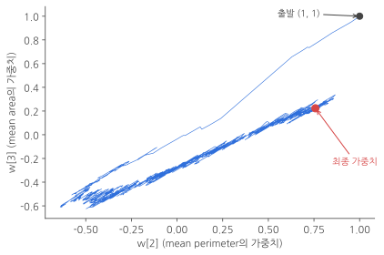
_1에서 출발해 -0.6~1 사이에서만 움직이고, 대각선 방향으로 곧게 내려가요._

앞의 그래프와 완전히 달라요. 가중치가 **-0.6에서 1 사이**에서만 움직이고, 두 가중치가 **비슷한 비율로** 바뀌어서 대각선 방향으로 곧게 내려가요. 두 특성의 스케일이 비슷해지니 어느 한쪽만 크게 흔들리는 일이 없어진 거예요. 이처럼 경사 하강법에서는 **특성의 스케일을 맞추는 것이 아주 중요**합니다.

### 4-3. 첫 번째 함정: 검증 세트를 변환하지 않았어요

이제 검증 세트로 평가해 볼까요?

```python
layer2.score(x_val, y_val)
```

```text
0.37362637362637363
```

정확도가 **37%**예요. 동전 던지기보다도 못하죠. 무슨 일일까요?

이 모델은 **표준화한 데이터**로 훈련했어요. 그래서 들어오는 데이터도 평균 0, 표준 편차 1 근처의 값일 거라고 기대해요. 그런데 검증 세트는 원래 값(넓이 600, 둘레 90 같은 값)을 그대로 넣었어요. 모델이 알던 세상과 전혀 다른 숫자가 들어온 거예요. **훈련 세트에 한 전처리는 검증 세트에도 똑같이 해 줘야 합니다.**

### 4-4. 두 번째 함정: 검증 세트를 자기 평균으로 표준화했어요

그럼 검증 세트도 표준화해 볼게요. 훈련 세트에서 한 것처럼 검증 세트의 평균과 표준 편차를 구해서요.

```python
val_mean = np.mean(x_val, axis=0)
val_std = np.std(x_val, axis=0)
x_val_wrong = (x_val - val_mean) / val_std
layer2.score(x_val_wrong, y_val)
```

```text
0.967032967032967
```

약 97%예요. 해결된 것 같죠? 하지만 여기에는 눈에 잘 띄지 않는 함정이 숨어 있어요.

훈련 세트는 **훈련 세트의 평균과 표준 편차**로, 검증 세트는 **검증 세트의 평균과 표준 편차**로 변환했어요. 두 세트를 **서로 다른 잣대**로 변환한 거예요. 실제로 두 세트의 통계값은 조금씩 달라요.

| | mean radius 평균 | mean radius 표준 편차 | mean texture 평균 | mean texture 표준 편차 |
|---|---|---|---|---|
| 훈련 세트 | 14.07 | 3.53 | 19.40 | 4.32 |
| 검증 세트 | 13.86 | 3.24 | 18.94 | 3.95 |

이 차이가 어떤 결과를 만드는지 그림으로 확인해 볼게요. 첫 번째, 두 번째 특성(`mean radius`, `mean texture`)으로 훈련 세트와 검증 세트를 50개씩 찍었어요.

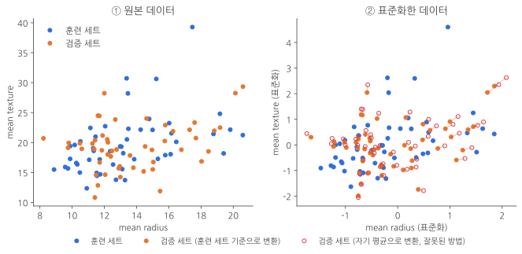
_오른쪽 그림에서 주황색 점(올바른 변환)과 빨간 빈 원(잘못된 변환)이 선으로 이어져 있어요. 같은 샘플인데 위치가 달라졌어요._

왼쪽은 원본 데이터, 오른쪽은 표준화한 데이터예요. 오른쪽에서 **주황색 점**은 검증 세트를 훈련 세트의 평균과 표준 편차로 변환한 위치이고, **빨간 빈 원**은 검증 세트를 자기 평균과 표준 편차로 변환한 위치예요. 같은 샘플끼리 선으로 이었어요.

주황색 점들은 왼쪽 원본 그림과 **훈련 세트와의 상대적인 위치가 똑같아요.** 반면 빨간 빈 원은 모두 조금씩 오른쪽 위로 밀려 있어요. 검증 세트의 평균이 훈련 세트보다 조금 작아서, 자기 평균을 빼면 값이 상대적으로 커지기 때문이에요. 결국 훈련 세트와 검증 세트 **사이의 거리가 원본과 달라졌어요.** 전처리를 제대로 했다면 이 거리는 그대로 유지되어야 해요.

모델 입장에서 생각해 볼까요? 모델은 훈련 세트를 보고 "둘레가 이 정도면 악성"이라는 기준을 배웠어요. 그런데 검증 세트를 다른 잣대로 변환하면 같은 크기의 종양이 다른 숫자로 바뀌어서 들어와요. **모델이 샘플을 잘못 읽게 되는 거죠.**

실제 서비스를 생각하면 문제가 더 분명해져요. 모델을 실제로 쓸 때는 환자 데이터가 **한 건씩** 들어와요. 샘플이 하나뿐이면 평균과 표준 편차를 계산할 수도 없죠. 그러니 **새 데이터는 언제나 훈련 세트의 평균과 표준 편차로 변환**해야 해요. 검증 세트와 테스트 세트도 마찬가지예요.

### 4-5. 올바르게 검증 세트 전처리하기

```python
x_val_scaled = (x_val - train_mean) / train_std
layer2.score(x_val_scaled, y_val)
```

```text
0.978021978021978
```

약 98%예요. 잘못된 방법(96.7%)보다 샘플 하나를 더 맞혔어요. 91개 중 89개를 맞힌 거예요.

데이터 세트가 작아서 차이가 한 개뿐이지만, 검증 세트가 크거나 훈련 세트와 검증 세트의 분포가 더 다르면 차이가 훨씬 커질 수 있어요. 결과가 우연히 비슷하게 나오더라도 **방법 자체가 틀린 것**이니 꼭 올바른 방법을 써야 해요.

> **잠깐 정리**
> - 경사 하강법을 쓸 때는 특성의 스케일을 맞춰요. 대표적인 방법은 **표준화**예요.
> - 훈련 세트에 한 전처리는 검증 세트와 테스트 세트에도 해야 해요.
> - 그때는 **훈련 세트의 평균과 표준 편차**를 써요. 검증 세트나 테스트 세트의 통계값을 쓰면 안 돼요.
{: .prompt-tip }

---

## 파트 5. 과대적합과 과소적합

### 5-1. 외우기만 한 모델, 덜 배운 모델

이제 훈련 세트와 검증 세트에서의 성능을 함께 놓고 비교해 볼 거예요. 두 점수를 같이 보면 모델의 상태를 진단할 수 있어요.

- **과대적합(overfitting)**: 훈련 세트에서는 성능이 좋은데 검증 세트에서는 성능이 낮은 경우예요. 예를 들어 훈련 세트 정확도가 99%인데 검증 세트 정확도가 80%라면 과대적합을 의심해 볼 수 있어요. 시험지 답을 외운 학생처럼 **훈련 데이터에만 지나치게 맞춰진** 상태예요.
- **과소적합(underfitting)**: 훈련 세트와 검증 세트의 성능이 비슷한데 **둘 다 낮은** 경우예요. 아직 덜 배운 상태죠.

### 5-2. 학습 곡선으로 진단하기

훈련 세트의 크기를 늘려 가면서 훈련 세트와 검증 세트의 정확도를 그린 그래프를 **학습 곡선(learning curve)**이라고 해요. 대표적인 세 가지 모습을 보세요.

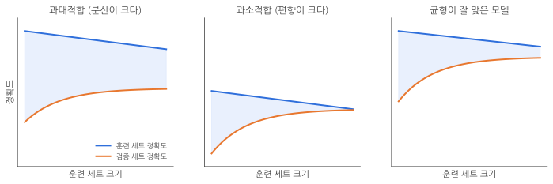
_파란 선은 훈련 세트 정확도, 주황 선은 검증 세트 정확도예요. 하늘색 영역이 두 성능의 차이예요._

**① 과대적합**: 훈련 세트와 검증 세트의 성능 차이가 커요. 그래서 과대적합된 모델을 **"분산이 크다(high variance)"**고도 말해요.

과대적합의 주요 원인 중 하나는 훈련 세트에 **다양한 패턴의 샘플이 충분하지 않은 것**이에요. 훈련 세트에서 못 본 패턴이 검증 세트에 나오니 제대로 맞히지 못하는 거죠. 해결 방법은 두 가지예요.

- **훈련 샘플을 더 모아요.** 다양한 패턴을 보면 검증 세트 성능이 올라가요.
- 샘플을 더 모을 수 없다면 **가중치를 제한해서** 모델이 훈련 세트에 너무 집착하지 않게 해요. 이걸 **모델의 복잡도를 낮춘다**고 말해요. 방법은 파트 7에서 배워요.

**② 과소적합**: 두 성능의 차이는 점점 줄어들지만 **성능 자체가 낮아요.** 과소적합된 모델을 **"편향이 크다(high bias)"**고도 말해요. 모델이 너무 단순해서 데이터에 있는 패턴을 다 잡아내지 못하는 상태예요. 해결하려면 **더 복잡한 모델**을 쓰거나 가중치에 대한 제한을 풀어 줘요.

**③ 균형 잡힌 모델**: 과대적합과 과소적합 사이에서 적절한 균형을 찾은 모습이에요. 훈련 세트 성능이 높고, 검증 세트 성능도 그에 가깝게 따라와요.

### 5-3. 에포크와 손실로 진단하기

2편에서 그렸던 **에포크에 따른 손실 그래프**로도 과대적합과 과소적합을 진단할 수 있어요. 그래서 이 그래프를 학습 곡선이라고 부르는 경우도 많아요.

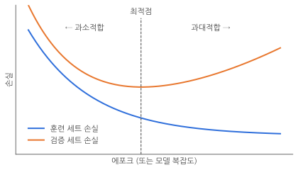
_훈련 세트 손실은 계속 줄지만, 검증 세트 손실은 최적점을 지나면 다시 올라가요._

- **훈련 세트 손실**은 에포크가 진행될수록 계속 줄어들어요. 훈련 세트를 계속 보니까 당연히 점점 잘 맞히게 돼요.
- **검증 세트 손실**은 처음에는 함께 줄다가, 어느 순간(**최적점**)을 지나면 **오히려 올라가요.** 최적점 이후에도 훈련을 계속하면 모델이 훈련 세트의 샘플에 너무 딱 맞춰지기 때문이에요. 과대적합이 시작된 거예요.
- 반대로 최적점에 도착하기 전에 멈추면 아직 덜 배운, **과소적합된** 모델이 돼요.

세로축을 손실 대신 정확도로 바꾸면 그래프가 위아래로 뒤집힐 뿐, 해석은 같아요.

가로축에 에포크 대신 **모델 복잡도**를 놓아도 비슷한 모양이 나와요. 모델 복잡도는 모델이 가진 **학습할 수 있는 가중치의 개수**를 말해요. 나중에 배울 층이나 뉴런의 개수가 많아지면 복잡도가 높아져요. 복잡한 모델이 무조건 좋을 것 같지만, 너무 복잡하면 훈련 세트에만 딱 맞는 모델이 되어 버려요. 그게 바로 과대적합이에요.

### 5-4. 편향-분산 트레이드오프

정리하면 과소적합된 모델은 **편향이 크고**, 과대적합된 모델은 **분산이 커요.** 이 둘의 관계를 **편향-분산 트레이드오프(bias-variance tradeoff)**라고 해요. 트레이드오프는 "하나를 얻으려면 다른 하나를 내줘야 한다"는 뜻이에요.

- **편향을 줄이면**(훈련 세트 성능을 높이면) **분산이 커져요**(검증 세트와의 성능 차이가 벌어져요).
- **분산을 줄이면**(검증 세트와의 성능 차이를 줄이면) **편향이 커져요**(훈련 세트 성능이 낮아져요).

그래서 둘 중 어느 쪽도 너무 커지지 않는 **알맞은 중간 지점**을 골라야 해요. 이걸 **적절한 편향-분산 트레이드오프를 선택한다**고 말합니다. 지금은 훈련 세트의 크기나 모델 복잡도를 바꾸기 어려우니, 다음 파트에서 **알맞은 에포크 수**를 찾는 것으로 이 선택을 해 볼게요.

---

## 파트 6. 검증 손실을 기록하고 조기 종료하기

### 6-1. 검증 세트의 손실 기록하기

훈련 세트의 손실은 이미 `losses`에 기록하고 있어요. 똑같이 검증 세트의 손실도 에포크마다 기록해 볼게요. 먼저 `__init__()`에 `val_losses` 리스트를 추가해요.

```python
def __init__(self, learning_rate=0.1):
    self.w = None
    self.b = None
    self.losses = []
    self.val_losses = []                   # 검증 세트의 손실을 기록
    self.w_history = []
    self.lr = learning_rate
```

`fit()` 메서드에는 검증 세트를 받는 `x_val`, `y_val` 매개변수를 추가하고, 에포크가 끝날 때마다 검증 손실을 계산하도록 한 줄을 넣어요.

```python
def fit(self, x, y, epochs=100, x_val=None, y_val=None):
    # ... 앞부분은 3-4와 같아요 ...
        self.losses.append(loss / len(y))  # 에포크마다 평균 손실을 저장
        self.update_val_loss(x_val, y_val) # 검증 세트의 손실을 계산
```

검증 손실은 새로 만든 `update_val_loss()` 메서드에서 계산해요.

```python
def update_val_loss(self, x_val, y_val):
    if x_val is None:                      # 검증 세트가 없으면 그냥 끝낸다
        return
    val_loss = 0
    for i in range(len(x_val)):
        z = self.forpass(x_val[i])         # 정방향 계산
        a = self.activation(z)             # 활성화 함수 적용
        a = np.clip(a, 1e-10, 1 - 1e-10)
        val_loss += -(y_val[i] * np.log(a) + (1 - y_val[i]) * np.log(1 - a))
    self.val_losses.append(val_loss / len(y_val))
```

훈련 세트의 손실을 계산하는 방식과 똑같아요. 샘플마다 정방향 계산을 하고, 활성화 함수를 통과시킨 뒤, 로지스틱 손실을 더해요. 다만 **가중치는 고치지 않아요.** 검증 세트는 평가만 하는 데이터니까요.

### 6-2. 손실 그래프 그리기

표준화한 훈련 세트와 검증 세트로 훈련하고, 두 손실을 함께 그려 볼게요.

```python
layer3 = SingleLayer()
layer3.fit(x_train_scaled, y_train, x_val=x_val_scaled, y_val=y_val)

plt.ylim(0, 0.15)
plt.plot(layer3.losses)
plt.plot(layer3.val_losses)
plt.ylabel('loss')
plt.xlabel('epoch')
plt.legend(['train_loss', 'val_loss'])
plt.show()
```

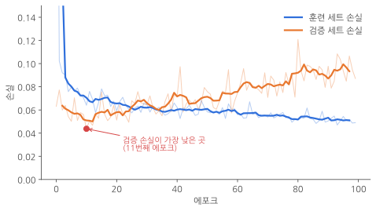
_흐린 선은 실제 값, 진한 선은 다섯 에포크씩 평균을 낸 값이에요._

손실은 확률적 경사 하강법 때문에 들쭉날쭉해서, 흐름이 잘 보이도록 다섯 에포크씩 평균을 낸 선을 진하게 겹쳐 그렸어요.

- **훈련 세트 손실(파란 선)**은 처음에 크게 떨어진 뒤 0.05 근처까지 **천천히 계속 줄어들어요.**
- **검증 세트 손실(주황 선)**은 **11번째 에포크**에서 가장 낮고(0.044), 그 뒤로는 오르락내리락하면서 **점점 올라가요.** 마지막 20 에포크의 평균은 약 0.094로, 같은 기간 훈련 세트 손실(약 0.052)보다 훨씬 높아요.

5-3에서 본 그림과 같은 모습이죠. 에포크가 진행될수록 가중치는 훈련 세트에 점점 더 잘 맞게 바뀌지만, 검증 세트에는 오히려 덜 맞게 되는 거예요. 이 모델은 **10번 정도 훈련하면 충분하고, 그 이상은 필요 없을 것 같아요.**

### 6-3. 훈련 조기 종료하기

이렇게 과대적합이 시작되기 전에 **훈련을 일찍 멈추는 방법**을 **조기 종료(early stopping)**라고 해요. 에포크를 10으로 정해서 다시 훈련해 볼게요.

```python
layer4 = SingleLayer()
layer4.fit(x_train_scaled, y_train, epochs=10)
layer4.score(x_val_scaled, y_val)
```

```text
0.989010989010989
```

100번 훈련했을 때 0.978(91개 중 89개)이던 검증 세트 정확도가 **0.989(91개 중 90개)**로 올라갔어요. 과대적합되기 전에 훈련을 멈춘 덕분이에요. 훈련 시간도 10분의 1로 줄었죠.

> **검증 세트가 작으면 최적점도 흔들려요**
> 에포크를 바꿔 가며 검증 정확도를 재 보면 5번은 0.978, 10번과 15번은 0.989, 20번·30번·50번·100번은 모두 0.978이었어요. 검증 세트가 91개뿐이라 샘플 하나 차이로 점수가 바뀌어요. 그래서 정확도 하나만 보기보다 **손실 그래프의 흐름**을 같이 보고 판단하는 게 좋아요.
{: .prompt-info }

---

## 파트 7. 규제: 가중치가 너무 커지지 않게 붙잡기

### 7-1. 경사가 완만한 모델이 더 좋은 이유

파트 5에서 과대적합을 줄이는 방법 중 하나로 **가중치를 제한하는 것**을 이야기했어요. 이걸 **가중치 규제(regularization)**라고 해요. 말 그대로 **가중치의 값이 너무 커지지 않도록 제한하는 방법**이에요. 가중치를 규제하면 모델의 일반화 성능이 올라가요. 왜 그런지 그림으로 볼게요.

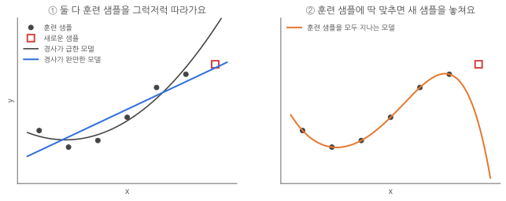
_검은 점은 훈련 샘플, 빨간 네모는 훈련 때 보지 못한 새로운 샘플이에요._

왼쪽 그림의 두 모델은 모두 훈련 샘플(검은 점) 여섯 개를 그럭저럭 따라가요. 둘 중 어느 모델이 더 좋을까요? 새로운 샘플(빨간 네모)을 보면 **경사가 완만한 모델**이 훨씬 가깝게 지나가요. 경사가 급한 모델은 훈련 샘플 근처에서는 괜찮지만 조금만 벗어나도 크게 빗나가요.

오른쪽 그림은 훈련 샘플 여섯 개를 **모두 정확히 지나가는** 모델이에요. 훈련 세트에서는 오차가 0이니 완벽해 보이지만, 새로운 샘플은 전혀 맞히지 못해요. 몇 개의 데이터에 **집착한** 거예요. 이런 모델은 **일반화되지 않았다**고 말해요.

규제를 써서 가중치를 제한하면 모델이 몇 개의 데이터에 집착하지 않게 되고, 일반화 성능이 높아져요. 대표적인 규제 방법인 **L1 규제**와 **L2 규제**를 차례로 알아볼게요.

### 7-2. L1 규제: 가중치의 절댓값을 손실에 더하기

L1 규제는 손실 함수에 **가중치의 절댓값을 모두 더한 값**을 더해요. 이 값을 **L1 노름(norm)**이라고 해요.

$$
\lVert \mathbf{w} \rVert_1 = \sum_{i=1}^{n} |w_i|
$$

n은 가중치의 개수예요. 굵게 쓴 **w**는 가중치 여러 개를 묶은 **벡터**라는 뜻이고요. 결국 L1 노름은 **"가중치 크기의 합"**이에요.

2편에서 배운 로지스틱 손실 함수는 이랬어요.

$$
L = -\left(y\log(a) + (1-y)\log(1-a)\right)
$$

여기에 L1 노름을 더하면 L1 규제가 돼요. 이때 그냥 더하지 않고, 규제의 세기를 조절하는 값 **α(알파)**를 곱해서 더해요.

$$
L = -\left(y\log(a) + (1-y)\log(1-a)\right) + \alpha\sum_{i=1}^{n}|w_i|
$$

말로 풀면 **"틀린 정도 + 가중치가 큰 정도"를 함께 줄여라**는 뜻이에요. 이제 모델은 손실을 줄이려면 잘 맞히는 것뿐 아니라 **가중치도 작게 유지**해야 해요.

- **α가 크면** 가중치가 조금만 커져도 손실이 확 커져요. 그래서 가중치가 작아질 수밖에 없어요. **규제가 강하다**고 말해요.
- **α가 작으면** 가중치가 커져도 손실이 별로 늘지 않아요. **규제가 약하다**고 말해요.

α도 사람이 정해 줘야 하는 하이퍼파라미터예요.

**L1 규제의 미분**

경사 하강법으로 가중치를 고치려면 이 손실 함수를 가중치에 대해 미분해야 해요. 로지스틱 손실 함수 부분은 2편에서 이미 미분했으니, 규제 부분만 미분하면 돼요.

절댓값 |w|를 w로 미분하면 **w의 부호만 남아요.** w가 양수면 +1, 음수면 -1이에요. 이걸 sign(w)라고 써요.

$$
\frac{\partial L}{\partial \mathbf{w}} = -(y - a)\mathbf{x} + \alpha \times \mathrm{sign}(\mathbf{w})
$$

이걸 3-3에서 배운 학습률 η와 함께 가중치 업데이트 식에 넣으면 다음과 같아요.

$$
\mathbf{w} \leftarrow \mathbf{w} - \eta\frac{\partial L}{\partial \mathbf{w}} = \mathbf{w} + \eta\left((y - a)\mathbf{x} - \alpha \times \mathrm{sign}(\mathbf{w})\right)
$$

생각보다 간단하죠? 원래 그레이디언트에 **α × (가중치의 부호)**를 더해 주기만 하면 돼요. 이 항은 가중치가 양수면 줄이는 쪽으로, 음수면 늘리는 쪽으로 밀어서 **가중치를 늘 0 쪽으로 끌어당겨요.** 코드로는 한 줄이에요.

```python
w_grad += alpha * np.sign(w)
```

넘파이의 `np.sign()` 함수는 배열 요소마다 부호를 돌려줘요(양수는 1, 음수는 -1, 0은 0).

> **절편은 규제하지 않아요**
> 위 식에는 가중치만 있고 절편 b는 없어요. 절편은 모델을 위아래로 옮길 뿐, 7-1의 그림처럼 **경사를 급하게 만들지는 않아요.** 그래서 모델의 복잡도와 상관이 없어 규제하지 않습니다.
{: .prompt-info }

**라쏘(Lasso)**

1편의 선형 회귀처럼 숫자를 예측하는 회귀 모델에도 똑같은 원리로 L1 규제를 더할 수 있어요. 제곱 오차에 L1 규제를 더한 회귀 모델을 **라쏘(Lasso)**라고 불러요. 라쏘는 가중치를 줄이다 못해 **일부 가중치를 아예 0으로** 만들기도 해요. 가중치가 0인 특성은 모델이 쓰지 않는다는 뜻이니, 쓸모 있는 특성만 골라내는 효과가 있어요. 사이킷런에서는 `sklearn.linear_model.Lasso` 클래스로 쓸 수 있어요.

다만 L1 규제는 가중치가 크든 작든 **똑같이 α만큼** 끌어당겨요(부호만 보니까요). 그래서 규제의 효과가 α 값 하나에 크게 좌우돼요. 다음으로 볼 L2 규제는 이 점에서 더 유연해요.

### 7-3. L2 규제: 가중치의 제곱을 손실에 더하기

L2 규제는 손실 함수에 **가중치를 제곱해서 모두 더한 값**을 더해요. 가중치의 L2 노름은 이렇게 정의돼요.

$$
\lVert \mathbf{w} \rVert_2 = \sqrt{\sum_{i=1}^{n} |w_i|^2}
$$

L2 규제에서는 이 L2 노름을 **제곱해서** 손실 함수에 더해요(그러면 제곱근이 사라져요). α는 L1 규제와 마찬가지로 규제의 세기를 조절하는 값이고, 앞에 붙은 1/2은 미분 결과를 깔끔하게 만들려고 넣은 거예요.

$$
L = -\left(y\log(a) + (1-y)\log(1-a)\right) + \frac{1}{2}\alpha\sum_{i=1}^{n}|w_i|^2
$$

**L2 규제의 미분**

w²을 미분하면 2w가 되고, 앞의 1/2과 만나서 **w만 남아요.**

$$
\frac{\partial L}{\partial \mathbf{w}} = -(y - a)\mathbf{x} + \alpha \times \mathbf{w}
$$

가중치 업데이트 식에 넣으면 다음과 같아요.

$$
\mathbf{w} \leftarrow \mathbf{w} - \eta\frac{\partial L}{\partial \mathbf{w}} = \mathbf{w} + \eta\left((y - a)\mathbf{x} - \alpha \times \mathbf{w}\right)
$$

코드도 한 줄이에요.

```python
w_grad += alpha * w
```

L1 규제와 비교해 보면 차이가 보여요. L2 규제는 그레이디언트에 **가중치 값 자체**가 들어가요. 그래서 **큰 가중치는 세게, 작은 가중치는 살살** 끌어당겨요. 부호만 보는 L1 규제보다 조금 더 효과적이에요. 또 가중치가 0에 가까워질수록 당기는 힘도 약해지니, 가중치를 **완전히 0으로 만들지는 않아요.** 가중치를 0으로 만들면 특성을 빼는 효과는 있지만 그만큼 모델이 쓸 수 있는 정보가 줄어들죠. 이런 이유로 실무에서는 **L2 규제를 더 많이 써요.**

**릿지(Ridge)**

회귀 모델에 L2 규제를 더한 것을 **릿지(Ridge)**라고 해요. 사이킷런에서는 `sklearn.linear_model.Ridge` 클래스로 제공해요. `SGDClassifier`에서는 `penalty` 매개변수를 `'l2'`로 정하면 L2 규제를 쓸 수 있어요(사실 `SGDClassifier`의 기본값이 `'l2'`예요). 두 클래스 모두 규제의 세기는 `alpha` 매개변수로 정해요.

### 7-4. L1 규제와 L2 규제 정리

| | L1 규제 | L2 규제 |
|---|---|---|
| 손실 함수에 더하는 값 | α × (가중치 절댓값의 합) | ½ × α × (가중치 제곱의 합) |
| 그레이디언트에 더하는 값 | `alpha * np.sign(w)` | `alpha * w` |
| 끌어당기는 힘 | 가중치 크기와 상관없이 일정 | 큰 가중치일수록 세게 |
| 가중치를 0으로 | 만들 수 있어요 (특성 선택 효과) | 0에 가까워지지만 0이 되지는 않아요 |
| 회귀 모델 이름 | 라쏘 (`Lasso`) | 릿지 (`Ridge`) |
| 많이 쓰는 쪽 | | ✓ |

### 7-5. SingleLayer 클래스에 규제 추가하기

이제 `SingleLayer` 클래스에 L1 규제와 L2 규제를 모두 넣어 볼게요. 바꿀 곳은 네 군데예요.

**① `__init__()`에 규제 강도를 정하는 `l1`, `l2` 매개변수 추가.** 기본값은 0이고, 0이면 규제를 하지 않아요.

```python
def __init__(self, learning_rate=0.1, l1=0, l2=0):
    self.w = None
    self.b = None
    self.losses = []
    self.val_losses = []
    self.w_history = []
    self.lr = learning_rate
    self.l1 = l1                           # L1 규제의 강도
    self.l2 = l2                           # L2 규제의 강도
```

**② `fit()`의 역방향 계산 뒤에 규제 항의 미분값 더하기.** L1 규제와 L2 규제를 따로 쓰지 않고 한 줄로 썼어요. 그래서 두 규제를 동시에 쓸 수도 있어요.

```python
w_grad, b_grad = self.backprop(x[i], err)
w_grad += self.l1 * np.sign(self.w) + self.l2 * self.w   # 규제 항의 미분값을 더한다
self.w -= self.lr * w_grad
```

**③ 손실을 계산할 때 규제 항의 값 더하기.** `reg_loss()` 메서드를 새로 만들어요.

```python
def reg_loss(self):
    return self.l1 * np.sum(np.abs(self.w)) + self.l2 / 2 * np.sum(self.w ** 2)
```

**④ 훈련 세트와 검증 세트의 손실에 `reg_loss()` 더하기.**

```python
self.losses.append(loss / len(y) + self.reg_loss())               # fit() 안
self.val_losses.append(val_loss / len(y_val) + self.reg_loss())   # update_val_loss() 안
```

지금까지 고친 내용을 모두 합친 전체 클래스예요. 그대로 복사해서 쓸 수 있어요.

```python
class SingleLayer:

    def __init__(self, learning_rate=0.1, l1=0, l2=0):
        self.w = None
        self.b = None
        self.losses = []                       # 훈련 세트의 손실
        self.val_losses = []                   # 검증 세트의 손실
        self.w_history = []                    # 가중치의 변화
        self.lr = learning_rate                # 학습률
        self.l1 = l1                           # L1 규제의 강도
        self.l2 = l2                           # L2 규제의 강도

    def forpass(self, x):
        z = np.sum(x * self.w) + self.b        # 직선 방정식을 계산
        return z

    def backprop(self, x, err):
        w_grad = x * err                       # 가중치에 대한 그레이디언트
        b_grad = 1 * err                       # 절편에 대한 그레이디언트
        return w_grad, b_grad

    def activation(self, z):
        z = np.clip(z, -100, None)             # 안전한 np.exp() 계산을 위해
        a = 1 / (1 + np.exp(-z))               # 시그모이드 계산
        return a

    def fit(self, x, y, epochs=100, x_val=None, y_val=None):
        self.w = np.ones(x.shape[1])           # 가중치를 초기화
        self.b = 0                             # 절편을 초기화
        self.w_history.append(self.w.copy())   # 가중치를 기록
        np.random.seed(42)                     # 섞는 순서를 고정
        for i in range(epochs):                # epochs만큼 반복
            loss = 0
            indexes = np.random.permutation(np.arange(len(x)))   # 인덱스를 섞는다
            for i in indexes:                  # 모든 샘플에 대해 반복
                z = self.forpass(x[i])         # 정방향 계산
                a = self.activation(z)         # 활성화 함수 적용
                err = -(y[i] - a)              # 오차 계산
                w_grad, b_grad = self.backprop(x[i], err)   # 역방향 계산
                w_grad += self.l1 * np.sign(self.w) + self.l2 * self.w   # 규제
                self.w -= self.lr * w_grad     # 가중치 업데이트
                self.b -= b_grad               # 절편 업데이트
                self.w_history.append(self.w.copy())        # 가중치를 기록
                a = np.clip(a, 1e-10, 1 - 1e-10)            # 안전한 로그 계산을 위해
                loss += -(y[i] * np.log(a) + (1 - y[i]) * np.log(1 - a))
            self.losses.append(loss / len(y) + self.reg_loss())   # 평균 손실을 저장
            self.update_val_loss(x_val, y_val)                    # 검증 손실을 계산

    def predict(self, x):
        z = [self.forpass(x_i) for x_i in x]   # 정방향 계산
        return np.array(z) > 0                 # 계단 함수 적용

    def score(self, x, y):
        return np.mean(self.predict(x) == y)   # 정확도

    def reg_loss(self):
        return self.l1 * np.sum(np.abs(self.w)) + self.l2 / 2 * np.sum(self.w ** 2)

    def update_val_loss(self, x_val, y_val):
        if x_val is None:
            return
        val_loss = 0
        for i in range(len(x_val)):
            z = self.forpass(x_val[i])         # 정방향 계산
            a = self.activation(z)             # 활성화 함수 적용
            a = np.clip(a, 1e-10, 1 - 1e-10)
            val_loss += -(y_val[i] * np.log(a) + (1 - y_val[i]) * np.log(1 - a))
        self.val_losses.append(val_loss / len(y_val) + self.reg_loss())
```

### 7-6. L1 규제 적용하기

규제 강도를 0.0001, 0.001, 0.01 세 가지로 바꿔 가며 모델을 만들고, 학습 곡선과 최종 가중치를 그려 볼게요.

```python
l1_list = [0.0001, 0.001, 0.01]

for l1 in l1_list:
    lyr = SingleLayer(l1=l1)
    lyr.fit(x_train_scaled, y_train, x_val=x_val_scaled, y_val=y_val)

    plt.plot(lyr.losses)
    plt.plot(lyr.val_losses)
    plt.title('Learning Curve (l1={})'.format(l1))
    plt.ylabel('loss')
    plt.xlabel('epoch')
    plt.legend(['train_loss', 'val_loss'])
    plt.ylim(0, 0.3)
    plt.show()

    plt.plot(lyr.w, 'bo')
    plt.title('Weight (l1={})'.format(l1))
    plt.ylabel('value')
    plt.xlabel('weight')
    plt.ylim(-4, 4)
    plt.show()
```

`title()` 함수로 그래프에 제목을 붙이고, `ylim()` 함수로 세로축의 범위를 고정해서 세 그래프를 비교하기 쉽게 했어요.

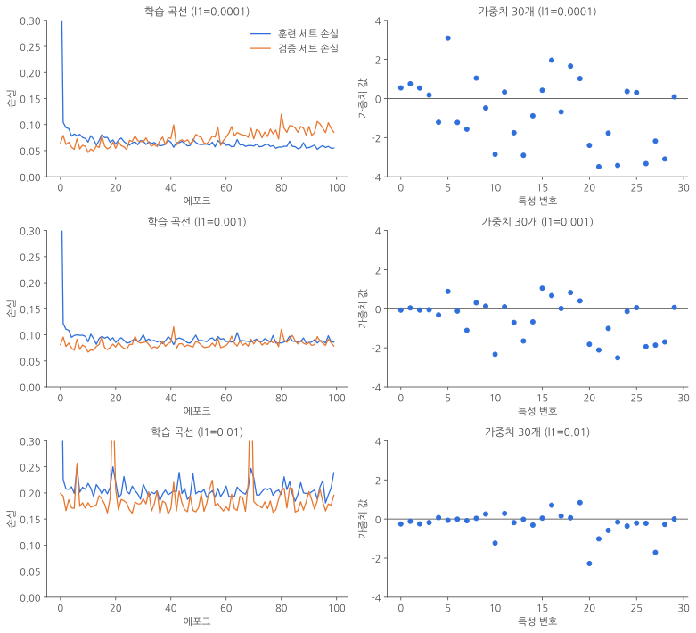
_왼쪽은 학습 곡선, 오른쪽은 훈련이 끝난 뒤 가중치 30개의 값이에요. 아래로 갈수록 규제가 강해요._

두 가지를 읽을 수 있어요.

- **학습 곡선(왼쪽)**: 규제가 강해질수록 훈련 세트와 검증 세트의 손실이 **둘 다 높아져요.** l1=0.01에서는 손실이 0.2 근처로, 다른 두 경우의 두 배가 넘어요. 규제가 너무 강해서 **과소적합**이 나타난 거예요. 반대로 l1=0.0001은 규제가 거의 없을 때처럼 검증 손실이 훈련 손실보다 점점 높아져요. **l1=0.001**에서는 두 손실이 거의 겹쳐서 함께 움직여요.
- **가중치(오른쪽)**: 규제가 강해질수록 가중치가 **0 쪽으로 모여요.** l1=0.0001에서는 -3.5에서 3까지 퍼져 있던 가중치가, l1=0.01에서는 대부분 0 근처에 붙어 있어요.

> **L1 규제를 썼는데 가중치가 정확히 0이 되지는 않았어요**
> 그래프를 보면 0 근처에 모인 가중치들도 0.002, 0.009처럼 정확히 0은 아니에요. 우리가 만든 방식은 가중치의 부호만 보고 일정한 양을 밀어 주기 때문에, 0 근처에서는 0을 살짝 넘었다가 돌아오기를 반복해요. 사이킷런의 `Lasso`처럼 다른 방식으로 최적화하면 가중치가 정확히 0이 됩니다.
{: .prompt-info }

그래프로 보면 알맞은 L1 규제 강도는 0.001 정도예요. 이 값으로 모델을 훈련해 볼게요. 에포크는 6-3에서 본 것처럼 일찍 멈추도록 20으로 정했어요.

```python
layer5 = SingleLayer(l1=0.001)
layer5.fit(x_train_scaled, y_train, epochs=20)
layer5.score(x_val_scaled, y_val)
```

```text
0.989010989010989
```

조기 종료만 했을 때(6-3)와 같은 0.989예요. 데이터 세트가 작아서 규제의 효과가 정확도에는 크게 드러나지 않았어요.

### 7-7. L2 규제 적용하기

같은 방법으로 L2 규제의 강도를 바꿔 가며 확인해 볼게요. 코드는 `l1`을 `l2`로 바꾸기만 하면 돼요.

```python
l2_list = [0.0001, 0.001, 0.01]

for l2 in l2_list:
    lyr = SingleLayer(l2=l2)
    lyr.fit(x_train_scaled, y_train, x_val=x_val_scaled, y_val=y_val)
    # 그래프를 그리는 코드는 7-6과 같아요 (l1을 l2로 바꿔 주세요)
```

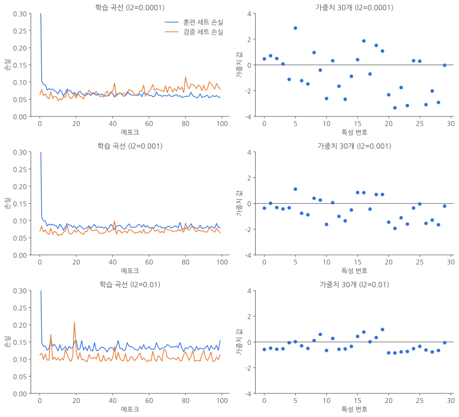
_L1 규제와 비슷하지만, 규제가 강해져도 손실이 덜 올라가요._

L2 규제도 L1 규제와 비슷한 모습이에요. 하지만 가장 강한 규제(l2=0.01)를 비교하면 차이가 보여요.

| 규제 | 마지막 20 에포크의 평균 손실 (훈련 / 검증) |
|---|---|
| 규제 없음 | 0.052 / 0.094 |
| l1=0.01 | 0.206 / 0.186 |
| l2=0.001 | 0.081 / 0.073 |
| l2=0.01 | 0.133 / 0.105 |

규제가 없을 때는 검증 손실(0.094)이 훈련 손실(0.052)보다 한참 높아요. 과대적합의 신호죠. L2 규제를 넣으면 **검증 손실이 훈련 손실보다 낮아질 만큼** 둘의 간격이 좁아져요. 그리고 같은 강도 0.01에서도 L2 규제는 L1 규제만큼 **과소적합이 심해지지 않아요.** 가중치 그래프를 봐도 0에 너무 가깝게 줄어들지 않고 -1에서 1 사이에 고르게 퍼져 있어요.

L2 규제를 적용한 모델은 50번 훈련하고 성능을 평가해 볼게요.

```python
layer6 = SingleLayer(l2=0.01)
layer6.fit(x_train_scaled, y_train, epochs=50)
layer6.score(x_val_scaled, y_val)
```

```text
0.989010989010989
```

L1 규제를 썼을 때와 같아요. 실제로 맞힌 개수를 세어 봐도 똑같이 91개 중 90개예요.

```python
np.sum(layer6.predict(x_val_scaled) == y_val)
```

```text
90
```

다만 에포크가 다르다는 점에 주목해 주세요. L1 규제는 20번, L2 규제는 50번 훈련했어요. L2 규제가 가중치를 단단히 붙잡아 주니, 훈련을 더 오래 해도 검증 손실이 크게 올라가지 않아요. 그래서 과대적합 걱정을 덜고 **더 오래 최솟값을 찾아 내려갈 수 있어요.**

### 7-8. 사이킷런의 SGDClassifier에서 규제 쓰기

사이킷런의 `SGDClassifier`도 L1 규제와 L2 규제를 지원해요. `penalty` 매개변수에 `'l1'`이나 `'l2'`를 주고, `alpha` 매개변수로 규제의 세기를 정하면 돼요.

```python
sgd = SGDClassifier(loss='log_loss', penalty='l2', alpha=0.001, random_state=42)
sgd.fit(x_train_scaled, y_train)
sgd.score(x_val_scaled, y_val)
```

```text
0.989010989010989
```

우리가 만든 `SingleLayer`와 같은 결과예요.

> **`C` 매개변수는 `alpha`와 반대예요**
> 사이킷런에는 `SGDClassifier` 말고도 규제를 지원하는 모델이 많아요. `LogisticRegression`, `SVC`, `LinearSVC` 같은 클래스는 `alpha` 대신 **`C`**라는 매개변수로 규제를 조절해요. 그런데 `C`는 규제 항이 아니라 원래 손실 함수 쪽에 곱하는 값이라서 **`alpha`와 반대로 움직여요.** `C`가 커지면 규제가 **약해지고**, `C`가 작아지면 규제가 **강해져요.** 헷갈리기 쉬우니 꼭 기억해 두세요.
{: .prompt-warning }

---

## 파트 8. 교차 검증: 데이터가 적을 때 검증하는 방법

### 8-1. 교차 검증의 원리

파트 2에서 검증 세트를 떼어 내느라 훈련 데이터가 줄어들고, 검증 세트가 작아서 점수가 크게 흔들리는 것도 봤어요. 데이터가 적을 때 이 두 문제를 함께 줄여 주는 방법이 **교차 검증(cross validation)**이에요.

교차 검증은 훈련 세트를 **같은 크기의 작은 덩어리 여러 개**로 나눠요. 이 덩어리를 **폴드(fold)**라고 불러요. 그런 다음 폴드를 하나씩 돌아가며 검증에 쓰고, 나머지 폴드로 훈련해요.

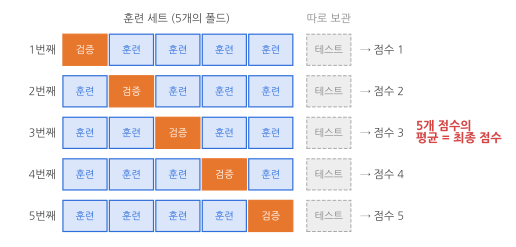
_훈련 세트를 5개의 폴드로 나누고, 폴드를 하나씩 돌아가며 검증에 써요. 테스트 세트는 따로 보관해요._

> **교차 검증 과정**
> 1. 훈련 세트를 k개의 폴드로 나눠요.
> 2. 첫 번째 폴드를 검증 세트로, 나머지 k-1개의 폴드를 훈련 세트로 써요.
> 3. 모델을 훈련한 뒤 검증 세트로 평가해요.
> 4. 다음 폴드를 검증 세트로 바꿔서 같은 과정을 반복해요.
> 5. k번 평가한 점수의 **평균**을 최종 점수로 써요.
{: .prompt-info }

훈련 세트를 k개로 나누기 때문에 **k-폴드 교차 검증**이라고 불러요. 장점은 두 가지예요.

- **모든 샘플이 한 번씩 검증에 쓰여요.** 검증 세트 하나의 운에 좌우되지 않으니 점수가 더 안정적이에요.
- **더 많은 데이터로 훈련할 수 있어요.** k=10이면 매번 훈련 세트의 90%로 훈련해요. 이번 데이터로 계산하면 6:2:2로 나눌 때는 364개로 훈련했지만, 10-폴드 교차 검증에서는 410개로 훈련해요. 전체 569개 중 64%에서 72%로 늘어난 거예요.

대신 모델을 k번 훈련해야 하니 **시간이 k배** 걸려요. 그래서 데이터가 아주 많을 때보다는 **데이터가 적을 때** 특히 유용해요.

### 8-2. k-폴드 교차 검증 직접 만들기

교차 검증에서는 검증 세트가 훈련 세트 안에 포함돼요. 그래서 처음에 한 번만 나눈 `x_train_all`과 `y_train_all`을 훈련과 검증에 모두 써요. 각 폴드의 검증 점수는 `validation_scores` 리스트에 모아요.

여기서는 k를 10으로 정할게요. 한 폴드에 들어갈 샘플 수는 전체 훈련 세트의 샘플 수를 k로 나눈 값이고, `bins` 변수에 저장해요.

```python
validation_scores = []

k = 10
bins = len(x_train_all) // k                   # 한 폴드의 샘플 수 (455 // 10 = 45)

for i in range(k):
    start = i * bins                           # 검증 폴드의 시작 인덱스
    end = (i + 1) * bins                       # 검증 폴드의 끝 인덱스
    val_fold = x_train_all[start:end]
    val_target = y_train_all[start:end]

    train_index = list(range(0, start)) + list(range(end, len(x_train_all)))
    train_fold = x_train_all[train_index]
    train_target = y_train_all[train_index]

    train_mean = np.mean(train_fold, axis=0)   # 훈련 폴드로만 평균과
    train_std = np.std(train_fold, axis=0)     # 표준 편차를 계산
    train_fold_scaled = (train_fold - train_mean) / train_std
    val_fold_scaled = (val_fold - train_mean) / train_std

    lyr = SingleLayer(l2=0.01)
    lyr.fit(train_fold_scaled, train_target, epochs=50)
    score = lyr.score(val_fold_scaled, val_target)
    validation_scores.append(score)

print(np.mean(validation_scores))
```

```text
0.9577777777777777
```

`start`와 `end`가 검증 폴드의 시작과 끝 인덱스예요. 그 나머지가 훈련 폴드의 인덱스가 되겠죠. `list(range(0, start))`는 검증 폴드 **앞쪽**, `list(range(end, len(x_train_all)))`는 검증 폴드 **뒤쪽** 인덱스예요. 두 리스트를 `+`로 이어 붙여 훈련 폴드의 인덱스를 만들었어요.

```text
[ 훈련 폴드 | 훈련 폴드 | 검증 폴드 | 훈련 폴드 | 훈련 폴드 ]
                       ↑ start   ↑ end
```

열 개 폴드의 점수는 0.933에서 1.0 사이였고, 평균은 약 0.958이에요. 6-3이나 7-7에서 본 0.989보다 낮지만, 이 점수는 **검증 세트 하나가 아니라 열 번의 평가를 평균 낸 값**이라 더 믿을 만해요. 91개짜리 검증 세트 하나로 잰 0.989는 운 좋게 쉬운 샘플이 많이 들어갔을 수도 있으니까요.

> **훈련 폴드를 만들 때 `len(x_train_all)`을 써야 해요**
> 인덱스 범위의 끝을 `len(x_train)`(364)으로 쓰면, 455개 중 뒤쪽 91개가 훈련에서 빠지고 마지막 몇 개 폴드는 훈련 데이터가 크게 줄어요. 교차 검증은 `x_train_all` 전체를 나누는 것이니 길이도 `len(x_train_all)`을 써야 합니다.
{: .prompt-warning }

> **표준화는 폴드를 나눈 뒤에 해요**
> 이 코드에서 가장 신경 써서 봐야 할 부분은 **표준화를 폴드를 나눈 다음에** 한다는 점이에요. 평균과 표준 편차를 훈련 폴드로만 계산했죠. 폴드를 나누기 전에 `x_train_all` 전체로 표준화하면, 평균과 표준 편차를 계산할 때 **검증 폴드의 값도 섞여 들어가요.** 파트 1에서 말한 정보 누설이 검증 폴드에서 일어나는 거예요.
{: .prompt-tip }

### 8-3. 사이킷런으로 교차 검증하기

교차 검증을 직접 만들어 보니 어렵지 않죠? 하지만 보통은 사이킷런에 준비된 함수를 쓰는 게 편해요. 사이킷런의 `model_selection` 모듈에는 교차 검증을 해 주는 `cross_validate()` 함수가 있어요.

우리가 만든 `SingleLayer`를 `cross_validate()`와 함께 쓰려면 기능을 몇 가지 더 넣어야 해요. 하지만 `SingleLayer`는 완전한 라이브러리를 만들려는 게 아니라 **원리를 배우려고** 만든 것이니, 여기서는 사이킷런의 `SGDClassifier`로 사용법만 알아볼게요.

사용법은 간단해요. 모델 객체, 훈련 데이터, 타깃 데이터를 넘기고 `cv` 매개변수에 폴드 수를 정하면 돼요. `cv`를 정하지 않으면 기본값은 5예요.

```python
from sklearn.model_selection import cross_validate

sgd = SGDClassifier(loss='log_loss', penalty='l2', alpha=0.001, random_state=42)
scores = cross_validate(sgd, x_train_all, y_train_all, cv=10)
print(np.mean(scores['test_score']))
```

```text
0.8198550724637681
```

`cross_validate()` 함수는 결과를 **딕셔너리**로 돌려줘요. 각 폴드의 검증 점수는 `scores['test_score']`에 들어 있어요. 이름은 `test_score`이지만 테스트 세트가 아니라 **검증 폴드의 점수**예요.

평균 점수가 약 82%로 꽤 낮네요. 왜 그럴까요? 아차, **표준화를 하지 않았어요.**

### 8-4. 전처리 단계를 포함해 교차 검증하기

그럼 `x_train_all`을 먼저 표준화한 다음 `cross_validate()`에 넘기면 될까요? 그러면 8-2의 팁에서 말한 문제가 생겨요. `x_train_all` 전체로 평균과 표준 편차를 구하니 **검증 폴드의 정보가 전처리 단계에서 새어 나가요.** 표준화는 각 폴드를 나눈 **뒤에**, 훈련 폴드로만 해야 해요.

사이킷런은 이를 위해 전처리 단계와 모델을 하나로 묶어 주는 **`Pipeline`** 클래스를 제공해요. 파이프라인으로 묶은 객체를 `cross_validate()`에 넘기면, `cross_validate()`는 훈련 세트를 폴드로 **나누기만** 하고 표준화와 훈련은 파이프라인 안에서 폴드마다 따로 이뤄져요. 그러면 검증 폴드가 전처리 단계에서 새어 나가지 않아요.

파이프라인 객체는 `make_pipeline()` 함수로 쉽게 만들 수 있어요. 사이킷런에서 표준화를 해 주는 클래스는 `preprocessing` 모듈의 `StandardScaler`예요. 이 둘을 써 볼게요.

```python
from sklearn.pipeline import make_pipeline
from sklearn.preprocessing import StandardScaler

pipe = make_pipeline(StandardScaler(), sgd)
scores = cross_validate(pipe, x_train_all, y_train_all, cv=10, return_train_score=True)
print(np.mean(scores['test_score']))
```

```text
0.9649275362318841
```

평균 검증 점수가 **82%에서 96.5%로** 올라갔어요. 표준화가 훈련 폴드와 검증 폴드에 올바르게 적용된 거예요. 폴드별 점수를 나란히 놓고 보면 차이가 더 분명해요.

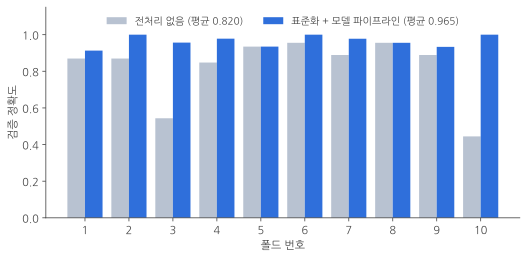
_전처리를 하지 않으면 폴드에 따라 44%에서 96%까지 크게 흔들려요. 표준화를 넣으면 모든 폴드가 91% 이상으로 안정돼요._

전처리를 하지 않았을 때는 3번 폴드가 54%, 10번 폴드가 44%로 **폴드에 따라 점수가 크게 흔들렸어요.** 파트 3에서 본 것처럼, 스케일이 다른 특성 때문에 가중치가 불안정하게 움직인 탓이에요. 표준화를 넣으니 모든 폴드가 91% 이상으로 고르게 나왔어요.

`return_train_score=True`로 정하면 **훈련 폴드의 점수**도 함께 받을 수 있어요.

```python
print(np.mean(scores['train_score']))
```

```text
0.9877899695867374
```

훈련 폴드 점수는 약 98.8%, 검증 폴드 점수는 약 96.5%예요. 차이가 크지 않으니 과대적합도 과소적합도 심하지 않은, 균형 잡힌 모델이라고 볼 수 있어요.

### 8-5. 마지막으로 테스트 세트에서 딱 한 번

교차 검증으로 설정이 괜찮다는 걸 확인했으니, 이제 파트 1에서 아껴 둔 테스트 세트를 꺼낼 차례예요. 파이프라인을 전체 훈련 세트로 훈련하고, 테스트 세트로 딱 한 번 평가해요.

```python
pipe.fit(x_train_all, y_train_all)
pipe.score(x_test, y_test)
```

```text
0.9824561403508771
```

테스트 세트 114개 중 112개를 맞혀서 약 98%가 나왔어요. 2편에서 같은 테스트 세트로 쟀던 93%보다 크게 좋아졌죠. 이번에는 테스트 세트로 설정을 고르지 않았으니, 이 점수는 **처음 보는 데이터에서 이 정도 성능을 기대할 수 있다**는 정직한 예상치예요.

파이프라인 안의 `StandardScaler`는 `fit()`을 할 때 훈련 세트의 평균과 표준 편차를 기억해 뒀다가, `score()`나 `predict()`를 할 때 그 값으로 테스트 세트를 변환해요. 파트 4에서 배운 **"새 데이터는 훈련 세트의 통계값으로 변환한다"**는 규칙을 알아서 지켜 주는 거예요.

---

## 마무리

### 핵심 요약

| 개념 | 한 줄 설명 |
|---|---|
| 하이퍼파라미터 | 훈련으로 정해지지 않아 사람이 직접 정하는 값 (loss, alpha, 학습률, 에포크 수 등) |
| 튜닝 | 하이퍼파라미터를 바꿔 가며 모델의 성능을 높이는 작업 |
| 검증 세트 | 튜닝할 때 쓰는 데이터. 훈련 세트에서 떼어 내 만들어요 |
| 정보 누설 | 평가에 쓸 데이터의 정보가 훈련이나 튜닝에 섞여 들어가는 것 |
| 스케일 | 특성이 가지는 값의 범위 |
| 학습률 | 가중치를 한 번에 얼마나 고칠지 정하는 값 |
| 표준화 | 평균을 빼고 표준 편차로 나눠서 평균 0, 표준 편차 1로 맞추는 것 |
| 과대적합 | 훈련 세트 성능은 좋은데 검증 세트 성능이 낮은 상태 (분산이 크다) |
| 과소적합 | 훈련 세트와 검증 세트 성능이 모두 낮은 상태 (편향이 크다) |
| 편향-분산 트레이드오프 | 편향을 줄이면 분산이 커지고, 분산을 줄이면 편향이 커지는 관계 |
| 조기 종료 | 과대적합이 시작되기 전에 훈련을 멈추는 방법 |
| L1 규제 / 라쏘 | 가중치 절댓값의 합을 손실에 더해요. 가중치를 0으로 만들 수 있어요 |
| L2 규제 / 릿지 | 가중치 제곱의 합을 손실에 더해요. 실무에서 더 많이 써요 |
| k-폴드 교차 검증 | 훈련 세트를 k개로 나눠 돌아가며 검증하고 점수를 평균 내는 방법 |
| 파이프라인 | 전처리와 모델을 하나로 묶어 폴드마다 올바르게 전처리하게 해 주는 도구 |

### 헷갈리기 쉬운 포인트

1. **테스트 세트는 튜닝에 쓰지 않아요.** 튜닝은 검증 세트(또는 교차 검증)로 하고, 테스트 세트는 마지막에 한 번만 써요.
2. **검증 세트와 테스트 세트도 훈련 세트의 평균과 표준 편차로 변환해요.** 자기 통계값으로 변환하면 훈련 세트와의 상대적인 위치가 달라져요.
3. **훈련 세트 점수만 보면 과대적합을 알 수 없어요.** 꼭 검증 세트 점수와 같이 봐야 해요.
4. **훈련을 오래 한다고 항상 좋은 게 아니에요.** 검증 손실이 다시 올라가기 시작하면 과대적합이 시작된 거예요.
5. **규제는 가중치에만 해요.** 절편은 모델의 복잡도와 상관이 없어서 규제하지 않아요.
6. **`alpha`는 클수록 규제가 강하고, `C`는 클수록 규제가 약해요.**
7. **교차 검증에서 전처리는 폴드를 나눈 뒤에 해요.** 사이킷런에서는 `make_pipeline()`으로 묶으면 알아서 해 줘요.
8. **`cross_validate()`의 `test_score`는 테스트 세트 점수가 아니에요.** 검증 폴드의 점수예요.
9. **`SGDClassifier(loss='log')`는 최신 사이킷런에서 오류가 나요.** `loss='log_loss'`로 써 주세요.

지금까지 단일층 신경망을 만들고, 이 모델을 잘 훈련하는 방법까지 배웠어요. 다음 편에서는 층을 여러 개 쌓은 **다층 신경망**을 만들어 보겠습니다. 궁금한 점이나 틀린 부분이 있으면 편하게 알려 주세요!
