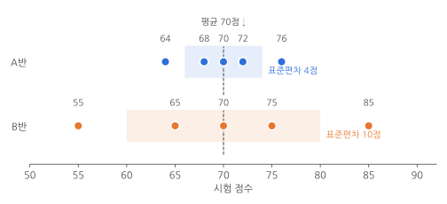
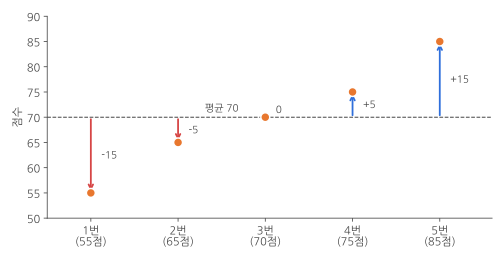
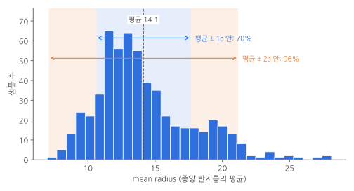
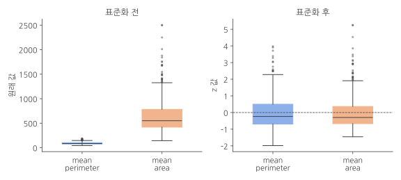

> **이 글에서 배우는 것**
> 3편에서 특성의 크기를 맞추는 **표준화**를 배웠어요. "평균을 빼고 **표준 편차**로 나눈다"고 했는데, 표준 편차가 무엇인지 잘 와닿지 않았다면 이 글을 먼저 읽어 보세요. 시험 점수 다섯 개로 **평균, 분산, 표준 편차**를 손으로 직접 계산해 보고, 마지막에 3편의 표준화로 다시 돌아갑니다.
{: .prompt-info }

이 글은 3편을 읽다가 막힌 부분을 채우는 **보충 글**이에요. 수학 공식은 최대한 숫자로 먼저 보여 드리고, 공식은 그다음에 정리할게요.

| 파트 | 내용 | 한 줄 요약 |
|---|---|---|
| 1 | 평균만으로는 부족해요 | 평균이 같아도 점수가 퍼진 모양은 다를 수 있어요 |
| 2 | 흩어진 정도를 숫자로 만들기 | 편차 → 제곱 → 분산 → 제곱근 → 표준 편차 |
| 3 | 넘파이로 계산하기 | `np.var()`, `np.std()`와 `ddof` 주의점 |
| 4 | 표준 편차의 감 잡기 | 대부분의 데이터는 평균 ± 표준 편차 2개 안에 있어요 |
| 5 | 표준화 다시 보기 | z 값은 "평균에서 표준 편차 몇 개만큼 떨어졌나" |
| 6 | '분산'이라는 말이 두 번 나와요 | 데이터의 분산과 모델의 분산은 다른 뜻이에요 |

---

## 파트 1. 평균만으로는 부족해요

두 반이 같은 시험을 봤어요. 각 반에서 학생 다섯 명의 점수는 이렇습니다.

| | 1번 | 2번 | 3번 | 4번 | 5번 |
|---|---|---|---|---|---|
| A반 | 64 | 68 | 70 | 72 | 76 |
| B반 | 55 | 65 | 70 | 75 | 85 |

평균을 내 볼게요. **평균(mean)**은 모든 값을 더한 뒤 개수로 나눈 값이에요.

- A반: (64 + 68 + 70 + 72 + 76) ÷ 5 = 350 ÷ 5 = **70점**
- B반: (55 + 65 + 70 + 75 + 85) ÷ 5 = 350 ÷ 5 = **70점**

두 반의 평균은 똑같이 70점이에요. 그런데 점수를 숫자로 늘어놓고 보면 두 반은 꽤 달라 보여요.


_두 반 모두 평균은 70점이지만, B반 점수가 훨씬 넓게 퍼져 있어요. 색칠한 구간은 평균 ± 표준 편차 1개예요._

- **A반**은 점수가 64~76점, 평균 근처에 **모여** 있어요.
- **B반**은 점수가 55~85점, 평균에서 **멀리 퍼져** 있어요.

평균은 데이터의 **가운데가 어디인지**는 알려 주지만, 데이터가 **얼마나 퍼져 있는지**는 알려 주지 않아요. 그래서 "얼마나 퍼져 있나"를 나타내는 숫자가 하나 더 필요해요. 그게 바로 이 글의 주인공인 **표준 편차(standard deviation)**입니다. 그림에 미리 적어 둔 것처럼 A반의 표준 편차는 4점, B반은 10점이에요. 이 숫자가 어떻게 나오는지 직접 계산해 볼게요.

---

## 파트 2. 흩어진 정도를 숫자로 만들기

B반 점수 55, 65, 70, 75, 85로 한 단계씩 계산해 봅시다.

### 2-1. 1단계: 평균에서 얼마나 떨어졌나 (편차)

먼저 각 점수가 평균 70점에서 얼마나 떨어져 있는지 구해요. **각 값에서 평균을 뺀 값**을 **편차(deviation)**라고 해요.


_점선이 평균 70점이에요. 화살표의 길이와 방향이 편차예요. 평균보다 낮으면 음수, 높으면 양수가 돼요._

| 학생 | 점수 | 편차 (점수 − 70) |
|---|---|---|
| 1번 | 55 | −15 |
| 2번 | 65 | −5 |
| 3번 | 70 | 0 |
| 4번 | 75 | +5 |
| 5번 | 85 | +15 |

편차가 크면 평균에서 멀리 떨어진 값이고, 0에 가까우면 평균 근처의 값이에요. 그러면 편차들의 평균을 내면 "평균적으로 얼마나 떨어져 있나"를 알 수 있지 않을까요?

### 2-2. 2단계: 편차를 그냥 더하면 0이 돼요

편차를 모두 더해 볼게요.

$$
(-15) + (-5) + 0 + 5 + 15 = 0
$$

0이 나왔어요. 우연이 아니에요. 평균보다 작은 값의 편차(음수)와 큰 값의 편차(양수)는 **항상 서로 지워져서 합이 0**이 돼요. 평균이 원래 "가운데"라는 뜻이니까요. A반으로 계산해도 마찬가지로 0이에요. 그래서 편차를 그냥 더하면 두 반의 차이를 전혀 알 수 없어요.

### 2-3. 3단계: 제곱해서 부호를 없애기

음수와 양수가 지워지지 않게 하려면 부호를 없애야 해요. 방법은 **제곱**이에요. 음수도 제곱하면 양수가 되니까요.

| 학생 | 편차 | 편차의 제곱 |
|---|---|---|
| 1번 | −15 | 225 |
| 2번 | −5 | 25 |
| 3번 | 0 | 0 |
| 4번 | +5 | 25 |
| 5번 | +15 | 225 |
| **합** | **0** | **500** |

> **절댓값으로 부호를 없애면 안 되나요?**
> 절댓값을 써도 부호는 없어져요. 이렇게 구한 값(평균 절대 편차)도 실제로 써요. 다만 제곱은 미분하기 쉽고 수학적으로 다루기 편해서 통계와 머신러닝에서는 제곱을 더 많이 써요. 1편에서 손실 함수로 **제곱 오차**를 쓴 것과 같은 이유예요.
{: .prompt-tip }

### 2-4. 4단계: 제곱의 평균 = 분산

편차의 제곱을 모두 더하면 500이에요. 이걸 학생 수 5로 나눠서 평균을 내요.

$$
500 \div 5 = 100
$$

이렇게 **편차의 제곱을 평균 낸 값**을 **분산(variance)**이라고 해요. B반의 분산은 100이에요. 분산이 클수록 데이터가 넓게 퍼져 있다는 뜻이에요.

그런데 분산에는 불편한 점이 하나 있어요. **단위**예요. 점수를 제곱했으니 분산의 단위는 "점"이 아니라 "점²(점의 제곱)"이에요. "B반 점수는 평균에서 100점² 정도 퍼져 있어요"라고 하면 감이 잘 오지 않죠.

### 2-5. 5단계: 제곱근으로 단위 되돌리기 = 표준 편차

제곱한 단위를 원래대로 되돌리려면 **제곱근(√)**을 씌우면 돼요.

$$
\sqrt{100} = 10
$$

이 값이 **표준 편차**예요. B반의 표준 편차는 **10점**이고, "B반 점수는 평균 70점에서 **보통 10점 정도** 떨어져 있다"고 읽으면 돼요.

A반도 같은 방법으로 계산해 볼게요.

| 학생 | 점수 | 편차 | 편차의 제곱 |
|---|---|---|---|
| 1번 | 64 | −6 | 36 |
| 2번 | 68 | −2 | 4 |
| 3번 | 70 | 0 | 0 |
| 4번 | 72 | +2 | 4 |
| 5번 | 76 | +6 | 36 |
| **합** | | **0** | **80** |

분산은 80 ÷ 5 = 16, 표준 편차는 √16 = **4점**이에요. 평균은 같아도 표준 편차가 A반 4점, B반 10점으로 다르게 나오니, 이제 **"B반이 더 넓게 퍼져 있다"를 숫자로 말할 수 있게** 됐어요.

### 2-6. 공식으로 정리하기

지금까지 한 계산을 공식으로 쓰면 다음과 같아요. 처음 보면 복잡해 보이지만 위에서 손으로 한 순서 그대로예요.

$$
\mu = \frac{1}{m}\sum_{i=1}^{m} x_i
$$

- 평균(μ, 뮤): 값 m개를 모두 더해서($$\sum$$, 시그마는 "모두 더하라"는 기호예요) m으로 나눠요.

$$
\sigma^2 = \frac{1}{m}\sum_{i=1}^{m} (x_i - \mu)^2
$$

- 분산(σ², 시그마 제곱): 각 값의 편차 $$(x_i - \mu)$$를 제곱해서 모두 더한 뒤 m으로 나눠요.

$$
\sigma = \sqrt{\frac{1}{m}\sum_{i=1}^{m} (x_i - \mu)^2}
$$

- 표준 편차(σ, 시그마): 분산에 제곱근을 씌워요.

> 표준 편차는 기호 **σ**(그리스 문자 시그마의 소문자)로 많이 써요. 3편에서는 s로 썼는데, 둘 다 표준 편차를 뜻해요. 분산은 표준 편차의 제곱이라서 **σ²**로 써요.
{: .prompt-info }

---

## 파트 3. 넘파이로 계산하기

### 3-1. 손계산을 코드로 따라 하기

방금 한 계산을 넘파이로 똑같이 해 볼게요. 먼저 두 반의 평균이에요.

```python
import numpy as np

class_a = np.array([64, 68, 70, 72, 76])
class_b = np.array([55, 65, 70, 75, 85])
print(np.mean(class_a), np.mean(class_b))
```

```
70.0 70.0
```

B반의 편차를 구하고 모두 더해 봅니다. 넘파이 배열에서 숫자 하나를 빼면 모든 원소에서 똑같이 빼 줘요.

```python
deviation = class_b - np.mean(class_b)
print(deviation)
print(np.sum(deviation))
```

```
[-15.  -5.   0.   5.  15.]
0.0
```

편차의 합이 정말 0이에요. 이제 제곱하고, 평균을 내고(분산), 제곱근을 씌워요(표준 편차).

```python
print(deviation ** 2)
variance = np.mean(deviation ** 2)
print(variance)
std = np.sqrt(variance)
print(std)
```

```
[225.  25.   0.  25. 225.]
100.0
10.0
```

손으로 계산한 값과 똑같이 분산 100, 표준 편차 10이 나왔어요.

### 3-2. np.var()와 np.std()

매번 이렇게 단계를 밟을 필요는 없어요. 넘파이에는 분산을 구하는 `np.var()`, 표준 편차를 구하는 `np.std()`가 있어요.

```python
print(np.var(class_a), np.std(class_a))
print(np.var(class_b), np.std(class_b))
```

```
16.0 4.0
100.0 10.0
```

3편에서 표준화할 때 쓴 `np.std(x_train, axis=0)`이 바로 이 함수예요. `axis=0`을 주면 열(특성)마다 따로 표준 편차를 계산해 줘요.

### 3-3. 주의: 나누는 수가 다른 표준 편차도 있어요

다른 책이나 블로그에서 같은 데이터로 표준 편차를 구했는데 값이 다르게 나오는 경우가 있어요. 대부분 **m으로 나눴는지, m − 1로 나눴는지**의 차이예요.

```python
print(np.std(class_b, ddof=1))
```

```
11.180339887498949
```

`ddof=1`을 주면 넘파이가 m 대신 **m − 1로 나눠요**. 500 ÷ 4 = 125이고, √125 ≈ 11.18이에요. 이렇게 m − 1로 나누는 방식은 **표본 표준 편차**라고 해서, 일부 데이터(표본)로 전체(모집단)의 퍼진 정도를 짐작할 때 써요.

> **도구마다 기본값이 달라요**
> - 넘파이 `np.std()`: 기본이 m으로 나눠요(`ddof=0`).
> - 사이킷런 `StandardScaler`: m으로 나눠요. 넘파이 기본값과 같아요.
> - 판다스 `DataFrame.std()`: 기본이 **m − 1**로 나눠요(`ddof=1`).
>
> 샘플이 수백 개만 돼도 두 값의 차이는 아주 작아서 표준화 결과에는 거의 영향이 없어요. 다만 숫자를 비교하다 값이 조금 다르면 이 차이를 떠올려 주세요.
{: .prompt-warning }

---

## 파트 4. 표준 편차의 감 잡기

표준 편차가 "평균에서 보통 얼마나 떨어져 있나"라는 건 알았어요. 실제 데이터에서는 어떤 의미인지 3편에서 쓴 종양 데이터로 확인해 볼게요. 첫 번째 특성인 `mean radius`(종양 반지름의 평균)를 씁니다.

```python
from sklearn.datasets import load_breast_cancer

cancer = load_breast_cancer()
radius = cancer.data[:, 0]
print(cancer.feature_names[0])
mean, std = np.mean(radius), np.std(radius)
print(mean, std)
```

```
mean radius
14.127291739894552 3.520950760711062
```

평균은 약 14.1, 표준 편차는 약 3.5예요. 그럼 **평균 ± 표준 편차 1개**(약 10.6~17.6) 안에 샘플이 얼마나 들어 있을까요? **± 표준 편차 2개**(약 7.1~21.2) 안에는요?

```python
within_1 = np.abs(radius - mean) <= std
within_2 = np.abs(radius - mean) <= 2 * std
print(np.mean(within_1), np.mean(within_2))
```

```
0.7012302284710018 0.9648506151142355
```

`np.abs(radius - mean)`은 편차의 절댓값, 즉 평균에서 떨어진 거리예요. 이 거리가 표준 편차 이하인 샘플은 `True`가 되고, `True`를 1로 보고 평균을 내면 **비율**이 나와요.


_파란 구간이 평균 ± 1σ, 주황 구간까지 합친 범위가 평균 ± 2σ예요._

- 평균 ± 표준 편차 1개 안: 약 **70%**
- 평균 ± 표준 편차 2개 안: 약 **96%**

즉, 표준 편차 2개를 벗어나는 샘플은 100개 중 4개 정도밖에 안 돼요. 그래서 표준 편차를 알면 이런 감을 잡을 수 있어요.

- 평균에서 표준 편차 **1개쯤** 떨어진 값: 흔한 값
- 평균에서 표준 편차 **2개 이상** 떨어진 값: 꽤 드문 값
- 평균에서 표준 편차 **3개 이상** 떨어진 값: 아주 드문 값

> 데이터가 종 모양(정규 분포)에 가까우면 ± 1σ 안에 약 68%, ± 2σ 안에 약 95%가 들어가요. `mean radius`는 오른쪽으로 꼬리가 긴 모양이라 숫자가 조금 다르지만, 대략 비슷한 감을 주죠. 모든 데이터가 이 비율을 따르는 건 아니니 **대략적인 감**으로만 써 주세요.
{: .prompt-info }

---

## 파트 5. 표준화 다시 보기

### 5-1. z 값: 표준 편차 몇 개만큼 떨어졌나

이제 3편의 표준화 공식을 다시 볼게요.

$$
z = \frac{x - \mu}{\sigma}
$$

- 분자 $$x - \mu$$: 편차예요. 평균에서 얼마나 떨어졌는지.
- 분모 σ: 표준 편차로 나눠요.

편차를 표준 편차로 나누면 **"평균에서 표준 편차 몇 개만큼 떨어졌나"**가 나와요. 이 값을 **z 값(z-score)**이라고 해요. B반 85점이라면 (85 − 70) ÷ 10 = 1.5, 즉 평균보다 표준 편차 1.5개만큼 높은 점수예요.

z 값이 왜 쓸모 있는지 예를 하나 들어 볼게요. 어떤 학생이 국어와 수학에서 똑같이 80점을 받았어요.

| 과목 | 내 점수 | 반 평균 | 표준 편차 | z 값 |
|---|---|---|---|---|
| 국어 | 80 | 70 | 5 | (80 − 70) ÷ 5 = **2** |
| 수학 | 80 | 60 | 20 | (80 − 60) ÷ 20 = **1** |

점수는 같은데 z 값은 국어가 2, 수학이 1이에요. 국어는 점수가 고르게 모여 있는 과목이라 평균보다 10점 높은 게 꽤 드문 일이고(표준 편차 2개), 수학은 점수가 넓게 퍼진 과목이라 20점 높아도 표준 편차 1개 정도예요. 그러니 **반에서의 위치로 보면 국어를 더 잘 본 것**이에요.

이처럼 표준화를 하면 원래 값의 크기나 단위와 상관없이 **"이 그룹 안에서 어느 정도 위치인가"라는 같은 잣대**로 비교할 수 있어요.

### 5-2. 종양 데이터로 표준화해 보기

3편에서 문제가 됐던 두 특성 `mean perimeter`(둘레)와 `mean area`(넓이)를 표준화해 볼게요. 3편에서는 훈련 세트만 썼지만, 여기서는 원리를 보려고 전체 데이터를 써요.

```python
x = cancer.data[:, [2, 3]]
print(cancer.feature_names[[2, 3]])
x_mean = np.mean(x, axis=0)
x_std = np.std(x, axis=0)
print(x_mean)
print(x_std)
```

```
['mean perimeter' 'mean area']
[ 91.96903339 654.88910369]
[ 24.27761929 351.60475406]
```

둘레는 평균 약 92, 표준 편차 약 24예요. 넓이는 평균 약 655, 표준 편차 약 352로, 둘레보다 수십 배 커요. 이제 표준화하고, 두 번째 샘플(인덱스 1)을 비교해 봅시다.

```python
x_scaled = (x - x_mean) / x_std
print(x[1])
print(x_scaled[1])
```

```
[ 132.9 1326. ]
[1.68595471 1.90870825]
```

원래 값만 보면 둘레 132.9, 넓이 1326이라 넓이가 10배쯤 큰 숫자예요. 하지만 이 숫자만으로는 이 종양이 "큰 편인지"를 알기 어려워요. 표준화한 값을 보면 둘레는 z ≈ 1.69, 넓이는 z ≈ 1.91이에요. 둘 다 **평균보다 표준 편차 2개 가까이 크다**, 즉 **둘레도 넓이도 꽤 큰 편인 종양**이라는 걸 같은 잣대로 읽을 수 있어요.


_왼쪽은 원래 값, 오른쪽은 표준화한 값이에요. 표준화하면 두 특성이 0을 중심으로 비슷한 범위에 놓여요._

마지막으로 표준화한 데이터의 평균과 표준 편차를 확인해 볼게요.

```python
print(np.mean(x_scaled, axis=0))
print(np.std(x_scaled, axis=0))
```

```
[-1.24875700e-16 -2.18532476e-16]
[1. 1.]
```

표준 편차는 정확히 1이에요. 평균은 `-1.24875700e-16`처럼 이상한 숫자가 나왔는데, `e-16`은 10의 −16제곱을 곱하라는 뜻이라 **−0.000…(0이 15개)…0125** 정도예요. 컴퓨터가 소수를 계산할 때 생기는 아주 작은 오차라서 사실상 **0**이에요. 3편에서 "표준화한 특성은 평균이 0, 표준 편차가 1이 된다"고 한 게 바로 이 뜻이에요.

> **왜 평균은 0, 표준 편차는 1이 될까요?**
> 모든 값에서 평균을 빼면 데이터 전체가 옆으로 이동해서 평균이 0이 돼요(파트 2에서 본 것처럼 편차의 평균은 0이에요). 그다음 모든 값을 표준 편차로 나누면 퍼진 정도가 그 비율만큼 줄어서, 표준 편차가 σ ÷ σ = 1이 돼요.
{: .prompt-tip }

### 5-3. 3편과 연결하기

이제 3편에서 표준화가 필요했던 이유를 이렇게 정리할 수 있어요.

- 원래 데이터에서는 `mean area`의 값이 `mean perimeter`보다 훨씬 커서, 경사 하강법으로 가중치를 고칠 때 `mean area` 쪽 가중치가 크게 흔들렸어요.
- 표준화하면 두 특성 모두 "평균에서 표준 편차 몇 개만큼 떨어졌나"라는 같은 단위가 돼서, 가중치가 비슷한 크기로 안정적으로 움직여요.
- 검증 세트와 테스트 세트도 **훈련 세트의 평균과 표준 편차**로 변환해야 해요. z 값은 "어느 그룹 안에서의 위치"라서, 기준이 되는 그룹(평균, 표준 편차)이 바뀌면 같은 값도 다른 z 값이 되거든요. 국어 80점도 반 평균이 다르면 z 값이 달라지는 것과 같아요.

---

## 파트 6. '분산'이라는 말이 두 번 나와요

3편을 읽다 보면 **분산**이라는 말이 두 곳에 나와요. 이름은 같지만 뜻이 조금 달라서 헷갈리기 쉬워요.

| | 데이터의 분산 | 모델의 분산 |
|---|---|---|
| 나온 곳 | 3편 파트 4 (표준화) | 3편 파트 5 (과대적합, 편향-분산 트레이드오프) |
| 무엇이 퍼져 있나 | **데이터 값**이 평균에서 퍼진 정도 | **모델의 성능(예측)**이 데이터에 따라 흔들리는 정도 |
| 계산 | 편차 제곱의 평균 (이 글의 파트 2) | 훈련 세트가 바뀔 때 예측이 얼마나 달라지는지 |
| 크면 | 값이 넓게 퍼져 있어요 | 훈련 세트에만 맞춰져 과대적합된 상태예요 |

공통점은 둘 다 **"얼마나 흔들리나, 얼마나 퍼져 있나"**를 나타낸다는 거예요. 과대적합된 모델은 훈련 세트를 조금만 바꿔도 예측이 크게 달라져요. 즉, 모델의 결과가 **넓게 퍼지기 때문에** "분산이 크다"고 부르는 거예요. 이 글에서 배운 분산의 개념을 모델의 예측에 적용한 것이라고 생각하면 돼요.

---

## 마무리

### 핵심 요약

| 개념 | 한 줄 설명 |
|---|---|
| 평균 (μ) | 값을 모두 더해 개수로 나눈 값. 데이터의 가운데 |
| 편차 | 각 값에서 평균을 뺀 값. 합은 항상 0 |
| 분산 (σ²) | 편차를 제곱해서 평균 낸 값. 단위가 제곱이 돼요 |
| 표준 편차 (σ) | 분산의 제곱근. 평균에서 보통 얼마나 떨어져 있는지를 원래 단위로 알려 줘요 |
| z 값 | (값 − 평균) ÷ 표준 편차. 평균에서 표준 편차 몇 개만큼 떨어졌는지 |
| 표준화 | 모든 값을 z 값으로 바꾸는 것. 평균 0, 표준 편차 1이 돼요 |

### 헷갈리기 쉬운 포인트

1. **평균이 같아도 데이터는 다를 수 있어요.** 퍼진 정도는 표준 편차로 확인해요.
2. **편차를 그냥 더하면 항상 0이에요.** 그래서 제곱해서 더해요.
3. **분산은 단위가 제곱이라 감이 잘 안 와요.** 원래 단위로 보려면 표준 편차를 써요.
4. **`np.std()`와 판다스 `std()`는 기본값이 달라요.** 넘파이는 m으로, 판다스는 m − 1로 나눠요.
5. **표준화한 평균이 `1e-16`처럼 나와도 0이에요.** 컴퓨터의 소수 계산 오차예요.
6. **z 값은 기준 그룹이 있어야 의미가 있어요.** 그래서 검증 세트와 테스트 세트도 훈련 세트의 평균과 표준 편차로 변환해요.
7. **데이터의 분산과 모델의 분산은 달라요.** 모델의 분산이 크다는 건 과대적합이라는 뜻이에요.

표준 편차가 이해됐다면 [3편의 표준화 부분](/posts/ml-basics-03-training-know-how/)을 다시 읽어 보세요. 처음보다 훨씬 잘 읽힐 거예요. 궁금한 점이나 틀린 부분이 있으면 편하게 알려 주세요!
