> **이 글에서 배우는 것**
> 3편까지 만든 모델은 뉴런이 **딱 1개**인 단일층 신경망이었어요. 이번에는 뉴런을 여러 개 두고, 층을 **2개로 쌓아** 진짜 "신경망"다운 모델을 만들어 봅니다. 그러려면 먼저 샘플을 하나씩 계산하던 방식을 버리고 **행렬로 한 번에 계산하는 방법(벡터화)**을 익혀야 해요. 그다음 2층 신경망에서 오차가 거꾸로 전달되는 **역전파**를 숫자로 직접 따라가 보고, **가중치 초기화**와 **미니 배치**로 훈련을 더 빠르고 안정적으로 만든 뒤, 마지막으로 사이킷런의 `MLPClassifier`와 비교합니다.
{: .prompt-info }

내용이 많아서 열 개 파트로 나눴어요. 수식이 나오는 곳마다 **숫자 예시**를 붙였으니 천천히 따라오시면 됩니다.

| 파트 | 내용 | 한 줄 요약 |
|---|---|---|
| 1 | 벡터화와 세 가지 경사 하강법 | 샘플을 하나씩 말고 한꺼번에 계산하기 |
| 2 | 점 곱과 행렬 곱셈 | 신경망 계산은 사실 행렬 곱셈이에요 |
| 3 | SingleLayer에 배치 경사 하강법 적용 | for문 하나를 없애고 행렬로 바꾸기 |
| 4 | 하나의 층에 뉴런 여러 개 | 가중치가 벡터에서 행렬이 돼요 |
| 5 | 다층 신경망 개념 정리 | 입력층, 은닉층, 출력층, 완전 연결 |
| 6 | 다층 신경망의 역전파 | 오차가 출력층에서 은닉층으로 거꾸로 전달돼요 |
| 7 | DualLayer 클래스 구현 | 2층 신경망을 코드로 만들기 |
| 8 | 가중치 초기화 개선 | 모두 1로 시작하면 생기는 문제 |
| 9 | 미니 배치 경사 하강법 | 확률적·배치 방식의 장점을 섞기 |
| 10 | 사이킷런 MLPClassifier | 같은 신경망을 한 줄로 만들기 |

---

## 시작하기 전에: 이번 편의 질문

지금까지 만든 `SingleLayer`는 종양 데이터에서 검증 정확도 98% 정도를 냈어요. 꽤 좋은 성적이죠. 그런데 이런 질문이 남아 있어요.

- 샘플이 수만, 수십만 개가 되어도 지금처럼 **for문으로 하나씩** 계산해도 될까?
- 뉴런을 **여러 개** 쓰거나 층을 **여러 겹** 쌓으면 무엇이 달라질까?
- 층이 여러 개면 오차를 어떻게 **앞쪽 층까지** 전달해서 가중치를 고칠까?

이번 글은 이 질문에 차례로 답해요. 데이터는 지금까지와 같은 **위스콘신 유방암 데이터**(569개 샘플, 30개 특성)를 쓰고, 2편·3편과 똑같이 데이터를 나눌 때 `random_state=1`을 써요.

---

## 파트 1. 벡터화: 한 번에 계산하면 빨라요

### 1-1. for문으로 하나씩 vs 한꺼번에

3편의 `SingleLayer`는 샘플 364개를 **for문으로 하나씩** 꺼내서 계산했어요. 사람으로 치면 계산기 하나를 들고 364번 버튼을 누른 셈이에요.

넘파이(NumPy)는 배열 전체를 **한 번에** 계산하는 기능을 갖고 있어요. 내부적으로 빠른 C 코드로 처리하기 때문에 파이썬 for문보다 훨씬 빨라요. 이렇게 for문 대신 배열(벡터, 행렬) 단위로 한꺼번에 계산하는 것을 **벡터화(vectorization)된 연산**이라고 해요.

얼마나 차이가 나는지 직접 재 봤어요. 훈련 세트 364개 샘플의 $$z$$(가중치 곱의 합)를 구하는 데 걸린 시간이에요.

```python
# 방법 1: for문으로 샘플을 하나씩 계산
z = [np.sum(x_i * w) for x_i in x_train_scaled]

# 방법 2: 행렬 곱셈으로 한 번에 계산
z = np.dot(x_train_scaled, w)
```

| 방법 | 걸린 시간 (한 번) |
|---|---|
| for문으로 하나씩 | 약 0.54밀리초 |
| `np.dot()`으로 한 번에 | 약 0.003밀리초 |

같은 결과를 내는데 **약 180배** 빨랐어요(컴퓨터마다 숫자는 조금 달라요). 샘플이 많아질수록 이 차이는 더 커져요. 그래서 실제 머신러닝·딥러닝 코드는 거의 모두 벡터화된 연산을 써요.

### 1-2. 한 번 업데이트할 때 샘플을 몇 개 쓸까

벡터화를 신경망 훈련에 적용하려면 먼저 **"가중치를 한 번 고칠 때 샘플을 몇 개 쓰느냐"**를 정해야 해요. 여기에 따라 경사 하강법은 세 가지로 나뉘어요.

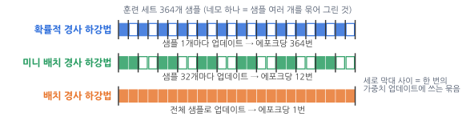
_훈련 세트 364개를 기준으로 그렸어요. 세로 막대 사이가 가중치를 한 번 업데이트할 때 쓰는 묶음이에요._

| 방식 | 한 번 업데이트에 쓰는 샘플 | 1 에포크당 업데이트 횟수 | 특징 |
|---|---|---|---|
| 확률적 경사 하강법 | 1개 | 364번 | 빠르게 움직이지만 경로가 크게 흔들려요 |
| 배치 경사 하강법 | 전체(364개) | 1번 | 경로가 매끄럽지만 한 번 계산이 무거워요 |
| 미니 배치 경사 하강법 | 일부(예: 32개) | 12번 | 두 방식의 중간이에요 |

지금까지 쓴 방식은 **확률적 경사 하강법**이었어요. 샘플 하나만 보고 가중치를 고치니까, 그 샘플이 조금 특이하면 엉뚱한 방향으로 움직이기도 해요. 그래서 손실 함수의 최솟값을 **불안정하게** 찾아가요.

**배치 경사 하강법**은 전체 샘플을 다 보고 "평균적으로 이 방향이 맞다"고 판단한 다음 한 번 움직여요. 그래서 최솟값을 **안정적으로** 찾아가요. 대신 한 번 움직일 때마다 전체 데이터를 계산해야 해서, 데이터가 아주 크면 메모리가 부족해 쓰지 못하는 경우도 있어요.

배치 경사 하강법은 "전체 샘플을 한 번에 계산"하는 방식이라 벡터화와 잘 맞아요. 이제 그 계산의 바탕이 되는 **점 곱**과 **행렬 곱셈**을 알아볼게요.

> "배치(batch)"는 원래 "한 묶음"이라는 뜻이에요. 배치 경사 하강법은 데이터 전체를 한 묶음으로, 미니 배치 경사 하강법은 데이터를 작은 묶음 여러 개로 나눠 쓰는 방법이에요.
{: .prompt-tip }

---

## 파트 2. 점 곱과 행렬 곱셈

### 2-1. 원소별 곱셈과 점 곱

단일층 신경망에서 $$z$$를 어떻게 구했는지 떠올려 볼게요. 특성 $$x_1, x_2, x_3$$에 가중치 $$w_1, w_2, w_3$$를 각각 곱해서 모두 더하고, 절편 $$b$$를 더했어요.

$$
z = x_1w_1 + x_2w_2 + x_3w_3 + b
$$

코드로는 `forpass()` 메서드에 이렇게 썼죠.

```python
z = np.sum(x * self.w) + self.b
```

여기서 `x * self.w`가 바로 넘파이의 **원소별 곱셈**이에요. 두 배열에서 **같은 자리에 있는 원소끼리** 곱해요.

$$
\begin{aligned}
\boldsymbol{x} &= [x_1,\ x_2,\ x_3] \\
\boldsymbol{w} &= [w_1,\ w_2,\ w_3] \\
\boldsymbol{x} * \boldsymbol{w} &= [x_1w_1,\ x_2w_2,\ x_3w_3]
\end{aligned}
$$

이렇게 여러 숫자를 한 줄로 늘어놓은 것을 **벡터**라고 부르고, 수식에서는 굵은 글씨($$\boldsymbol{x}$$, $$\boldsymbol{w}$$)로 써요. 그리고 두 벡터를 원소별로 곱한 다음 **모두 더하는 계산**을 **점 곱(dot product)** 또는 **스칼라 곱(scalar product)**이라고 해요. 결과가 숫자 하나(스칼라)라서 스칼라 곱이라고도 불러요. 이 글에서는 "점 곱"으로 부를게요. 수학에서는 가운데 점을 찍어 $$\boldsymbol{x} \cdot \boldsymbol{w}$$로 써요.

숫자로 해 보면 바로 이해돼요.

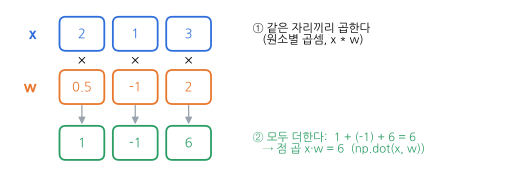

```python
x = np.array([2, 1, 3])
w = np.array([0.5, -1, 2])
print(x * w)            # 원소별 곱셈
print(np.sum(x * w))    # 모두 더하면 점 곱
print(np.dot(x, w))     # np.dot()은 이 두 단계를 한 번에
```

```text
[ 1. -1.  6.]
6.0
6.0
```

> **스칼라**는 숫자 하나를 말해요. 스칼라를 여러 개 한 줄로 모으면 **벡터**, 벡터를 여러 줄 쌓으면 **행렬**이 돼요. 키 하나 = 스칼라, 한 반 학생들의 키 목록 = 벡터, 여러 반의 키 목록을 표로 만든 것 = 행렬이라고 생각하면 쉬워요.
{: .prompt-tip }

단일층 신경망 그림도 점 곱으로 다시 그릴 수 있어요. 특성마다 따로 그리던 화살표를 벡터 하나로 묶으면 $$z = \boldsymbol{x} \cdot \boldsymbol{w} + b$$ 한 줄이 돼요.

### 2-2. 점 곱을 행렬 곱셈으로 쓰기

점 곱은 **행렬 곱셈**으로도 표현할 수 있어요. 첫 번째 벡터를 **가로(행)**로, 두 번째 벡터를 **세로(열)**로 세운 다음 곱하면 돼요.

$$
\begin{bmatrix} x_1 & x_2 & x_3 \end{bmatrix}
\begin{bmatrix} w_1 \\ w_2 \\ w_3 \end{bmatrix}
= x_1w_1 + x_2w_2 + x_3w_3
$$

행렬 곱셈의 규칙은 **"왼쪽 행렬의 행(가로줄)과 오른쪽 행렬의 열(세로줄)을 점 곱한다"**예요. 위 식에서는 왼쪽에 가로줄이 하나, 오른쪽에 세로줄이 하나라서 점 곱 한 번이 전부예요. 결과는 `np.sum(x * self.w)`와 정확히 같아요.

넘파이에서 행렬 곱셈은 `np.dot()` 함수로 해요. 그래서 `forpass()`를 이렇게 바꿀 수 있어요.

```python
z = np.dot(x, self.w) + self.b
```

### 2-3. 전체 샘플을 한 번에: 행렬 곱셈의 진짜 힘

이제 진짜 중요한 부분이에요. 훈련 데이터는 **한 행이 샘플 하나**인 2차원 배열이에요. 이걸 행렬 $$\boldsymbol{X}$$로 보고 가중치 $$\boldsymbol{W}$$와 곱하면, **모든 샘플의 점 곱이 한 번에** 계산돼요. (행렬은 벡터와 구분하려고 대문자로 써요.)

샘플이 $$m$$개, 특성이 3개라고 해 볼게요. 샘플 번호는 위첨자 괄호로 $$x^{(1)}, x^{(2)}$$처럼 붙여요.

$$
\boldsymbol{XW} =
\begin{bmatrix}
x_1^{(1)} & x_2^{(1)} & x_3^{(1)} \\
x_1^{(2)} & x_2^{(2)} & x_3^{(2)} \\
\vdots & \vdots & \vdots \\
x_1^{(m)} & x_2^{(m)} & x_3^{(m)}
\end{bmatrix}
\begin{bmatrix} w_1 \\ w_2 \\ w_3 \end{bmatrix}
=
\begin{bmatrix}
x_1^{(1)}w_1 + x_2^{(1)}w_2 + x_3^{(1)}w_3 \\
x_1^{(2)}w_1 + x_2^{(2)}w_2 + x_3^{(2)}w_3 \\
\vdots \\
x_1^{(m)}w_1 + x_2^{(m)}w_2 + x_3^{(m)}w_3
\end{bmatrix}
$$

$$\boldsymbol{X}$$의 첫 번째 행(첫 번째 샘플)과 $$\boldsymbol{W}$$를 점 곱한 값이 결과의 첫 번째 칸, 두 번째 행과 점 곱한 값이 두 번째 칸… 이런 식이에요. for문으로 364번 돌던 일을 행렬 곱셈 **한 번**이 해 주는 거예요.

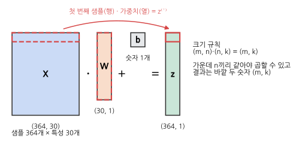

### 2-4. 행렬 곱셈의 크기 규칙

행렬 곱셈에서 꼭 기억할 규칙이 하나 있어요. 결과 행렬의 크기는 **(첫 번째 행렬의 행 수, 두 번째 행렬의 열 수)**가 돼요.

$$
(m,\ n) \cdot (n,\ k) = (m,\ k)
$$

- 가운데 두 숫자 $$n$$은 **반드시 같아야** 해요. 왼쪽 행렬의 한 행에 있는 숫자 개수와 오른쪽 행렬의 한 열에 있는 숫자 개수가 같아야 짝을 지어 곱할 수 있으니까요.
- 결과는 바깥쪽 두 숫자 $$(m, k)$$가 돼요.

종양 데이터에 적용하면 훈련 세트 $$(364, 30)$$과 가중치 $$(30, 1)$$을 곱해서 $$(364, 1)$$, 즉 **샘플마다 $$z$$ 하나씩**이 나와요.

> 행렬 크기가 헷갈리면 **"가운데가 같으면 지워지고, 바깥만 남는다"**고 외우세요. $$(364, \cancel{30}) \cdot (\cancel{30}, 1) = (364, 1)$$. 코드에서 오류가 나면 제일 먼저 `.shape`로 크기를 찍어 보는 습관을 들이면 좋아요.
{: .prompt-tip }

### 2-5. 절편 더하기: 브로드캐스팅

$$\boldsymbol{XW}$$에 절편 $$b$$를 더할 때, $$b$$를 364개 복사한 $$(364, 1)$$ 행렬을 따로 만들 필요가 없어요. 넘파이는 **행렬에 숫자 하나를 더하면 모든 원소에 그 숫자를 더해** 줘요. 이 기능을 **브로드캐스팅(broadcasting)**이라고 해요.

```python
z = np.array([[1], [2], [3]])
print(z + 10)
```

```text
[[11]
 [12]
 [13]]
```

그래서 전체 샘플의 정방향 계산은 이렇게 한 줄이면 끝나요.

$$
\boldsymbol{z} = \boldsymbol{XW} + b
$$

### 2-6. 그레이디언트도 행렬 곱셈으로: 전치

가중치를 고치려면 **그레이디언트**도 구해야 해요. 2편에서 배운 것처럼 가중치 $$w_i$$의 그레이디언트는 "오차 × 그 특성의 값"이었어요.

$$
\frac{\partial L}{\partial w_i} = -(y - a)\,x_i
$$

이제 이걸 **모든 샘플에 대해 한꺼번에** 구하고 더해 볼게요. 샘플마다의 오차 $$-(y-a)$$를 모은 열 벡터를 $$\boldsymbol{E}$$라고 할게요. 크기는 $$(364, 1)$$이에요.

첫 번째 가중치 $$w_1$$의 그레이디언트 합 $$g_1$$은 "모든 샘플의 첫 번째 특성 × 그 샘플의 오차"를 다 더한 값이에요.

$$
g_1 = x_1^{(1)}e^{(1)} + x_1^{(2)}e^{(2)} + \cdots + x_1^{(364)}e^{(364)}
$$

이건 **$$\boldsymbol{X}$$의 첫 번째 열(세로줄)과 $$\boldsymbol{E}$$의 점 곱**이에요. 그런데 행렬 곱셈은 "왼쪽의 **행**과 오른쪽의 열"을 곱하니까, $$\boldsymbol{X}$$의 열을 행으로 바꿔야 해요. 이렇게 **행과 열을 뒤바꾸는 것**을 **전치(transpose)**라고 하고, $$\boldsymbol{X}^T$$로 써요. 넘파이에서는 `x.T`예요.

```python
a = np.array([[1, 2, 3],
              [4, 5, 6]])
print(a.shape, a.T.shape)
print(a.T)
```

```text
(2, 3) (3, 2)
[[1 4]
 [2 5]
 [3 6]]
```

$$\boldsymbol{X}$$의 크기는 $$(364, 30)$$이므로 전치하면 $$(30, 364)$$가 되고, 오차 $$\boldsymbol{E}$$와 곱하면 크기 규칙에 따라 $$(30, 364) \cdot (364, 1) = (30, 1)$$, 즉 **가중치 30개 각각의 그레이디언트**가 한 번에 나와요.

$$
\boldsymbol{X}^T\boldsymbol{E} =
\begin{bmatrix}
x_1^{(1)} & x_1^{(2)} & \cdots & x_1^{(364)} \\
x_2^{(1)} & x_2^{(2)} & \cdots & x_2^{(364)} \\
\vdots & & & \vdots \\
x_{30}^{(1)} & x_{30}^{(2)} & \cdots & x_{30}^{(364)}
\end{bmatrix}
\begin{bmatrix} e^{(1)} \\ e^{(2)} \\ \vdots \\ e^{(364)} \end{bmatrix}
=
\begin{bmatrix} g_1 \\ g_2 \\ \vdots \\ g_{30} \end{bmatrix}
$$

이 값은 364개 샘플의 그레이디언트를 **모두 더한 것**이라서, 마지막에 샘플 수 364로 나눠 **평균 그레이디언트**를 구해요. 평균으로 나누지 않으면 샘플이 많을수록 그레이디언트가 커져서 가중치가 너무 크게 움직여요.

---

## 파트 3. SingleLayer 클래스에 배치 경사 하강법 적용하기

### 3-1. 데이터 준비하기

2편·3편과 같은 방식으로 데이터를 훈련, 검증, 테스트 세트로 나눠요.

```python
import numpy as np
import matplotlib.pyplot as plt
from sklearn.datasets import load_breast_cancer
from sklearn.model_selection import train_test_split

cancer = load_breast_cancer()
x = cancer.data
y = cancer.target
x_train_all, x_test, y_train_all, y_test = train_test_split(
    x, y, stratify=y, test_size=0.2, random_state=1)
x_train, x_val, y_train, y_val = train_test_split(
    x_train_all, y_train_all, stratify=y_train_all, test_size=0.2, random_state=1)
print(x_train.shape, x_val.shape)
```

```text
(364, 30) (91, 30)
```

훈련 세트는 364개 샘플에 특성 30개, 검증 세트는 91개 샘플이에요. 시작하기 전에 데이터의 크기를 확인하는 건 아주 좋은 습관이에요. 행렬 계산에서는 크기가 하나만 어긋나도 오류가 나거나, 더 나쁘게는 **오류 없이 엉뚱한 값**이 나오거든요(3-3에서 직접 볼게요).

### 3-2. forpass()와 backprop() 고치기

파트 2에서 배운 두 가지를 그대로 코드로 옮겨요.

```python
def forpass(self, x):
    z = np.dot(x, self.w) + self.b        # 선형 출력을 계산
    return z

def backprop(self, x, err):
    m = len(x)
    w_grad = np.dot(x.T, err) / m         # 가중치에 대한 평균 그레이디언트
    b_grad = np.sum(err) / m              # 절편에 대한 평균 그레이디언트
    return w_grad, b_grad
```

- `forpass()`: $$\boldsymbol{XW} + b$$. 이제 `x`에는 샘플 하나가 아니라 **훈련 세트 전체**가 들어와요.
- `backprop()`: $$\boldsymbol{X}^T\boldsymbol{E}$$를 샘플 수로 나눠요. 파이썬의 `len()`은 넘파이 배열의 **행 개수**(샘플 수)를 돌려줘요.
- 절편의 그레이디언트는 2편에서 본 것처럼 "1 × 오차"라서 **오차를 모두 더한 뒤** 샘플 수로 나누면 돼요. 즉 오차의 평균이에요.

### 3-3. fit() 고치기: for문이 하나 사라져요

`fit()`에는 원래 for문이 두 개 있었어요. **에포크를 반복하는 for문**과 **샘플을 하나씩 꺼내는 for문**이요. 이제 `forpass()`와 `backprop()`이 전체 샘플을 한꺼번에 계산하니까 **두 번째 for문이 필요 없어요.**

```python
def fit(self, x, y, epochs=100, x_val=None, y_val=None):
    y = y.reshape(-1, 1)                  # 타깃을 열 벡터로 바꾼다
    y_val = y_val.reshape(-1, 1)          # 검증용 타깃도 열 벡터로
    m = len(x)                            # 샘플 개수
    self.w = np.ones((x.shape[1], 1))     # 가중치를 (특성 개수, 1) 크기로 초기화
    self.b = 0                            # 절편을 초기화
    self.w_history.append(self.w.copy())  # 가중치를 기록
    for i in range(epochs):               # epochs만큼 반복
        z = self.forpass(x)               # 정방향 계산
        a = self.activation(z)            # 활성화 함수 적용
        err = -(y - a)                    # 오차 계산
        w_grad, b_grad = self.backprop(x, err)               # 역방향 계산
        w_grad += (self.l1 * np.sign(self.w) + self.l2 * self.w) / m   # 규제 항의 미분값을 더한다
        self.w -= self.lr * w_grad        # 가중치 업데이트
        self.b -= self.lr * b_grad        # 절편 업데이트
        self.w_history.append(self.w.copy())                 # 가중치를 기록
        a = np.clip(a, 1e-10, 1 - 1e-10)  # 안전한 로그 계산을 위해
        loss = np.sum(-(y * np.log(a) + (1 - y) * np.log(1 - a)))
        self.losses.append((loss + self.reg_loss()) / m)     # 평균 손실을 저장
        self.update_val_loss(x_val, y_val)                   # 검증 손실을 계산
```

달라진 점을 하나씩 짚어 볼게요.

**① `y.reshape(-1, 1)`: 타깃을 열 벡터로 바꿔요.** 정방향 계산 결과 `a`는 $$(364, 1)$$ 크기의 **열 벡터**(세로로 긴 행렬)예요. 그런데 `y_train`은 $$(364,)$$ 크기의 **1차원 배열**이에요. 두 개를 그냥 빼면 무슨 일이 생길까요?

```python
a = np.zeros((364, 1))
print((y_train - a).shape)
print((y_train.reshape(-1, 1) - a).shape)
```

```text
(364, 364)
(364, 1)
```

오류가 나지 않고 **364 × 364 크기의 엉뚱한 행렬**이 만들어져요! 브로드캐스팅이 "가로로 긴 것"과 "세로로 긴 것"을 서로 늘려서 표를 만들어 버리거든요. 이 상태로 훈련하면 오류 메시지도 없이 이상한 결과가 나와요. 그래서 `reshape(-1, 1)`로 `y`도 $$(364, 1)$$ 열 벡터로 맞춰요. `-1`은 "나머지는 알아서 계산해 줘"라는 뜻이라, 행 개수를 직접 쓰지 않아도 돼요.

> **크기가 다른 배열끼리 더하거나 뺄 때는 꼭 `.shape`를 확인하세요.** 넘파이는 크기가 안 맞아도 브로드캐스팅으로 어떻게든 계산을 해 버리기 때문에, 오류 없이 틀린 값이 나오는 게 가장 무서운 실수예요.
{: .prompt-warning }

**② 가중치도 열 벡터로 초기화해요.** `np.ones((x.shape[1], 1))`은 $$(30, 1)$$ 크기예요. 그래야 $$(364, 30) \cdot (30, 1)$$ 계산이 맞아요.

**③ 절편도 학습률을 곱해서 업데이트해요.** 3편에서는 절편을 `self.b -= b_grad`로 고쳤는데, 이번에는 가중치와 똑같이 `self.lr`을 곱했어요. 가중치와 절편이 같은 보폭으로 움직이는 게 더 자연스러워요.

**④ 손실을 `np.sum()`으로 한 번에 더해요.** `a`와 `y`가 모두 $$(364, 1)$$이니까 샘플별 로지스틱 손실이 한꺼번에 계산되고, `np.sum()`으로 모두 더한 뒤 샘플 수로 나눠 평균을 내요.

**⑤ 규제 항도 샘플 수 `m`으로 나눠요.** 손실과 그레이디언트를 모두 "샘플 평균"으로 바꿨으니까, 규제 항도 같은 기준에 맞춰 `m`으로 나눠요. 이렇게 해야 데이터가 많든 적든 규제의 세기가 일정하게 유지돼요.

### 3-4. predict()와 update_val_loss()도 간단해져요

`predict()`에서 쓰던 리스트 내포(`[... for x_i in x]`)도 필요 없어요. `update_val_loss()`도 for문 없이 한 번에 계산해요.

```python
def predict(self, x):
    z = self.forpass(x)                   # 정방향 계산
    return z > 0                          # 계단 함수 적용

def update_val_loss(self, x_val, y_val):
    z = self.forpass(x_val)               # 정방향 계산
    a = self.activation(z)                # 활성화 함수 적용
    a = np.clip(a, 1e-10, 1 - 1e-10)      # 출력값을 클리핑
    val_loss = np.sum(-(y_val * np.log(a) + (1 - y_val) * np.log(1 - a)))
    self.val_losses.append((val_loss + self.reg_loss()) / len(y_val))
```

`predict()`가 $$(m, 1)$$ 크기를 돌려주니까 `score()`에서도 `y`를 열 벡터로 바꿔서 비교해요.

```python
def score(self, x, y):
    return np.mean(self.predict(x) == y.reshape(-1, 1))
```

### 3-5. 전체 코드

지금까지 고친 내용을 모두 합친 `SingleLayer` 클래스예요. 그대로 복사해서 쓸 수 있어요.

```python
class SingleLayer:

    def __init__(self, learning_rate=0.1, l1=0, l2=0):
        self.w = None                     # 가중치
        self.b = None                     # 절편
        self.losses = []                  # 훈련 손실
        self.val_losses = []              # 검증 손실
        self.w_history = []               # 가중치 기록
        self.lr = learning_rate           # 학습률
        self.l1 = l1                      # L1 규제의 강도
        self.l2 = l2                      # L2 규제의 강도

    def forpass(self, x):
        z = np.dot(x, self.w) + self.b    # 선형 출력을 계산
        return z

    def backprop(self, x, err):
        m = len(x)
        w_grad = np.dot(x.T, err) / m     # 가중치에 대한 평균 그레이디언트
        b_grad = np.sum(err) / m          # 절편에 대한 평균 그레이디언트
        return w_grad, b_grad

    def activation(self, z):
        z = np.clip(z, -100, None)        # 안전한 np.exp() 계산을 위해
        a = 1 / (1 + np.exp(-z))          # 시그모이드 계산
        return a

    def fit(self, x, y, epochs=100, x_val=None, y_val=None):
        y = y.reshape(-1, 1)
        y_val = y_val.reshape(-1, 1)
        m = len(x)
        self.w = np.ones((x.shape[1], 1))
        self.b = 0
        self.w_history.append(self.w.copy())
        for i in range(epochs):
            z = self.forpass(x)
            a = self.activation(z)
            err = -(y - a)
            w_grad, b_grad = self.backprop(x, err)
            w_grad += (self.l1 * np.sign(self.w) + self.l2 * self.w) / m
            self.w -= self.lr * w_grad
            self.b -= self.lr * b_grad
            self.w_history.append(self.w.copy())
            a = np.clip(a, 1e-10, 1 - 1e-10)
            loss = np.sum(-(y * np.log(a) + (1 - y) * np.log(1 - a)))
            self.losses.append((loss + self.reg_loss()) / m)
            self.update_val_loss(x_val, y_val)

    def predict(self, x):
        z = self.forpass(x)
        return z > 0

    def score(self, x, y):
        return np.mean(self.predict(x) == y.reshape(-1, 1))

    def reg_loss(self):
        return self.l1 * np.sum(np.abs(self.w)) + self.l2 / 2 * np.sum(self.w ** 2)

    def update_val_loss(self, x_val, y_val):
        z = self.forpass(x_val)
        a = self.activation(z)
        a = np.clip(a, 1e-10, 1 - 1e-10)
        val_loss = np.sum(-(y_val * np.log(a) + (1 - y_val) * np.log(1 - a)))
        self.val_losses.append((val_loss + self.reg_loss()) / len(y_val))
```

### 3-6. 표준화하고 훈련하기

3편에서 배운 것처럼 특성의 스케일을 맞춰야 안정적으로 훈련돼요. 이번에는 사이킷런의 `StandardScaler`를 써서 평균 0, 표준 편차 1로 바꿔요. 사이킷런에서 이렇게 데이터를 변환하는 클래스들을 **변환기(transformer)**라고 하고, `sklearn.preprocessing` 모듈 아래에 모여 있어요.

```python
from sklearn.preprocessing import StandardScaler

scaler = StandardScaler()
scaler.fit(x_train)                       # 훈련 세트의 평균과 표준 편차를 익힌다
x_train_scaled = scaler.transform(x_train)
x_val_scaled = scaler.transform(x_val)    # 검증 세트도 훈련 세트 기준으로 변환
```

`fit()`으로 **변환 규칙**(훈련 세트의 평균과 표준 편차)을 익히고, `transform()`으로 실제 변환을 해요. 검증 세트도 **훈련 세트로 익힌 규칙**으로 변환한다는 점, 3편에서 강조했던 그 규칙이에요.

이제 훈련해 볼게요. L2 규제는 0.01로 하고, 에포크는 **10,000번**으로 크게 늘렸어요.

```python
single_layer = SingleLayer(l2=0.01)
single_layer.fit(x_train_scaled, y_train,
                 x_val=x_val_scaled, y_val=y_val, epochs=10000)
single_layer.score(x_val_scaled, y_val)
```

```text
0.978021978021978
```

검증 세트 91개 중 89개를 맞혔어요.

**에포크를 왜 10,000번이나 했을까요?** 핵심은 **에포크 한 번에 가중치가 몇 번 업데이트되느냐**예요.

| 방식 | 1 에포크당 업데이트 | 100 에포크 동안 업데이트 |
|---|---|---|
| 확률적 경사 하강법 | 364번 | 36,400번 |
| 배치 경사 하강법 | 1번 | 100번 |

확률적 경사 하강법은 100 에포크 동안 가중치를 36,400번이나 고쳐요. 흔들리긴 해도 목표를 향해 빠르게 다가가죠. 반면 배치 경사 하강법은 100 에포크를 해도 겨우 100번만 고쳐요. 실제로 100 에포크 시점의 훈련 손실은 0.126으로, 아직 한참 내려가는 중이었어요. 그래서 에포크를 크게 늘려 줘야 해요.

### 3-7. 손실 그래프 비교: 흔들림이 사라졌어요

같은 데이터, 같은 L2 규제로 확률적 경사 하강법(100 에포크)과 배치 경사 하강법(10,000 에포크)의 손실을 나란히 그려 봤어요.

```python
plt.ylim(0, 0.3)
plt.plot(single_layer.losses)
plt.plot(single_layer.val_losses)
plt.ylabel('loss')
plt.xlabel('epoch')
plt.legend(['train_loss', 'val_loss'])
plt.show()
```

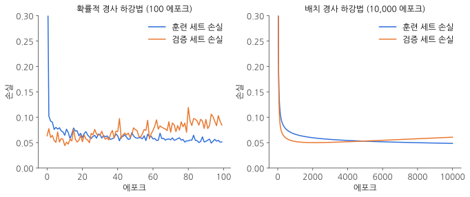
_왼쪽은 3편 방식(샘플마다 업데이트), 오른쪽은 이번에 만든 배치 방식이에요. 비교를 위해 왼쪽도 규제 세기를 오른쪽과 같은 기준으로 맞췄어요._

- **왼쪽(확률적)**: 샘플을 고르는 순서에 따라 에포크마다 손실이 **들쭉날쭉**해요.
- **오른쪽(배치)**: 전체 샘플을 보고 움직이니까 손실이 **매끄럽게** 줄어들어요. 검증 손실은 약 2,000번째 에포크에서 가장 낮고(0.050), 그 뒤로는 아주 천천히 올라가요. 3편에서 배운 조기 종료를 떠올리면, 이 모델은 2,000 에포크 정도면 충분하다는 뜻이에요.

**왜 이런 차이가 날까요?** 가중치가 움직인 길을 그려 보면 바로 보여요. 30개 가중치 중 세 번째(`w[2]`, mean perimeter)와 네 번째(`w[3]`, mean area) 가중치가 어떻게 바뀌었는지 그려 볼게요.

```python
w2 = []
w3 = []
for w in single_layer.w_history:
    w2.append(w[2])
    w3.append(w[3])
plt.plot(w2, w3)
plt.plot(w2[-1], w3[-1], 'ro')
plt.xlabel('w[2]')
plt.ylabel('w[3]')
plt.show()
```

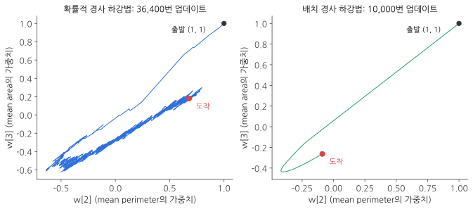

- **왼쪽(확률적)**: 출발점 (1, 1)에서 빠르게 내려오지만, 도착할 즈음에는 **같은 자리를 지그재그로 맴돌아요.** 샘플 하나하나가 서로 조금씩 다른 방향을 가리키기 때문이에요.
- **오른쪽(배치)**: 가중치가 **부드러운 곡선**을 그리며 움직여요. 가중치의 변화가 연속적이니 손실도 안정적으로 줄어들어요.

대신 배치 경사 하강법은 매번 전체 훈련 세트를 계산하니까 **한 번의 업데이트가 무겁고**, 최솟값까지 가는 데 업데이트 횟수도 많이 필요해요. 이 단점은 파트 9의 미니 배치에서 해결해요.

---

## 파트 4. 하나의 층에 뉴런을 여러 개 두기

지금까지는 층 하나에 **뉴런 하나**뿐이었어요. 이제 뉴런을 여러 개 두면 어떻게 되는지 볼게요. 쉽게 이해하려고 **특성 3개, 뉴런 2개**로 예를 들게요. 입력값(특성)이 나열된 부분은 앞으로 **입력층**이라고 부를게요.

### 4-1. 특성이 모든 뉴런에 전달돼요

뉴런이 2개면, 특성 3개가 **두 뉴런 모두에게** 전달돼요. 뉴런마다 특성에 곱할 가중치가 3개씩 필요하니까 가중치는 모두 $$3 \times 2 = 6$$개, 절편은 뉴런마다 하나씩 2개예요.

가중치에는 **"몇 번째 특성에서 → 몇 번째 뉴런으로"**를 뜻하는 번호 두 개를 붙여요. 예를 들어 $$w_{21}$$은 "2번 특성이 1번 뉴런으로 갈 때 곱하는 가중치"예요.

$$
\begin{aligned}
x_1w_{11} + x_2w_{21} + x_3w_{31} + b_1 &= z_1 \quad \text{(1번 뉴런)} \\
x_1w_{12} + x_2w_{22} + x_3w_{32} + b_2 &= z_2 \quad \text{(2번 뉴런)}
\end{aligned}
$$

뉴런이 2개니까 출력도 $$z_1, z_2$$ 두 개예요.

| | 1번 특성에 대한 | 2번 특성에 대한 | 3번 특성에 대한 |
|---|---|---|---|
| **1번 뉴런의 가중치** | $$w_{11}$$ | $$w_{21}$$ | $$w_{31}$$ |
| **2번 뉴런의 가중치** | $$w_{12}$$ | $$w_{22}$$ | $$w_{32}$$ |

> 가중치 이름의 **첫 번째 숫자는 특성(입력) 번호, 두 번째 숫자는 뉴런(출력) 번호**예요. "어디서 와서 → 어디로 가는지" 순서로 읽으면 헷갈리지 않아요.
{: .prompt-tip }

### 4-2. 가중치가 벡터에서 행렬로

위의 두 식을 행렬 곱셈으로 쓰면 이렇게 돼요.

$$
\begin{bmatrix} x_1 & x_2 & x_3 \end{bmatrix}
\begin{bmatrix}
w_{11} & w_{12} \\
w_{21} & w_{22} \\
w_{31} & w_{32}
\end{bmatrix}
+
\begin{bmatrix} b_1 & b_2 \end{bmatrix}
=
\begin{bmatrix} z_1 & z_2 \end{bmatrix}
$$

가중치 행렬의 **첫 번째 열**은 1번 뉴런의 가중치, **두 번째 열**은 2번 뉴런의 가중치예요. 입력 $$(1, 3)$$과 가중치 $$(3, 2)$$를 곱하면 크기 규칙에 따라 $$(1, 2)$$, 즉 뉴런 2개의 출력이 나와요.

여기서 기억할 점은 **뉴런을 여러 개 쓰면 가중치가 열 하나짜리 벡터가 아니라 2차원 행렬이 된다**는 거예요. 크기를 정하는 방법은 아주 간단해요.

$$
\text{가중치 행렬의 크기} = (\text{입력의 개수},\ \text{출력의 개수})
$$

뉴런이 하나뿐이면 출력이 1개라서 가중치가 $$(\text{특성 수}, 1)$$, 즉 열 벡터였던 거예요. 이 규칙을 꼭 기억해 두세요. 나중에 복잡한 신경망을 볼 때도 가중치 행렬의 크기를 바로 떠올릴 수 있어요.

위 식은 샘플 1개에 대한 거예요. 샘플 $$m$$개를 한꺼번에 계산하면 이렇게 써요.

$$
\boldsymbol{XW}_1 + \boldsymbol{b}_1 = \boldsymbol{Z}_1
$$

- $$\boldsymbol{W}_1$$의 아래 첨자 1은 **첫 번째 층**의 가중치라는 뜻이에요. 곧 나올 두 번째 층의 가중치는 $$\boldsymbol{W}_2$$로 써요.
- 절편 $$\boldsymbol{b}_1$$은 뉴런마다 하나씩인 **1차원 배열**이라 소문자로 썼어요.
- $$\boldsymbol{Z}_1$$의 크기는 $$(m, 3) \cdot (3, 2) = (m, 2)$$예요. 샘플마다 뉴런 2개의 출력이 한 줄씩이에요.

### 4-3. 출력을 하나로 모아요

우리가 풀 문제는 종양이 악성인지 양성인지 고르는 **이진 분류**예요. 그런데 뉴런이 2개면 출력도 2개라서, 둘 중 하나만 골라 쓸 수는 없겠죠. 그래서 각 뉴런의 출력을 **활성화 함수(시그모이드)에 통과시킨 다음**, 그 값들을 **마지막 뉴런 하나에 다시 모아** 최종 판단을 해요.

$$a_1, a_2$$는 $$z_1, z_2$$를 시그모이드에 통과시킨 값이에요. 그냥 "출력"과 구분하려고 **활성화 출력**이라고 부를게요. 마지막 뉴런은 활성화 출력 $$a_1, a_2$$를 입력으로 받아, 단일층 신경망과 똑같은 계산을 해요.

$$
\begin{aligned}
a_1w_1 + a_2w_2 + b_2 &= z \quad \text{(선형 방정식)} \\
\begin{bmatrix} a_1 & a_2 \end{bmatrix}
\begin{bmatrix} w_1 \\ w_2 \end{bmatrix} + b_2 &= z \quad \text{(행렬 곱셈)}
\end{aligned}
$$

샘플 전체에 대해 쓰면 이렇게 돼요.

$$
\boldsymbol{A}_1\boldsymbol{W}_2 + \boldsymbol{b}_2 = \boldsymbol{Z}_2
$$

$$\boldsymbol{A}_1$$의 크기는 (전체 샘플 수, 뉴런 수) = $$(m, 2)$$이고, $$\boldsymbol{W}_2$$는 (입력의 개수, 출력의 개수) = $$(2, 1)$$이에요. 그래서 $$\boldsymbol{Z}_2$$는 $$(m, 1)$$, 샘플마다 숫자 하나가 나와요.

### 4-4. 은닉층이 있는 신경망

이제 지금까지 본 두 부분을 하나로 연결할게요.

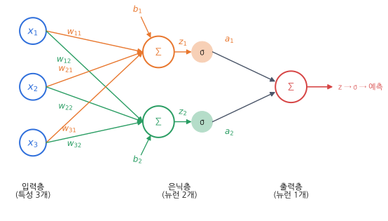
_Σ는 가중치 곱을 모두 더하는 계산, σ는 시그모이드 함수예요._

뉴런 2개짜리 층과 뉴런 1개짜리 층, **2개의 층을 가진 신경망**이 만들어졌어요. 각 부분의 이름은 이래요.

- **입력층**: 입력값(특성)이 모여 있는 곳이에요. 계산을 하지 않고 값만 전달하기 때문에 **보통 층의 개수에 넣지 않아요.** 그래서 위 그림은 "2층 신경망"이에요.
- **은닉층(hidden layer)**: 입력층과 출력층 사이에 있는 층이에요. 우리 눈에는 입력과 최종 출력만 보이고 이 층의 값은 겉으로 드러나지 않아서 "숨겨진(hidden)" 층이라고 불러요.
- **출력층(output layer)**: 은닉층을 통과한 값들을 하나로 합쳐 최종 결과를 내는 층이에요.

> 신경망 그림에서는 번거로움을 피하려고 절편을 아예 그리지 않는 경우가 많아요. 하지만 그림에 없어도 **절편은 각 뉴런의 계산에 항상 포함된다**는 점을 잊지 마세요.
{: .prompt-tip }

### 4-5. 행렬로 표기하면 간단해져요

그림에 개별 값을 다 쓰니까 복잡하죠. 행렬로 쓰면 훨씬 간단해요.

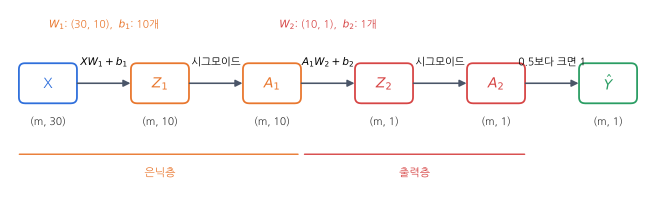
_종양 데이터(특성 30개)에 은닉층 뉴런 10개를 쓴다고 했을 때의 크기예요._

| 기호 | 뜻 | 크기 (특성 30개, 은닉 뉴런 10개) |
|---|---|---|
| $$\boldsymbol{X}$$ | 입력 행렬 | $$(m, 30)$$ |
| $$\boldsymbol{W}_1,\ \boldsymbol{b}_1$$ | 은닉층의 가중치와 절편 | $$(30, 10)$$, 10개 |
| $$\boldsymbol{Z}_1$$ | 은닉층의 출력 | $$(m, 10)$$ |
| $$\boldsymbol{A}_1$$ | 은닉층의 활성화 출력 | $$(m, 10)$$ |
| $$\boldsymbol{W}_2,\ \boldsymbol{b}_2$$ | 출력층의 가중치와 절편 | $$(10, 1)$$, 1개 |
| $$\boldsymbol{Z}_2$$ | 출력층의 출력 | $$(m, 1)$$ |
| $$\boldsymbol{A}_2$$ | 출력층의 활성화 출력 (확률) | $$(m, 1)$$ |

최종 예측을 하려면 $$\boldsymbol{Z}_2$$를 다시 시그모이드 함수에 통과시켜 확률 $$\boldsymbol{A}_2$$를 얻고, 0.5보다 크면 양성(1), 아니면 음성(0)으로 정해요.

신경망과 행렬의 관계는 이렇게 기억하면 쉬워요. **층 하나 = 가중치 행렬 하나, 뉴런 하나 = 그 행렬의 열 하나.** 층을 많이 쌓은 신경망은 행렬이 많으니까 행렬 연산도 그만큼 많이 해야 해요. 벡터화가 중요한 이유죠.

---

## 파트 5. 다층 신경망의 개념 정리

### 5-1. 뉴런 m개짜리 은닉층

보통 다층 신경망의 각 층은 뉴런을 2개 이상 가져요. 은닉층의 뉴런을 2개가 아니라 $$m$$개로 늘려 일반화하면 이렇게 돼요. 이제 그림에서는 활성화 함수를 뉴런 오른쪽에 작은 원으로 붙여서 표현해요.

$$
\underbrace{x_1, \dots, x_n}_{\text{입력층: } n\text{개}}
\ \longrightarrow\
\underbrace{z_1, \dots, z_m \ \text{(+ 활성화 함수)}}_{\text{은닉층: 뉴런 } m\text{개}}
\ \longrightarrow\
\underbrace{\text{뉴런 1개 (+ 활성화 함수)}}_{\text{출력층}}
\ \longrightarrow\ \hat{y}
$$

$$n$$개의 입력이 $$m$$개의 뉴런으로 들어가고, 은닉층을 통과한 값들이 다시 출력층으로 모여요. 이렇게 층을 쌓아 만든 신경망을 깊게(deep) 쌓을수록 **딥러닝(deep learning)**이라고 불러요.

### 5-2. 활성화 함수는 층마다 다를 수 있지만, 한 층 안에서는 같아야 해요

은닉층과 출력층의 모든 뉴런에는 활성화 함수가 필요하고, **문제에 맞는 활성화 함수**를 골라야 해요. 예를 들어 이진 분류 문제에서는 확률을 내야 하니까 **출력층에 시그모이드 함수**를 써요. 그리고 **같은 층에 있는 뉴런은 모두 같은 활성화 함수**를 써요. 층마다 다른 활성화 함수를 쓰는 방법은 다음 편부터 알아볼게요.

> **은닉층에 활성화 함수가 꼭 필요한 이유**
> 활성화 함수 없이 층을 쌓으면 $$(\boldsymbol{XW}_1)\boldsymbol{W}_2 = \boldsymbol{X}(\boldsymbol{W}_1\boldsymbol{W}_2)$$가 돼요. $$\boldsymbol{W}_1\boldsymbol{W}_2$$는 그냥 행렬 하나니까, 결국 **층을 하나만 쓴 것과 똑같아져요.** 층을 아무리 쌓아도 직선(선형) 계산을 여러 번 한 것일 뿐이에요. 중간에 시그모이드처럼 **곡선(비선형) 함수**를 끼워 넣어야 층을 쌓은 의미가 생겨요.
{: .prompt-info }

### 5-3. 모든 뉴런이 연결되어 있으면 완전 연결 신경망

입력층과 은닉층, 은닉층과 출력층 사이의 뉴런들이 **빠짐없이 모두 연결**된 신경망을 **완전 연결(fully-connected) 신경망**이라고 해요. 이런 층을 **완전 연결층**이라고 부르고, 가장 기본적인 신경망 구조예요.

같은 구조를 부르는 이름이 여러 개라서 미리 알아 두면 좋아요.

| 이름 | 붙은 이유 |
|---|---|
| 완전 연결 신경망 | 모든 뉴런이 빠짐없이 연결되어 있어서 |
| 다층 퍼셉트론 (MLP) | 퍼셉트론(뉴런)을 여러 층 쌓아서 (Multi-Layer Perceptron) |
| 밀집 연결 신경망 | 연결이 빽빽해서 (densely-connected) |
| 피드 포워드 신경망 | 데이터가 한쪽 방향(앞쪽)으로만 흘러서 (feed forward) |

신경망에는 다른 종류도 있어요. 데이터 흐름이 순환하는 **순환 신경망**, 앞쪽으로 흐르지만 모든 뉴런이 연결되지는 않은 **합성곱 신경망**이 대표적이에요. 이 둘은 뒤에서 따로 다룰게요.

---

## 파트 6. 다층 신경망에 경사 하강법 적용하기 (역전파)

이번 편에서 가장 중요하고, 가장 어려운 부분이에요. 하지만 **2편에서 배운 연쇄 법칙을 행렬로 확장한 것**일 뿐이니 겁먹지 않아도 돼요. 마지막에 작은 숫자로 직접 계산해 보면서 확인할게요.

### 6-1. 큰 그림: 무엇을 구해야 할까

2층 신경망의 계산 흐름을 다시 볼게요.

$$
\boldsymbol{X}
\xrightarrow{\ \boldsymbol{XW}_1 + \boldsymbol{b}_1\ }
\boldsymbol{Z}_1
\xrightarrow{\ \text{시그모이드}\ }
\boldsymbol{A}_1
\xrightarrow{\ \boldsymbol{A}_1\boldsymbol{W}_2 + \boldsymbol{b}_2\ }
\boldsymbol{Z}_2
\xrightarrow{\ \text{시그모이드}\ }
\boldsymbol{A}_2
\xrightarrow{\ \text{0.5 기준}\ }
\hat{\boldsymbol{Y}}
$$

- $$\boldsymbol{X}$$와 $$\boldsymbol{W}_1$$을 곱하고 $$\boldsymbol{b}_1$$을 더해 $$\boldsymbol{Z}_1$$, 시그모이드를 통과시켜 $$\boldsymbol{A}_1$$. 여기까지가 **은닉층**이에요.
- $$\boldsymbol{A}_1$$과 $$\boldsymbol{W}_2$$를 곱하고 $$\boldsymbol{b}_2$$를 더해 $$\boldsymbol{Z}_2$$, 시그모이드를 통과시켜 $$\boldsymbol{A}_2$$. 여기까지가 **출력층**이에요.

경사 하강법으로 훈련하려면 고쳐야 할 네 가지, $$\boldsymbol{W}_2,\ \boldsymbol{b}_2,\ \boldsymbol{W}_1,\ \boldsymbol{b}_1$$ 각각에 대한 **손실 함수 $$L$$의 도함수(그레이디언트)**를 구해야 해요. 손실 함수는 지금까지와 같은 **로지스틱 손실 함수**예요.

미분은 **출력층에서 은닉층 방향**, 즉 정방향의 반대로 진행해요. 그래서 **역방향 계산**, 또는 오차가 거꾸로 퍼져 나간다고 해서 **역전파(backpropagation)**라고 불러요.

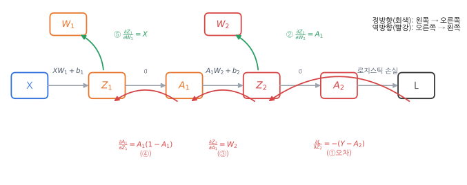
_번호 순서대로 구해 나가요. 빨간 화살표가 오차가 거꾸로 전달되는 길이에요._

### 6-2. 출력층의 가중치 W₂에 대한 미분

$$\boldsymbol{W}_2$$에 대한 손실 함수의 미분을 연쇄 법칙으로 풀어 쓰면 이래요.

$$
\frac{\partial L}{\partial \boldsymbol{W}_2}
= \frac{\partial L}{\partial \boldsymbol{Z}_2}\,\frac{\partial \boldsymbol{Z}_2}{\partial \boldsymbol{W}_2}
$$

두 조각을 하나씩 볼게요.

**① $$\frac{\partial L}{\partial \boldsymbol{Z}_2} = -(\boldsymbol{Y} - \boldsymbol{A}_2)$$**: 2편에서 유도했던 "로지스틱 손실을 $$z$$로 미분하면 $$-(y-a)$$"와 똑같아요. 샘플마다 오차가 하나씩이니까 크기는 $$(m, 1)$$이에요. 코드에서는 `err`라는 이름으로 불러요.

**② $$\frac{\partial \boldsymbol{Z}_2}{\partial \boldsymbol{W}_2} = \boldsymbol{A}_1$$**: $$\boldsymbol{Z}_2 = \boldsymbol{A}_1\boldsymbol{W}_2 + \boldsymbol{b}_2$$이니까, $$\boldsymbol{W}_2$$로 미분하면 곱해져 있던 $$\boldsymbol{A}_1$$이 남아요. 2편에서 $$z = wx + b$$를 $$w$$로 미분하면 $$x$$가 남았던 것과 같은 원리예요. 출력층 입장에서는 **은닉층의 활성화 출력 $$\boldsymbol{A}_1$$이 곧 입력**이니까요.

즉 2편의 식 $$\frac{\partial L}{\partial w_i} = -(y-a)x_i$$에서 $$x_i$$ 자리에 $$\boldsymbol{A}_1$$이 들어간 것뿐이에요.

**이제 두 조각을 곱하는데, 그냥 곱하면 안 돼요.** 행렬은 크기와 순서를 맞춰야 하죠.

- 오차 $$-(\boldsymbol{Y} - \boldsymbol{A}_2)$$: $$(m, 1)$$
- $$\boldsymbol{A}_1$$: $$(m, 2)$$ (뉴런이 2개일 때)
- 결과로 얻고 싶은 것: $$\boldsymbol{W}_2$$와 같은 $$(2, 1)$$

$$(?) \cdot (?) = (2, 1)$$이 되려면 $$(2, m) \cdot (m, 1)$$이어야 해요. 그래서 $$\boldsymbol{A}_1$$을 **전치**해서 앞에 놓아요. 파트 2-6에서 $$\boldsymbol{X}^T\boldsymbol{E}$$를 계산한 것과 완전히 같은 모양이에요.

$$
\frac{\partial L}{\partial \boldsymbol{W}_2} = \boldsymbol{A}_1^T\bigl(-(\boldsymbol{Y} - \boldsymbol{A}_2)\bigr)
$$

$$\boldsymbol{A}_1$$의 **첫 번째 열**은 모든 샘플에 대한 1번 뉴런의 활성화 출력이에요. 이 열을 각 샘플의 오차와 곱해서 모두 더하면 **1번 뉴런에서 오는 가중치의 그레이디언트 합**이 돼요. 두 번째 열도 마찬가지로 2번 뉴런의 그레이디언트 합이 되고요. 이 값은 모든 샘플의 합이니까 샘플 수 $$m$$으로 나눠 평균을 낸 뒤, 학습률을 곱해 $$\boldsymbol{W}_2$$를 업데이트해요.

### 6-3. 출력층의 절편 b₂에 대한 미분

$$
\frac{\partial L}{\partial \boldsymbol{b}_2}
= \frac{\partial L}{\partial \boldsymbol{Z}_2}\,\frac{\partial \boldsymbol{Z}_2}{\partial \boldsymbol{b}_2}
= \boldsymbol{1}^T\bigl(-(\boldsymbol{Y} - \boldsymbol{A}_2)\bigr)
$$

$$\boldsymbol{Z}_2$$를 절편으로 미분하면 1이에요. 그런데 샘플이 $$m$$개라서, 모든 원소가 1인 벡터 $$\boldsymbol{1} = [1, 1, \dots, 1]$$로 써요(굵은 글씨 1). $$\boldsymbol{1}^T$$와 오차 벡터를 곱하면 $$1 \times e^{(1)} + 1 \times e^{(2)} + \cdots$$, 즉 **오차를 모두 더한 값**이에요. 그래서 코드에서는 그냥 `np.sum(err)`로 계산해요. 이 값도 모든 샘플의 합이니까 $$m$$으로 나눠 평균을 구해요.

여기까지가 출력층이에요. 사실 단일층 신경망과 거의 같아요. 이제 새로운 부분, 은닉층으로 가 볼게요.

### 6-4. 은닉층의 가중치 W₁에 대한 미분

$$\boldsymbol{W}_1$$은 손실 함수에서 멀리 떨어져 있어요. 그래서 연쇄 법칙의 사슬이 길어져요.

$$
\frac{\partial L}{\partial \boldsymbol{W}_1}
= \underbrace{\frac{\partial L}{\partial \boldsymbol{Z}_2}}_{\text{①}}\,
  \underbrace{\frac{\partial \boldsymbol{Z}_2}{\partial \boldsymbol{A}_1}}_{\text{③}}\,
  \underbrace{\frac{\partial \boldsymbol{A}_1}{\partial \boldsymbol{Z}_1}}_{\text{④}}\,
  \underbrace{\frac{\partial \boldsymbol{Z}_1}{\partial \boldsymbol{W}_1}}_{\text{⑤}}
$$

복잡해 보이지만, **손실에서 $$\boldsymbol{W}_1$$까지 거꾸로 가는 길에 있는 정거장을 하나씩 지나는 것**뿐이에요. 위 그림의 화살표를 따라가 보세요. 조각을 하나씩 볼게요.

**① $$\frac{\partial L}{\partial \boldsymbol{Z}_2} = -(\boldsymbol{Y} - \boldsymbol{A}_2)$$**: 앞에서 구한 오차 그대로예요. 크기 $$(m, 1)$$.

**③ $$\frac{\partial \boldsymbol{Z}_2}{\partial \boldsymbol{A}_1} = \boldsymbol{W}_2$$**: $$\boldsymbol{Z}_2 = \boldsymbol{A}_1\boldsymbol{W}_2 + \boldsymbol{b}_2$$를 이번에는 $$\boldsymbol{A}_1$$로 미분하니까 $$\boldsymbol{W}_2$$가 남아요. 크기는 은닉층 뉴런 수만큼인 $$(2, 1)$$이에요. 직관적으로는 **"은닉층의 각 뉴런이 최종 결과에 얼마나 영향을 줬는지"**를 나타내요. $$\boldsymbol{W}_2$$가 큰 뉴런일수록 오차에 대한 책임도 커요.

**④ $$\frac{\partial \boldsymbol{A}_1}{\partial \boldsymbol{Z}_1} = \boldsymbol{A}_1 \odot (1 - \boldsymbol{A}_1)$$**: 2편에서 배운 **시그모이드 함수의 도함수 $$a(1-a)$$**예요. 은닉층의 뉴런마다, 샘플마다 따로 계산하니까 크기는 $$\boldsymbol{A}_1$$과 같은 $$(m, 2)$$예요. 기호 $$\odot$$는 **원소별 곱셈**을 뜻해요.

**⑤ $$\frac{\partial \boldsymbol{Z}_1}{\partial \boldsymbol{W}_1} = \boldsymbol{X}$$**: $$\boldsymbol{Z}_1 = \boldsymbol{XW}_1 + \boldsymbol{b}_1$$이니까 $$\boldsymbol{W}_1$$로 미분하면 $$\boldsymbol{X}$$가 남아요. 특성이 3개면 크기는 $$(m, 3)$$이에요.

> **원소별 곱셈($$\odot$$)과 행렬 곱셈은 달라요.** 원소별 곱셈은 크기가 같은 두 행렬에서 같은 자리끼리 곱해요.
> $$\begin{bmatrix} 1 & 6 \\ 4 & 2 \end{bmatrix} \odot \begin{bmatrix} 12 & 2 \\ 3 & 6 \end{bmatrix} = \begin{bmatrix} 12 & 12 \\ 12 & 12 \end{bmatrix}$$
> 넘파이에서 원소별 곱셈은 `*`, 행렬 곱셈은 `np.dot()`이에요.
{: .prompt-tip }

**이제 조각들을 거꾸로 순서대로 곱해요.**

**첫째, ①과 ③을 곱해요.** $$-(\boldsymbol{Y} - \boldsymbol{A}_2)$$는 $$(m, 1)$$, $$\boldsymbol{W}_2$$는 $$(2, 1)$$이에요. 오차의 모든 원소를 $$\boldsymbol{W}_2$$와 곱하려면 $$\boldsymbol{W}_2$$를 전치해서 $$(1, 2)$$로 만들어요. 그러면 $$(m, 1) \cdot (1, 2) = (m, 2)$$가 돼요.

$$
\frac{\partial L}{\partial \boldsymbol{Z}_2}\,\frac{\partial \boldsymbol{Z}_2}{\partial \boldsymbol{A}_1}
= -(\boldsymbol{Y} - \boldsymbol{A}_2)\,\boldsymbol{W}_2^T
$$

이건 **각 샘플이 만든 오차를 은닉층의 뉴런 2개에게 나눠 주는** 계산이에요. 뉴런마다 자기 가중치($$\boldsymbol{W}_2$$)만큼 책임을 나눠 받아요.

**둘째, ④를 곱해요.** 지금까지의 결과가 $$(m, 2)$$이고 $$\boldsymbol{A}_1 \odot (1 - \boldsymbol{A}_1)$$도 $$(m, 2)$$로 크기가 같으니까, 이번에는 **원소별 곱셈**을 해요. 오차가 은닉층의 시그모이드 함수를 거꾸로 통과하는 단계예요.

$$
-(\boldsymbol{Y} - \boldsymbol{A}_2)\,\boldsymbol{W}_2^T \odot \boldsymbol{A}_1 \odot (1 - \boldsymbol{A}_1)
$$

이 값은 코드에서 `err_to_hidden`(은닉층으로 전달된 오차)이라고 부를 거예요. 크기는 $$(m, 2)$$예요.

**셋째, ⑤를 곱해요.** $$\boldsymbol{X}$$는 $$(m, 3)$$, `err_to_hidden`은 $$(m, 2)$$예요. $$\boldsymbol{W}_1$$과 같은 $$(3, 2)$$를 얻으려면 $$(3, m) \cdot (m, 2)$$가 되어야 하니까 $$\boldsymbol{X}$$를 전치해서 앞에 놓아요. $$\boldsymbol{W}_2$$ 때 $$\boldsymbol{A}_1^T$$를 앞에 놓았던 것과 같은 방법이에요.

$$
\frac{\partial L}{\partial \boldsymbol{W}_1}
= \boldsymbol{X}^T\Bigl(-(\boldsymbol{Y} - \boldsymbol{A}_2)\,\boldsymbol{W}_2^T \odot \boldsymbol{A}_1 \odot (1 - \boldsymbol{A}_1)\Bigr)
$$

이것도 모든 샘플의 합이니까 $$m$$으로 나눠 평균을 낸 다음 $$\boldsymbol{W}_1$$을 업데이트해요.

### 6-5. 은닉층의 절편 b₁에 대한 미분

$$\boldsymbol{b}_2$$와 같은 원리예요. $$\frac{\partial \boldsymbol{Z}_1}{\partial \boldsymbol{b}_1} = \boldsymbol{1}$$이니까 `err_to_hidden`을 **샘플 방향(세로)으로 모두 더하면** 돼요.

$$
\frac{\partial L}{\partial \boldsymbol{b}_1}
= \boldsymbol{1}^T\Bigl(-(\boldsymbol{Y} - \boldsymbol{A}_2)\,\boldsymbol{W}_2^T \odot \boldsymbol{A}_1 \odot (1 - \boldsymbol{A}_1)\Bigr)
$$

결과는 은닉층 뉴런마다 하나씩, 크기 2의 배열이에요.

### 6-6. 숫자로 직접 따라가 보기

수식만 보면 감이 잘 안 오죠. **샘플 3개, 특성 3개, 은닉층 뉴런 2개**짜리 아주 작은 신경망으로 처음부터 끝까지 직접 계산해 볼게요.

```python
X = np.array([[1., 2., 0.],      # 샘플 1
              [0., 1., 3.],      # 샘플 2
              [2., 0., 1.]])     # 샘플 3
Y = np.array([[1.], [0.], [1.]]) # 정답
W1 = np.array([[ 0.5, -0.3],     # 1번 특성 → 뉴런 1, 뉴런 2
               [ 0.2,  0.4],     # 2번 특성 → 뉴런 1, 뉴런 2
               [-0.1,  0.6]])    # 3번 특성 → 뉴런 1, 뉴런 2
b1 = np.array([0., 0.])
W2 = np.array([[1.0], [-1.0]])   # 뉴런 1, 뉴런 2 → 출력
b2 = 0.
sigmoid = lambda z: 1 / (1 + np.exp(-z))
```

**정방향 계산**부터 할게요.

```python
Z1 = np.dot(X, W1) + b1     # (3, 3)·(3, 2) = (3, 2)
A1 = sigmoid(Z1)
Z2 = np.dot(A1, W2) + b2    # (3, 2)·(2, 1) = (3, 1)
A2 = sigmoid(Z2)
```

| | $$\boldsymbol{Z}_1$$ | $$\boldsymbol{A}_1$$ | $$\boldsymbol{Z}_2$$ | $$\boldsymbol{A}_2$$ (예측 확률) | 정답 $$\boldsymbol{Y}$$ |
|---|---|---|---|---|---|
| 샘플 1 | [0.9, 0.5] | [0.711, 0.622] | 0.088 | 0.522 | 1 |
| 샘플 2 | [-0.1, 2.2] | [0.475, 0.900] | -0.425 | 0.395 | 0 |
| 샘플 3 | [0.9, 0.0] | [0.711, 0.500] | 0.211 | 0.552 | 1 |

예를 들어 샘플 1의 $$z_1$$은 $$1 \times 0.5 + 2 \times 0.2 + 0 \times (-0.1) = 0.9$$예요. 아직 훈련 전이라 예측 확률이 모두 0.5 근처로 애매하죠.

**① 오차**를 구해요.

```python
err = -(Y - A2)
```

샘플 1은 $$-(1 - 0.522) = -0.478$$, 샘플 2는 $$-(0 - 0.395) = 0.395$$, 샘플 3은 $$-0.448$$이에요. 정답이 1인데 확률이 낮으면 음수, 정답이 0인데 확률이 높으면 양수가 나와요.

**② 출력층의 그레이디언트**를 구해요.

```python
w2_grad = np.dot(A1.T, err)   # (2, 3)·(3, 1) = (2, 1)
b2_grad = np.sum(err)
```

$$\boldsymbol{W}_2$$의 첫 번째 그레이디언트는 "1번 뉴런의 활성화 출력 × 오차"를 샘플 3개에 대해 더한 값이에요.

$$
0.711 \times (-0.478) + 0.475 \times 0.395 + 0.711 \times (-0.448) = -0.470
$$

같은 방법으로 두 번째는 $$-0.165$$, 절편은 오차의 합 $$-0.530$$이에요.

**③ 오차를 은닉층으로 나눠 주고, ④ 시그모이드를 거꾸로 통과시켜요.**

```python
err_to_hidden = np.dot(err, W2.T) * A1 * (1 - A1)   # (3, 2)
```

샘플 1을 예로 들면 이렇게 계산돼요.

| 단계 | 뉴런 1 | 뉴런 2 |
|---|---|---|
| 오차 × $$\boldsymbol{W}_2^T$$ | $$-0.478 \times 1.0 = -0.478$$ | $$-0.478 \times (-1.0) = 0.478$$ |
| $$a(1-a)$$ | $$0.711 \times 0.289 = 0.206$$ | $$0.622 \times 0.378 = 0.235$$ |
| 곱한 결과 (err_to_hidden) | $$-0.098$$ | $$0.112$$ |

뉴런 1은 출력층 가중치가 +1이라 오차를 같은 부호로, 뉴런 2는 출력층 가중치가 -1이라 **반대 부호로** 받았어요. "정답보다 확률이 낮았으니 뉴런 1은 값을 키우고, 뉴런 2는 값을 줄여야 한다"는 신호예요.

> 시그모이드의 출력 $$a$$는 항상 0과 1 사이라서 $$a(1-a)$$는 **최대 0.25**예요($$a = 0.5$$일 때). 위 표에서도 모두 0.25 이하죠. 오차가 은닉층을 거꾸로 지날 때마다 최대 4분의 1로 줄어든다는 뜻이라, 층을 아주 많이 쌓으면 앞쪽 층까지 오차가 거의 전달되지 않는 문제가 생겨요. 이 문제는 다음 편에서 다른 활성화 함수와 함께 다시 볼게요.
{: .prompt-info }

**⑤ 은닉층의 그레이디언트**를 구해요.

```python
w1_grad = np.dot(X.T, err_to_hidden)   # (3, 3)·(3, 2) = (3, 2)
b1_grad = np.sum(err_to_hidden, axis=0)
print(np.round(w1_grad, 4))
print(np.round(b1_grad, 4))
```

```text
[[-0.2821  0.336 ]
 [-0.0978  0.1891]
 [ 0.2038  0.0054]]
[-0.0916  0.1887]
```

$$\boldsymbol{W}_1$$과 똑같은 $$(3, 2)$$ 크기의 그레이디언트가 나왔어요. `axis=0`은 "세로 방향(샘플 방향)으로 더하라"는 뜻이라, `b1_grad`는 뉴런마다 하나씩 2개가 나와요.

**정말 맞는 값일까요?** 가중치를 아주 조금(0.000001) 움직였을 때 손실이 얼마나 변하는지 직접 재서 기울기를 구하는 방법(수치 미분)으로 확인해 봤어요. 역전파로 구한 값과 **소수점 아래 9자리까지 일치**했어요. 우리가 유도한 공식이 정확하다는 뜻이에요.

마지막으로 이 그레이디언트를 샘플 수 3으로 나눠 평균을 내고, 학습률 0.1을 곱해 가중치를 한 번 업데이트했더니 손실이 **1.746 → 1.718**로 줄었어요. 이걸 수천 번 반복하는 게 신경망의 훈련이에요.

지금까지 다층 완전 연결 신경망의 경사 하강법 공식을 모두 유도했어요. 연쇄 법칙을 적용하니까 **출력층에서부터 입력층 쪽으로 오차가 거꾸로 전파되는 모습**이 그대로 보이죠.

---

## 파트 7. 2개의 층을 가진 신경망 구현하기: DualLayer

### 7-1. SingleLayer 클래스를 상속해요

새로 만들 `DualLayer` 클래스는 은닉층 부분만 빼면 `SingleLayer`와 하는 일이 거의 같아요. 그래서 처음부터 다시 만들지 않고 **`SingleLayer`를 상속**한 뒤, 달라지는 메서드만 새로 정의(재정의)할게요.

파이썬에서 상속은 아주 간단해요. 클래스 이름 뒤 괄호 안에 물려받을 **부모 클래스** 이름을 쓰면 돼요. 그러면 부모의 메서드(`activation()`, `predict()`, `score()`, `update_val_loss()` 등)를 그대로 쓸 수 있어요.

> **상속**은 "부모의 기능을 물려받고, 바꾸고 싶은 부분만 고쳐 쓰는 것"이에요. 자식 클래스에 같은 이름의 메서드를 새로 만들면 부모의 메서드 대신 자식의 메서드가 쓰여요. 이걸 **재정의(오버라이딩)**라고 해요.
{: .prompt-tip }

`__init__()`에는 은닉층의 뉴런 개수를 정하는 `units` 매개변수를 추가해요.

```python
class DualLayer(SingleLayer):

    def __init__(self, units=10, learning_rate=0.1, l1=0, l2=0):
        self.units = units          # 은닉층의 뉴런 개수
        self.w1 = None              # 은닉층의 가중치
        self.b1 = None              # 은닉층의 절편
        self.w2 = None              # 출력층의 가중치
        self.b2 = None              # 출력층의 절편
        self.a1 = None              # 은닉층의 활성화 출력
        self.losses = []            # 훈련 손실
        self.val_losses = []        # 검증 손실
        self.lr = learning_rate     # 학습률
        self.l1 = l1                # L1 손실 하이퍼파라미터
        self.l2 = l2                # L2 손실 하이퍼파라미터
```

- 은닉층의 가중치와 절편은 `w1`, `b1`, 출력층의 가중치와 절편은 `w2`, `b2`에 저장해요.
- 은닉층의 활성화 출력 `a1`은 **역방향 계산에서 다시 쓰기 때문에**(6-2의 $$\boldsymbol{A}_1$$) 따로 저장해 둬요.
- `SingleLayer`에서는 학습 과정을 보려고 `w_history`에 가중치를 기록했지만, `DualLayer`에서는 기록하지 않을게요.

### 7-2. forpass(): 정방향 계산

```python
def forpass(self, x):
    z1 = np.dot(x, self.w1) + self.b1        # 첫 번째 층의 선형식을 계산
    self.a1 = self.activation(z1)            # 활성화 함수를 적용
    z2 = np.dot(self.a1, self.w2) + self.b2  # 두 번째 층의 선형식을 계산
    return z2
```

4-5의 표를 그대로 코드로 옮겼어요. $$\boldsymbol{XW}_1 + \boldsymbol{b}_1$$로 $$\boldsymbol{Z}_1$$을 만들고, 시그모이드로 $$\boldsymbol{A}_1$$을 만들고, $$\boldsymbol{A}_1\boldsymbol{W}_2 + \boldsymbol{b}_2$$로 $$\boldsymbol{Z}_2$$를 만들어 돌려줘요. `activation()`은 `SingleLayer`에서 물려받은 시그모이드 함수예요.

### 7-3. backprop(): 역방향 계산

오차를 거꾸로 전달하는 가장 중요한 메서드예요. 6-6에서 숫자로 계산한 코드와 똑같아요.

```python
def backprop(self, x, err):
    m = len(x)       # 샘플 개수
    # 출력층의 가중치와 절편에 대한 그레이디언트를 계산
    w2_grad = np.dot(self.a1.T, err) / m
    b2_grad = np.sum(err) / m
    # 시그모이드 함수까지 그레이디언트를 계산
    err_to_hidden = np.dot(err, self.w2.T) * self.a1 * (1 - self.a1)
    # 은닉층의 가중치와 절편에 대한 그레이디언트를 계산
    w1_grad = np.dot(x.T, err_to_hidden) / m
    b1_grad = np.sum(err_to_hidden, axis=0) / m
    return w1_grad, b1_grad, w2_grad, b2_grad
```

코드와 수식을 짝지어 보면 이래요.

| 코드 | 수식 |
|---|---|
| `w2_grad` | $$\boldsymbol{A}_1^T\bigl(-(\boldsymbol{Y} - \boldsymbol{A}_2)\bigr) / m$$ |
| `b2_grad` | $$\boldsymbol{1}^T\bigl(-(\boldsymbol{Y} - \boldsymbol{A}_2)\bigr) / m$$ |
| `err_to_hidden` | $$-(\boldsymbol{Y} - \boldsymbol{A}_2)\,\boldsymbol{W}_2^T \odot \boldsymbol{A}_1 \odot (1 - \boldsymbol{A}_1)$$ |
| `w1_grad` | $$\boldsymbol{X}^T \times$$ `err_to_hidden` $$/ m$$ |
| `b1_grad` | $$\boldsymbol{1}^T \times$$ `err_to_hidden` $$/ m$$ |

`err_to_hidden`을 미리 계산해 두면 `w1_grad`와 `b1_grad`를 쉽게 구할 수 있어요. 수식에서 겹치는 부분을 변수 하나로 묶어 둔 거예요.

### 7-4. fit()을 세 개의 메서드로 나누기

`fit()`이 하는 일은 `SingleLayer`와 같아요. 가중치를 초기화하고, 에포크마다 정방향 계산 → 오차 계산 → 역전파 → 가중치 업데이트 → 손실 기록을 해요. 다만 코드가 길어져서 **세 개의 작은 메서드로** 나눌게요. 이렇게 나눠 두면 파트 8, 9에서 일부만 바꿔 끼우기가 아주 편해져요.

**① 가중치 초기화는 `init_weights()`로 분리해요.** 입력 특성의 개수 `n_features`를 받아서 가중치 행렬의 크기를 정해요. 4-2의 규칙 "(입력의 개수, 출력의 개수)" 그대로예요.

```python
def init_weights(self, n_features):
    self.w1 = np.ones((n_features, self.units))  # (특성 개수, 은닉층의 크기)
    self.b1 = np.zeros(self.units)               # 은닉층의 크기
    self.w2 = np.ones((self.units, 1))           # (은닉층의 크기, 1)
    self.b2 = 0
```

**② 에포크마다 하는 일은 `training()`으로 분리해요.** 정방향 계산부터 가중치 업데이트까지 하고, 손실 계산에 쓸 출력층의 활성화 출력 `a`를 돌려줘요.

```python
def training(self, x, y, m):
    z = self.forpass(x)                  # 정방향 계산
    a = self.activation(z)               # 활성화 함수 적용
    err = -(y - a)                       # 오차 계산
    # 오차를 역전파하여 그레이디언트를 계산
    w1_grad, b1_grad, w2_grad, b2_grad = self.backprop(x, err)
    # 그레이디언트에 규제 항의 미분값을 더한다
    w1_grad += (self.l1 * np.sign(self.w1) + self.l2 * self.w1) / m
    w2_grad += (self.l1 * np.sign(self.w2) + self.l2 * self.w2) / m
    # 은닉층의 가중치와 절편을 업데이트
    self.w1 -= self.lr * w1_grad
    self.b1 -= self.lr * b1_grad
    # 출력층의 가중치와 절편을 업데이트
    self.w2 -= self.lr * w2_grad
    self.b2 -= self.lr * b2_grad
    return a
```

**③ `fit()`은 이 둘을 불러서 쓰기만 해요.**

```python
def fit(self, x, y, epochs=100, x_val=None, y_val=None):
    y = y.reshape(-1, 1)                 # 타깃을 열 벡터로 바꾼다
    y_val = y_val.reshape(-1, 1)
    m = len(x)                           # 샘플 개수
    self.init_weights(x.shape[1])        # 은닉층과 출력층의 가중치를 초기화
    for i in range(epochs):              # epochs만큼 반복
        a = self.training(x, y, m)
        a = np.clip(a, 1e-10, 1 - 1e-10) # 안전한 로그 계산을 위해
        # 로그 손실과 규제 손실을 더하여 리스트에 추가
        loss = np.sum(-(y * np.log(a) + (1 - y) * np.log(1 - a)))
        self.losses.append((loss + self.reg_loss()) / m)
        self.update_val_loss(x_val, y_val)  # 검증 세트에 대한 손실을 계산
```

**④ `reg_loss()`도 고쳐요.** 이제 가중치가 `w1`, `w2` 두 개라서 둘 다 규제해요. 절편은 3편에서 배운 것처럼 규제하지 않아요.

```python
def reg_loss(self):
    # 은닉층과 출력층의 가중치에 규제를 적용
    return self.l1 * (np.sum(np.abs(self.w1)) + np.sum(np.abs(self.w2))) + \
           self.l2 / 2 * (np.sum(self.w1 ** 2) + np.sum(self.w2 ** 2))
```

나머지 메서드(`activation()`, `predict()`, `score()`, `update_val_loss()`)는 `SingleLayer`의 것을 그대로 물려받아 써요. `predict()`와 `update_val_loss()` 안에서 부르는 `forpass()`는 자동으로 `DualLayer`의 새 `forpass()`가 쓰여요. 상속의 편리한 점이죠.

### 7-5. 전체 코드

```python
class DualLayer(SingleLayer):

    def __init__(self, units=10, learning_rate=0.1, l1=0, l2=0):
        self.units = units
        self.w1 = None
        self.b1 = None
        self.w2 = None
        self.b2 = None
        self.a1 = None
        self.losses = []
        self.val_losses = []
        self.lr = learning_rate
        self.l1 = l1
        self.l2 = l2

    def forpass(self, x):
        z1 = np.dot(x, self.w1) + self.b1
        self.a1 = self.activation(z1)
        z2 = np.dot(self.a1, self.w2) + self.b2
        return z2

    def backprop(self, x, err):
        m = len(x)
        w2_grad = np.dot(self.a1.T, err) / m
        b2_grad = np.sum(err) / m
        err_to_hidden = np.dot(err, self.w2.T) * self.a1 * (1 - self.a1)
        w1_grad = np.dot(x.T, err_to_hidden) / m
        b1_grad = np.sum(err_to_hidden, axis=0) / m
        return w1_grad, b1_grad, w2_grad, b2_grad

    def init_weights(self, n_features):
        self.w1 = np.ones((n_features, self.units))
        self.b1 = np.zeros(self.units)
        self.w2 = np.ones((self.units, 1))
        self.b2 = 0

    def fit(self, x, y, epochs=100, x_val=None, y_val=None):
        y = y.reshape(-1, 1)
        y_val = y_val.reshape(-1, 1)
        m = len(x)
        self.init_weights(x.shape[1])
        for i in range(epochs):
            a = self.training(x, y, m)
            a = np.clip(a, 1e-10, 1 - 1e-10)
            loss = np.sum(-(y * np.log(a) + (1 - y) * np.log(1 - a)))
            self.losses.append((loss + self.reg_loss()) / m)
            self.update_val_loss(x_val, y_val)

    def training(self, x, y, m):
        z = self.forpass(x)
        a = self.activation(z)
        err = -(y - a)
        w1_grad, b1_grad, w2_grad, b2_grad = self.backprop(x, err)
        w1_grad += (self.l1 * np.sign(self.w1) + self.l2 * self.w1) / m
        w2_grad += (self.l1 * np.sign(self.w2) + self.l2 * self.w2) / m
        self.w1 -= self.lr * w1_grad
        self.b1 -= self.lr * b1_grad
        self.w2 -= self.lr * w2_grad
        self.b2 -= self.lr * b2_grad
        return a

    def reg_loss(self):
        return self.l1 * (np.sum(np.abs(self.w1)) + np.sum(np.abs(self.w2))) + \
               self.l2 / 2 * (np.sum(self.w1 ** 2) + np.sum(self.w2 ** 2))
```

### 7-6. 모델 훈련하고 평가하기

L2 규제는 0.01, 에포크는 20,000번으로 정했어요.

```python
dual_layer = DualLayer(l2=0.01)
dual_layer.fit(x_train_scaled, y_train,
               x_val=x_val_scaled, y_val=y_val, epochs=20000)
dual_layer.score(x_val_scaled, y_val)
```

```text
0.989010989010989
```

검증 세트 91개 중 **90개**를 맞혔어요. `SingleLayer`(89개)보다 하나 더 맞혔네요. 다만 검증 세트가 91개뿐이라 샘플 하나 차이예요. 종양 데이터는 이미 단일층으로도 잘 풀리는 **비교적 쉬운 문제**라서 큰 차이가 나지 않는 거예요. 더 복잡한 문제일수록 층을 쌓은 효과가 크게 나타나요.

훈련 손실과 검증 손실도 그려 볼게요.

```python
plt.ylim(0, 0.3)
plt.plot(dual_layer.losses)
plt.plot(dual_layer.val_losses)
plt.ylabel('loss')
plt.xlabel('epoch')
plt.legend(['train_loss', 'val_loss'])
plt.show()
```

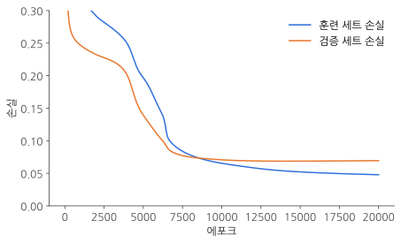

`SingleLayer`보다 손실이 **훨씬 천천히** 줄어들어요. 0.1 아래로 내려가는 데 7,000 에포크 가까이 걸렸어요. 이유는 **학습할 가중치가 훨씬 많아졌기** 때문이에요.

| 모델 | 가중치 | 절편 | 합계 |
|---|---|---|---|
| SingleLayer | 30개 | 1개 | **31개** |
| DualLayer (은닉 뉴런 10개) | 은닉층 30 × 10 = 300개 + 출력층 10개 | 은닉층 10개 + 출력층 1개 | **321개** |

고쳐야 할 값이 10배 넘게 늘었으니 시간이 더 걸리는 게 자연스러워요. 그런데 손실 그래프를 보면 처음 몇천 에포크 동안 **계단처럼 울퉁불퉁하게** 내려가요. 손실이 줄어드는 방향을 제대로 찾는 데 시간이 오래 걸린 것 같아요. 이건 **가중치 초기화**와 관련이 깊어요.

---

## 파트 8. 가중치 초기화 개선하기

### 8-1. 모두 1로 시작하면 생기는 문제

지금까지는 가중치를 **모두 1로** 놓고 훈련을 시작했어요. 단일층에서는 괜찮았지만, 은닉층이 생기면 큰 문제가 숨어 있어요.

은닉층의 뉴런 10개가 **모두 똑같은 가중치(전부 1)**로 출발하면 어떻게 될까요?

1. 같은 입력에 같은 가중치를 곱하니 10개 뉴런의 출력이 **모두 똑같아요.**
2. 출력층 가중치도 모두 1이니 오차도 10개 뉴런에게 **똑같이 나눠져요.**
3. 그러면 그레이디언트도 **똑같고**, 업데이트된 가중치도 **또 똑같아요.**

이 과정이 끝없이 반복돼요. 실제로 20,000 에포크를 훈련한 뒤에도 은닉층 10개 뉴런의 가중치는 **완전히 똑같았어요**(소수점 아래 10자리까지 같고, 그 아래는 계산 오차 수준이에요). 뉴런을 10개 만들었지만 사실상 **뉴런 1개를 10번 복사한 것**과 같은 거예요. 이 문제를 **대칭(symmetry) 문제**라고 해요.

> 반 학생 10명에게 똑같은 교과서, 똑같은 문제, 똑같은 채점 기준을 주면 10명이 모두 똑같은 답을 쓰게 돼요. 학생이 10명인 의미가 없죠. 뉴런들이 서로 다른 특징을 배우게 하려면 **출발점부터 달라야** 해요.
{: .prompt-tip }

### 8-2. 무작위 수로 초기화하기: RandomInitNetwork

그래서 이번에는 넘파이의 `random.normal()` 함수로 **정규 분포를 따르는 무작위 수**로 가중치를 초기화할게요. `normal()`의 매개변수는 순서대로 평균, 표준 편차, 배열 크기예요. 평균 0, 표준 편차 1이면 대부분 -2에서 2 사이의 서로 다른 값이 나와요.

`DualLayer`를 상속한 `RandomInitNetwork` 클래스를 만들고, `init_weights()` 메서드만 고치면 끝이에요. 파트 7에서 `fit()`을 나눠 둔 덕분에 이렇게 간단해요.

```python
class RandomInitNetwork(DualLayer):

    def init_weights(self, n_features):
        np.random.seed(42)
        self.w1 = np.random.normal(0, 1, (n_features, self.units))  # (특성 개수, 은닉층의 크기)
        self.b1 = np.zeros(self.units)                              # 은닉층의 크기
        self.w2 = np.random.normal(0, 1, (self.units, 1))           # (은닉층의 크기, 1)
        self.b2 = 0
```

`np.random.seed(42)`는 무작위 수의 시작점을 고정해서, 실행할 때마다 같은 결과가 나오게 해요. 여러분이 실행해도 이 글과 같은 숫자를 볼 수 있게 고정한 것이고, 실전에서는 고정할 필요가 없어요. 절편은 0으로 시작해도 괜찮아요. 가중치가 이미 서로 달라서 대칭이 깨졌으니까요.

이제 모델을 다시 훈련하고 손실을 그려 볼게요. 에포크는 500번만 해요.

```python
random_init_net = RandomInitNetwork(l2=0.01)
random_init_net.fit(x_train_scaled, y_train,
                    x_val=x_val_scaled, y_val=y_val, epochs=500)
random_init_net.score(x_val_scaled, y_val)
```

```text
0.989010989010989
```

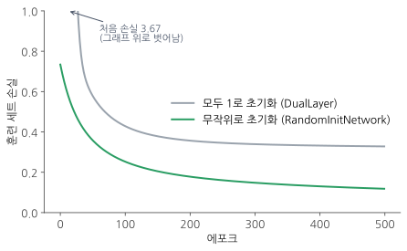
_처음 500 에포크만 비교했어요._

- **모두 1로 초기화(회색)**: 시작 손실이 **3.67**로 매우 높고, 500 에포크 뒤에도 0.33에 머물러요.
- **무작위로 초기화(초록)**: 시작 손실이 0.73이고, **매끄럽게** 줄어들어 500 에포크 만에 0.12까지 내려가요. 검증 정확도도 20,000 에포크를 돌린 `DualLayer`와 같은 0.989예요.

에포크를 40분의 1로 줄였는데도 같은 성능을 냈어요. **가중치를 무작위로 초기화한 것이 학습 속도와 성능에 큰 영향을 준 거예요.** 가중치를 초기화하는 방법은 이것 말고도 여러 가지가 있어요. 앞으로 실습하며 하나씩 알아볼게요.

> 모두 1로 시작했을 때 처음 손실이 3.67이나 된 이유도 있어요. 표준화된 특성 30개에 가중치 1을 곱해 더하면 $$z$$가 아주 커지거나 작아져서, 시그모이드 출력이 0이나 1에 딱 붙어 버려요. 그 상태에서 틀리면 로지스틱 손실이 크게 나와요. 무작위로 시작하면 양수와 음수 가중치가 섞여 서로 상쇄되니까 $$z$$가 한쪽 끝으로 치우치지 않고, 처음 손실도 0.73 정도에서 시작해요.
{: .prompt-info }

---

## 파트 9. 미니 배치 경사 하강법

### 9-1. 두 방식의 장점만 섞기

배치 경사 하강법은 손실이 매끄럽게 줄어들지만, 매번 **전체 데이터**를 계산하니 훈련하는 데 시간이 오래 걸려요. 딥러닝에서는 데이터가 수십만, 수백만 개인 경우가 흔해서 배치 방식은 쓰기 어려워요. 그래서 실전에서는 확률적 경사 하강법과 배치 경사 하강법의 장점을 절충한 **미니 배치(mini-batch) 경사 하강법**을 널리 써요.

방법은 간단해요. 에포크마다 전체 데이터를 쓰는 대신, 데이터를 **작은 묶음(미니 배치)으로 나눠서** 묶음마다 정방향 계산 → 그레이디언트 계산 → 가중치 업데이트를 해요. 미니 배치 안에서는 배치 경사 하강법과 똑같이 행렬로 한 번에 계산해요.

- 미니 배치 크기가 **1**이면? → 샘플 하나씩이니 **확률적 경사 하강법**이에요.
- 미니 배치 크기가 **전체 데이터 크기**면? → 한 번에 전부니 **배치 경사 하강법**이에요.

즉 미니 배치 경사 하강법은 그 사이 어딘가에 있어요. 크기가 작으면 확률적 경사 하강법처럼 **빠르지만 많이 흔들리고**, 크면 배치 경사 하강법처럼 **안정적이지만 느려요.** 미니 배치의 크기는 보통 16, 32, 64처럼 2의 배수를 써요. 중요한 점은 **정답인 크기가 정해져 있지 않다**는 거예요. 문제마다 달라서, 미니 배치 크기도 튜닝해야 하는 **하이퍼파라미터**예요.

### 9-2. MinibatchNetwork 클래스 만들기

`RandomInitNetwork`를 상속해서 만들어요. 배치 크기를 받아야 하니 `__init__()`에 `batch_size` 매개변수를 추가해요.

```python
class MinibatchNetwork(RandomInitNetwork):

    def __init__(self, units=10, batch_size=32, learning_rate=0.1, l1=0, l2=0):
        super().__init__(units, learning_rate, l1, l2)   # 나머지는 부모에게 전달
        self.batch_size = batch_size                     # 배치 크기
```

`super()`는 **부모 클래스**를 가리켜요. `super().__init__(...)`은 "부모의 초기화 메서드를 그대로 실행해 줘"라는 뜻이에요. 그래서 새로 추가된 `batch_size`만 직접 관리하고, 나머지 매개변수는 부모에게 맡겨요.

### 9-3. fit(): 미니 배치를 도는 for문 추가

`fit()`은 거의 같지만, 에포크를 도는 for문 **안에** 미니 배치를 도는 for문이 하나 더 들어가요.

```python
def fit(self, x, y, epochs=100, x_val=None, y_val=None):
    y_val = y_val.reshape(-1, 1)          # 검증용 타깃을 열 벡터로 바꾼다
    self.init_weights(x.shape[1])         # 은닉층과 출력층의 가중치를 초기화
    np.random.seed(42)
    for i in range(epochs):               # epochs만큼 반복
        loss = 0
        # 제너레이터 함수에서 반환한 미니 배치를 순환
        for x_batch, y_batch in self.gen_batch(x, y):
            y_batch = y_batch.reshape(-1, 1)  # 타깃을 열 벡터로 바꾼다
            m = len(x_batch)                  # 샘플 개수를 저장
            a = self.training(x_batch, y_batch, m)
            a = np.clip(a, 1e-10, 1 - 1e-10)  # 안전한 로그 계산을 위해
            # 로그 손실을 누적
            loss += np.sum(-(y_batch * np.log(a) + (1 - y_batch) * np.log(1 - a)))
        self.losses.append((loss + self.reg_loss()) / len(x))
        self.update_val_loss(x_val, y_val)    # 검증 세트에 대한 손실을 계산
```

`DualLayer`의 `fit()`과 다른 점은 세 가지예요.

1. `gen_batch()`가 훈련 데이터를 `batch_size`만큼 잘라서 하나씩 건네주면, 그걸 `training()`에 넘겨요. **`training()`은 고칠 필요가 없어요.** 받은 데이터가 전체든 일부든 똑같이 행렬로 계산하니까요.
2. 샘플 개수 `m`을 **미니 배치마다** 다시 계산해요. 마지막 미니 배치는 크기가 작을 수 있거든요(364 ÷ 32 = 11 묶음 + 나머지 12개).
3. 미니 배치마다 나온 손실을 누적하려고 **에포크마다 `loss`를 0으로 초기화**해요. 에포크가 끝나면 전체 샘플 수로 나눠 평균을 내요.

### 9-4. gen_batch(): 제너레이터로 미니 배치 만들기

이제 남은 일은 `gen_batch()` 메서드를 만드는 거예요. 이 메서드는 파이썬의 **제너레이터(generator)**로 만들어요.

```python
# 미니 배치 제너레이터 함수
def gen_batch(self, x, y):
    length = len(x)
    bins = length // self.batch_size      # 미니 배치 횟수
    if length % self.batch_size:
        bins += 1                         # 나누어떨어지지 않을 때
    indexes = np.random.permutation(np.arange(len(x)))  # 인덱스를 섞는다
    x = x[indexes]
    y = y[indexes]
    for i in range(bins):
        start = self.batch_size * i
        end = self.batch_size * (i + 1)
        yield x[start:end], y[start:end]  # batch_size만큼 슬라이싱하여 반환
```

**제너레이터가 뭔가요?** 보통 함수는 `return`으로 값을 한 번 돌려주고 끝나요. 그런데 `return` 대신 **`yield`**를 쓰면, 값을 하나 돌려준 뒤 **그 자리에서 잠시 멈췄다가**, 다음 값을 요청받으면 멈춘 곳부터 다시 이어서 실행해요. 그래서 for문과 함께 쓰면 값을 하나씩 차례로 꺼내 쓸 수 있어요.

> 제너레이터는 **번호표 기계**와 비슷해요. 번호표 100장을 미리 다 뽑아 두는 게 아니라, 손님이 올 때마다 한 장씩 뽑아 줘요. 미니 배치 12개를 미리 리스트로 만들어 메모리에 다 올려 두지 않고, 필요할 때 하나씩 잘라 주니까 **메모리를 효율적으로** 쓸 수 있어요.
{: .prompt-tip }

코드를 한 줄씩 보면 이래요.

- `bins`: 미니 배치를 몇 번 만들지 계산해요. `//`는 몫, `%`는 나머지예요. 364를 32로 나누면 몫이 11, 나머지가 12라서 나머지 12개를 위해 1을 더해 **12번**이에요.
- `np.random.permutation()`: 3편에서도 쓴 함수로, 인덱스를 무작위로 섞어요. `gen_batch()`는 에포크마다 호출되니까 **에포크마다 미니 배치 구성이 달라져요.** 매번 똑같은 순서와 묶음으로 반복하지 않게 해 주는 거예요.
- `yield x[start:end], y[start:end]`: `batch_size`만큼 잘라서 돌려줘요. 마지막 미니 배치에서 `end`가 데이터 길이를 넘어도, 넘파이 슬라이싱은 있는 데까지만 잘라 줘서 오류가 나지 않아요.

나머지 메서드는 모두 `RandomInitNetwork`에서 물려받아요.

### 9-5. 미니 배치 경사 하강법 적용하기

먼저 `batch_size`를 기본값 32로 훈련해 볼게요.

```python
minibatch_net = MinibatchNetwork(l2=0.01, batch_size=32)
minibatch_net.fit(x_train_scaled, y_train,
                  x_val=x_val_scaled, y_val=y_val, epochs=500)
minibatch_net.score(x_val_scaled, y_val)
```

```text
0.978021978021978
```

이번에는 `batch_size`를 128로 늘려서 다시 훈련해 볼게요.

```python
minibatch_net = MinibatchNetwork(l2=0.01, batch_size=128)
minibatch_net.fit(x_train_scaled, y_train,
                  x_val=x_val_scaled, y_val=y_val, epochs=500)
minibatch_net.score(x_val_scaled, y_val)
```

```text
0.989010989010989
```

정확도는 91개 중 89개, 90개로 샘플 하나 차이예요. 더 중요한 차이는 **손실이 줄어드는 속도**에 있어요. 파트 8의 배치 방식(`RandomInitNetwork`)까지 세 가지 훈련 손실을 한 그래프에 그려 봤어요.

```python
plt.plot(minibatch_net.losses)
plt.plot(minibatch_net.val_losses)
plt.ylabel('loss')
plt.xlabel('iteration')
plt.legend(['train_loss', 'val_loss'])
plt.show()
```

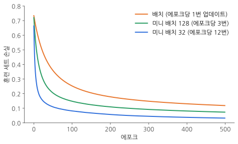

| 방식 | 에포크당 업데이트 | 훈련 손실이 0.15 아래로 내려간 에포크 | 500 에포크 뒤 훈련 손실 |
|---|---|---|---|
| 배치 (전체 364개) | 1번 | 291번째 | 0.118 |
| 미니 배치 128 | 3번 | 97번째 | 0.073 |
| 미니 배치 32 | 12번 | **25번째** | **0.032** |

미니 배치 경사 하강법은 에포크마다 업데이트가 **여러 번** 일어나니까 배치 방식보다 **훨씬 빨리 수렴**해요. 배치 크기가 작을수록 더 빨라요.

그럼 무조건 작을수록 좋을까요? 훈련 손실과 검증 손실을 함께 보면 이야기가 달라져요.

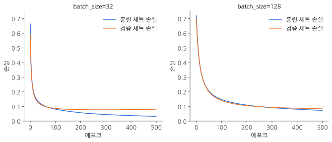

- **batch_size=32 (왼쪽)**: 훈련 손실은 계속 내려가지만, 검증 손실은 약 290번째 에포크에서 가장 낮고(0.077) 그 뒤로는 살짝 올라가요. 빨리 배우는 만큼 **과대적합도 빨리** 시작돼요.
- **batch_size=128 (오른쪽)**: 손실이 줄어드는 속도는 느리지만, 두 손실이 거의 겹쳐서 **안정적으로** 함께 내려가요.

`batch_size`를 128로 늘렸더니 손실 그래프는 더 안정적으로 바뀌었지만 손실이 줄어드는 속도는 느려졌어요. 일반적으로 미니 배치의 크기는 **32~512개 사이**에서 정해요. 다른 값도 넣어 보면서 그래프가 어떻게 바뀌는지 관찰해 보세요.

지금까지 신경망 모델을 직접 만들어 배치 경사 하강법과 미니 배치 경사 하강법을 구현하고, 2개의 층을 가진 신경망의 역전파도 직접 만들었어요. 마지막으로 사이킷런으로 같은 구조의 신경망을 만들어 볼게요.

---

## 파트 10. 사이킷런으로 다층 신경망 훈련하기

### 10-1. MLPClassifier 객체 만들기

사이킷런에는 신경망 알고리즘이 이미 구현되어 있어요. `sklearn.neural_network` 모듈 아래에 분류용 **`MLPClassifier`**, 회귀용 **`MLPRegressor`**가 있어요. MLP는 파트 5에서 본 **다층 퍼셉트론(Multi-Layer Perceptron)**의 약자예요.

사이킷런의 다른 모델과 사용법이 똑같아요. 객체를 만들고 `fit()`으로 훈련하고 `score()`로 정확도를 평가해요. 새로운 샘플을 예측할 때는 `predict()`를 써요.

```python
from sklearn.neural_network import MLPClassifier

mlp = MLPClassifier(hidden_layer_sizes=(10, ), activation='logistic',
                    solver='sgd', alpha=0.01, batch_size=32,
                    learning_rate_init=0.1, max_iter=500, random_state=42)
```

우리가 만든 `MinibatchNetwork(l2=0.01, batch_size=32)`와 **같은 구조**로 설정했어요. 매개변수를 하나씩 볼게요.

| 매개변수 | 이번 설정 | 뜻 | 기본값 |
|---|---|---|---|
| `hidden_layer_sizes` | `(10, )` | 은닉층의 수와 뉴런 개수를 튜플로 지정. 은닉층 1개에 뉴런 10개 | `(100, )` |
| `activation` | `'logistic'` | 은닉층의 활성화 함수. `logistic`이 시그모이드 함수예요 | `'relu'` |
| `solver` | `'sgd'` | 경사 하강법 알고리즘의 종류 | `'adam'` |
| `alpha` | `0.01` | L2 규제의 강도 (우리 모델의 `l2`) | `0.0001` |
| `batch_size` | `32` | 미니 배치의 크기 | `'auto'` (최대 200) |
| `learning_rate_init` | `0.1` | 학습률의 초깃값 | `0.001` |
| `max_iter` | `500` | 최대 에포크 횟수 | `200` |
| `random_state` | `42` | 가중치 초기화와 섞기를 고정해서 결과를 재현 | 없음 |

조금 더 자세히 짚어 볼게요.

- **`hidden_layer_sizes`**: 뉴런 10개짜리 은닉층을 2개 쓰고 싶으면 `(10, 10)`처럼 써요. `(10, )`처럼 쉼표를 붙이는 이유는 원소가 하나인 **튜플**이라는 걸 나타내기 위해서예요. `(10)`이라고만 쓰면 파이썬은 그냥 숫자 10으로 봐요.
- **`activation`**: 기본값인 **렐루(ReLU)** 함수는 다음 편에서 자세히 알아볼게요. S자 모양의 또 다른 함수인 **하이퍼볼릭 탄젠트(tanh)**를 쓰려면 `'tanh'`를 넣어요. 사이킷런의 신경망은 은닉층마다 다른 활성화 함수를 지정할 수 없어요. 다음 편부터 쓸 텐서플로 같은 딥러닝 전문 패키지는 은닉층마다 다르게 정할 수 있어요.
- **`solver`**: 최신 사이킷런의 기본값은 `'adam'`이라는 더 발전된 경사 하강법이에요. 여기서는 지금까지 배운 방식과 맞추려고 `'sgd'`를 직접 지정했어요. 사이킷런의 `'sgd'`는 이름은 확률적 경사 하강법이지만 `batch_size`만큼씩 묶어서 계산하는 **미니 배치 방식**으로 동작해요.
- **`alpha`**: 일반적으로 L1 규제는 효과가 크지 않아서 사이킷런의 신경망 모델은 **L2 규제만** 지원해요.

### 10-2. 모델 훈련하기

표준화한 훈련 세트로 훈련하고, 검증 세트로 정확도를 확인해요.

```python
mlp.fit(x_train_scaled, y_train)
mlp.score(x_val_scaled, y_val)
```

```text
0.978021978021978
```

우리가 직접 만든 `MinibatchNetwork`(batch_size=32)와 같은 0.978이에요. 직접 만든 모델이 사이킷런과 같은 수준으로 동작한다는 뜻이에요.

> `max_iter=500`으로 정했지만, 실제로는 **220번째 에포크에서 훈련이 멈췄어요**(`mlp.n_iter_`로 확인할 수 있어요). 사이킷런은 훈련 손실이 10 에포크 연속으로 거의 줄지 않으면(`tol`, `n_iter_no_change` 매개변수) 스스로 멈추기 때문이에요. 또 `random_state`를 바꾸면 정확도가 0.967~0.978 사이에서 조금씩 달라졌어요. 가중치를 무작위로 초기화하니까 시작점에 따라 결과가 약간 달라지는 거예요. 우리 모델과 사이킷런은 가중치 초기화 방식 같은 세부 구현이 조금씩 달라서 숫자가 완전히 같지는 않아요.
{: .prompt-info }

---

## 마무리

### 핵심 요약

| 개념 | 한 줄 설명 |
|---|---|
| 벡터화 | for문 대신 배열(벡터, 행렬) 단위로 한꺼번에 계산하는 것. 훨씬 빨라요 |
| 점 곱 | 두 벡터를 원소별로 곱해서 모두 더한 값. `np.dot()` |
| 행렬 곱셈 | 왼쪽 행렬의 행과 오른쪽 행렬의 열을 점 곱. 크기 규칙 $$(m, n) \cdot (n, k) = (m, k)$$ |
| 전치 | 행렬의 행과 열을 바꾸는 것. $$\boldsymbol{X}^T$$, 넘파이에서는 `x.T` |
| 브로드캐스팅 | 크기가 다른 배열을 넘파이가 자동으로 늘려서 계산해 주는 기능 |
| 배치 경사 하강법 | 전체 샘플로 한 번 업데이트. 안정적이지만 느려요 |
| 미니 배치 경사 하강법 | 작은 묶음마다 업데이트. 확률적·배치 방식의 절충안 |
| 가중치 행렬의 크기 | (입력의 개수, 출력의 개수) |
| 입력층·은닉층·출력층 | 입력이 모인 곳, 중간에 숨은 층, 최종 결과를 내는 층. 입력층은 층 수에 넣지 않아요 |
| 완전 연결 신경망 | 모든 뉴런이 연결된 신경망. 다층 퍼셉트론(MLP), 밀집 연결, 피드 포워드 신경망이라고도 해요 |
| 역전파 | 연쇄 법칙으로 오차를 출력층에서 은닉층으로 거꾸로 전달하며 그레이디언트를 구하는 방법 |
| 원소별 곱셈 | 같은 자리끼리 곱하기. 기호 $$\odot$$, 넘파이에서는 `*` |
| 대칭 문제 | 가중치를 모두 같은 값으로 시작하면 은닉층 뉴런들이 끝까지 똑같이 움직이는 문제 |
| 상속 | 부모 클래스의 기능을 물려받고 필요한 메서드만 재정의하는 것 |
| 제너레이터 | `yield`로 값을 하나씩 차례로 돌려주는 함수. 메모리를 아껴요 |

### 이번 편의 결과 한눈에 보기

| 모델 | 설정 | 검증 정확도 |
|---|---|---|
| SingleLayer (배치) | l2=0.01, 10,000 에포크 | 0.978 |
| DualLayer (가중치 1로 시작) | l2=0.01, 20,000 에포크 | 0.989 |
| RandomInitNetwork | l2=0.01, 500 에포크 | 0.989 |
| MinibatchNetwork | batch_size=32, 500 에포크 | 0.978 |
| MinibatchNetwork | batch_size=128, 500 에포크 | 0.989 |
| MLPClassifier | 같은 구조, batch_size=32 | 0.978 |

검증 세트가 91개라 0.978과 0.989는 샘플 **하나** 차이예요. 이 데이터에서는 정확도보다 **훈련에 걸린 에포크 수와 손실 그래프의 모양**이 각 방법의 차이를 더 잘 보여 줘요.

### 헷갈리기 쉬운 포인트

1. **원소별 곱셈(`*`)과 행렬 곱셈(`np.dot()`)은 달라요.** 원소별 곱셈은 크기가 같아야 하고, 행렬 곱셈은 가운데 크기가 같아야 해요.
2. **`(364,)`와 `(364, 1)`은 달라요.** 1차원 배열과 열 벡터를 빼면 오류 없이 `(364, 364)` 행렬이 나와요. 꼭 `reshape(-1, 1)`로 맞추세요.
3. **역전파에서 곱하는 순서와 전치에 주의하세요.** 결과가 가중치와 같은 크기가 되도록 전치해서 앞에 놓아요($$\boldsymbol{A}_1^T$$, $$\boldsymbol{X}^T$$).
4. **그레이디언트는 샘플 수로 나눠 평균을 내요.** 행렬 곱셈 결과는 모든 샘플의 합이에요.
5. **배치 경사 하강법은 에포크를 많이 늘려야 해요.** 에포크당 업데이트가 1번뿐이니까요.
6. **은닉층이 있으면 가중치를 모두 같은 값으로 초기화하면 안 돼요.** 뉴런들이 똑같이 움직이는 대칭 문제가 생겨요.
7. **입력층은 층의 개수에 넣지 않아요.** 은닉층 1개 + 출력층 1개 = 2층 신경망이에요.
8. **은닉층의 활성화 함수는 꼭 필요해요.** 없으면 층을 쌓아도 하나의 층과 같아져요.
9. **미니 배치 크기도 하이퍼파라미터예요.** 작으면 빠르지만 흔들리고, 크면 안정적이지만 느려요.

지금까지 층을 2개로 쌓은 신경망을 행렬로 직접 만들고, 역전파 공식까지 손으로 유도해 봤어요. 여기까지 따라오셨다면 신경망이 "내부에서 실제로 무슨 계산을 하는지" 다 아시는 거예요. 다음 편부터는 딥러닝 전문 패키지인 **텐서플로**로 신경망을 만들어 보겠습니다. 궁금한 점이나 틀린 부분이 있으면 편하게 알려 주세요!
