> **이 글에서 배우는 것**
> 지금까지는 종양이 악성인지 양성인지, **둘 중 하나**를 고르는 이진 분류만 했어요. 이번에는 티셔츠, 바지, 가방, 운동화처럼 **여러 개 중 하나**를 고르는 **다중 분류**를 배웁니다. 출력값을 확률로 바꿔 주는 **소프트맥스 함수**, 다중 분류용 손실 함수인 **크로스 엔트로피**를 숫자로 계산해 보고, 의류 이미지 6만 장으로 신경망을 직접 훈련합니다. 마지막에는 딥러닝 패키지인 **텐서플로와 케라스**로 같은 신경망을 단 몇 줄로 만들어 봐요.
{: .prompt-info }

이번 글도 길어서 열한 개 파트로 나눴어요. 4편에서 만든 `MinibatchNetwork`를 조금만 고치면 다중 분류 신경망이 돼요.

| 파트 | 내용 | 한 줄 요약 |
|---|---|---|
| 1 | 다중 분류 신경망의 구조 | 출력층에 클래스 개수만큼 뉴런을 둬요 |
| 2 | 소프트맥스 함수 | 출력값의 합을 1로 만들어 확률처럼 비교해요 |
| 3 | 크로스 엔트로피 손실 함수 | 정답 클래스의 확률에 $$-\log$$를 붙인 값이에요 |
| 4 | 크로스 엔트로피 미분 | 결과가 로지스틱 손실과 똑같이 $$-(y-a)$$예요 |
| 5 | MultiClassNetwork 구현 | 4편의 코드에서 몇 군데만 고쳐요 |
| 6 | 의류 이미지 데이터 준비 | 28×28 흑백 이미지 6만 장 |
| 7 | 원-핫 인코딩 | 정답 번호를 0과 1로 된 배열로 바꿔요 |
| 8 | 직접 만든 신경망 훈련하기 | 검증 정확도 약 81% |
| 9 | 텐서플로와 케라스 | 딥러닝 전문 패키지를 쓰는 이유 |
| 10 | Sequential과 Dense | 층을 블록처럼 쌓아 신경망을 만들어요 |
| 11 | 케라스로 다중 분류 신경망 만들기 | 검증 정확도 약 86% |

> 이번 편에는 지수 함수 $$e^z$$와 로그 $$\log$$, 그리고 분수를 미분하는 방법이 자주 나와요. 이 부분이 낯설다면 **[보충] 지수 함수, 로그, 분수의 미분 쉽게 이해하기**를 먼저 읽고 오면 훨씬 수월해요. [보충 글 바로 가기](/posts/ml-basics-extra-02-exp-log/)
{: .prompt-tip }

---

## 파트 1. 다중 분류 신경망은 출력층만 달라요

### 1-1. 이진 분류 신경망 다시 보기

4편에서 만든 2층 신경망을 떠올려 볼게요. 이진 분류를 위해 **출력층에 뉴런을 하나만** 두었어요. 출력층의 활성화 출력(시그모이드를 통과한 값)이 0.5보다 크면 양성 클래스, 아니면 음성 클래스로 분류했죠.

뉴런이 하나뿐인데 어떻게 두 클래스를 구분할 수 있었을까요? 출력값 $$\hat{y}$$ 하나가 "양성일 확률"을 뜻하고, "음성일 확률"은 $$1 - \hat{y}$$로 저절로 정해지기 때문이에요. 종양 데이터라면 "양성 종양일 확률이 0.9"라고만 말해도 "악성 종양일 확률은 0.1"이라는 걸 알 수 있죠. 그래서 뉴런 하나로 충분했어요.

### 1-2. 클래스 수만큼 출력 뉴런을 둬요

그런데 자동차, 비행기, 로켓 중 하나를 고르는 문제라면 어떨까요? "자동차일 확률이 0.6"이라는 것만으로는 나머지 0.4가 비행기와 로켓에 어떻게 나뉘는지 알 수 없어요. 그래서 다중 분류 신경망은 **출력층에 분류할 클래스 개수만큼 뉴런을 둡니다.** 클래스가 3개면 출력 뉴런도 3개, 10개면 10개예요.

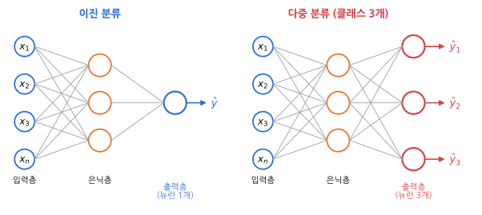
_입력층과 은닉층은 똑같고, 출력층의 뉴런 개수만 달라요._

- **이진 분류**: 양성 클래스에 대한 확률 $$\hat{y}$$ **하나**만 출력해요.
- **다중 분류**: 클래스마다 확률을 하나씩 출력해요. 첫 번째 클래스의 확률은 $$\hat{y}_1$$, 두 번째는 $$\hat{y}_2$$, 세 번째는 $$\hat{y}_3$$이에요. 그리고 **가장 큰 값을 가진 클래스**를 정답으로 예측해요.

4편에서 배운 규칙 "가중치 행렬의 크기 = (입력의 개수, 출력의 개수)"를 떠올리면, 출력층 가중치 $$\boldsymbol{W}_2$$의 크기가 **(은닉층의 뉴런 개수, 클래스 개수)**가 된다는 것도 바로 알 수 있어요. 이진 분류에서는 클래스 쪽 숫자가 1이었던 거고요.

---

## 파트 2. 소프트맥스 함수: 출력의 합을 1로 만들기

### 2-1. 시그모이드만 쓰면 생기는 문제

자동차, 비행기, 로켓 이미지를 분류하는 신경망이 있다고 해 볼게요. 출력층의 세 뉴런에 지금까지처럼 **시그모이드 함수**를 쓴다면, 두 자동차 사진에 대한 출력이 이렇게 나올 수 있어요.

| | 자동차 | 비행기 | 로켓 | 합 |
|---|---|---|---|---|
| 왼쪽 샘플 (스포츠카 사진) | 0.9 | 0.8 | 0.7 | 2.4 |
| 오른쪽 샘플 (오래된 자동차 사진) | 0.5 | 0.2 | 0.1 | 0.8 |

두 신경망 모두 자동차의 값이 가장 크니까 "자동차"라고 예측해요. 그런데 **어느 쪽이 더 확신 있게 자동차라고 말한 걸까요?**

숫자만 보면 왼쪽의 자동차 값(0.9)이 오른쪽(0.5)보다 크니 왼쪽이 더 확신하는 것 같아요. 하지만 왼쪽을 다시 보면 뉴런들이 각자 "90% 확률로 자동차다", "80% 확률로 비행기다", "70% 확률로 로켓이다"라고 주장하고 있어요. 셋 다 확신에 차 있으니 사실상 **헷갈리고 있는 거예요.** 반대로 오른쪽은 값이 전체적으로 작지만 자동차만 눈에 띄게 높아요.

문제는 **출력값의 합이 1이 아니라서** 서로 공정하게 비교할 수 없다는 거예요. 시그모이드는 뉴런마다 따로따로 0~1 사이 값을 만들 뿐, 다른 뉴런의 값은 전혀 신경 쓰지 않거든요. 2.4나 0.8을 "확률의 합"이라고 부를 수는 없겠죠.

### 2-2. 소프트맥스 함수의 정의

이 문제를 해결하는 함수가 **소프트맥스 함수(softmax function)**예요. 소프트맥스는 출력층의 출력 강도를 **정규화**해요. 여기서 정규화한다는 건 **전체 출력값의 합을 1로 만든다**는 뜻이에요. 합이 1이면 각 값을 진짜 확률처럼 해석할 수 있어요.

출력이 3개인 신경망에서 소프트맥스 함수는 이렇게 생겼어요. $$z_1, z_2, z_3$$는 출력층의 세 뉴런이 계산한 **선형 출력**(가중치 곱의 합 + 절편)이고, $$e$$는 약 2.718인 **자연 상수**예요.

$$
a_1 = \frac{e^{z_1}}{e^{z_1} + e^{z_2} + e^{z_3}}, \quad
a_2 = \frac{e^{z_2}}{e^{z_1} + e^{z_2} + e^{z_3}}, \quad
a_3 = \frac{e^{z_3}}{e^{z_1} + e^{z_2} + e^{z_3}}
$$

어렵게 볼 것 없어요. 하는 일은 딱 두 단계예요.

1. 각 출력을 $$e^z$$로 바꿔요. (지수 함수는 항상 **양수**를 만들고, 큰 값을 **더 크게** 벌려 줘요.)
2. 그 값들을 **모두 더한 값으로 나눠요.** 전체에서 내 몫이 얼마인지 비율을 구하는 거예요.

피자 한 판을 나눌 때 각자 낸 돈의 비율대로 조각을 나누는 것과 같아요. 비율이니까 다 합치면 반드시 1(피자 한 판)이 돼요. 출력이 더 많으면 분모에 $$e^{z_4}, e^{z_5}, \dots$$를 계속 더해 주면 돼요.

$$
a_i = \frac{e^{z_i}}{\sum_{k=1}^{c} e^{z_k}} \qquad (c\text{는 클래스의 개수})
$$

### 2-3. 숫자로 직접 계산하기

앞의 두 샘플에 소프트맥스를 적용해 볼게요. 소프트맥스에는 시그모이드를 통과하기 **전**의 값 $$z$$가 필요해요. 시그모이드 공식 $$a = \frac{1}{1+e^{-z}}$$을 $$z$$에 대해 거꾸로 풀면 $$z = -\ln\left(\frac{1}{a} - 1\right)$$이 되니까, 이걸로 $$z$$를 구할 수 있어요. ($$\ln$$은 자연 상수 $$e$$를 밑으로 하는 로그예요. 보충 글에서 자세히 다뤄요.)

**왼쪽 샘플 (시그모이드 출력 0.9, 0.8, 0.7)**

$$
z_1 = -\ln\left(\tfrac{1}{0.9} - 1\right) = 2.20, \quad
z_2 = -\ln\left(\tfrac{1}{0.8} - 1\right) = 1.39, \quad
z_3 = -\ln\left(\tfrac{1}{0.7} - 1\right) = 0.85
$$

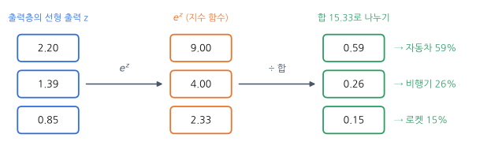

- $$e^{2.20} = 9.00$$, $$e^{1.39} = 4.00$$, $$e^{0.85} = 2.33$$ → 모두 더하면 15.33
- 자동차: $$9.00 \div 15.33 = 0.59$$
- 비행기: $$4.00 \div 15.33 = 0.26$$
- 로켓: $$2.33 \div 15.33 = 0.15$$

합이 $$0.59 + 0.26 + 0.15 = 1$$이 됐어요. 왼쪽 샘플은 **자동차일 확률이 59%**예요.

**오른쪽 샘플 (시그모이드 출력 0.5, 0.2, 0.1)**

$$
z_1 = -\ln\left(\tfrac{1}{0.5} - 1\right) = 0.00, \quad
z_2 = -\ln\left(\tfrac{1}{0.2} - 1\right) = -1.39, \quad
z_3 = -\ln\left(\tfrac{1}{0.1} - 1\right) = -2.20
$$

$$
\hat{y}_1 = \frac{e^{0.00}}{e^{0.00} + e^{-1.39} + e^{-2.20}} = 0.74, \quad
\hat{y}_2 = 0.18, \quad
\hat{y}_3 = 0.08
$$

오른쪽 샘플은 **자동차일 확률이 74%**예요.

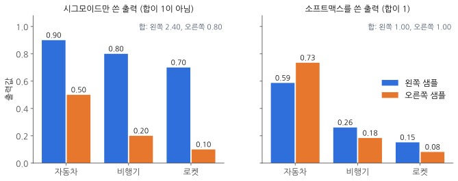

처음에 숫자만 보고는 왼쪽(0.9)이 더 확신하는 것 같았지만, 소프트맥스로 합을 1로 맞추니 **오른쪽 샘플이 자동차일 가능성이 더 높다(74% > 59%)**는 걸 확실히 말할 수 있게 됐어요. 직관으로 느꼈던 것을 숫자로 확인한 거예요.

> 위 계산에서 $$e^z$$가 9, 4, 2.33처럼 깔끔하게 나온 건 우연이 아니에요. $$z = -\ln\left(\frac{1}{a}-1\right)$$이면 $$e^z = \frac{a}{1-a}$$이고, 이건 2편에서 배운 **오즈(odds)**예요. 0.9의 오즈는 $$0.9 \div 0.1 = 9$$, 0.8의 오즈는 $$0.8 \div 0.2 = 4$$죠.
{: .prompt-info }

### 2-4. 소프트맥스는 출력층 전체에 하나

시그모이드는 뉴런마다 따로 붙어 있었지만, 소프트맥스는 **출력층의 모든 출력을 한꺼번에** 받아서 처리해요. 분모에 모든 뉴런의 값이 들어가니까요. 그래서 신경망 그림에서는 출력층 오른쪽에 길쭉한 소프트맥스 함수 하나를 그려서 표현해요.

---

## 파트 3. 크로스 엔트로피 손실 함수

### 3-1. 로지스틱 손실 함수의 일반화 버전

소프트맥스로 확률을 얻었으니, 이제 이 확률로 가중치를 고치기 위한 **손실 함수**가 필요해요. 다중 분류에서는 **크로스 엔트로피(cross entropy) 손실 함수**를 써요. 2편에서 배운 **로지스틱 손실 함수의 일반화 버전**이라서, 로지스틱 손실을 이해했다면 금방 이해할 수 있어요.

두 식을 나란히 놓고 볼게요.

$$
\begin{aligned}
\text{크로스 엔트로피:}\quad L &= -\sum_{c=1}^{C} y_c \log(a_c) = -\bigl(y_1\log(a_1) + y_2\log(a_2) + \cdots + y_C\log(a_C)\bigr) \\
\text{로지스틱 손실:}\quad L &= -\bigl(y\log(a) + (1-y)\log(1-a)\bigr)
\end{aligned}
$$

- 시그마 기호 위의 $$C$$는 **전체 클래스 개수**예요. 자동차, 비행기, 로켓이면 3이에요.
- $$y_c$$는 $$c$$번째 클래스의 **타깃**이에요. 분류 문제에서 **정답 클래스의 타깃은 1이고, 나머지 클래스의 타깃은 0**이에요.
- $$a_c$$는 $$c$$번째 클래스에 대한 소프트맥스의 출력(확률)이에요.

### 3-2. 결국 정답 클래스의 항만 남아요

시그마를 풀어 쓴 식에서 타깃이 0인 항은 곱하면 0이 되니까 모두 사라져요. 오른쪽 샘플(정답: 자동차)에 적용해 볼게요.

$$
L = -(1 \times \log 0.74 + 0 \times \log 0.18 + 0 \times \log 0.08) = -\log 0.74 = 0.31
$$

결국 크로스 엔트로피는 **정답 클래스의 확률에 $$-\log$$를 붙인 값**이에요.

$$
L = -\log(a_{y=1})
$$

$$a_{y=1}$$은 정답 클래스에 해당하는 뉴런의 활성화 출력을 뜻해요.

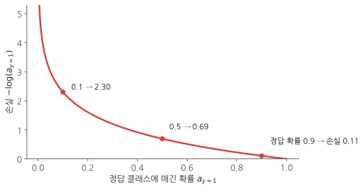

- 정답에 확률 0.9를 줬다면 손실은 $$-\log 0.9 = 0.11$$로 아주 작아요.
- 0.5를 줬다면 0.69예요.
- 0.1밖에 안 줬다면 2.30으로 커져요. 0에 가까워질수록 손실이 **끝없이** 커져요.

만약 오른쪽 샘플의 정답이 로켓이었다면, 모델은 로켓에 고작 0.08을 줬으니 손실이 $$-\log 0.08 = 2.51$$이 돼요. 확신을 가지고 틀릴수록 큰 벌점을 받는 구조예요.

### 3-3. 로지스틱 손실과 크로스 엔트로피는 사실 같은 식이에요

로지스틱 손실 함수를 타깃이 양성 클래스($$y=1$$)일 때와 음성 클래스($$y=0$$)일 때로 나눠 보면 이렇게 돼요.

$$
L =
\begin{cases}
-\log a & (y = 1, \text{ 양성 클래스인 경우}) \\
-\log(1-a) & (y = 0, \text{ 음성 클래스인 경우})
\end{cases}
$$

이진 분류에서 $$a$$는 양성 클래스의 확률이고, $$1-a$$는 음성 클래스의 확률이에요. 즉 **$$1-a$$를 음성 클래스의 활성화 출력이라고 생각하면**, 두 경우 모두 "정답 클래스의 확률에 $$-\log$$를 붙인 값"이에요. 크로스 엔트로피와 완전히 같죠. 로지스틱 손실은 크로스 엔트로피에서 클래스가 2개뿐인 특별한 경우를 풀어 쓴 것뿐이에요.

---

## 파트 4. 크로스 엔트로피 손실 함수 미분하기

경사 하강법을 쓰려면 손실 함수를 미분해야 해요. 자동차, 비행기, 로켓의 3개 클래스 예로 유도하고, 마지막에 숫자로 맞는지 확인할게요. 2편처럼 샘플 하나에 대한 손실의 미분을 구해요. 결과는 클래스가 몇 개든, 행렬로 여러 샘플을 한꺼번에 계산하든 똑같이 쓸 수 있어요.

> 이 파트는 이번 편에서 가장 수학이 많은 부분이에요. 결론만 먼저 말하면 **"로지스틱 손실의 미분과 똑같이 $$-(y-a)$$가 나와서, 4편의 역전파 코드를 그대로 쓸 수 있다"**예요. 수식이 부담스러우면 4-5로 넘어가도 괜찮아요.
{: .prompt-tip }

### 4-1. 주의할 점: z₁ 하나가 a₁, a₂, a₃ 모두를 바꿔요

먼저 $$z_1$$에 대한 손실 함수의 미분 $$\frac{\partial L}{\partial z_1}$$을 구할 거예요. 시그모이드에서는 $$z_1$$이 $$a_1$$에만 영향을 줬어요. 그런데 소프트맥스는 분모에 $$e^{z_1}$$이 들어 있어서, $$z_1$$이 바뀌면 **분모가 바뀌고, 그래서 $$a_1, a_2, a_3$$가 모두 바뀌어요.**

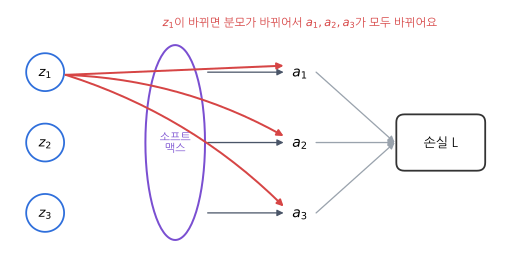

그래서 연쇄 법칙도 세 갈래 길을 **모두 더해야** 해요. $$z_1$$에서 손실 $$L$$까지 가는 길이 $$a_1$$을 지나는 길, $$a_2$$를 지나는 길, $$a_3$$를 지나는 길 세 개거든요.

$$
\frac{\partial L}{\partial z_1}
= \frac{\partial L}{\partial a_1}\frac{\partial a_1}{\partial z_1}
+ \frac{\partial L}{\partial a_2}\frac{\partial a_2}{\partial z_1}
+ \frac{\partial L}{\partial a_3}\frac{\partial a_3}{\partial z_1}
$$

> 어떤 값이 여러 길을 통해 결과에 영향을 주면, **각 길의 영향을 모두 더한다**. 이게 연쇄 법칙의 확장판이에요. 물건 가격이 오르면 내 지출이 "직접 사는 물건"과 "그 물건이 들어간 다른 상품" 두 길로 늘어나는 것과 비슷해요.
{: .prompt-info }

### 4-2. 손실을 a로 미분하기

크로스 엔트로피 손실은 $$L = -(y_1\log a_1 + y_2\log a_2 + y_3\log a_3)$$예요. 이걸 $$a_1$$로 미분하면, $$a_1$$이 없는 $$y_2\log a_2 + y_3\log a_3$$는 상수처럼 사라지고 $$y_1\log a_1$$만 남아요. $$\log a$$의 도함수는 $$\frac{1}{a}$$이므로 이렇게 돼요.

$$
\frac{\partial L}{\partial a_1} = -\frac{\partial}{\partial a_1}(y_1\log a_1 + y_2\log a_2 + y_3\log a_3) = -\frac{y_1}{a_1}
$$

같은 방법으로 $$a_2$$와 $$a_3$$에 대해서도 구할 수 있어요.

$$
\frac{\partial L}{\partial a_2} = -\frac{y_2}{a_2}, \qquad \frac{\partial L}{\partial a_3} = -\frac{y_3}{a_3}
$$

### 4-3. 소프트맥스를 z₁로 미분하기

이제 $$\frac{\partial a_1}{\partial z_1}$$, $$\frac{\partial a_2}{\partial z_1}$$, $$\frac{\partial a_3}{\partial z_1}$$을 구할 차례예요. 소프트맥스는 분수라서 **분수의 미분 공식(몫의 미분)**을 써요.

$$
\left(\frac{f}{g}\right)' = \frac{f'g - fg'}{g^2}
\qquad \text{"분자를 미분해서 분모를 곱하고, 분자에 분모의 미분을 곱해서 뺀 다음, 분모의 제곱으로 나눈다"}
$$

계산을 줄이려고 분모를 $$S = e^{z_1} + e^{z_2} + e^{z_3}$$로 부를게요. 미리 알아 둘 사실은 두 가지예요.

- $$e^{z_1}$$을 $$z_1$$로 미분하면 그대로 $$e^{z_1}$$이에요. ($$e^x$$는 미분해도 자기 자신이에요.)
- $$S$$를 $$z_1$$로 미분하면 $$e^{z_2}$$, $$e^{z_3}$$는 상수라서 사라지고 $$e^{z_1}$$만 남아요. 즉 $$\frac{\partial S}{\partial z_1} = e^{z_1}$$이에요.

**① $$a_1$$을 $$z_1$$로 미분 (자기 자신)**

$$
\frac{\partial a_1}{\partial z_1}
= \frac{\partial}{\partial z_1}\left(\frac{e^{z_1}}{S}\right)
= \frac{e^{z_1}\cdot S - e^{z_1}\cdot e^{z_1}}{S^2}
= \frac{e^{z_1}}{S} - \left(\frac{e^{z_1}}{S}\right)^2
= a_1 - a_1^2 = a_1(1 - a_1)
$$

시그모이드의 도함수 $$a(1-a)$$와 모양이 똑같아요.

**② $$a_2$$를 $$z_1$$로 미분 (다른 출력)**

분자 $$e^{z_2}$$에는 $$z_1$$이 없으니 분자의 미분은 0이에요.

$$
\frac{\partial a_2}{\partial z_1}
= \frac{0\cdot S - e^{z_2}\cdot e^{z_1}}{S^2}
= -\frac{e^{z_2}}{S}\cdot\frac{e^{z_1}}{S}
= -a_2 a_1
$$

**③ $$a_3$$를 $$z_1$$로 미분**도 같은 방법으로 $$\frac{\partial a_3}{\partial z_1} = -a_3 a_1$$이에요.

내 출력은 $$z_1$$이 커지면 **커지고**($$a_1(1-a_1) > 0$$), 다른 출력은 **작아져요**($$-a_2a_1 < 0$$). 합이 항상 1이어야 하니까, 하나가 커지면 나머지가 줄어드는 게 당연하죠.

### 4-4. 모두 합치기

4-2와 4-3의 결과를 4-1의 식에 넣어요.

$$
\begin{aligned}
\frac{\partial L}{\partial z_1}
&= \left(-\frac{y_1}{a_1}\right)a_1(1-a_1) + \left(-\frac{y_2}{a_2}\right)(-a_2a_1) + \left(-\frac{y_3}{a_3}\right)(-a_3a_1) \\
&= -y_1(1-a_1) + y_2a_1 + y_3a_1 \\
&= -y_1 + (y_1 + y_2 + y_3)\,a_1
\end{aligned}
$$

여기서 $$y_1 + y_2 + y_3$$는 타깃의 합이에요. 정답 타깃만 1이고 나머지는 0이니까 **타깃의 합은 항상 1**이에요. 그러면 식이 깔끔하게 정리돼요.

$$
\frac{\partial L}{\partial z_1} = -y_1 + a_1 = -(y_1 - a_1)
$$

$$z_2$$와 $$z_3$$에 대해서도 같은 과정으로 $$-(y_2 - a_2)$$, $$-(y_3 - a_3)$$를 얻어요. 벡터로 정리하면 이래요.

$$
\frac{\partial L}{\partial \boldsymbol{z}} = -(\boldsymbol{y} - \boldsymbol{a})
$$

**2편에서 구한 로지스틱 손실 함수의 미분과 정확히 같은 모양이에요!** 그래서 크로스 엔트로피 손실을 역전파에 쓰려고 코드를 새로 만들 필요가 없어요. 4편에서 만든 `backprop()` 메서드를 그대로 쓰면 돼요. 오차를 `err = -(y - a)`로 계산하는 것도 똑같아요.

### 4-5. 숫자로 확인하기

정말 맞는지 숫자로 확인해 볼게요. 출력층의 선형 출력이 $$\boldsymbol{z} = [1.0,\ 0.5,\ -0.5]$$이고 정답이 두 번째 클래스($$\boldsymbol{y} = [0,\ 1,\ 0]$$)라고 해요.

```python
z = np.array([1.0, 0.5, -0.5])
y = np.array([0, 1, 0])
a = np.exp(z) / np.sum(np.exp(z))     # 소프트맥스
print(np.round(a, 4))
print(np.round(-(y - a), 4))          # 우리가 유도한 미분 공식
```

```text
[0.5465 0.3315 0.122 ]
[ 0.5465 -0.6685  0.122 ]
```

$$z$$를 아주 조금(0.000001) 움직였을 때 손실이 얼마나 변하는지 직접 재서 기울기를 구해 봐도(수치 미분) **소수점 아래 6자리까지 똑같이** $$[0.5465,\ -0.6685,\ 0.1220]$$이 나왔어요.

해석도 자연스러워요. 정답(두 번째)에 대한 미분값은 음수라서 경사 하강법이 $$z_2$$를 **키우고**, 오답에 대한 미분값은 양수라서 $$z_1, z_3$$를 **줄여요.** 정답의 확률은 올리고 오답의 확률은 내리는 방향이죠.

---

## 파트 5. 다중 분류 신경망 구현하기: MultiClassNetwork

4편의 `MinibatchNetwork` 클래스를 확장해서 다중 분류를 하는 `MultiClassNetwork` 클래스를 만들게요. 원리는 이진 분류와 같고 **소프트맥스 함수가 추가된 점**만 다르니까, 고칠 곳만 하나씩 볼게요. 이번에는 상속 없이 클래스 하나에 전체 코드를 담을 거예요.

### 5-1. 소프트맥스 함수 추가하기

지금까지는 활성화 함수로 시그모이드만 써서 `activation()` 메서드 하나로 충분했어요. 하지만 다중 분류에서는 **은닉층은 시그모이드, 출력층은 소프트맥스**처럼 층마다 다른 활성화 함수를 써야 해요. 그래서 `activation()`의 이름을 `sigmoid()`로 바꾸고 `softmax()` 메서드를 새로 추가해요.

```python
def sigmoid(self, z):
    z = np.clip(z, -100, None)              # 안전한 np.exp() 계산을 위해
    a = 1 / (1 + np.exp(-z))                # 시그모이드 계산
    return a

def softmax(self, z):
    # 소프트맥스 함수
    z = np.clip(z, -100, None)              # 안전한 np.exp() 계산을 위해
    exp_z = np.exp(z)
    return exp_z / np.sum(exp_z, axis=1).reshape(-1, 1)
```

`softmax()`의 마지막 줄이 핵심이니 한 단계씩 볼게요. `z`는 (샘플 수, 클래스 수) 크기의 행렬이에요. 샘플 두 개, 클래스 세 개라고 해 볼게요.

**① `np.exp(z)`**: 모든 원소를 $$e^z$$로 바꿔요. 넘파이 함수라 원소별로 한꺼번에 계산돼요.

$$
\begin{bmatrix} 0.9 & 0.8 & 0.7 \\ 0.5 & 0.2 & 0.1 \end{bmatrix}
\xrightarrow{\ \texttt{np.exp(z)}\ }
\begin{bmatrix} 2.46 & 2.23 & 2.01 \\ 1.65 & 1.22 & 1.11 \end{bmatrix}
$$

**② `np.sum(exp_z, axis=1)`**: **각 행(샘플)의 합**을 구해요. `axis=1`은 "가로 방향으로 더하라"는 뜻이에요. 결과는 $$[6.70,\ 3.98]$$ 같은 **1차원 배열(행 벡터)**이에요.

**③ `.reshape(-1, 1)`**: 1차원 배열을 **열 벡터**로 세워요. 그래야 브로드캐스팅으로 각 행을 **자기 행의 합**으로 나눌 수 있어요.

$$
\begin{bmatrix} 2.46 & 2.23 & 2.01 \\ 1.65 & 1.22 & 1.11 \end{bmatrix}
\div
\begin{bmatrix} 6.70 \\ 3.98 \end{bmatrix}
=
\begin{bmatrix} 0.37 & 0.33 & 0.30 \\ 0.41 & 0.31 & 0.28 \end{bmatrix}
$$

각 행의 합이 1이 됐어요. 소프트맥스가 잘 적용된 거예요.

> 열 벡터로 바꾸지 않고 `(2, 3)` 행렬을 `(2,)` 배열로 나누면 어떻게 될까요? 넘파이는 `(2,)`를 가로줄로 보고 열 방향으로 맞추려다 크기가 안 맞아 **오류**가 나요. 클래스가 2개처럼 우연히 크기가 맞으면 오류 없이 **엉뚱한 값**이 나오고요. 4편에서 본 `reshape(-1, 1)` 함정이 여기서도 나와요.
{: .prompt-warning }

### 5-2. 정방향 계산하기

`activation()`의 이름을 `sigmoid()`로 바꿨으니 `forpass()`에서 쓰던 이름도 바꿔요. 나머지 코드는 같아요.

```python
def forpass(self, x):
    z1 = np.dot(x, self.w1) + self.b1       # 첫 번째 층의 선형식을 계산
    self.a1 = self.sigmoid(z1)              # 활성화 함수를 적용
    z2 = np.dot(self.a1, self.w2) + self.b2 # 두 번째 층의 선형식을 계산
    return z2
```

### 5-3. 가중치 초기화하기

이진 분류에서는 출력층의 뉴런이 1개라서 `w2`의 크기를 `(은닉층의 뉴런 개수, 1)`로 정했어요. 다중 분류에서는 **`(은닉층의 뉴런 개수, 클래스 개수)`**가 돼요. `b2`도 클래스마다 하나씩 필요하니 클래스 개수만큼 만들어요.

```python
def init_weights(self, n_features, n_classes):
    self.w1 = np.random.normal(0, 1, (n_features, self.units))   # (특성 개수, 은닉층의 크기)
    self.b1 = np.zeros(self.units)                               # 은닉층의 크기
    self.w2 = np.random.normal(0, 1, (self.units, n_classes))    # (은닉층의 크기, 클래스 개수)
    self.b2 = np.zeros(n_classes)                                # 클래스 개수
```

### 5-4. fit() 메서드 수정하기

`fit()`은 몇 군데만 고치면 돼요.

```python
def fit(self, x, y, epochs=100, x_val=None, y_val=None):
    np.random.seed(42)
    self.init_weights(x.shape[1], y.shape[1])   # 은닉층과 출력층의 가중치를 초기화
    for i in range(epochs):                     # epochs만큼 반복
        loss = 0
        print('.', end='')                      # 진행 상황 표시
        # 제너레이터 함수에서 반환한 미니 배치를 순환
        for x_batch, y_batch in self.gen_batch(x, y):
            a = self.training(x_batch, y_batch)
            a = np.clip(a, 1e-10, 1 - 1e-10)    # 안전한 로그 계산을 위해
            loss += np.sum(-y_batch * np.log(a))   # 크로스 엔트로피 손실을 누적
        self.losses.append((loss + self.reg_loss()) / len(x))
        self.update_val_loss(x_val, y_val)      # 검증 세트에 대한 손실을 계산
```

- `init_weights()`를 부를 때 **클래스 개수**도 넘겨요. 다중 분류에서 타깃 `y`는 (샘플 수, 클래스 수) 크기의 2차원 배열이라서 `y.shape[1]`이 곧 클래스 개수예요. (왜 2차원인지는 파트 7에서 봐요.)
- `y`가 이미 2차원 행렬이니까 열 벡터로 바꾸던 `reshape(-1, 1)` 코드는 지워요.
- 손실은 **크로스 엔트로피**로 계산해요. `-y_batch * np.log(a)`는 원소별 곱셈이라, 타깃이 0인 자리는 모두 0이 되고 정답 자리의 $$-\log a$$만 남아요. 파트 3에서 본 바로 그 계산이에요.
- 데이터가 커서 훈련이 오래 걸리니, 진행 상황을 보려고 에포크마다 점(`.`)을 하나씩 찍어요. `end=''`는 줄을 바꾸지 말라는 뜻이에요.

### 5-5. training() 메서드 수정하기

출력층의 활성화 함수를 `activation()`에서 **`softmax()`**로 바꿔요. 이번에는 샘플 개수 `m`을 `training()` 안에서 직접 계산하도록 했어요.

```python
def training(self, x, y):
    m = len(x)                    # 샘플 개수를 저장
    z = self.forpass(x)           # 정방향 계산
    a = self.softmax(z)           # 활성화 함수 적용
    err = -(y - a)                # 오차 계산
    ...                           # 나머지는 4편과 같아요
```

파트 4에서 유도한 대로 오차는 이진 분류와 똑같이 `-(y - a)`예요. 다만 이제 `y`와 `a`가 모두 (샘플 수, 클래스 수) 크기의 행렬이라 클래스마다 오차가 따로 계산돼요.

### 5-6. backprop()의 함정: 절편의 그레이디언트는 클래스별로

`backprop()`은 4편과 거의 같지만 **한 줄은 꼭 고쳐야** 해요. 출력층 절편의 그레이디언트예요.

```python
b2_grad = np.sum(err) / m            # 4편: 출력이 1개일 때는 괜찮았어요
b2_grad = np.sum(err, axis=0) / m    # 5편: 클래스마다 따로 더해야 해요
```

이진 분류에서는 오차가 (샘플 수, 1) 크기라서 전부 더해도 상관없었어요. 하지만 이제는 오차가 (샘플 수, 클래스 수) 크기예요. `axis=0` 없이 `np.sum(err)`를 쓰면 **모든 클래스의 오차를 한데 섞어 숫자 하나**로 만들어 버려요.

게다가 소프트맥스의 오차에는 재미있는 성질이 있어요. 한 샘플의 오차를 클래스 방향으로 모두 더하면 $$\sum(a_c - y_c) = 1 - 1 = 0$$이에요. 확률의 합도 1, 타깃의 합도 1이니까요. 그래서 `np.sum(err)`는 **항상 0**이 되고, 출력층 절편은 처음 값 0에서 **영원히 움직이지 않아요.** 실제로 `axis=0` 없이 훈련해 보니 40 에포크 뒤에도 `b2`가 10개 모두 0이었어요. `axis=0`을 넣으면 `[0.15, 0.08, 0.03, -0.15, ...]`처럼 클래스마다 다른 값으로 학습돼요.

> 이 실수는 **오류 메시지가 나지 않아요.** 절편 없이도 가중치가 대부분의 일을 하기 때문에 정확도도 거의 차이가 없었어요(0.8104 vs 0.8108). 그래서 더 알아채기 어려운 버그예요. 행렬을 `np.sum()`으로 더할 때는 "어느 방향으로 더하는지(`axis`)"를 꼭 확인하는 습관을 들이세요. 은닉층 절편 `b1_grad`에는 4편에서부터 이미 `axis=0`이 붙어 있었어요.
{: .prompt-warning }

### 5-7. predict()와 score() 메서드 수정하기

`predict()`는 정방향 계산의 출력 중 **가장 큰 값의 인덱스**를 돌려줘요. 그 인덱스가 예측한 클래스 번호예요.

```python
def predict(self, x):
    z = self.forpass(x)            # 정방향 계산
    return np.argmax(z, axis=1)    # 가장 큰 값의 인덱스를 반환
```

`np.argmax()`는 가장 큰 값이 **몇 번째에 있는지**를 알려 줘요. `axis=1`이니까 샘플(행)마다 하나씩 구해요. 예를 들어 `[0.2, 3.1, -0.5]`면 1을 돌려줘요.

이진 분류와 마찬가지로 **예측할 때는 소프트맥스를 거칠 필요가 없어요.** $$e^z$$는 $$z$$가 클수록 크고, 모두 같은 분모로 나누니까 순서가 바뀌지 않거든요. $$z$$에서 가장 큰 클래스가 소프트맥스 확률에서도 가장 커요.

`score()`는 예측한 클래스 번호와 **타깃의 클래스 번호**를 비교해요. 타깃 `y`는 2차원 배열이니까 각 행에서 1이 있는 자리(가장 큰 값의 인덱스)를 `np.argmax()`로 찾아요.

```python
def score(self, x, y):
    # 예측과 타깃 열 벡터를 비교하여 True의 비율을 반환
    return np.mean(self.predict(x) == np.argmax(y, axis=1))
```

### 5-8. 검증 손실 계산하기

`update_val_loss()`도 활성화 함수를 `softmax()`로, 손실을 크로스 엔트로피로 바꿔요.

```python
def update_val_loss(self, x_val, y_val):
    z = self.forpass(x_val)            # 정방향 계산
    a = self.softmax(z)                # 활성화 함수 적용
    a = np.clip(a, 1e-10, 1 - 1e-10)   # 출력값을 클리핑
    # 크로스 엔트로피 손실과 규제 손실을 더하여 리스트에 추가
    val_loss = np.sum(-y_val * np.log(a))
    self.val_losses.append((val_loss + self.reg_loss()) / len(y_val))
```

### 5-9. 전체 코드

지금까지 고친 내용을 모두 합친 `MultiClassNetwork` 클래스예요. 그대로 복사해서 쓸 수 있어요.

```python
class MultiClassNetwork:

    def __init__(self, units=10, batch_size=32, learning_rate=0.1, l1=0, l2=0):
        self.units = units            # 은닉층의 뉴런 개수
        self.batch_size = batch_size  # 배치 크기
        self.w1 = None                # 은닉층의 가중치
        self.b1 = None                # 은닉층의 절편
        self.w2 = None                # 출력층의 가중치
        self.b2 = None                # 출력층의 절편
        self.a1 = None                # 은닉층의 활성화 출력
        self.losses = []              # 훈련 손실
        self.val_losses = []          # 검증 손실
        self.lr = learning_rate       # 학습률
        self.l1 = l1                  # L1 손실 하이퍼파라미터
        self.l2 = l2                  # L2 손실 하이퍼파라미터

    def forpass(self, x):
        z1 = np.dot(x, self.w1) + self.b1
        self.a1 = self.sigmoid(z1)
        z2 = np.dot(self.a1, self.w2) + self.b2
        return z2

    def backprop(self, x, err):
        m = len(x)
        w2_grad = np.dot(self.a1.T, err) / m
        b2_grad = np.sum(err, axis=0) / m          # 클래스마다 따로 더한다
        err_to_hidden = np.dot(err, self.w2.T) * self.a1 * (1 - self.a1)
        w1_grad = np.dot(x.T, err_to_hidden) / m
        b1_grad = np.sum(err_to_hidden, axis=0) / m
        return w1_grad, b1_grad, w2_grad, b2_grad

    def sigmoid(self, z):
        z = np.clip(z, -100, None)
        a = 1 / (1 + np.exp(-z))
        return a

    def softmax(self, z):
        z = np.clip(z, -100, None)
        exp_z = np.exp(z)
        return exp_z / np.sum(exp_z, axis=1).reshape(-1, 1)

    def init_weights(self, n_features, n_classes):
        self.w1 = np.random.normal(0, 1, (n_features, self.units))
        self.b1 = np.zeros(self.units)
        self.w2 = np.random.normal(0, 1, (self.units, n_classes))
        self.b2 = np.zeros(n_classes)

    def fit(self, x, y, epochs=100, x_val=None, y_val=None):
        np.random.seed(42)
        self.init_weights(x.shape[1], y.shape[1])
        for i in range(epochs):
            loss = 0
            print('.', end='')
            for x_batch, y_batch in self.gen_batch(x, y):
                a = self.training(x_batch, y_batch)
                a = np.clip(a, 1e-10, 1 - 1e-10)
                loss += np.sum(-y_batch * np.log(a))
            self.losses.append((loss + self.reg_loss()) / len(x))
            self.update_val_loss(x_val, y_val)

    # 미니 배치 제너레이터 함수
    def gen_batch(self, x, y):
        length = len(x)
        bins = length // self.batch_size
        if length % self.batch_size:
            bins += 1
        indexes = np.random.permutation(np.arange(len(x)))
        x = x[indexes]
        y = y[indexes]
        for i in range(bins):
            start = self.batch_size * i
            end = self.batch_size * (i + 1)
            yield x[start:end], y[start:end]

    def training(self, x, y):
        m = len(x)
        z = self.forpass(x)
        a = self.softmax(z)
        err = -(y - a)
        w1_grad, b1_grad, w2_grad, b2_grad = self.backprop(x, err)
        w1_grad += (self.l1 * np.sign(self.w1) + self.l2 * self.w1) / m
        w2_grad += (self.l1 * np.sign(self.w2) + self.l2 * self.w2) / m
        self.w1 -= self.lr * w1_grad
        self.b1 -= self.lr * b1_grad
        self.w2 -= self.lr * w2_grad
        self.b2 -= self.lr * b2_grad
        return a

    def predict(self, x):
        z = self.forpass(x)
        return np.argmax(z, axis=1)

    def score(self, x, y):
        return np.mean(self.predict(x) == np.argmax(y, axis=1))

    def reg_loss(self):
        return self.l1 * (np.sum(np.abs(self.w1)) + np.sum(np.abs(self.w2))) + \
               self.l2 / 2 * (np.sum(self.w1 ** 2) + np.sum(self.w2 ** 2))

    def update_val_loss(self, x_val, y_val):
        z = self.forpass(x_val)
        a = self.softmax(z)
        a = np.clip(a, 1e-10, 1 - 1e-10)
        val_loss = np.sum(-y_val * np.log(a))
        self.val_losses.append((val_loss + self.reg_loss()) / len(y_val))
```

---

## 파트 6. 의류 이미지 데이터를 준비합니다

### 6-1. 패션 MNIST 데이터 세트

이번에 풀 문제는 **"의류 이미지 분류하기"**예요. 데이터는 **패션 MNIST(Fashion-MNIST)** 데이터 세트를 써요. 원래 딥러닝 공부에는 손글씨 숫자 이미지 10종으로 된 **MNIST** 데이터가 많이 쓰였는데, 너무 쉬워서 요즘은 그 대신 이 의류 데이터가 널리 쓰여요. 크기와 구성은 MNIST와 똑같고, 내용만 옷, 신발, 가방으로 바뀌었어요. 자세한 정보는 [패션 MNIST 깃허브](https://github.com/zalandoresearch/fashion-mnist)에서 볼 수 있어요.

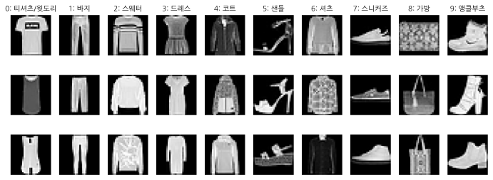
_클래스마다 이미지 3장씩 골라 그렸어요. 숫자는 레이블(클래스 번호)이에요._

지금까지 쓴 종양 데이터(샘플 569개, 특성 30개)와 달리 **이미지**이고, 샘플도 **6만 개**나 돼요. 그래서 데이터를 준비하는 과정부터 천천히 볼게요.

### 6-2. 텐서플로 설치하고 데이터 불러오기

패션 MNIST는 딥러닝 패키지인 **텐서플로(TensorFlow)**에서 바로 불러올 수 있어요. 코랩(Colab)에는 텐서플로가 이미 설치되어 있고, 내 컴퓨터라면 다음 명령으로 설치해요.

```bash
pip install tensorflow
```

텐서플로는 별칭 `tf`로 임포트하는 것이 관례예요. 이 글은 텐서플로 2.21 버전으로 실행했어요.

```python
import tensorflow as tf
print(tf.__version__)
```

```text
2.21.0
```

텐서플로는 2019년 10월에 2.0 버전이 나오면서 크게 바뀌었어요. 딥러닝 모델을 더 쉽게 만들 수 있게 바뀌었고, 특히 **케라스(Keras)**가 핵심 파이썬 API가 된 게 가장 큰 특징이에요. 케라스는 파트 9에서 자세히 볼게요.

패션 MNIST는 `tf.keras.datasets.fashion_mnist` 모듈의 `load_data()` 함수로 불러와요.

```python
(x_train_all, y_train_all), (x_test, y_test) = tf.keras.datasets.fashion_mnist.load_data()
```

이 데이터는 처음부터 **훈련 데이터와 테스트 데이터로 나뉘어** 있어요. `load_data()`는 입력과 타깃을 튜플로 묶어서 훈련 세트와 테스트 세트를 돌려주고, 우리는 이걸 변수 4개에 나눠 담아요. 이번 글에서는 **훈련 세트만** 써요. 3편에서 배운 것처럼 테스트 세트로 모델을 반복해서 평가하면, 실전에 투입했을 때의 성능을 지나치게 좋게 예상하게 되거든요.

### 6-3. 훈련 세트의 크기 확인하기

```python
print(x_train_all.shape, y_train_all.shape)
```

```text
(60000, 28, 28) (60000,)
```

`x_train_all`은 **3차원 배열**이에요. 각 샘플이 높이 28, 너비 28인 흑백 이미지, 즉 **2차원 배열**이고, 그게 6만 장 쌓여 있는 거예요. 28×28 크기의 종이 6만 장을 쌓아 놓은 상자를 떠올리면 돼요. `y_train_all`에는 각 이미지가 어떤 옷인지를 나타내는 타깃 값이 6만 개 들어 있어요.

### 6-4. imshow()로 샘플 이미지 확인하기

맷플롯립의 `imshow()` 함수는 2차원 넘파이 배열을 받아 이미지로 그려 줘요. 배열의 각 원소는 색을 나타내는 값이에요. 맷플롯립은 **컬러맵(colormap)**으로 숫자를 색으로 바꾸는데, 기본값인 `'viridis'`는 짙은 녹색에서 밝은 노란색으로 그려요. 패션 MNIST는 흑백 이미지이므로 `cmap='gray'`로 지정할게요.

```python
import matplotlib.pyplot as plt
plt.imshow(x_train_all[0], cmap='gray')
plt.show()
```

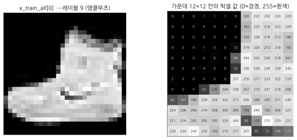
_오른쪽은 왼쪽 이미지의 가운데 부분을 픽셀 값으로 보여 준 거예요._

첫 번째 샘플은 발목까지 오는 부츠예요. 오른쪽 그림처럼 이미지는 사실 **0부터 255 사이의 숫자**가 칸마다 적힌 표예요. 0에 가까울수록 검게, 255에 가까울수록 밝게 그려져요. 이 숫자를 **픽셀 강도**라고 불러요. 신경망은 이 784개(28×28)의 숫자를 특성으로 받아요.

### 6-5. 타깃의 내용과 의미 확인하기

```python
print(y_train_all[:10])
```

```text
[9 0 0 3 0 2 7 2 5 5]
```

타깃에는 0부터 9까지의 정수로 된 **클래스 레이블**이 들어 있어요. 각 번호가 뜻하는 옷은 이래요.

```python
class_names = ['티셔츠/윗도리', '바지', '스웨터', '드레스', '코트',
               '샌들', '셔츠', '스니커즈', '가방', '앵클부츠']
print(class_names[y_train_all[0]])
```

```text
앵클부츠
```

첫 번째 샘플의 레이블은 9, 즉 '앵클부츠'예요. 이미지에서 본 것과 같으니 레이블이 올바르게 붙어 있네요.

### 6-6. 타깃 분포 확인하기

훈련 세트를 나누기 전에 클래스가 고르게 들어 있는지 확인해요. 넘파이의 `bincount()` 함수는 배열에 있는 정수가 **몇 번씩 나오는지** 세서, 그 정수에 해당하는 인덱스 자리에 저장해 줘요.

```python
np.bincount(y_train_all)
```

```text
array([6000, 6000, 6000, 6000, 6000, 6000, 6000, 6000, 6000, 6000])
```

클래스마다 정확히 6,000개씩 들어 있어요.

### 6-7. 훈련 세트와 검증 세트 고르게 나누기

사이킷런의 `train_test_split()`으로 훈련 세트와 검증 세트를 8:2로 나눠요. `stratify=y_train_all`로 정해서 클래스 비율이 고르게 나뉘도록 해요. 지금까지와 같이 `random_state=1`을 썼어요.

```python
from sklearn.model_selection import train_test_split
x_train, x_val, y_train, y_val = train_test_split(x_train_all, y_train_all,
    stratify=y_train_all, test_size=0.2, random_state=1)
print(np.bincount(y_train))
print(np.bincount(y_val))
```

```text
[4800 4800 4800 4800 4800 4800 4800 4800 4800 4800]
[1200 1200 1200 1200 1200 1200 1200 1200 1200 1200]
```

훈련 세트에는 클래스마다 4,800개, 검증 세트에는 1,200개씩 같은 비율로 나뉘었어요. 분류 문제에서 데이터를 나누면 이렇게 **클래스의 균형이 맞는지** 확인하는 습관을 들이면 좋아요.

### 6-8. 입력 데이터 정규화하기

4편까지는 종양 데이터를 **표준화**해서 평균 0, 분산 1로 맞췄어요. 이미지는 픽셀마다 0~255 사이의 값을 가지니까, 더 간단하게 **255로 나눠서 0~1 사이로** 맞춰요. 엄밀히 말해 표준화는 아니지만, 이미지에서는 이 방법이 잘 작동해서 아주 많이 써요.

```python
x_train = x_train / 255
x_val = x_val / 255
```

> 이미지는 모든 특성(픽셀)이 원래부터 **같은 범위(0~255)**를 써요. 3편의 종양 데이터처럼 어떤 특성은 0.1, 어떤 특성은 2,000인 문제가 없어서, 모두 같은 수로 나누기만 해도 충분해요.
{: .prompt-info }

### 6-9. 이미지를 1줄로 펼치기

훈련 세트와 검증 세트의 샘플은 28×28 크기의 **2차원 배열**이에요. 그런데 우리가 만든 `MultiClassNetwork`는 샘플 하나가 **1차원 배열**(특성이 한 줄로 늘어선 것)이길 기대해요. 그래서 `reshape()`로 두 번째, 세 번째 차원을 합쳐 784 길이로 펼쳐요. 이미지의 픽셀을 한 줄씩 떼어서 **1줄로 이어 붙이는** 셈이에요.

```python
x_train = x_train.reshape(-1, 784)
x_val = x_val.reshape(-1, 784)
print(x_train.shape, x_val.shape)
```

```text
(48000, 784) (12000, 784)
```

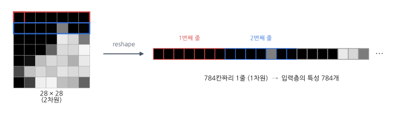
_그림은 간단히 줄여 그렸어요. 실제로는 28칸짜리 줄 28개를 이어 붙여요._

이제 훈련 세트는 48,000개 샘플 × 784개 특성, 검증 세트는 12,000개 × 784개인 2차원 배열이 됐어요. 종양 데이터(샘플 × 특성 30개)와 같은 모양이죠. 특성이 784개로 늘었을 뿐이에요.

> 이렇게 펼치면 "이 픽셀의 바로 아래 픽셀이 어떤 색인지" 같은 **위치 정보가 사라져요.** 신경망 입장에서는 784개의 숫자가 순서 없이 들어오는 것과 같아요. 이게 이 신경망의 한계이기도 한데, 마지막 파트에서 다시 이야기할게요.
{: .prompt-tip }

---

## 파트 7. 원-핫 인코딩: 타깃을 출력 뉴런에 맞추기

### 7-1. 왜 타깃을 바꿔야 할까

패션 MNIST는 클래스가 10개니까 출력층의 뉴런도 **10개**예요. 출력층은 샘플마다 숫자 10개를 내놓아요. 그런데 `y_train`, `y_val`에는 0~9 사이의 **정수 하나**만 들어 있어요. 숫자 10개와 숫자 1개를 비교할 수는 없겠죠.

파트 3에서 크로스 엔트로피를 계산할 때 "정답 클래스의 타깃은 1, 나머지는 0"이라고 했던 게 기억나나요? 바로 그 모양으로 타깃을 바꿔 주면 돼요.

### 7-2. 원-핫 인코딩이란

타깃의 정수에 해당하는 자리만 1이고 **나머지는 모두 0**인, 원소가 10개인 배열을 만드는 거예요. 이 방법을 **원-핫 인코딩(one-hot encoding)**이라고 해요. "하나(one)만 뜨겁다(hot)", 즉 하나만 1로 켜져 있다는 뜻이에요.

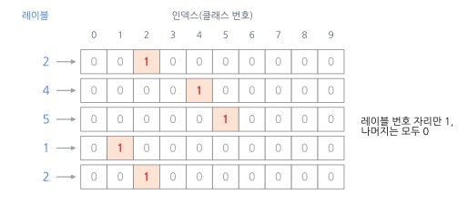

예를 들어 타깃 2는 인덱스 2 자리만 1이고 나머지가 0인 배열이 돼요. 1차원 정수 배열 48,000개를 원-핫 인코딩하면 (48000, 10) 크기의 2차원 배열이 돼요.

이렇게 하면 출력층의 10개 뉴런과 타깃의 10개 원소가 **한 자리씩 짝지어져요.** 5번째 뉴런의 출력은 5번째 원소와 비교되는 식이에요. 훈련할 때는 이 배열로 크로스 엔트로피를 계산하고, 정확도를 잴 때는 **가장 큰 출력값의 인덱스가 타깃에서 1이 있는 인덱스와 같은지** 비교해요(5-7의 `score()`).

### 7-3. to_categorical()로 원-핫 인코딩하기

원-핫 인코딩은 파이썬으로 직접 만들 수도 있지만 조금 번거로워요. 다행히 텐서플로를 비롯한 머신러닝·딥러닝 라이브러리는 원-핫 인코딩 도구를 제공해요. 텐서플로에서는 `keras.utils` 모듈의 `to_categorical()` 함수를 써요. 샘플 데이터 [0, 1, 3]으로 어떻게 동작하는지 볼게요.

```python
tf.keras.utils.to_categorical([0, 1, 3])
```

```text
array([[1., 0., 0., 0.],
       [0., 1., 0., 0.],
       [0., 0., 0., 1.]])
```

가장 큰 수가 3이니까 0~3, 4칸짜리 배열을 만들었어요. 2는 데이터에 없으니 **세 번째 열(인덱스 2)은 모두 0**으로 비워 두고, 0, 1, 3만 제자리에 1을 넣었어요. `to_categorical()`은 정수 레이블만 처리하고 **문자열 레이블은 인코딩하지 못해요.** 우리 타깃은 정수 배열이니까 바로 쓸 수 있어요.

```python
y_train_encoded = tf.keras.utils.to_categorical(y_train)
y_val_encoded = tf.keras.utils.to_categorical(y_val)
print(y_train_encoded.shape, y_val_encoded.shape)
```

```text
(48000, 10) (12000, 10)
```

훈련 세트 레이블이 (48000,) 크기의 1차원 배열에서 (48000, 10) 크기의 2차원 배열로 바뀌었어요. 인코딩을 한 다음에는 **제대로 바뀌었는지 직접 출력해 보는 것**이 중요해요.

```python
print(y_train[0], y_train_encoded[0])
```

```text
2 [0. 0. 1. 0. 0. 0. 0. 0. 0. 0.]
```

레이블 2가 **세 번째 자리(인덱스 2)**에 1로 인코딩됐어요. 인덱스는 0부터 세니까요. 이제 훈련 세트 `x_train`, `y_train_encoded`와 검증 세트 `x_val`, `y_val_encoded`가 모두 준비됐어요.

---

## 파트 8. 직접 만든 신경망으로 의류 이미지 분류하기

### 8-1. 훈련하기

은닉층 뉴런 100개, 미니 배치 크기 256으로 40 에포크 동안 훈련해요. 점이 하나씩 찍히면 훈련이 잘 진행되고 있는 거예요.

```python
fc = MultiClassNetwork(units=100, batch_size=256)
fc.fit(x_train, y_train_encoded,
       x_val=x_val, y_val=y_val_encoded, epochs=40)
```

```text
........................................
```

학습할 값이 꽤 많아요. 은닉층 가중치만 784 × 100 = 78,400개, 전체로는 **79,510개**예요. 그래도 행렬 계산 덕분에 일반 노트북에서 1분 안쪽(제 환경에서는 약 33초)에 끝나요.

### 8-2. 손실 그래프와 점수 확인하기

```python
plt.plot(fc.losses)
plt.plot(fc.val_losses)
plt.ylabel('loss')
plt.xlabel('iteration')
plt.legend(['train_loss', 'val_loss'])
plt.show()
```

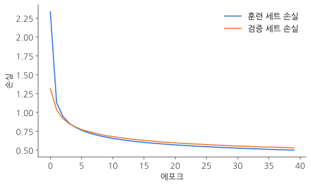

손실이 처음에는 빠르게 줄다가(훈련 손실 2.33 → 1 에포크 만에 1.1대) 점점 완만하게 수렴해요. 40 에포크 뒤 훈련 손실은 0.50, 검증 손실은 0.53이에요. 두 선이 거의 붙어 있어서 과대적합도 없어요.

> 첫 에포크의 훈련 손실(2.33)이 검증 손실(1.31)보다 훨씬 큰 이유가 있어요. 훈련 손실은 에포크 **동안** 미니 배치마다 계산한 값의 평균이라 아직 아무것도 모르던 처음 상태가 섞여 있고, 검증 손실은 에포크가 **끝난 뒤** 한 번 계산한 값이에요. 참고로 아무것도 모르고 10개 중 하나를 찍을 때의 손실이 $$-\log 0.1 = 2.30$$이에요.
{: .prompt-info }

이제 검증 세트로 정확도를 확인해 볼게요.

```python
fc.score(x_val, y_val_encoded)
```

```text
0.81075
```

검증 세트에서 약 **81%**를 맞혔어요. 아무렇게나 찍으면 10%이니 훨씬 높은 점수예요. 하지만 다섯 벌 중 한 벌은 틀린다는 뜻이라 실전에 쓰기는 어려워요.

### 8-3. 어떤 옷을 많이 틀렸을까

클래스별로 정확도를 나눠 보면 모델이 어디서 헷갈리는지 보여요.

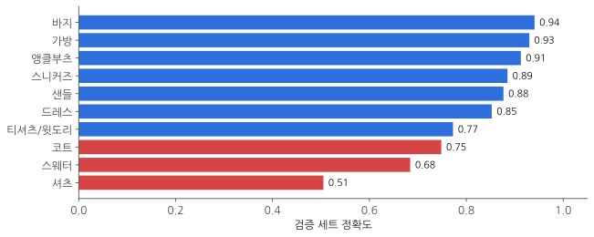

- **잘 맞힌 클래스**: 바지(0.94), 가방(0.93), 앵클부츠(0.91). 모양이 다른 옷과 확실히 달라요.
- **많이 틀린 클래스**: 셔츠(0.51), 스웨터(0.68), 코트(0.75). 셋 다 **소매가 있는 윗옷**이라 28×28 흑백 이미지로는 서로 비슷해 보여요. 티셔츠(0.77)도 셔츠와 자주 헷갈렸어요.

사람이 봐도 헷갈릴 만한 것들이에요. 모델이 엉뚱하게 틀리는 게 아니라 **비슷한 것끼리** 헷갈린다는 건 제대로 배우고 있다는 신호이기도 해요.

### 8-4. 설정을 바꾸면 얼마나 좋아질까

미니 배치 크기를 바꿔 보면 결과가 꽤 달라져요. 4편에서 배운 것처럼 미니 배치가 작으면 에포크마다 가중치를 더 자주 고치니까요.

| 설정 | 에포크당 업데이트 | 검증 정확도 |
|---|---|---|
| batch_size=256, 학습률 0.1 | 188번 | 0.811 |
| batch_size=32, 학습률 0.1 | 1,500번 | **0.860** |
| batch_size=32, 학습률 0.01 | 1,500번 | 0.803 |

미니 배치를 32로 줄이자 86%까지 올라갔어요. 다만 학습률까지 0.01로 낮추면 다시 80%로 떨어져요. 한 번에 조금씩만 고치니 40 에포크로는 부족한 거예요. **하이퍼파라미터는 서로 영향을 주고받아요.** 이 숫자들은 파트 11에서 케라스와 비교할 때 다시 쓸게요.

---

## 파트 9. 텐서플로와 케라스로 신경망 만들기

지금까지 다중 분류 신경망을 직접 만들고 훈련해 봤어요. 원리를 이해하는 데는 직접 만드는 게 최고지만, 실전에서는 **전문 딥러닝 라이브러리**를 써요. 더 빠르고, 더 다양한 기능이 이미 들어 있고, 실수할 여지가 적거든요. 지금부터는 구글이 만든 대표적인 딥러닝 패키지 **텐서플로**와, 텐서플로를 쉽게 쓰게 해 주는 **케라스 API(Keras API)**를 알아볼게요. 앞으로는 간단히 **케라스**라고 부를게요.

### 9-1. 케라스는 딥러닝 패키지를 편하게 쓰는 래퍼

케라스는 딥러닝 패키지를 편리하게 쓰기 위해 만든 **래퍼(wrapper) 패키지**예요. 래퍼는 복잡한 것을 감싸서 쓰기 쉽게 만든 포장지 같은 거예요. 텐서플로만으로 신경망을 만들면 코드를 꽤 많이 써야 해요. 아주 간단한 선형 회귀 신경망(뉴런 1개, 제곱 오차 손실)을 텐서플로의 저수준 기능으로 만들면 이래요.

```python
# 훈련할 가중치 변수를 선언
w = tf.Variable(tf.zeros(shape=(1)))
b = tf.Variable(tf.zeros(shape=(1)))

# 경사 하강법 옵티마이저를 설정
optimizer = tf.optimizers.SGD(learning_rate=0.01)
# 에포크 횟수만큼 훈련
num_epochs = 10
for step in range(num_epochs):

    # 자동 미분을 위해 연산 과정을 기록
    with tf.GradientTape() as tape:
        z_net = w * x_train + b
        z_net = tf.reshape(z_net, [-1])
        sqr_errors = tf.square(y_train - z_net)
        mean_cost = tf.reduce_mean(sqr_errors)
    # 손실 함수에 대한 가중치의 그레이디언트를 계산
    grads = tape.gradient(mean_cost, [w, b])
    # 옵티마이저에 그레이디언트를 반영
    optimizer.apply_gradients(zip(grads, [w, b]))
```

가중치 변수를 선언하고, 정방향 계산을 하고, 손실을 구하고, 그레이디언트를 계산하고, 가중치를 업데이트하는 과정을 모두 직접 써야 해요. 우리가 지금까지 넘파이로 해 온 일과 거의 같죠. 그나마 `GradientTape`가 **미분을 자동으로** 해 줘서 `backprop()`을 직접 만들 필요는 없어요.

같은 신경망을 케라스로 만들면 이렇게 짧아져요.

```python
# 신경망 모델을 만든다
model = tf.keras.models.Sequential()
# 완전 연결층을 추가한다
model.add(tf.keras.layers.Dense(1))
# 옵티마이저와 손실 함수를 지정한다
model.compile(optimizer='sgd', loss='mse')
# 훈련 데이터를 사용하여 에포크 횟수만큼 훈련한다 (입력은 2차원으로)
model.fit(x_train.reshape(-1, 1), y_train, epochs=10)
```

코드가 확 줄었죠. (케라스는 입력이 (샘플 수, 특성 수) 크기의 **2차원 배열**이길 기대해서, 특성이 하나뿐인 1차원 `x_train`은 `reshape(-1, 1)`로 세워서 넘겨요. 4편에서 본 그 열 벡터예요.) 구글은 아예 케라스를 텐서플로 안에 포함시켜서, 텐서플로 2.0부터는 케라스가 텐서플로의 **주력 파이썬 API**가 됐어요. 그래서 `tf.keras`로 바로 쓸 수 있어요. 케라스는 원래 텐서플로, 씨아노 같은 여러 딥러닝 패키지를 뒤에서(백엔드) 골라 쓸 수 있는 독립 프로젝트였어요([케라스 공식 깃허브](https://github.com/keras-team/keras)).

> 옛날 자료에는 `tf.optimizers.SGD(lr=0.01)`처럼 `lr`이라고 쓴 코드가 많아요. 최신 텐서플로에서는 이 이름을 쓸 수 없고 `learning_rate=0.01`로 써야 해요.
{: .prompt-warning }

### 9-2. 케라스를 쓰면 층을 직관적으로 설계할 수 있어요

케라스의 진짜 장점은 신경망을 **그림 그리듯** 설계할 수 있다는 거예요. 이번 편에서 만든 다중 분류 신경망을 케라스의 눈으로 보면 이렇게 나뉘어요.

$$
\underbrace{\text{입력층} \longrightarrow \underbrace{\text{은닉층 (뉴런 100개)}}_{\texttt{Dense(100)}} \longrightarrow \underbrace{\text{출력층 (뉴런 10개)}}_{\texttt{Dense(10)}}}_{\texttt{Sequential()}}
$$

케라스는 신경망 모델을 만드는 **`Sequential` 클래스**와 완전 연결층을 만드는 **`Dense` 클래스**를 제공해요.

- `Sequential`은 이름 그대로 **층을 순서대로 쌓은 신경망 모델**이에요.
- `Dense`는 모델에 들어가는 **완전 연결층** 하나예요. 4편에서 "밀집 연결(densely-connected)"이라는 이름을 봤었죠.

즉 은닉층과 출력층을 `Dense` 객체로 만들고, 그 객체들을 `Sequential` 객체에 차례로 넣으면 신경망이 완성돼요. 정말 블록을 쌓는 것 같죠? 그래서 "직관적으로 층을 설계할 수 있다"고 말해요. 우리가 만든 `MultiClassNetwork`는 모델과 층이 한 클래스에 섞여 있었지만, 케라스는 **모델과 층이 명확하게 나뉘어** 있어서 층 하나를 다른 층으로 바꾸기도 쉬워요.

---

## 파트 10. Sequential과 Dense 사용법

### 10-1. Sequential 객체에 층을 추가하는 두 가지 방법

**① 객체를 만들 때 층의 리스트를 전달하기**

```python
from tensorflow.keras import Sequential
from tensorflow.keras.layers import Dense
model = Sequential([Dense(...), ...])
```

**② 객체를 만든 뒤 `add()` 메서드로 하나씩 추가하기**

```python
dense = Dense(...)
model.add(dense)
```

매번 `Dense` 객체를 변수에 담아서 넘기는 건 번거로우니, 보통은 만들자마자 바로 넘겨요.

```python
model = Sequential()
model.add(Dense(...))
model.add(Dense(...))
```

### 10-2. Dense 클래스의 매개변수

**뉴런의 개수: `units`**

`Dense`에 전달하는 첫 번째 매개변수는 층의 **유닛(unit) 개수**예요. 실제 신경망 알고리즘은 뇌와 직접적인 관련이 없어서, 오해를 피하려고 뉴런을 종종 **유닛**이라고 불러요. 은닉층의 뉴런이 100개라면 이렇게 써요.

```python
Dense(units=100, ...)     # 또는 첫 번째 위치에 그냥 Dense(100, ...)
```

매개변수 이름은 `unit`이 아니라 **`units`**(복수형)예요. 첫 번째 위치에 숫자만 쓰는 경우가 많아서 이름을 직접 쓸 일은 적지만, `unit=100`이라고 쓰면 오류가 나요. 은닉층의 뉴런 개수도 모델의 성능을 위해 사람이 튜닝해야 하는 **하이퍼파라미터**예요.

**활성화 함수: `activation`**

두 번째 매개변수 `activation`은 활성화 함수를 정해요. **기본값은 `None`**이라서 따로 정하지 않으면 활성화 함수가 적용되지 않아요. 우리가 만든 다중 분류 신경망은 은닉층에 시그모이드를 썼으니 `'sigmoid'`로 정해요. 이 밖에도 소프트맥스(`'softmax'`), 하이퍼볼릭 탄젠트(`'tanh'`), 렐루(`'relu'`) 등 많은 함수를 쓸 수 있어요.

```python
Dense(100, activation='sigmoid')
```

> **케라스는 가중치를 커널(kernel)이라고 불러요.** 그래서 `Dense`에는 가중치를 어떤 값으로 시작할지 정하는 `kernel_initializer`(가중치 초기화 방법), 가중치를 규제하는 `kernel_regularizer`(3편의 L1·L2 규제) 같은 매개변수가 있어요. 머신러닝에서 "커널"은 여러 뜻으로 쓰이는 말이지만, 케라스에서는 그냥 가중치를 뜻해요.
{: .prompt-tip }

### 10-3. 최적화 알고리즘과 손실 함수 정하기: compile()

모델을 훈련하려면 **최적화 알고리즘**과 **손실 함수**를 정해야 해요. 다중 분류에서는 최적화 알고리즘으로 경사 하강법을, 손실 함수로 크로스 엔트로피를 써요. 둘 다 `Sequential` 클래스의 `compile()` 메서드로 정해요.

**최적화 알고리즘: `optimizer`**

텐서플로에는 경사 하강법을 비롯해 널리 쓰이는 최적화 알고리즘이 이미 구현되어 있어요. `optimizer='sgd'`로 정하면 기본 경사 하강법을 써요. 이때 **학습률의 기본값은 0.01**이에요.

```python
model.compile(optimizer='sgd', ...)
```

**손실 함수: `loss`**

지금까지 배운 손실 함수를 케라스에서 부르는 이름은 이래요.

| 지금까지 배운 손실 함수 | 쓰는 곳 | 케라스의 `loss` 값 |
|---|---|---|
| 제곱 오차 | 회귀 (1편) | `'mse'` |
| 로지스틱 손실 함수 | 이진 분류 (2편~4편) | `'binary_crossentropy'` |
| 크로스 엔트로피 손실 함수 | 다중 분류 (5편) | `'categorical_crossentropy'` |

로지스틱 손실의 케라스 이름이 "이진(binary) 크로스 엔트로피"라는 점이 재미있어요. 파트 3에서 본 것처럼 로지스틱 손실은 크로스 엔트로피의 이진 분류 버전이니까요. 지금은 다중 분류니까 `'categorical_crossentropy'`로 정해요.

```python
model.compile(optimizer='sgd', loss='categorical_crossentropy')
```

### 10-4. 훈련, 예측, 평가: fit(), predict(), evaluate()

모델을 훈련하고 예측하는 메서드는 `fit()`과 `predict()`예요. 지금까지 쓴 사이킷런의 메서드와 **이름도 같고 쓰는 방법도 비슷해요.** 검증 세트나 테스트 세트에서 모델을 평가할 때는 `evaluate()`를 써요. `Sequential` 클래스를 쓰는 전형적인 흐름은 이래요.

```python
model = Sequential()
model.add(Dense(...))
model.add(Dense(...))
model.compile(optimizer='...', loss='...')
model.fit(X, y, epochs=...)
model.predict(X)
model.evaluate(X, y)
```

---

## 파트 11. 케라스로 다중 분류 신경망 만들기

이제 케라스로 다중 분류 신경망을 만들고, 패션 MNIST로 훈련해서 직접 만든 모델과 비교해 볼게요.

### 11-1. 모델을 만들고 층 추가하기

`MultiClassNetwork`와 **같은 크기**의 신경망을 만들어요. 은닉층은 유닛 100개에 시그모이드, 출력층은 유닛 10개에 소프트맥스예요.

```python
from tensorflow.keras import Sequential, Input
from tensorflow.keras.layers import Dense

model = Sequential()
model.add(Input(shape=(784,)))                 # 입력 데이터의 크기
model.add(Dense(100, activation='sigmoid'))    # 은닉층
model.add(Dense(10, activation='softmax'))     # 출력층
```

첫 번째 층 앞에는 **입력 데이터의 크기**를 알려 줘야 해요. 28×28 이미지를 일렬로 펼쳤으니 784예요. 입력 행렬의 첫 번째 차원은 **샘플 개수**인데, 신경망의 구조를 정할 때 샘플 개수는 필요 없어서 나머지 차원만 `(784,)`처럼 튜플로 써요. 입력 행렬의 첫 번째 차원은 **배치 차원** 또는 **샘플 차원**이라고 불러요.

> 예전 케라스 코드에서는 `Dense(100, activation='sigmoid', input_shape=(784,))`처럼 첫 번째 `Dense` 안에 `input_shape`를 넣었어요. 지금도 동작하지만 최신 버전에서는 경고가 나와요. 위 코드처럼 `Input(shape=(784,))`을 따로 추가하는 방식을 권장해요.
{: .prompt-warning }

`model.summary()`로 모델 구조를 확인할 수 있어요.

```python
model.summary()
```

```text
Model: "sequential"
┏━━━━━━━━━━━━━━━━━━━━━━━━━━━━━━━━━┳━━━━━━━━━━━━━━━━━━━━━━━━┳━━━━━━━━━━━━━━━┓
┃ Layer (type)                    ┃ Output Shape           ┃       Param # ┃
┡━━━━━━━━━━━━━━━━━━━━━━━━━━━━━━━━━╇━━━━━━━━━━━━━━━━━━━━━━━━╇━━━━━━━━━━━━━━━┩
│ dense (Dense)                   │ (None, 100)            │        78,500 │
├─────────────────────────────────┼────────────────────────┼───────────────┤
│ dense_1 (Dense)                 │ (None, 10)             │         1,010 │
└─────────────────────────────────┴────────────────────────┴───────────────┘
 Total params: 79,510 (310.59 KB)
```

- 은닉층의 파라미터: 가중치 784 × 100 = 78,400개 + 절편 100개 = **78,500개**
- 출력층의 파라미터: 가중치 100 × 10 = 1,000개 + 절편 10개 = **1,010개**
- `Output Shape`의 `None`이 바로 **배치 차원**이에요. 샘플이 몇 개 들어올지 아직 모르니 비워 둔 거예요.

### 11-2. 최적화 알고리즘과 손실 함수 지정하기

```python
model.compile(optimizer='sgd', loss='categorical_crossentropy', metrics=['accuracy'])
```

`metrics` 매개변수는 훈련 과정에서 **정확도도 함께 기록**하려고 추가했어요. `fit()`은 훈련하면서 기록한 정보를 **`History` 객체**에 담아 돌려주는데, `metrics`를 정하지 않으면 손실(loss)만 기록돼요.

### 11-3. 모델 훈련하기

`fit()`으로 40 에포크 동안 훈련해요. `validation_data` 매개변수에 검증 세트를 튜플로 넘기면, 에포크마다 검증 세트의 손실과 정확도도 계산해 줘요. 반환값은 `history` 변수에 저장해요.

```python
history = model.fit(x_train, y_train_encoded, epochs=40,
                    validation_data=(x_val, y_val_encoded))
```

```text
Epoch 1/40
1500/1500 - 4s - 3ms/step - accuracy: 0.6513 - loss: 1.3770 - val_accuracy: 0.7260 - val_loss: 0.9635
Epoch 2/40
1500/1500 - 3s - 2ms/step - accuracy: 0.7405 - loss: 0.8394 - val_accuracy: 0.7548 - val_loss: 0.7550
...
Epoch 39/40
1500/1500 - 3s - 2ms/step - accuracy: 0.8628 - loss: 0.3902 - val_accuracy: 0.8564 - val_loss: 0.4004
Epoch 40/40
1500/1500 - 5s - 3ms/step - accuracy: 0.8636 - loss: 0.3884 - val_accuracy: 0.8566 - val_loss: 0.3990
```

- `1500/1500`은 한 에포크에 미니 배치를 **1,500번** 처리했다는 뜻이에요. `fit()`의 `batch_size` 기본값이 **32**라서 48,000 ÷ 32 = 1,500이에요.
- 에포크마다 훈련 세트의 손실(`loss`)과 정확도(`accuracy`), 검증 세트의 손실(`val_loss`)과 정확도(`val_accuracy`)가 출력돼요.

> 케라스는 실행할 때마다 가중치를 무작위로 초기화해서 숫자가 조금씩 달라요. 결과를 고정하고 싶으면 모델을 만들기 전에 `tf.keras.utils.set_random_seed(42)`를 실행하세요. 이 글의 숫자도 이렇게 고정해서 얻었어요. 컴퓨터 환경에 따라서는 그래도 끝자리가 조금 다를 수 있어요.
{: .prompt-info }

### 11-4. 손실과 정확도 그래프 그리기

`history` 객체의 `history` 딕셔너리에 측정한 값들이 들어 있어요. 키를 출력해 보면 어떤 값이 있는지 알 수 있어요.

```python
print(history.history.keys())
```

```text
dict_keys(['accuracy', 'loss', 'val_accuracy', 'val_loss'])
```

훈련 세트와 검증 세트의 손실 `loss`, `val_loss`, 정확도 `accuracy`, `val_accuracy`가 있어요. 그래프로 그려 볼게요.

```python
plt.plot(history.history['loss'])
plt.plot(history.history['val_loss'])
plt.ylabel('loss')
plt.xlabel('epoch')
plt.legend(['train_loss', 'val_loss'])
plt.show()

plt.plot(history.history['accuracy'])
plt.plot(history.history['val_accuracy'])
plt.ylabel('accuracy')
plt.xlabel('epoch')
plt.legend(['train_accuracy', 'val_accuracy'])
plt.show()
```

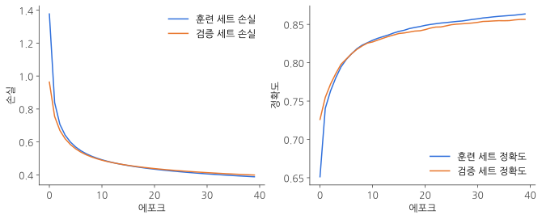

손실은 꾸준히 줄어들고, 정확도는 점점 올라가요. 훈련 세트와 검증 세트의 선이 거의 붙어 있어서 과대적합도 없어요.

### 11-5. 검증 세트 정확도 계산하기

`evaluate()` 메서드는 손실값과 `metrics`에 추가한 지표(정확도)를 계산해서 돌려줘요. `verbose=0`은 진행 막대를 출력하지 말라는 뜻이에요.

```python
loss, accuracy = model.evaluate(x_val, y_val_encoded, verbose=0)
print(accuracy)
```

```text
0.8565833568572998
```

40 에포크 동안 훈련해서 검증 정확도 약 **86%**를 얻었어요.

`predict()`로 처음 세 샘플의 예측 확률도 볼게요. 출력층에 소프트맥스를 썼으니 **샘플마다 10개 확률의 합이 1**이에요.

```python
proba = model.predict(x_val[:3], verbose=0)
print(np.round(proba, 3))
print(np.argmax(proba, axis=1), y_val[:3])
```

```text
[[0.002 0.    0.001 0.    0.001 0.    0.005 0.    0.991 0.   ]
 [0.106 0.001 0.154 0.084 0.009 0.    0.646 0.    0.001 0.   ]
 [0.004 0.    0.927 0.002 0.017 0.    0.049 0.    0.    0.   ]]
[8 6 2] [8 0 2]
```

- 첫 번째 샘플은 **가방(8)**일 확률이 99.1%예요. 정답이에요.
- 두 번째 샘플은 정답이 **티셔츠(0)**인데, **셔츠(6)**일 확률을 64.6%로 가장 높게 매겨서 틀렸어요. 티셔츠(10.6%)와 스웨터(15.4%)도 후보에 올렸어요. 8-3에서 본 "윗옷끼리 헷갈리는" 모습 그대로예요.
- 세 번째 샘플은 **스웨터(2)**일 확률이 92.7%예요. 정답이에요.

### 11-6. 직접 만든 모델과 비교하기

| 모델 | 미니 배치 | 학습률 | 검증 정확도 |
|---|---|---|---|
| MultiClassNetwork | 256 | 0.1 | 0.811 |
| 케라스 | 32 | 0.01 | **0.857** |
| MultiClassNetwork | 32 | 0.1 | **0.860** |

케라스 모델이 몇 줄 안 되는 코드로 직접 만든 모델(81%)보다 좋은 성능(86%)을 냈어요. 그런데 그 차이는 케라스가 특별해서라기보다 **설정의 차이**가 커요. 케라스는 미니 배치 기본값이 32라서 에포크마다 가중치를 1,500번 고쳤지만, 우리 모델은 256으로 188번만 고쳤거든요. 8-4처럼 우리 모델도 미니 배치를 32로 줄이니 **86%**로 비슷해졌어요. 우리가 직접 만든 신경망이 제대로 동작하고 있다는 증거이기도 해요.

그러면 케라스를 왜 쓸까요? **같은 성능을 훨씬 적은 코드로, 실수 없이** 낼 수 있기 때문이에요. 파트 5에서 본 `axis=0` 버그 같은 실수를 할 일이 없고, 층을 바꾸거나 더 쌓는 것도 한 줄이면 돼요.

### 11-7. 86%의 벽: 이미지에 맞는 신경망이 필요해요

두 모델 모두 86% 근처에서 멈췄어요. 이건 케라스나 우리 코드의 문제가 아니라, **완전 연결 신경망이 이미지 데이터에 잘 맞는 모델이 아니기 때문**이에요. 6-9에서 이미지를 1줄로 펼치면서 "어떤 픽셀이 어떤 픽셀 옆에 있는지"라는 **위치 정보**를 버렸던 걸 떠올려 보세요. 셔츠의 단추나 깃처럼 작은 모양의 차이를 알아보려면 주변 픽셀과의 관계가 중요한데, 펼친 순간 그 정보가 사라지는 거예요.

이미지 분류에 아주 효과적인 신경망이 따로 있어요. 바로 **합성곱 신경망(convolutional neural network, CNN)**이에요. 다음 편에서 합성곱 신경망을 파이썬으로 직접 만들어 보고, 그다음 케라스로도 만들어 볼게요.

---

## 마무리

### 핵심 요약

| 개념 | 한 줄 설명 |
|---|---|
| 다중 분류 | 셋 이상의 클래스 중 하나를 고르는 문제. 출력층에 클래스 수만큼 뉴런을 둬요 |
| 소프트맥스 함수 | $$e^{z_i}$$를 모든 $$e^{z}$$의 합으로 나눠서 출력의 합을 1로 만드는 함수 |
| 크로스 엔트로피 | $$-\sum y_c\log a_c$$. 결국 정답 클래스 확률의 $$-\log$$ |
| 크로스 엔트로피의 미분 | $$-(\boldsymbol{y}-\boldsymbol{a})$$. 로지스틱 손실의 미분과 같아요 |
| 원-핫 인코딩 | 정답 자리만 1, 나머지는 0인 배열로 타깃을 바꾸는 것 |
| `np.argmax()` | 가장 큰 값의 인덱스. 예측 클래스를 고를 때 써요 |
| 패션 MNIST | 28×28 흑백 의류 이미지 7만 장(훈련 6만, 테스트 1만), 10개 클래스 |
| 정규화 (이미지) | 픽셀 값을 255로 나눠 0~1로 맞추기 |
| 텐서플로 | 구글이 만든 딥러닝 패키지 |
| 케라스 | 딥러닝 패키지를 쉽게 쓰게 해 주는 래퍼. 텐서플로 2.0부터 주력 API |
| `Sequential` / `Dense` | 층을 순서대로 쌓은 모델 / 완전 연결층 |
| `compile()` | 최적화 알고리즘(`optimizer`), 손실 함수(`loss`), 측정 지표(`metrics`)를 정해요 |
| `fit()` / `predict()` / `evaluate()` | 훈련 / 예측 / 평가 |

### 헷갈리기 쉬운 포인트

1. **시그모이드의 출력은 합이 1이 아니에요.** 다중 분류의 출력층에는 소프트맥스를 써서 확률로 비교해요.
2. **소프트맥스는 뉴런 하나가 아니라 출력층 전체에 하나**예요. 분모에 모든 출력이 들어가요.
3. **크로스 엔트로피에서 오답 클래스의 항은 모두 사라져요.** 타깃이 0이니까요.
4. **예측할 때는 소프트맥스가 필요 없어요.** $$z$$에서 가장 큰 클래스가 확률에서도 가장 커요.
5. **다중 분류에서 출력층 절편의 그레이디언트는 `np.sum(err, axis=0)`**이에요. `axis`를 빼면 절편이 영원히 0에 머물러요.
6. **`softmax()`에서 행의 합은 `reshape(-1, 1)`로 열 벡터로 세워서 나눠요.**
7. **타깃은 원-핫 인코딩하고, 인코딩한 뒤에는 꼭 출력해서 확인해요.** 인덱스는 0부터 세요.
8. **이미지를 1줄로 펼치면 위치 정보가 사라져요.** 완전 연결 신경망의 한계예요.
9. **케라스 `Dense`의 뉴런 개수 매개변수는 `units`**(복수형)예요. `kernel`은 가중치를 뜻해요.
10. **`sgd`의 기본 학습률은 0.01, `fit()`의 기본 `batch_size`는 32**예요.

지금까지 여러 개 중 하나를 고르는 다중 분류 신경망을 직접 만들고, 케라스로도 만들어 봤어요. 소프트맥스와 크로스 엔트로피는 앞으로 만들 거의 모든 분류 신경망의 출력층에 쓰이니 꼭 기억해 두세요. 다음 편에서는 이미지에 강한 **합성곱 신경망**을 다뤄 보겠습니다. 궁금한 점이나 틀린 부분이 있으면 편하게 알려 주세요!
