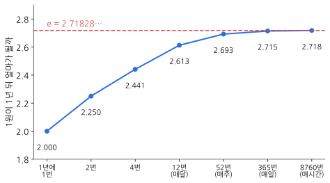
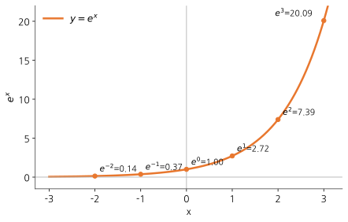
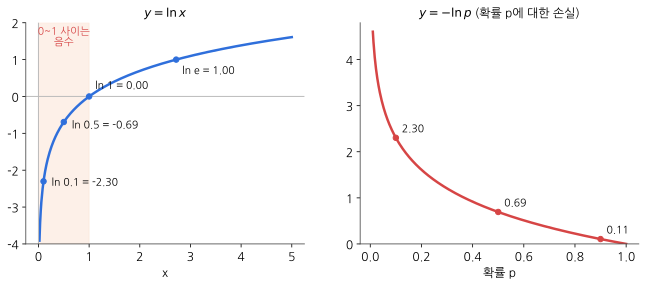
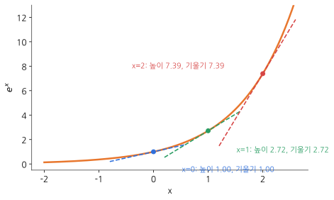

> **이 글에서 배우는 것**
> 5편의 **소프트맥스 함수**에는 $$e^z$$가, **크로스 엔트로피 손실**에는 $$\log$$가 나오고, 소프트맥스를 미분할 때는 **분수의 미분**을 써요. 이 셋이 낯설면 5편의 수식이 외계어처럼 보일 수 있어요. 이 글에서는 자연 상수 $$e$$가 어디서 왔는지, 지수 함수와 로그가 어떤 모양인지, 분수는 어떻게 미분하는지를 **숫자로 먼저** 보여 드리고, 마지막에 5편의 소프트맥스 미분으로 돌아갑니다.
{: .prompt-info }

이 글은 5편을 읽다가 막힌 부분을 채우는 **보충 글**이에요. 수학 공식은 최대한 숫자로 먼저 보여 드리고, 공식은 그다음에 정리할게요.

| 파트 | 내용 | 한 줄 요약 |
|---|---|---|
| 1 | 거듭제곱 복습 | $$2^3$$, $$2^0$$, $$2^{-1}$$은 각각 무슨 뜻일까 |
| 2 | 자연 상수 e | 이자를 아주 잘게 쪼개 붙이면 나오는 수 2.718… |
| 3 | 지수 함수 $$e^x$$ | 항상 양수이고, 순서를 지키고, 큰 값을 크게 벌려요 |
| 4 | 로그 | 지수를 거꾸로 묻는 것. "몇 번 곱해야 이 수가 될까" |
| 5 | $$e^x$$와 $$\ln x$$의 미분 | $$e^x$$는 미분해도 자기 자신, $$\ln x$$는 $$\frac{1}{x}$$ |
| 6 | 분수의 미분 | 분자 미분 × 분모 − 분자 × 분모 미분, 나누기 분모 제곱 |
| 7 | 5편과 연결하기 | 소프트맥스 미분과 시그모이드 거꾸로 풀기 |

---

## 파트 1. 거듭제곱 복습

같은 수를 여러 번 곱하는 것을 **거듭제곱**이라고 하고, 몇 번 곱했는지를 오른쪽 위에 작게 써요. 이 작은 숫자를 **지수(exponent)**라고 불러요.

$$
2^3 = 2 \times 2 \times 2 = 8
$$

지수가 1씩 줄어들 때마다 값이 2로 나뉘는 규칙을 따라가면, 지수가 0이나 음수일 때의 뜻도 자연스럽게 정해져요.

| 식 | $$2^3$$ | $$2^2$$ | $$2^1$$ | $$2^0$$ | $$2^{-1}$$ | $$2^{-2}$$ |
|---|---|---|---|---|---|---|
| 값 | 8 | 4 | 2 | **1** | $$\frac{1}{2}$$ | $$\frac{1}{4}$$ |

- **지수가 0이면 항상 1**이에요. 어떤 수든 $$a^0 = 1$$이에요.
- **지수가 음수면 분수**가 돼요. $$2^{-1} = \frac{1}{2}$$이에요. 그래서 $$e^{-z} = \frac{1}{e^z}$$이고, 시그모이드 $$\frac{1}{1+e^{-z}}$$에 나오는 $$e^{-z}$$도 이 뜻이에요.
- 지수는 0.5 같은 소수도 될 수 있어요. $$2^{0.5} = \sqrt{2} = 1.414\ldots$$예요.

그리고 꼭 기억할 성질이 하나 있어요. **지수끼리는 더해져요.**

$$
2^3 \times 2^2 = (2\times2\times2)\times(2\times2) = 2^5 = 2^{3+2}
$$

즉 $$a^m \times a^n = a^{m+n}$$이에요. 곱셈이 덧셈으로 바뀌는 이 성질은 로그에서 다시 나와요.

---

## 파트 2. 자연 상수 e는 어디서 왔을까

### 2-1. 이자를 잘게 쪼개 붙이면

은행에 **1원**을 맡겼는데 1년 이자율이 무려 **100%**라고 상상해 볼게요.

- **1년에 한 번** 이자를 주면: 1년 뒤 $$1 \times 2 = 2$$원이에요.
- **반년마다** 50%씩 두 번 주면: $$1 \times 1.5 \times 1.5 = 2.25$$원이에요. 첫 반년 동안 붙은 이자에도 이자가 붙거든요(복리).
- **석 달마다** 25%씩 네 번 주면: $$1.25^4 = 2.441$$원이에요.

이자를 더 잘게 쪼갤수록 돈이 늘어나요. 그럼 매일, 매시간, 매초… 끝없이 쪼개면 돈이 무한히 불어날까요?



| 1년에 이자를 붙이는 횟수 $$n$$ | 1 | 2 | 4 | 12 | 365 | 10,000 | 1,000,000 |
|---|---|---|---|---|---|---|---|
| 1년 뒤 금액 $$\left(1+\frac{1}{n}\right)^n$$ | 2 | 2.25 | 2.441 | 2.613 | 2.715 | 2.71815 | 2.71828 |

늘어나긴 하지만 점점 적게 늘어나서, **2.71828…**이라는 값에 한없이 가까워질 뿐 넘지 못해요. 이 수를 **자연 상수 $$e$$**라고 불러요. 원주율 $$\pi = 3.14159\ldots$$처럼 끝없이 이어지는 특별한 수예요.

$$
e = 2.718281828\ldots
$$

### 2-2. 넘파이에서 e

넘파이에서는 `np.e`가 자연 상수예요. `np.exp(x)`는 $$e^x$$를 계산해 줘요. exp는 지수(exponential)의 줄임말이에요.

```python
import numpy as np
print(np.e)
print(np.exp(1), np.exp(2), np.exp(0))
```

```text
2.718281828459045
2.718281828459045 7.38905609893065 1.0
```

---

## 파트 3. 지수 함수 $$e^x$$

### 3-1. 그래프로 보기

$$e$$를 $$x$$번 곱한 값 $$e^x$$를 그래프로 그리면 이런 모양이에요.



| $$x$$ | -2 | -1 | 0 | 1 | 2 | 3 |
|---|---|---|---|---|---|---|
| $$e^x$$ | 0.14 | 0.37 | 1 | 2.72 | 7.39 | 20.09 |

세 가지 성질이 보여요.

1. **항상 양수예요.** $$x$$가 아무리 작은 음수여도 $$e^x$$는 0에 가까워질 뿐 0이나 음수가 되지 않아요.
2. **순서를 지켜요.** $$x$$가 크면 $$e^x$$도 커요. 작은 쪽이 큰 쪽을 앞지르는 일이 없어요.
3. **큰 값을 훨씬 크게 벌려요.** $$x$$가 1씩 늘 때마다 값이 2.7배씩 커져요. 2와 3은 1 차이지만 $$e^2$$와 $$e^3$$은 7.39와 20.09로 거의 3배 차이가 나요.

### 3-2. 소프트맥스가 $$e^z$$를 쓰는 이유

이 세 성질이 소프트맥스에 딱 필요한 것들이에요.

- 출력층의 $$z$$는 음수일 수도 있어요. 음수를 그대로 비율로 나누면 "확률이 -20%" 같은 이상한 값이 나와요. **$$e^z$$로 바꾸면 모두 양수**가 되니 안심하고 비율을 구할 수 있어요.
- **순서를 지키니까** $$z$$가 가장 큰 클래스가 확률도 가장 커요. 그래서 5편에서 "예측할 때는 소프트맥스가 필요 없다"고 했던 거예요.
- **큰 값을 크게 벌려 주니까** 가장 그럴듯한 클래스가 더 뚜렷하게 드러나요. 이름이 소프트**맥스**인 것도 "가장 큰 것(max)을 부드럽게(soft) 골라 준다"는 뜻이에요.

5편의 왼쪽 샘플로 확인해 볼게요. $$z = [2.20,\ 1.39,\ 0.85]$$를 그냥 합으로 나누면 $$[0.50,\ 0.31,\ 0.19]$$지만, $$e^z = [9.00,\ 4.00,\ 2.33]$$으로 바꾼 뒤 나누면 $$[0.59,\ 0.26,\ 0.15]$$가 돼요. 가장 큰 클래스의 몫이 더 커졌죠.

---

## 파트 4. 로그: 지수를 거꾸로 묻기

### 4-1. 로그는 "몇 번 곱했나"

거듭제곱은 "2를 3번 곱하면 얼마?"를 묻는 거예요. 답은 8이죠. **로그(logarithm)**는 이걸 거꾸로 물어요. **"2를 몇 번 곱하면 8이 될까?"** 답은 3이에요. 이걸 이렇게 써요.

$$
2^3 = 8 \quad\Longleftrightarrow\quad \log_2 8 = 3
$$

로그 아래에 작게 쓴 2를 **밑**이라고 해요. 머신러닝에서는 거의 항상 **자연 상수 $$e$$를 밑으로 하는 로그**를 쓰고, 이걸 **자연 로그**라고 불러요. $$\log_e x$$를 줄여서 $$\ln x$$로 쓰거나, 그냥 $$\log x$$로 써요. 이 시리즈에서 $$\log$$라고 쓴 건 모두 자연 로그예요.

$$
e^1 = 2.718\ldots \quad\Longleftrightarrow\quad \ln 2.718\ldots = 1
$$

> 넘파이의 `np.log()`가 바로 **자연 로그**예요. 밑이 10인 로그는 `np.log10()`, 밑이 2인 로그는 `np.log2()`로 따로 있어요. 손실 함수를 계산할 때는 `np.log()`를 써요.
{: .prompt-tip }

### 4-2. 로그 그래프와 몇 가지 값



| $$x$$ | 0.01 | 0.1 | 0.5 | 1 | 2 | $$e$$ | 10 |
|---|---|---|---|---|---|---|---|
| $$\ln x$$ | -4.61 | -2.30 | -0.69 | **0** | 0.69 | **1** | 2.30 |

- **$$\ln 1 = 0$$**이에요. $$e^0 = 1$$이니까요.
- **0과 1 사이의 수는 로그가 음수**예요. 예를 들어 $$e^{-0.69} = 0.5$$라서 $$\ln 0.5 = -0.69$$예요.
- 0에 가까워질수록 로그는 **끝없이 작아져요.** 0의 로그는 정의되지 않아요. 그래서 손실을 계산하기 전에 `np.clip(a, 1e-10, 1 - 1e-10)`으로 확률이 0이 되지 않게 막았던 거예요.

### 4-3. 손실 함수에 $$-\log$$가 붙는 이유

확률은 0과 1 사이라서 그 로그는 항상 0 이하예요. 손실은 양수가 편하니 **마이너스를 붙여** $$-\log p$$로 써요. 위 오른쪽 그래프처럼 이 값은

- 확률이 1에 가까우면(잘 맞히면) **0에 가까워지고**,
- 확률이 0에 가까우면(확신을 가지고 틀리면) **끝없이 커져요.**

정답에 0.9를 주면 손실 0.11, 0.5를 주면 0.69, 0.1을 주면 2.30이에요. 이것이 2편의 로지스틱 손실과 5편의 크로스 엔트로피 손실이 생긴 모양이에요.

### 4-4. 로그는 곱셈을 덧셈으로 바꿔요

파트 1에서 $$e^m \times e^n = e^{m+n}$$이라고 했죠. 로그는 이걸 거꾸로 써서 이런 성질을 가져요.

$$
\ln(a \times b) = \ln a + \ln b, \qquad \ln\frac{a}{b} = \ln a - \ln b
$$

예를 들어 $$\ln 2 + \ln 5 = 0.69 + 1.61 = 2.30 = \ln 10$$이에요. 샘플이 여러 개일 때 손실을 "곱하지 않고 **더할 수 있는**" 것도 이 성질 덕분이에요.

그리고 지수와 로그는 서로를 **되돌려요.**

$$
\ln(e^x) = x, \qquad e^{\ln x} = x
$$

옷을 입고(지수) 벗는(로그) 것처럼, 둘을 연달아 하면 원래대로 돌아와요.

---

## 파트 5. $$e^x$$와 $$\ln x$$의 미분

미분은 **"이 지점에서 그래프가 얼마나 가파른가(기울기)"**였어요(1편). 두 함수의 미분은 아주 깔끔해요.

### 5-1. $$e^x$$는 미분해도 자기 자신

$$
\frac{d}{dx}e^x = e^x
$$

$$e^x$$ 그래프의 어느 점에서든 **그 점의 기울기가 그 점의 높이와 같아요.** 이게 자연 상수 $$e$$가 특별한 이유예요. 밑이 2나 10이었다면 이렇게 깔끔하지 않아요.



숫자로 확인해 볼게요. $$x$$를 아주 조금(0.000001)만 움직였을 때 $$e^x$$가 얼마나 변하는지 재서 기울기를 구했어요.

| $$x$$ | 0 | 1 | 2 |
|---|---|---|---|
| 직접 잰 기울기 | 1.0000 | 2.7183 | 7.3891 |
| $$e^x$$ (높이) | 1.0000 | 2.7183 | 7.3891 |

정말로 같아요.

### 5-2. $$\ln x$$의 미분은 $$\frac{1}{x}$$

$$
\frac{d}{dx}\ln x = \frac{1}{x}
$$

| $$x$$ | 0.5 | 1 | 2 | 4 |
|---|---|---|---|---|
| 직접 잰 기울기 | 2.00 | 1.00 | 0.50 | 0.25 |
| $$\frac{1}{x}$$ | 2.00 | 1.00 | 0.50 | 0.25 |

$$x$$가 작을수록 로그 그래프가 가파르고, 클수록 완만해지는 모습과 맞아요. 5편 4-2에서 $$\frac{\partial L}{\partial a_1} = -\frac{y_1}{a_1}$$이 나온 건 이 공식 덕분이에요. $$-y_1\log a_1$$을 $$a_1$$로 미분하면 $$-y_1 \times \frac{1}{a_1}$$이니까요.

### 5-3. 상수는 미분하면 사라져요

미분할 변수와 **상관없는 값**은 상수로 보고, 상수의 미분은 0이에요. 기울기가 없으니까요. 5편에서 $$e^{z_1} + e^{z_2} + e^{z_3}$$를 $$z_1$$로 미분하면 $$e^{z_2}$$와 $$e^{z_3}$$는 $$z_1$$과 상관없으니 사라지고, $$e^{z_1}$$만 남아 $$e^{z_1}$$이 된 것도 이 원리예요.

---

## 파트 6. 분수의 미분 (몫의 미분)

### 6-1. 공식

소프트맥스 $$\frac{e^{z_1}}{e^{z_1}+e^{z_2}+e^{z_3}}$$처럼 **분자와 분모가 모두 변수에 따라 변하는 분수**는 이렇게 미분해요. 분자를 $$f$$, 분모를 $$g$$라고 할게요.

$$
\left(\frac{f}{g}\right)' = \frac{f' \cdot g - f \cdot g'}{g^2}
$$

말로 외우면 이래요. **"분자를 미분해서 분모를 곱하고, 거기서 분자에 분모의 미분을 곱한 걸 빼고, 분모의 제곱으로 나눈다."** 빼는 순서가 중요해요. 분자의 미분이 먼저예요.

### 6-2. 숫자로 확인하기

$$h(x) = \frac{x^2}{x+1}$$을 $$x = 2$$에서 미분해 볼게요.

- 분자 $$f = x^2$$, 분자의 미분 $$f' = 2x$$
- 분모 $$g = x + 1$$, 분모의 미분 $$g' = 1$$

$$
h'(2) = \frac{(2 \times 2)(2+1) - 2^2 \times 1}{(2+1)^2} = \frac{12 - 4}{9} = 0.889
$$

$$x$$를 아주 조금 움직여서 직접 잰 기울기도 **0.889**로 같았어요.

```python
h = lambda x: x**2 / (x + 1)
d = 1e-6
print((h(2 + d) - h(2 - d)) / (2 * d))    # 직접 잰 기울기
```

```text
0.8888888889391211
```

### 6-3. 시그모이드의 도함수도 이렇게 나와요

2편에서 "시그모이드의 도함수는 $$a(1-a)$$"라고 했죠. 몫의 미분으로 직접 확인할 수 있어요. $$a = \frac{1}{1+e^{-z}}$$에서 분자는 1(미분하면 0), 분모는 $$1 + e^{-z}$$(미분하면 $$-e^{-z}$$)예요.

$$
\frac{da}{dz} = \frac{0 \cdot (1+e^{-z}) - 1 \cdot (-e^{-z})}{(1+e^{-z})^2}
= \frac{e^{-z}}{(1+e^{-z})^2}
= \underbrace{\frac{1}{1+e^{-z}}}_{a} \cdot \underbrace{\frac{e^{-z}}{1+e^{-z}}}_{1-a}
= a(1-a)
$$

> $$e^{-z}$$를 미분하면 왜 $$-e^{-z}$$일까요? $$e^{\square}$$는 미분해도 그대로지만, 안에 든 $$-z$$를 $$z$$로 미분한 값 $$-1$$을 연쇄 법칙으로 한 번 더 곱해야 하거든요. 안쪽에 함수가 들어 있으면 **안쪽의 미분을 곱한다**, 이게 연쇄 법칙이에요(2편).
{: .prompt-info }

$$z = 1$$이면 $$a = 0.731$$이고 $$a(1-a) = 0.197$$이에요. 직접 잰 기울기도 0.197이었어요.

---

## 파트 7. 5편과 연결하기

### 7-1. 소프트맥스를 숫자로 미분해 보기

5편 4-3에서 유도한 소프트맥스의 미분을 숫자로 확인해 볼게요. 5편 4-5와 같은 $$\boldsymbol{z} = [1.0,\ 0.5,\ -0.5]$$를 써요.

- $$e^{z} = [2.718,\ 1.649,\ 0.607]$$, 합 $$S = 4.974$$
- 소프트맥스 출력 $$\boldsymbol{a} = [0.5465,\ 0.3315,\ 0.1220]$$

| | 공식 | 공식으로 계산 | 직접 잰 기울기 |
|---|---|---|---|
| $$\frac{\partial a_1}{\partial z_1}$$ | $$a_1(1-a_1)$$ | $$0.5465 \times 0.4535 = 0.2478$$ | 0.2478 |
| $$\frac{\partial a_2}{\partial z_1}$$ | $$-a_2a_1$$ | $$-0.3315 \times 0.5465 = -0.1812$$ | -0.1812 |
| $$\frac{\partial a_3}{\partial z_1}$$ | $$-a_3a_1$$ | $$-0.1220 \times 0.5465 = -0.0667$$ | -0.0667 |

세 값이 모두 맞아요. 그리고 세 값을 더하면 $$0.2478 - 0.1812 - 0.0667 = 0$$이에요. $$z_1$$을 키우면 $$a_1$$이 늘어난 만큼 $$a_2$$와 $$a_3$$가 정확히 줄어든다는 뜻이에요. 확률의 합은 항상 1이어야 하니까요.

### 7-2. 시그모이드를 거꾸로 풀기: $$z = -\ln\left(\frac{1}{a} - 1\right)$$

5편 2-3에서 시그모이드 출력 $$a$$로부터 $$z$$를 구하는 식이 나왔어요. 파트 4의 "지수와 로그는 서로를 되돌린다"를 쓰면 직접 유도할 수 있어요.

$$
a = \frac{1}{1+e^{-z}}
\;\Rightarrow\; 1 + e^{-z} = \frac{1}{a}
\;\Rightarrow\; e^{-z} = \frac{1}{a} - 1
\;\Rightarrow\; -z = \ln\left(\frac{1}{a} - 1\right)
\;\Rightarrow\; z = -\ln\left(\frac{1}{a} - 1\right)
$$

네 번째 단계에서 양쪽에 $$\ln$$을 씌웠어요. $$\ln(e^{-z}) = -z$$니까요. 조금 더 정리하면 $$\frac{1}{a} - 1 = \frac{1-a}{a}$$이므로

$$
z = -\ln\frac{1-a}{a} = \ln\frac{a}{1-a}
$$

이 돼요. $$\frac{a}{1-a}$$는 2편에서 본 **오즈**, $$\ln\frac{a}{1-a}$$는 **로짓**이었죠. 시그모이드는 로짓을 확률로 바꾸는 함수이고, 그 반대가 로짓이에요. $$a = 0.9$$를 넣으면 $$z = \ln 9 = 2.20$$, 5편의 계산과 같아요.

---

## 마무리

### 핵심 요약

| 개념 | 한 줄 설명 | 머신러닝에서 쓰는 곳 |
|---|---|---|
| 지수 $$a^n$$ | $$a$$를 $$n$$번 곱한 것. $$a^0 = 1$$, $$a^{-n} = \frac{1}{a^n}$$ | 시그모이드의 $$e^{-z}$$ |
| 자연 상수 $$e$$ | $$\left(1+\frac{1}{n}\right)^n$$이 다가가는 수 2.718… | 시그모이드, 소프트맥스 |
| 지수 함수 $$e^x$$ | 항상 양수, 순서를 지킴, 큰 값을 크게 벌림 | 소프트맥스의 분자와 분모 |
| 자연 로그 $$\ln x$$ | "e를 몇 번 곱해야 x가 될까". `np.log()` | 손실 함수 |
| $$-\ln p$$ | 확률이 1이면 0, 0에 가까우면 끝없이 커짐 | 로지스틱 손실, 크로스 엔트로피 |
| $$(e^x)' = e^x$$ | 미분해도 자기 자신 | 소프트맥스 미분 |
| $$(\ln x)' = \frac{1}{x}$$ | | 손실을 확률로 미분 |
| 몫의 미분 | $$\frac{f'g - fg'}{g^2}$$ | 시그모이드·소프트맥스 미분 |

### 헷갈리기 쉬운 포인트

1. **$$e^{-z}$$는 $$\frac{1}{e^z}$$이에요.** 음수가 아니라 0과 1 사이의 양수(z가 양수일 때)예요.
2. **넘파이의 `np.log()`는 자연 로그(밑이 e)**예요. 밑이 10인 로그가 아니에요.
3. **0과 1 사이의 로그는 음수**라서 손실 함수에는 마이너스를 붙여요.
4. **로그의 입력이 0이면 계산이 안 돼요.** 그래서 손실을 계산하기 전에 확률을 `np.clip()`으로 0이 아니게 막아요.
5. **몫의 미분은 빼는 순서가 중요해요.** 분자의 미분 × 분모가 먼저예요.
6. **변수와 상관없는 항은 미분하면 0**이에요.

5편으로 돌아가서 소프트맥스와 크로스 엔트로피의 수식을 다시 보면 훨씬 잘 읽힐 거예요. [5편으로 돌아가기](/posts/ml-basics-05-multiclass/)
